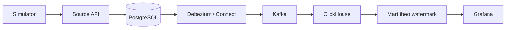

# Tài liệu dự án Real-time CDC

Marketplace nhiều shop, mô phỏng giao dịch từ Source API qua PostgreSQL → Debezium → Kafka → ClickHouse. Grafana phục vụ phân tích nghiệp vụ và giám sát pipeline.

## Bắt đầu ở đâu?

| Mục tiêu | Điểm bắt đầu |
|---|---|
| Lần đầu tìm hiểu dự án | [Nghiệp vụ và dữ liệu nguồn](business/01-nghiep-vu-va-du-lieu-nguon.md) |
| Xem toàn cảnh bằng sơ đồ | [Kiến trúc và ERD](architecture/README.md) |
| Chạy và kiểm tra stack local | [Vận hành](operations/README.md) |
| Học triển khai lên server | [Triển khai và DevOps](deployment/README.md) |
| Ôn phỏng vấn | [Bộ câu hỏi và trả lời](interview/README.md) |

## Các nhóm tài liệu

| Thư mục | Nội dung |
|---|---|
| [business/](business/README.md) | Nghiệp vụ marketplace, mô hình nguồn, Source API và bảo mật |
| [platform/](platform/README.md) | CDC ingestion, Kafka, ClickHouse, watermark và mart |
| [architecture/](architecture/README.md) | Sơ đồ luồng hệ thống, ERD tổng thể và quan hệ theo nhóm |
| [operations/](operations/README.md) | Chạy local, giám sát, kiểm thử, backup và phục hồi |
| [deployment/](deployment/README.md) | Tách môi trường, server, domain/TLS, secret và CI/CD |
| [interview/](interview/README.md) | 850 câu Q&A theo bảy chủ đề |
| [maintenance/](maintenance/README.md) | Kế hoạch dọn code và cấu hình cũ |
| [handoff/](handoff/README.md) | Nhật ký bàn giao, kết quả kiểm thử và log bằng chứng |

## Lộ trình đọc

**Hiểu hệ thống:** nghiệp vụ 01 → sơ đồ kiến trúc → CDC 03 → warehouse 04 → mart 05. Sau đó đọc API/bảo mật 02 để hiểu transaction và đường ghi.

**Học vận hành:** chương 06 → bài thực hành backup 09 → hướng dẫn triển khai lần đầu → chương DevOps 07. Phần server là thiết kế/hướng dẫn; chưa có môi trường cloud được triển khai thật chỉ vì có mô tả trong docs.

**Ôn phỏng vấn:** đọc một chủ đề, tự trả lời bộ Q&A tương ứng rồi quay lại chương giải thích. Giữ nguyên số chương 01–09 để đối chiếu giữa tài liệu và câu hỏi dù các chương đã được gom theo thư mục.

## Bản đồ luồng dữ liệu

## Tài liệu liên quan trong repo

- [Hướng dẫn giám sát](../observability/README.md).
- [Năm dashboard nghiệp vụ và cách đọc metric](../observability/grafana/README.md).
- [Nhật ký kiểm thử và bàn giao](handoff/README.md).

Các chương giải thích thiết kế hiện tại; tài liệu triển khai phân biệt phần đề xuất với phần đã chạy. Nhật ký ghi lại từng lần kiểm chứng, không thay thế hướng dẫn đang được duy trì.
