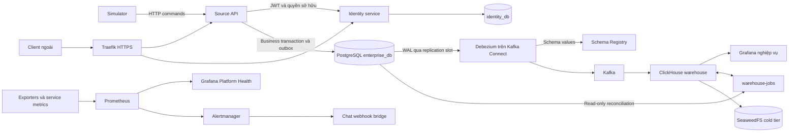
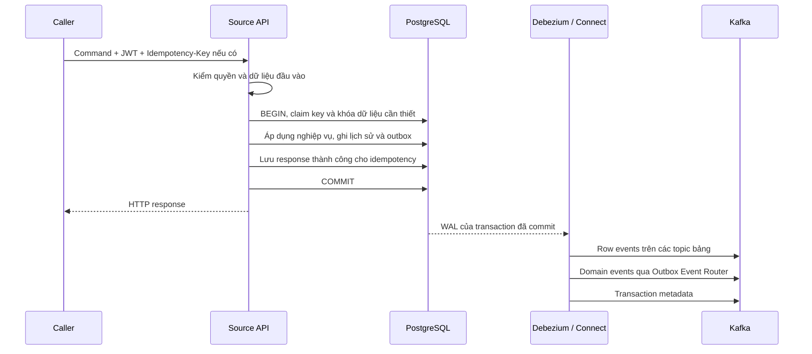
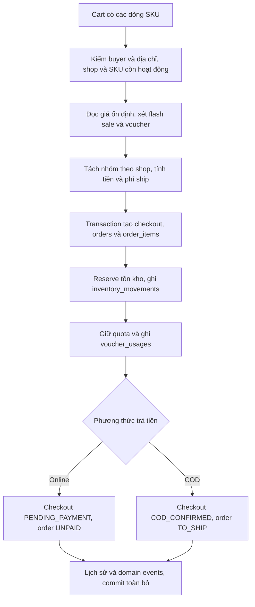
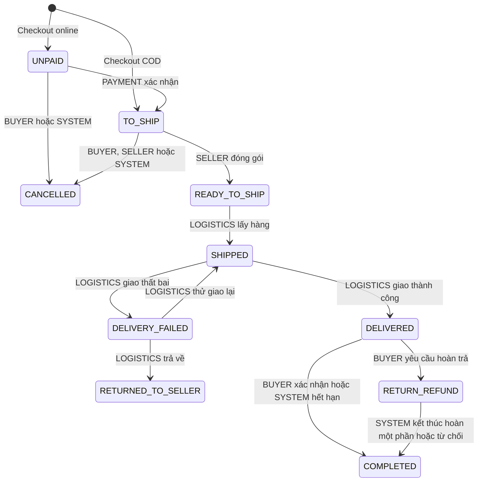
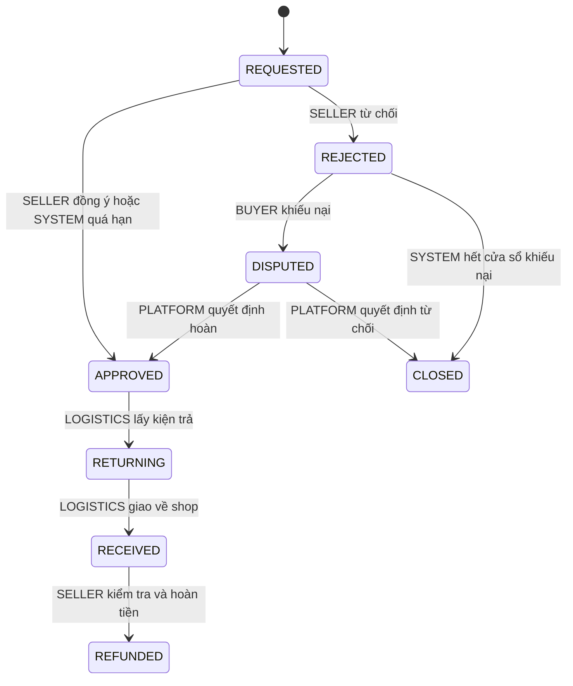
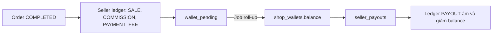
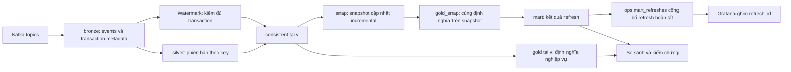

# Luồng nghiệp vụ và kiến trúc dữ liệu marketplace

[Tài liệu dự án](../README.md) / [Kiến trúc](README.md)

Tài liệu này nối ba lớp: **người dùng thực hiện nghiệp vụ gì → transaction nguồn thay đổi những bảng nào → báo cáo nhìn thấy thay đổi đó khi nào**. Đây là kiến trúc đang chạy, đã đối chiếu ngày 18/10/2026. Để tra cột và quan hệ, đọc [ERD theo nhóm](entity_relationships.md) hoặc [ERD đầy đủ](erDiagram.txt).

## Mục lục

1. [Bối cảnh và ranh giới](#1-bối-cảnh-và-ranh-giới)
2. [Kiến trúc tổng thể](#2-kiến-trúc-tổng-thể)
3. [Ai ghi dữ liệu và transaction kết thúc ở đâu](#3-ai-ghi-dữ-liệu-và-transaction-kết-thúc-ở-đâu)
4. [Từ giỏ hàng tới checkout nhiều shop](#4-từ-giỏ-hàng-tới-checkout-nhiều-shop)
5. [Thanh toán và vòng đời đơn](#5-thanh-toán-và-vòng-đời-đơn)
6. [Tồn kho, giao hàng và hoàn trả](#6-tồn-kho-giao-hàng-và-hoàn-trả)
7. [Ví seller và ghi nhận giá trị](#7-ví-seller-và-ghi-nhận-giá-trị)
8. [Từ Kafka đến warehouse và dashboard](#8-từ-kafka-đến-warehouse-và-dashboard)
9. [Thời gian và job nền](#9-thời-gian-và-job-nền)
10. [Dừng, replay và phục hồi](#10-dừng-replay-và-phục-hồi)
11. [Các bất biến cần giữ](#11-các-bất-biến-cần-giữ)
12. [Bản đồ đọc tiếp](#12-bản-đồ-đọc-tiếp)

## 1. Bối cảnh và ranh giới

Hệ thống mô phỏng sàn thương mại điện tử nhiều shop, có nhiều ngành hàng: điện tử, thời trang, làm đẹp, gia dụng và các nhóm khác. Seller sở hữu shop; shop đăng product, product có các SKU biến thể. Người mua chọn SKU vào giỏ; một lần checkout có thể mua từ nhiều shop.

Simulator đóng vai buyer, seller, cổng thanh toán, carrier và các hành động vận hành. Nó gọi API như các tác nhân bên ngoài, không viết trực tiếp các bảng nghiệp vụ. Nguồn dữ liệu vì vậy có các tình huống thực tế như thanh toán thất bại, retry, hủy, quá hạn, giao không thành công, đổi giá và hoàn một phần.

Phạm vi hiện tại không bao gồm mua hàng từ supplier hoặc tồn kho theo nhiều kho địa lý. Restock là command bổ sung tồn SKU của shop và ghi movement. Hệ thống không có Flink, Iceberg hoặc MinIO trong đường xử lý đang chạy; warehouse hiện tại là ClickHouse. SeaweedFS cung cấp S3 tương thích cho cold tier của bronze trên cùng máy.

## 2. Kiến trúc tổng thể



Các thành phần đang chạy một node trên cùng host. Docker Compose tổ chức service và volume, không tạo HA nhiều máy. Replication slot thuộc PostgreSQL; Kafka giữ source offset/config/status của Connect cùng các topic dữ liệu; ClickHouse giữ lịch sử và bảng phục vụ phân tích. Mỗi nơi có trạng thái riêng cần xét khi reset hoặc phục hồi.

Identity và Source API dùng chung hạ tầng PostgreSQL nhưng khác database. Source API kiểm JWT qua JWKS; sơ đồ mũi tên tới identity thể hiện quan hệ tin cậy và lấy khóa xác minh, không có nghĩa mỗi request phải gọi lại endpoint đăng nhập.

## 3. Ai ghi dữ liệu và transaction kết thúc ở đâu

Source API xử lý command nghiệp vụ và các job nguồn như hết hạn đơn, tự hoàn thành, roll-up ví và payout. Identity ghi dữ liệu tài khoản của nó trong database riêng; provisioning customer/shop được thực hiện qua Source API. Debezium còn có heartbeat và bảng tín hiệu cho quản lý CDC, tách với thao tác nghiệp vụ.

Một command có thể thay đổi nhiều bảng, nhưng các thay đổi liên quan được commit trong **một transaction PostgreSQL**. Ví dụ checkout không được commit order mà bỏ mất dòng giữ tồn kho tương ứng.



API trả thành công sau commit nguồn; nó không chờ ClickHouse ingest xong hoặc mart refresh. Do đó “đơn đã tạo” và “dashboard đã nhìn thấy đơn” là hai mốc khác nhau.

Khi client truyền cùng Idempotency-Key cho cùng caller, endpoint và payload, API có thể trả response đã lưu thay vì chạy command lại. Key dùng với payload/endpoint khác bị từ chối. Lệnh không thành công rollback cả claim; cơ chế này không bảo đảm chống lặp cho một request được gửi bằng key mới hoặc không có key. Payment/carrier callback còn có mã giao dịch hoặc mã sự kiện và kiểm tra trạng thái để xử lý redelivery phù hợp.

Outbox được insert rồi delete trong transaction command, nên sau commit bảng thường rỗng. WAL vẫn giữ insert để Debezium xuất domain event. Vì vậy `count(outbox_events)=0` không có nghĩa chưa có event và cũng không có nghĩa Kafka đã nhận đủ.

## 4. Từ giỏ hàng tới checkout nhiều shop

### 4.1. Các grain không được nhầm

| Entity | Một dòng biểu diễn gì? | Quan hệ quan trọng |
|---|---|---|
| Product | Listing của một shop | Có category, brand tùy chọn và nhiều SKU |
| SKU | Biến thể có giá, khối lượng và tồn kho riêng | Một dòng inventory theo sku_id |
| Cart | Giỏ của khách ở một giai đoạn | Tối đa một cart ACTIVE; có thể chưa có checkout |
| Checkout | Một lần chốt giỏ của khách | Có địa chỉ, phương thức và tổng phải thanh toán |
| Order | Phần của checkout thuộc một shop | Một checkout có thể sinh nhiều order |
| Order item | Một SKU cùng số lượng và giá đã chốt | Snapshot giá và phân bổ giảm giá |
| Payment | Một lần/đơn vị thu tiền | Online gắn checkout; COD gắn thêm order |
| Refund | Một lần hoàn tiền | Gắn payment; order/return có thể tùy ngữ cảnh |

Ví dụ khách chọn hai SKU của shop A và một SKU của shop B: một cart tạo **một checkout và hai order**, không phải ba order. Giá line ở order_items được lưu lại; sửa giá SKU sau đó không thay giá đã bán.

### 4.2. Checkout thực hiện những gì?



Đây là các công việc trong cùng ranh giới transaction, không phải các service độc lập commit lần lượt. Nếu không đủ tồn hoặc quota, command thất bại và không để lại nửa checkout. Các khóa được lấy theo thứ tự ổn định để hạn chế deadlock; giá SKU được khóa đọc để không chốt giá cũ trong lúc command đổi giá commit.

Tiền là số nguyên VND. Với từng order:

```text
subtotal = tổng line_total
line_total = unit_price × quantity
order.total = subtotal - shop_discount - platform_discount + shipping_fee - shipping_subsidy
checkout.grand_total = tổng order.total thuộc checkout
```

Voucher không đơn giản là một cột promotion_id trên order. Voucher có scope PLATFORM/SHOP, điều kiện giá trị, thời gian, giới hạn toàn chương trình và giới hạn theo khách. `voucher_usages` ghi việc áp dụng vào checkout, có order_id khi là voucher shop. `voucher_quota_slots` chia tải đếm quota; nó không được stream vì thông tin sử dụng để phân tích nằm ở usages.

## 5. Thanh toán và vòng đời đơn

### 5.1. Online, COD và refund

Online thu tiền ở mức checkout. Callback thành công trong cửa sổ hợp lệ chuyển checkout sang PAID và các order UNPAID sang TO_SHIP. Attempt thất bại khác với checkout chắc chắn thất bại: người mua còn có thể thử lại theo điều kiện API. Sau hết hạn, job làm checkout EXPIRED và hủy các order còn UNPAID.

Callback thành công đến sau hạn có thể cần **hoàn khoản thu muộn**, không hồi sinh đơn đã hủy. Refund này gắn payment nhưng có thể không có order_id. COD có payment theo order và chỉ ghi thu thành công khi giao tới người mua; hủy hoặc trả về trước khi giao thì không được tính như tiền đã thu rồi refund.



Mũi tên trên là các chuyển trạng thái được state machine chấp nhận; không vẽ đường hủy trực tiếp từ mọi trạng thái. Giao lại còn chịu giới hạn số lần. `order_status_history` ghi từ/đến, actor, lý do và thời điểm, còn orders giữ trạng thái hiện tại cùng milestone timestamps.

DELIVERED chưa phải COMPLETED: còn thời gian xác nhận hoặc yêu cầu trả hàng. Khi hoàn toàn bộ hàng, order có thể giữ RETURN_REFUND sau khi return đã REFUNDED; chỉ nhìn trạng thái order không đủ biết yêu cầu hoàn đang mở hay đã xử lý xong.

## 6. Tồn kho, giao hàng và hoàn trả

### 6.1. Giữ hàng khác với xuất hàng

| Hành động | Δ on_hand | Δ reserved | Tác động |
|---|---:|---:|---|
| Listing/restock q đơn vị | +q | 0 | Thêm hàng có thể bán |
| Checkout reserve q | 0 | +q | Giữ hàng; available giảm |
| Hủy trước khi gửi q | 0 | −q | Trả hàng đang giữ về khả dụng |
| Bàn giao carrier q | −q | −q | Hàng thật rời kho, giải phóng reservation |
| Giao thất bại rồi hàng về q | +q | 0 | Nhận hàng quay lại |
| Customer return bán lại được q | +q | 0 | Nhập lại sau inspection |

Mỗi lần đổi stock cập nhật inventory và append một inventory_movements trong cùng transaction. Bất biến là `available = on_hand - reserved`, cùng số dư tồn khớp tổng ledger delta. Không cộng hàng DAMAGED vào tồn bán lại được chỉ vì người mua đã gửi trả.

Restock hiện không có purchase order hay supplier receipt. Actor gọi command nhập thêm cho SKU; movement ghi RESTOCK và ref_type/ref_id của nghiệp vụ liên quan. Đây là ranh giới mô phỏng đã chọn, không phải một module purchasing đang được triển khai dở.

### 6.2. Tracking của carrier

`shipments` giữ trạng thái mới nhất của kiện và direction FORWARD/RETURN. `shipment_events` giữ các callback với carrier_event_id, event_time và cờ applied. Event đến muộn so với mốc đã áp dụng vẫn có thể được lưu với `applied=false`, không đẩy trạng thái kiện quay ngược. Thời gian carrier và thời gian hệ thống nhận event là hai cột khác nhau.

Giới hạn unique `(order_id, direction)` cho phép tối đa một kiện mỗi chiều trong mô hình hiện tại; nó không mô hình hóa việc chia một order thành nhiều kiện forward độc lập.

### 6.3. Yêu cầu trả hàng



Một order tối đa một return request; một order item tối đa một return line, nhưng line có thể trả ít hơn quantity đã mua. Tiền hoàn cho phần trả tính từ net_amount sau voucher của dòng hàng, theo tỷ lệ số lượng và làm tròn số nguyên. Nó không được lấy từ giá SKU hiện tại.

Seller inspection quyết định phần hàng bán lại được và ghi refund. Trả một phần hoặc yêu cầu bị từ chối cuối cùng có thể đưa order về COMPLETED; khi trả toàn bộ, order không ghi nhận phần hàng còn giữ như một đơn hoàn thành bình thường. Refund vì hủy/giao không thành công và refund sau customer return cần được tách khi phân tích.

## 7. Ví seller và ghi nhận giá trị

Khi order hoàn tất, settlement tính phần giá trị hàng seller được hưởng, trừ phần hàng trả, ghi SALE dương và COMMISSION/PAYMENT_FEE âm vào `seller_ledger_entries`. Cơ sở tiền của seller không mặc nhiên bằng `order.total`: phí vận chuyển và phần trợ giá của nền tảng có ý nghĩa khác nhau.



Wallet được roll-up theo lô để hoàn tất nhiều order không cùng tranh chấp một dòng ví shop. Vì vậy balance có thể chưa bao gồm mọi ledger entry mới nhất; cần xét cả wallet_pending. Bảng pending không được stream nhưng ledger và shop_wallets có, nên báo cáo settlement phải dùng định nghĩa phù hợp với trạng thái đã roll-up.

Khách được cộng total_spent và xét loyalty theo phần thực trả còn giữ của đơn COMPLETED. GMV, NMV, tiền thu, tiền hoàn, thu phí nền tảng và payout là các đại lượng khác nhau; các bảng chỉ cho biết dữ liệu để tính, không tự quyết định định nghĩa metric. Định nghĩa chi tiết nằm ở [chương mart](../platform/05-mart-va-metric.md).

## 8. Từ Kafka đến warehouse và dashboard

### 8.1. Ba loại dữ liệu tích hợp

| Đường | Nội dung | Người dùng chính |
|---|---|---|
| `cdc.ecommerce.<table>` | Snapshot/read và row changes có op, before/after, source LSN, transaction ID | Bronze và dựng silver |
| `events.<aggregate>` | Domain event như OrderStatusChanged hoặc RefundIssued | Bronze domain_events, kiểm chứng outbox và tìm hiểu nghiệp vụ |
| `cdc.transaction` | BEGIN/END và số row events của transaction | Watermark kiểm tra transaction đã nhận đủ |

Connect là runtime quản worker/task, config, offset và việc chạy connector; Debezium PostgreSQL connector đọc WAL và tạo record. Kafka producer idempotence không loại mọi replay ở cấp source: worker có thể phát lại thay đổi kể từ offset nguồn đã commit sau restart. Vì vậy không mô tả toàn pipeline là exactly-once đã được bảo đảm.

Connector dùng pgoutput và initial snapshot, giữ envelope trước/sau, không bật unwrap. Delete là change event, không dùng tombstone NULL cho ingestion ClickHouse. Values dùng JSON Schema converter và Schema Registry; thay đổi không tương thích có thể khiến task fail thay vì âm thầm bỏ message. Các Kafka engine đọc raw bytes, xử lý header schema registry trước khi parse JSON.

PII ở những cột được cấu hình được băm có salt trong connector trước khi publish. PostgreSQL và tiến trình connector vẫn tiếp cận giá trị gốc. Đây không phải cơ chế tự động làm sạch mọi chuỗi hoặc payload JSON; domain-event payload phải được thiết kế không chứa PII ngoài ý muốn. Database identity nằm ngoài publication này.

### 8.2. Vì sao silver mới nhất chưa đủ?

Các bảng nằm ở các topic và được ingest độc lập. Transaction nguồn cập nhật order, inventory và ledger cùng lúc nhưng ClickHouse có thể nhận order trước các dòng còn lại. Đọc `silver FINAL` giữa thời điểm đó có thể thấy một phần transaction; FINAL chủ yếu xử lý version trùng theo key, không tạo snapshot xuyên bảng.

Bronze transaction metadata giữ END records; count kỳ vọng loại phần outbox đã chuyển sang domain-event stream. Watermark chặn công bố các transaction chưa nhận đủ CDC rows. Mốc `v` được dùng như ranh giới offset transaction: các giao dịch được công bố ở phía trước ranh giới đó, không coi `v` là LSN hoặc timestamp.



Bronze giữ lịch sử thay đổi cùng topic/partition/offset. Silver giữ trạng thái/version của 31 bảng; bảng state dùng LSN làm version và giữ before-image để dựng trạng thái nhất quán. `consistent.<table>(v)` phục vụ trạng thái tại mốc công bố, không phải API time-travel tùy ý vô hạn; cơ chế watermark và đọc lịch sử có cửa sổ nhìn lại hữu hạn cần được tôn trọng khi xử lý outage dài.

Job cập nhật snap tới watermark rồi tính gold_snap vào 18 mart. Marker refresh hoàn tất được ghi sau khi tính các mart; dashboard chỉ chọn refresh đã hoàn tất và dùng một refresh_id cho các panel trên cùng trang. Không đọc mỗi bảng mart ở một “latest” riêng. Reconciliation so nguồn với warehouse theo cách đọc nhất quán; kiểm tra dữ liệu so cả mart với gold để không chỉ thấy pipeline đang sống mà bỏ qua số liệu sai.

### 8.3. Năm góc nhìn nghiệp vụ

| Trang Grafana | Quyết định hỗ trợ |
|---|---|
| Điều hành sàn | Xem biến động GMV/NMV, nhịp đặt đơn và điểm cần ưu tiên |
| Đơn hàng & trải nghiệm | Backlog, carrier outcome và customer returns |
| Danh mục & chiến dịch | Mix doanh số, sản phẩm, voucher, flash sale và loyalty |
| Nhà bán & tồn kho | Shop cần hỗ trợ, thời gian đóng gói và gap tồn khả dụng |
| Thu phí & dòng tiền | Thu phí, khuyến mại, payment/refund và đối soát ví seller |

Một trang dùng một snapshot hoàn tất; các trang mở ở thời điểm khác nhau có thể lấy refresh khác nhau. Bộ lọc kỳ ở trang điều hành không áp dụng ngầm cho mọi bảng lũy kế. Return cohort mới có thể chưa chín, NMV của kỳ mới có thể còn đổi, và voucher cost không phải ROI. Xem [hướng dẫn Grafana](../../observability/grafana/README.md) để đọc các giới hạn của metric.

## 9. Thời gian và job nền

| Loại thời gian | Dùng ở đâu? | Vì sao phải tách? |
|---|---|---|
| Business time | Deadline thanh toán, seller SLA, delivery/return, ngày bán và payout | Mô phỏng nhiều ngày trong vài phút |
| Wall clock | CDC lag, lịch scrape/job, token expiry, TTL idempotency | Đánh giá hệ thống chạy thật và bảo mật client |
| Carrier event_time | Thứ tự áp dụng tracking của một kiện | Callback có thể trễ hoặc đảo thứ tự |

Mặc định nguồn dùng cửa sổ thanh toán 15 phút nghiệp vụ, SLA đóng gói 2 ngày, auto-complete 3 ngày sau giao, chờ phản hồi return 2 ngày và cửa sổ dispute 1 ngày. Các mốc này là cấu hình hiện tại, không phải tác vụ diễn ra đúng ngay một thời điểm thực: scheduler phải chạy rồi mới áp dụng được.

Dừng simulator chỉ dừng các actor mô phỏng. Job nguồn vẫn có thể hết hạn đơn hoặc ghi payout; warehouse-jobs vẫn có thể refresh và reconcile. Chỉ khi dừng các writer liên quan mới có baseline dữ liệu cố định để so checksum restore. Khi hạ clock từ ×1440 về ×1, kiểm thử cần đợi backlog deadline được scheduler xử lý trong giới hạn trước khi chụp snapshot kiểm tra.

## 10. Dừng, replay và phục hồi

| Thành phần dừng | Hiệu ứng trực tiếp | Điều kiện để đọc tiếp |
|---|---|---|
| Source API | Command/job nguồn ngừng tạo thay đổi nghiệp vụ | Database và credential còn đúng, API lên lại |
| Connect/Debezium | CDC dừng; slot có thể giữ WAL | Offset, slot và WAL cần thiết còn dùng được |
| Kafka | Connector không publish được; warehouse thiếu event mới | Broker/storage khôi phục trước khi các giới hạn lưu giữ làm mất khả năng replay |
| ClickHouse | Dashboard/mart mất khả dụng hoặc cũ | Kafka còn các offset cần đọc bù |
| warehouse-jobs | Bronze/silver vẫn có thể cập nhật; mart và đối soát cũ | Job chạy lại và công bố refresh mới |

Một node khởi động lại không đồng nghĩa có HA hay RPO=0. WAL có giới hạn và Kafka có retention; dừng quá lâu hoặc mất volume có thể cần snapshot/phục hồi thay vì tự tiếp tục. Không reset riêng PostgreSQL hay Kafka mà giữ offset/slot của lịch sử còn lại.

Backup ClickHouse nằm ở `warehouse/backups/` trên host, ngoài named volume. Restore cùng Kafka kiểm tra topic IDs và retained offsets trước khi thay database, rồi đưa consumer group ClickHouse về điểm replay đã lưu. Nó không rewind source offset của Debezium. Backup thuộc Kafka đã reset chỉ được xem bằng offline restore; `--force` không bật consumers/jobs để trộn lịch sử.

Backup tại cùng host bảo vệ một số thao tác reset, không bảo vệ mất cả ổ đĩa. Chưa cấu hình lịch backup hay off-site trong phạm vi local. Bài thực hành có lệnh và cách xác nhận phục hồi ở [chương 09](../operations/09-thuc-hanh-backup-clickhouse.md).

## 11. Các bất biến cần giữ

| Lớp | Bất biến | Dấu hiệu sai thường gặp |
|---|---|---|
| Nguồn | Tổng checkout bằng tổng order; công thức tiền line/order đúng | Tách shop hoặc phân bổ voucher lệch |
| Nguồn | Inventory bằng tổng movement; available = on_hand − reserved | Hủy/ship/return cập nhật thiếu một phía |
| Nguồn | Chuyển trạng thái có actor hợp lệ và lịch sử tương ứng | Callback vượt state hoặc retry tạo side effect hai lần |
| Nguồn | Refund đúng khoản đã trả và số lượng trả | Dùng giá SKU mới để hoàn đơn cũ |
| Nguồn | Seller balance xét cả ledger và pending chưa roll-up | Gọi balance là tổng toàn bộ ledger ngay lập tức |
| CDC | Row events, domain events và transaction counts được hiểu đúng phạm vi | Tính outbox hai lần hoặc coi bảng outbox rỗng là mất event |
| Warehouse | consistent không công bố nửa transaction | Đọc silver mới nhất như snapshot xuyên bảng |
| Mart | Các kết quả cùng một refresh_id công bố hoàn tất | Ghép bảng ở các refresh khác nhau |
| Phục hồi | Đọc bù xong khớp số dòng, checksum và số liệu nghiệp vụ | Chỉ nhìn RESTORE thành công mà không kiểm tra lag/reconcile |

Các lần kiểm tra local gần nhất đã qua smoke, auth, kiểm tra dữ liệu sau restore và query Grafana. Bằng chứng nằm trong [nhật ký bàn giao](../handoff/2026-10-18-codex.md); đây không phải cam kết hiệu năng trên mọi máy hoặc chứng minh toàn bộ tình huống source replay/HA đã được thử.

## 12. Bản đồ đọc tiếp

- [Nghiệp vụ và dữ liệu nguồn](../business/01-nghiep-vu-va-du-lieu-nguon.md): các actor, entity, vòng đời và ví dụ nghiệp vụ.
- [Source API và bảo mật](../business/02-source-api-va-bao-mat.md): transaction, lock, idempotency, identity và phân quyền.
- [CDC ingestion](../platform/03-cdc-ingestion.md): slot, offset, connector, outbox, schema và xử lý replay.
- [Warehouse](../platform/04-warehouse.md): bronze, silver, before-image, watermark và snapshot incremental.
- [Mart và metric](../platform/05-mart-va-metric.md): grain, định nghĩa và đối chiếu tiền/trạng thái.
- [Vận hành](../operations/06-van-hanh.md): gate, exporter, alert và runbook.
- [ERD theo nhóm](entity_relationships.md): đối chiếu FK, nullable, cardinality và phạm vi các bảng.
