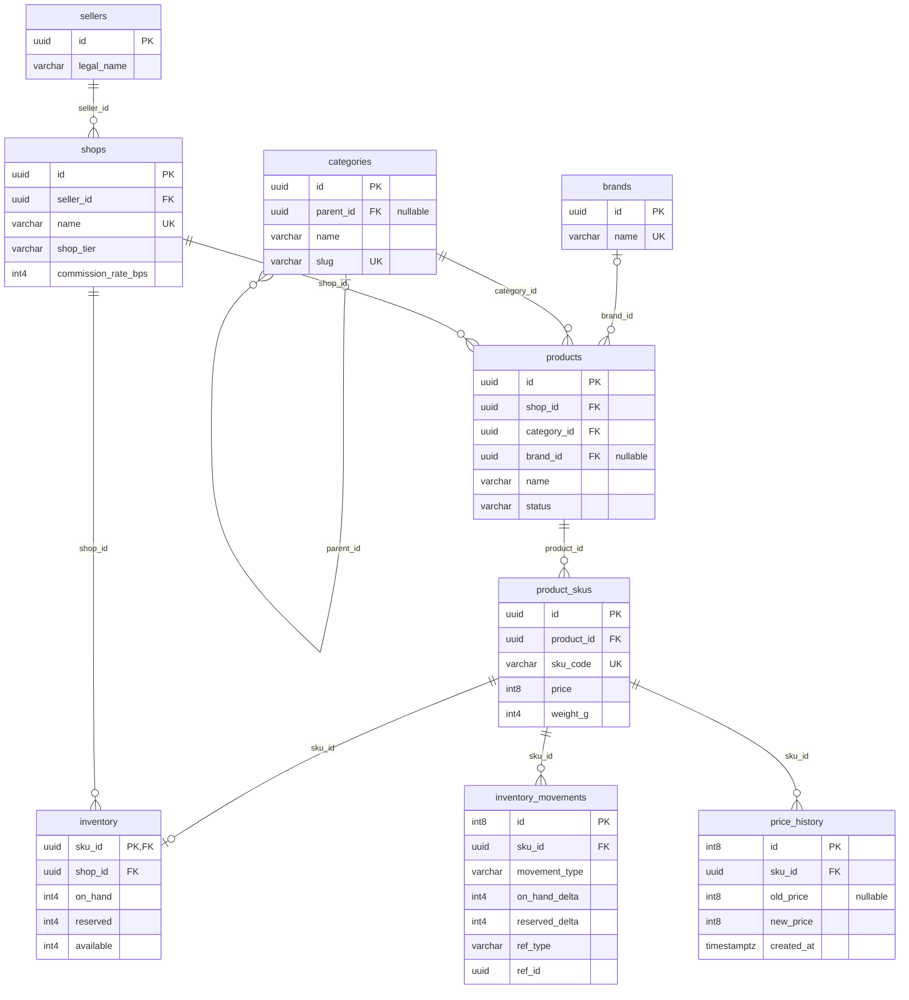
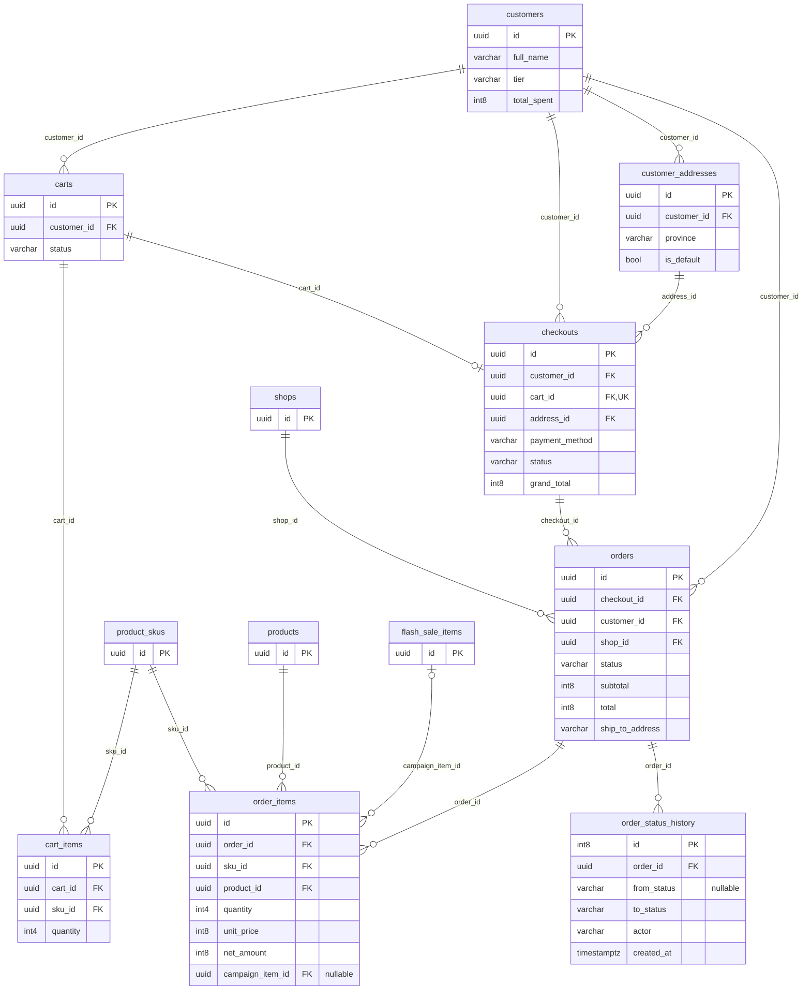
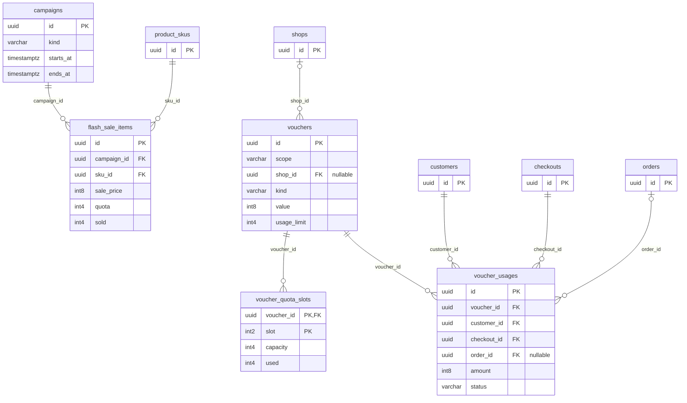
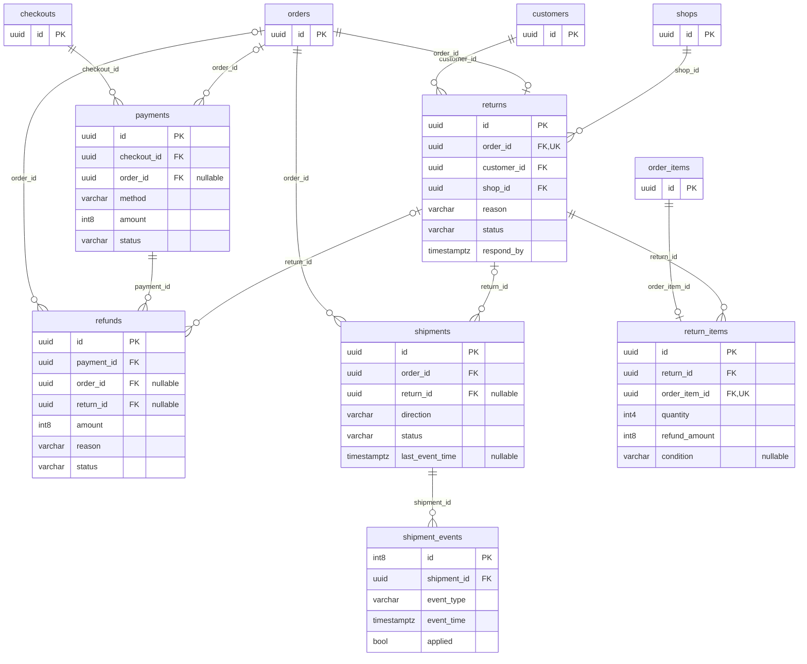
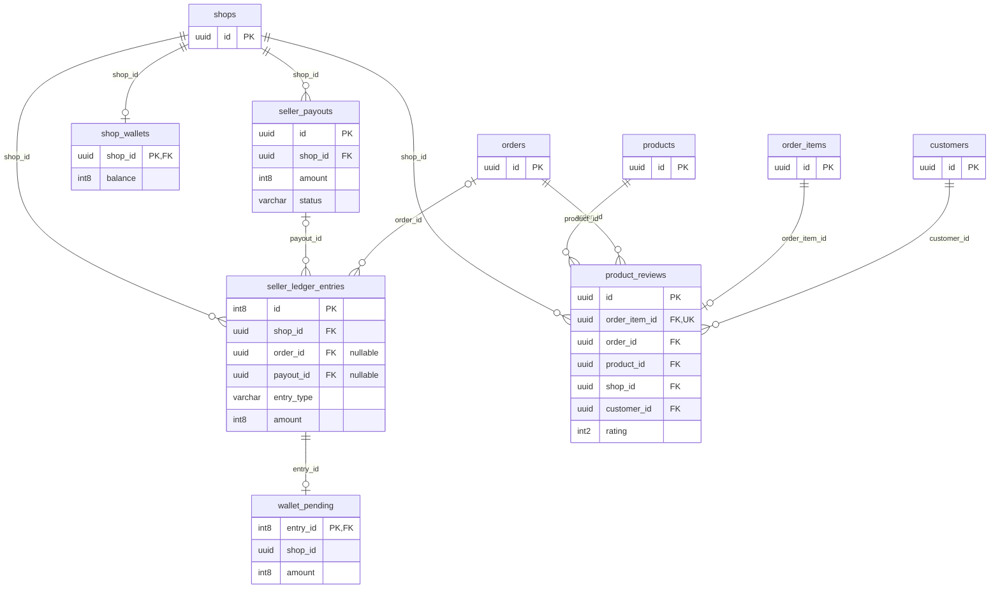
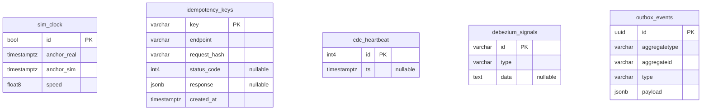

# ERD theo nhóm nghiệp vụ

[Tài liệu dự án](../README.md) / [Kiến trúc](README.md)

Các sơ đồ dùng tên bảng/cột thật nhưng **chỉ chọn một số cột** để dễ đọc. Bảng ngữ cảnh chỉ hiển thị PK; cột FK dùng làm nhãn cạnh có thể được ẩn trong ô ngữ cảnh. Danh sách đầy đủ 38 bảng và 319 cột nằm ở [erDiagram.txt](erDiagram.txt). Xem [quy ước cardinality và giới hạn ERD](README.md#cách-đọc-erd) trước khi suy ra quy tắc nghiệp vụ từ cạnh nối.

Các cạnh bên dưới là 57 FK vật lý của schema, được chia nhóm và có thể lặp giữa các nhóm để giữ ngữ cảnh. Không biểu diễn quan hệ ClickHouse bằng FK PostgreSQL.

## 1. Seller, catalog và tồn kho

Seller là chủ thể bán; shop là đơn vị vận hành có tier, địa điểm gửi và commission rate. Product là listing của shop, SKU mới là cấp có giá, khối lượng và tồn kho. Product có một category; brand là tùy chọn nên cạnh brand → product cho phép không có brand. Categories có parent nullable, cho phép node gốc.

Một SKU có tối đa một dòng inventory do sku_id đồng thời là PK và FK. API listing tạo tồn kho, nhưng cạnh ERD vẫn dùng 0..1 ở phía inventory: riêng FK không ép mọi SKU phải có inventory. Inventory movements và price_history có khóa BIGINT tăng dần và lưu lịch sử; ref_type/ref_id của movement là liên kết nghiệp vụ đa hình, không vẽ thành FK tới order/return.

Các bảng ngữ cảnh: không có.

## 2. Buyer, giỏ hàng và checkout theo shop

Một customer có nhiều cart theo thời gian; partial unique index giới hạn một cart ACTIVE, không phải một cart cho cả đời tài khoản. Một cart có thể chưa checkout; checkouts.cart_id unique nên tối đa một checkout cho cart đó. Checkout tách nhiều order theo shop, rồi mỗi order có nhiều order item.

checkouts.address_id là FK tới sổ địa chỉ. Order lại giữ ship_to_name/address/province dạng snapshot để sửa địa chỉ hiện tại không thay đổi đơn cũ. Unit price và net amount cũng là snapshot tại checkout. Order item có campaign_item_id nullable vì có thể được bán ngoài flash sale. Lịch sử trạng thái là dữ liệu append-only riêng, không cần đoán từ updated_at.

Các bảng ngữ cảnh: `product_skus`, `products`, `shops`, `flash_sale_items`.

## 3. Voucher, campaign và quota

Voucher scope PLATFORM có shop_id NULL; voucher SHOP phải gắn shop. CHECK của schema cưỡng chế điều kiện này, trong khi cạnh ERD chỉ thể hiện FK nullable. Campaign gom các flash_sale_items theo SKU; unique (campaign_id, sku_id) ngăn SKU xuất hiện hai lần trong cùng campaign.

Voucher usages nối voucher và customer với checkout, có order_id khi áp vào order shop. Nó ghi dấu áp dụng/đảo hiệu lực thay vì dùng một promotion_id trên order. Voucher quota chia thành nhiều dòng với PK ghép voucher_id + slot; bảng slot hỗ trợ đồng thời ở nguồn và bị loại khỏi CDC. Flash-sale quota/sold thuộc flash_sale_items, không dùng chung cơ chế slot của voucher.

Các bảng ngữ cảnh: `shops`, `product_skus`, `customers`, `checkouts`, `orders`.

## 4. Payment, fulfillment và customer return

Payment luôn gắn checkout; order_id tùy chọn phân biệt thu tiền theo checkout với COD theo order. Refund luôn gắn payment nhưng order_id và return_id có thể NULL, như tiền online đến muộn sau khi checkout hết hạn. Trạng thái refund nằm ở refunds, không phải một payment_status REFUNDED.

Order có tối đa một return request, mỗi order item có tối đa một return line. Refund và shipment có FK tới return được khai báo qua ALTER TABLE trong schema, vì vậy phải đọc cả phần khai báo sau CREATE TABLE khi dựng ERD. Một order có thể có một shipment FORWARD và một RETURN nhờ unique (order_id, direction); ERD orders → shipments vẫn là nhiều, không phải 1:1.

Carrier events lưu event_time và applied để giữ dấu callback cũ mà không kéo lùi trạng thái. Customer return có inspection và hoàn tiền riêng; giao thất bại trả về seller không tự động tạo một customer return request.

Các bảng ngữ cảnh: `checkouts`, `orders`, `order_items`, `customers`, `shops`.

## 5. Seller settlement, ví và review

Seller ledger gắn shop và có thể gắn order hoặc payout theo loại entry. SALE/COMMISSION/PAYMENT_FEE ghi nhận quyết toán đơn, PAYOUT ghi tiền trả cho shop. Những liên kết nullable không có nghĩa mọi entry đồng thời thuộc cả order lẫn payout.

shop_wallets có PK=FK shop_id. wallet_pending có PK=FK entry_id, nghĩa là mỗi ledger entry có tối đa một dòng pending; shop_id trong pending là cột dữ liệu nhưng không có FK vật lý riêng. Roll-up cộng pending vào balance theo lô; không suy ra balance luôn bằng tổng mọi ledger ngay sau mỗi transaction hoàn tất order.

Review gắn với order item duy nhất và mang thêm order/product/shop/customer để đọc, phân quyền và tổng hợp. Các FK riêng chỉ bảo đảm bản ghi cha tồn tại; API còn phải bảo đảm các ID này thuộc cùng một giao dịch mua.

Các bảng ngữ cảnh: `shops`, `orders`, `order_items`, `products`, `customers`.

## 6. Bảng điều khiển và tích hợp

Đây là những bảng nguồn thật, không phải mart. sim_clock điều khiển business time; idempotency_keys giữ response thành công cho retry; cdc_heartbeat giúp slot tiến lên ở nguồn ít thay đổi. Cả ba bị loại khỏi capture. wallet_pending và voucher_quota_slots ở nhóm trước cũng bị loại.

debezium_signals được capture nhưng không có silver nghiệp vụ. Outbox được capture rồi Event Router chuyển sang events.<aggregate>; aggregateid không phải một FK đa bảng. Việc không có cạnh trên sơ đồ này là có chủ đích, không có nghĩa các bảng không tham gia luồng vận hành.

Identity nằm ở database riêng, không đưa vào ERD enterprise_db: users có memberships và refresh_tokens; resource_id của membership liên hệ customer/shop qua ứng dụng. Audit user_id cũng không được suy thành FK nếu schema không khai báo.

Các bảng ngữ cảnh: không có.

