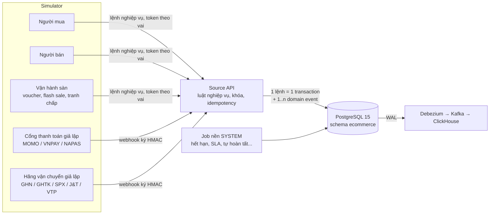
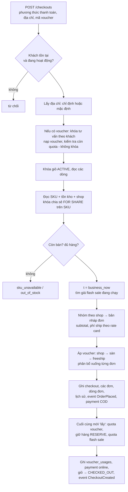
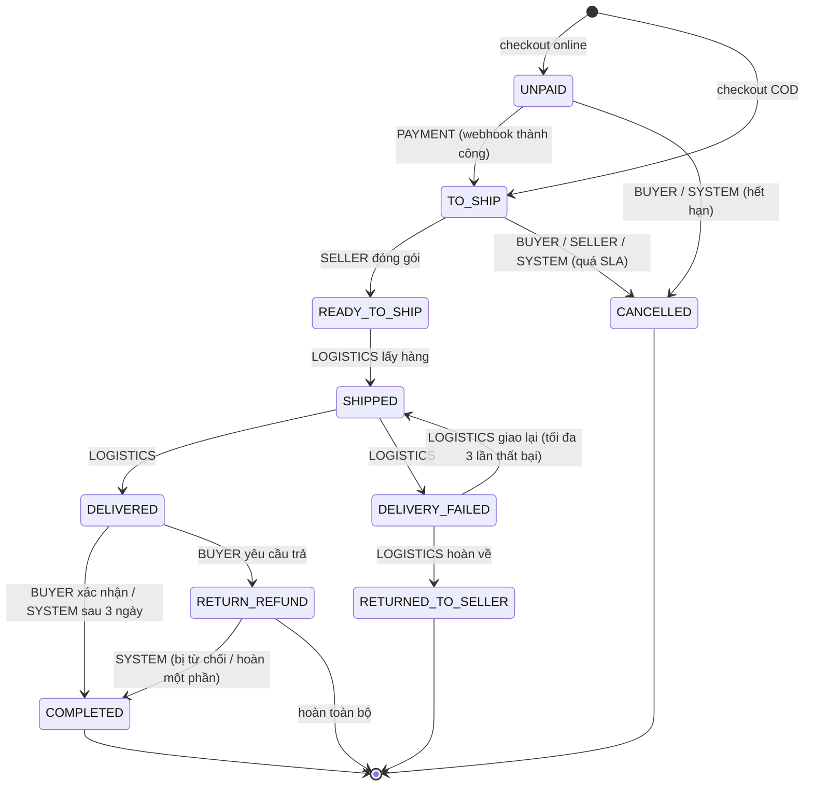
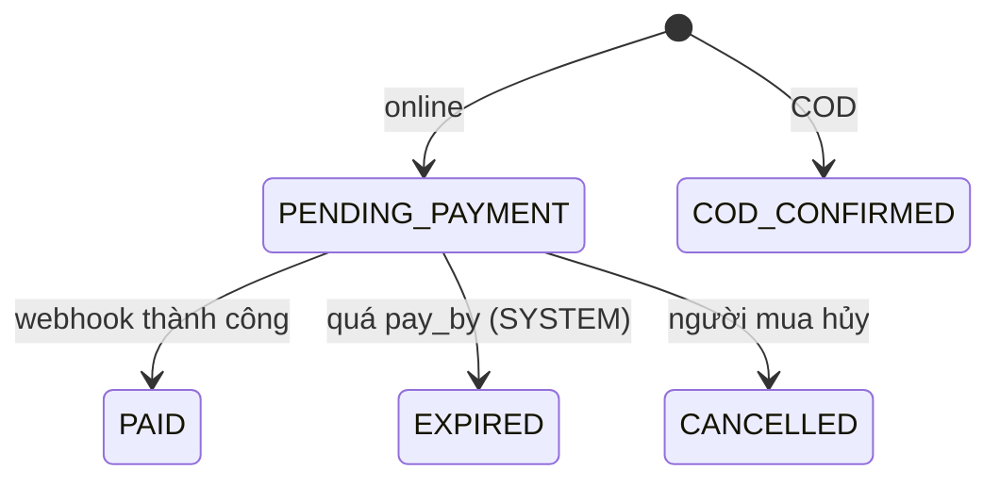
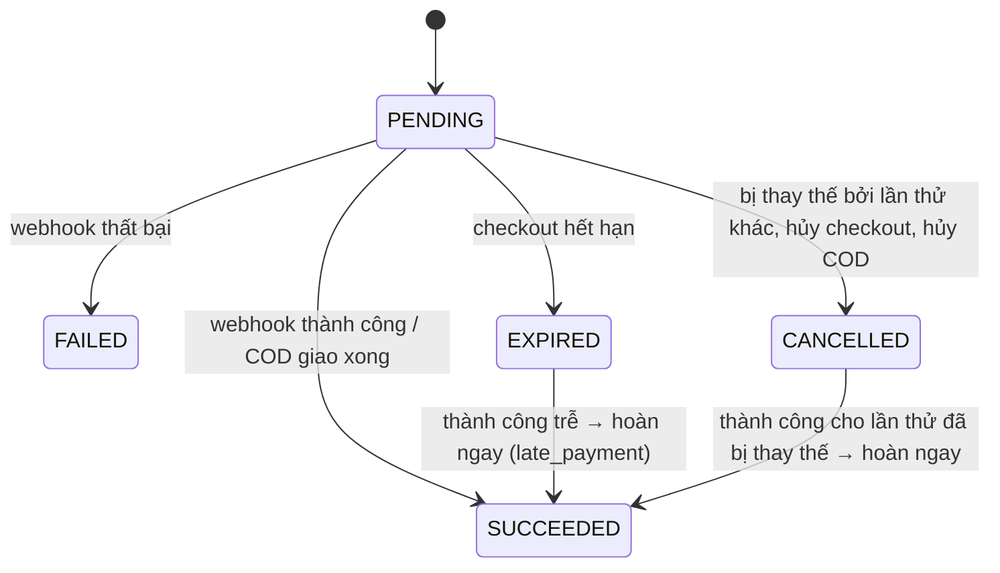
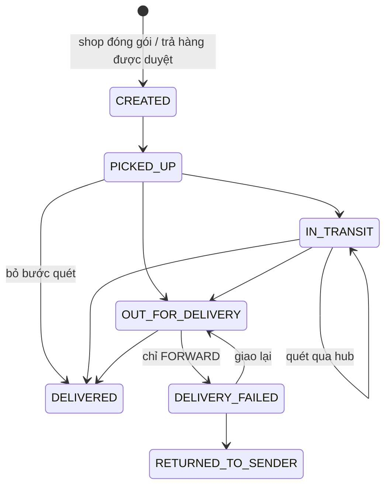
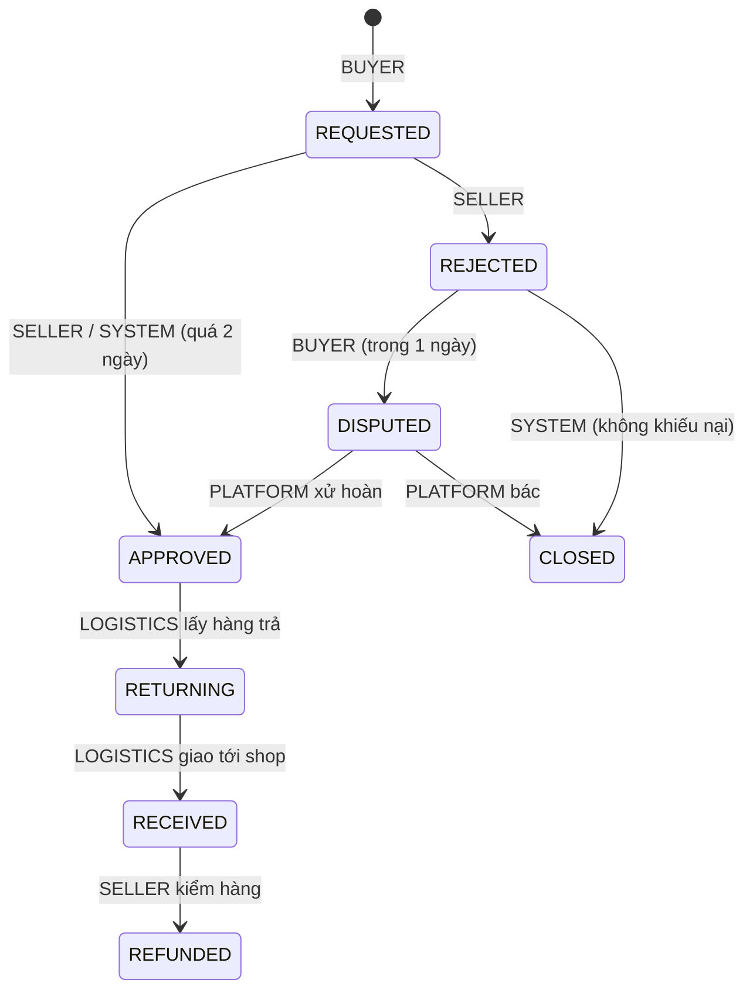
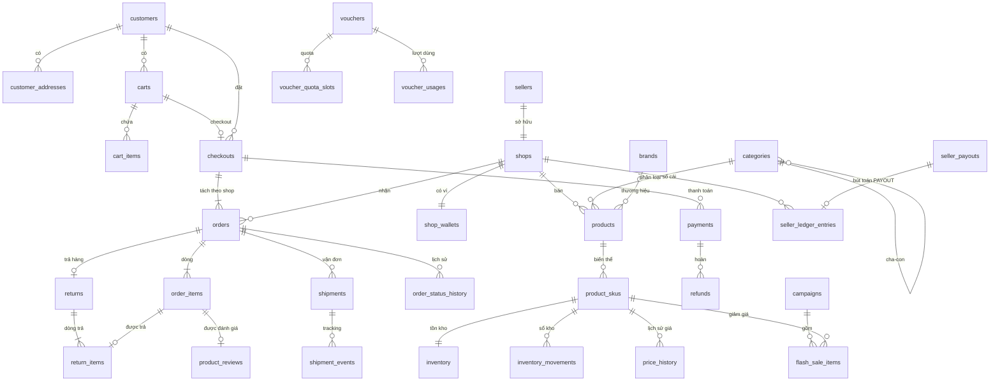

# 01 — Nghiệp vụ và dữ liệu nguồn

[Tài liệu dự án](../README.md) / [Nghiệp vụ](README.md)

## Đọc file này để biết gì

File này giải thích **hệ thống nguồn** của pipeline: một sàn thương mại điện tử nhiều shop kiểu Shopee / TikTok Shop, chạy ở Việt Nam, được mô phỏng hoàn toàn bằng phần mềm. Đọc xong, bạn sẽ biết: ai tham gia vào sàn và mỗi bên làm gì; mỗi luồng nghiệp vụ (từ đăng sản phẩm, giỏ hàng, checkout, thanh toán, giao hàng, hủy, đổi trả đến quyết toán cho người bán) chạy thế nào và vì sao lại thiết kế như vậy; các máy trạng thái của đơn hàng, thanh toán, vận đơn và yêu cầu trả hàng; các quy tắc mà Source API bắt buộc; từng bảng trong schema `ecommerce` của PostgreSQL và cách bảng đó được ghi (chỉ thêm, có cập nhật hay bị xóa cứng — điều này rất quan trọng với CDC); và cuối cùng là bộ mô phỏng (simulator) tạo ra toàn bộ lưu lượng. Những phần về xác thực, CDC/Kafka, kho dữ liệu ClickHouse và mart chỉ được nhắc tới và dẫn link sang tài liệu khác.

## Mục lục

1. [Bức tranh tổng thể](#1-bức-tranh-tổng-thể)
2. [Các tác nhân trên sàn](#2-các-tác-nhân-trên-sàn)
3. [Bối cảnh Việt Nam](#3-bối-cảnh-việt-nam)
4. [Đồng hồ nghiệp vụ (business clock)](#4-đồng-hồ-nghiệp-vụ-business-clock)
5. [Các luồng nghiệp vụ](#5-các-luồng-nghiệp-vụ)
   - 5.1 Đăng ký người mua và người bán
   - 5.2 Danh mục, sản phẩm, SKU, giá, tồn kho
   - 5.3 Giỏ hàng
   - 5.4 Checkout
   - 5.5 Thanh toán và webhook cổng thanh toán
   - 5.6 Đóng gói, vận chuyển, giao hàng
   - 5.7 Hoàn tất đơn và hạng thành viên
   - 5.8 Hủy đơn
   - 5.9 Trả hàng / hoàn tiền
   - 5.10 Quyết toán cho người bán: sổ cái, ví, chi trả
   - 5.11 Đổi giá và nhập thêm hàng
   - 5.12 Đánh giá sản phẩm
   - 5.13 Các job nền chạy theo thời gian
6. [Máy trạng thái](#6-máy-trạng-thái)
7. [Quy tắc nghiệp vụ và bất biến](#7-quy-tắc-nghiệp-vụ-và-bất-biến)
8. [Đồng thời (concurrency): khóa, hot row và các race đã sửa](#8-đồng-thời-concurrency-khóa-hot-row-và-các-race-đã-sửa)
9. [Idempotency và outbox](#9-idempotency-và-outbox)
10. [Mô hình dữ liệu schema `ecommerce`](#10-mô-hình-dữ-liệu-schema-ecommerce)
11. [Domain event trong outbox](#11-domain-event-trong-outbox)
12. [Bộ mô phỏng (simulator)](#12-bộ-mô-phỏng-simulator)
13. [Chỗ tài liệu cũ không còn đúng](#13-chỗ-tài-liệu-cũ-không-còn-đúng)
14. [Tài liệu liên quan](#14-tài-liệu-liên-quan)

---

## 1. Bức tranh tổng thể

Mục tiêu của dự án là một pipeline CDC thời gian thực. Muốn CDC có ý nghĩa thì dữ liệu nguồn phải **giống thật**: có trạng thái thay đổi theo thời gian, có cập nhật, có xóa, có giao dịch nhiều bảng, có tranh chấp đồng thời, có sự kiện đến trễ hoặc trùng. Vì vậy dự án không "insert dữ liệu giả ngẫu nhiên" mà xây hẳn một **ứng dụng nghiệp vụ** (Source API) với luật lệ của một sàn TMĐT, rồi để một **simulator** đóng vai hàng nghìn người dùng gọi vào ứng dụng đó.

Ba nguyên tắc nền tảng:

- **Source API là nơi duy nhất ghi vào PostgreSQL.** Simulator không có driver database; mọi thay đổi đi qua HTTP. Ngay cả dữ liệu khởi tạo (danh mục, shop, khách hàng) cũng được tạo qua API, nên mọi dòng trong DB đều có một domain event tương ứng trong outbox.
- **Một lệnh nghiệp vụ = một transaction.** Ví dụ checkout ghi cùng lúc vào `checkouts`, `orders`, `order_items`, `order_status_history`, `inventory`, `inventory_movements`, `voucher_usages`, `payments`, `carts` và vài dòng outbox — tất cả commit hoặc rollback cùng nhau. Phía CDC nhờ đó có thể dựng lại "trạng thái nhất quán tại một thời điểm" (xem tài liệu 04).
- **Thời gian là thời gian nghiệp vụ.** Một ngày kinh doanh có thể trôi qua trong vài phút thực, nhưng các luật (15 phút để thanh toán, 2 ngày để đóng gói…) vẫn giữ độ dài thật.

Tiền tệ là **VND, kiểu BIGINT** (không có số lẻ), giá **đã gồm VAT**.

## 2. Các tác nhân trên sàn

| Tác nhân | Là ai | Làm gì trong hệ thống | Ghi vào `actor` của lịch sử đơn |
|---|---|---|---|
| **Người mua (buyer / customer)** | Khách đăng ký qua dịch vụ identity, có sổ địa chỉ, phân khúc (NEW, REGULAR, BARGAIN_HUNTER, LOYAL, BUSINESS), hạng thành viên (BRONZE → PLATINUM) | Thêm/sửa/xóa giỏ hàng, checkout, thử thanh toán lại, hủy đơn, xác nhận đã nhận hàng, yêu cầu trả hàng, khiếu nại khi bị từ chối, viết đánh giá | `BUYER` |
| **Người bán (seller) và shop** | Một pháp nhân (`sellers`) sở hữu một shop (`shops`) với hạng MALL / PREFERRED / NORMAL, tỉnh gửi hàng, tỉ lệ hoa hồng | Đăng sản phẩm và SKU, đổi giá, nhập thêm hàng, tạo voucher của shop, đóng gói đơn (đặt vận chuyển), hủy đơn khi hết hàng, duyệt/từ chối/kiểm hàng trả về | `SELLER` |
| **Cổng thanh toán** | MOMO (ví điện tử), VNPAY (thẻ), NAPAS (chuyển khoản) | Gọi webhook báo một lần thanh toán thành công/thất bại; có thể gọi trễ, gọi trùng | `PAYMENT` |
| **Hãng vận chuyển** | GHN, GHTK, SPX, J&T, VTP | Gọi webhook theo dõi vận đơn: lấy hàng, đang vận chuyển, đang giao, đã giao, giao thất bại, hoàn về người gửi; có thể trùng, trễ, sai thứ tự, bỏ qua bước | `LOGISTICS` |
| **Vận hành sàn (platform / ops / admin)** | Đội ngũ của sàn | Tạo danh mục, thương hiệu, voucher toàn sàn, chiến dịch flash sale / mega sale, phân xử tranh chấp trả hàng, khóa tài khoản khách, chỉnh tốc độ đồng hồ | `PLATFORM` (chỉ ở luồng trả hàng) |
| **Hệ thống (SYSTEM)** | Các job nền của Source API | Hết hạn checkout chưa trả tiền, hủy đơn quá SLA đóng gói và phạt shop, tự hoàn tất đơn đã giao, đánh dấu giỏ bỏ quên, tự duyệt trả hàng khi shop không trả lời, đóng yêu cầu bị từ chối mà không khiếu nại, cộng dồn ví và chi trả cho shop | `SYSTEM` |

Điểm hay của thiết kế: **máy trạng thái kiểm tra cả "bước chuyển" lẫn "ai được phép làm bước đó"**. Ví dụ chỉ hãng vận chuyển mới chuyển được đơn sang "đã giao"; người bán không thể tự tuyên bố đã giao để nhận tiền.

Mỗi lời gọi của simulator mang token của đúng vai đang đóng (một buyer cụ thể, một shop cụ thể, hoặc partner ký HMAC), nên API kiểm tra quyền sở hữu như với người dùng thật. Chi tiết ở [02-source-api-va-bao-mat.md](02-source-api-va-bao-mat.md).

## 3. Bối cảnh Việt Nam

- **Tỉnh/thành và vùng.** API chỉ chấp nhận 17 tỉnh/thành, chia 3 vùng: Bắc (Hà Nội, Hải Phòng, Quảng Ninh, Bắc Ninh, Thanh Hóa), Trung (Nghệ An, Thừa Thiên Huế, Đà Nẵng, Khánh Hòa, Lâm Đồng), Nam (TP.HCM, Bình Dương, Đồng Nai, Bà Rịa - Vũng Tàu, Long An, Cần Thơ, An Giang). Vùng dùng để tính phí ship và thời gian vận chuyển. Simulator phân bố người mua tập trung ở TP.HCM (32%) và Hà Nội (25%), shop còn tập trung hơn (TP.HCM 45%, Hà Nội 35%) — giống thực tế, hàng chủ yếu đi từ hai đầu đất nước.
- **Hãng vận chuyển.** Khi shop đóng gói, sàn chọn hãng theo tỉ trọng GHN 30, GHTK 25, SPX 25, J&T 15, VTP 5; mã vận đơn có tiền tố riêng của từng hãng (GHN…, S…, SPXVN…, JT…, VTP…) cộng 12 chữ số.
- **Phương thức và cổng thanh toán.** COD (thu tiền khi giao), WALLET → MOMO, CARD → VNPAY, BANK_TRANSFER → NAPAS. Simulator dùng tỉ lệ COD 45%, ví 25%, thẻ 15%, chuyển khoản 15% — COD vẫn chiếm phần lớn như ở VN.
- **Bảng phí ship (rate card).** Tính theo tuyến và cân nặng tổng của các món trong cùng một shop: 500 g đầu giá cơ bản, mỗi 500 g tiếp theo cộng thêm một bậc.

  | Tuyến | 500 g đầu | Mỗi 500 g thêm |
  |---|---|---|
  | Cùng tỉnh | 15.000 ₫ | 2.500 ₫ |
  | Cùng vùng, khác tỉnh | 22.000 ₫ | 4.000 ₫ |
  | Khác vùng | 32.000 ₫ | 5.000 ₫ |

  Ví dụ gói 1,2 kg từ TP.HCM ra Hà Nội: khác vùng, vượt 2 bậc → 32.000 + 2 × 5.000 = 42.000 ₫.
- **Dữ liệu người dùng.** Họ tên theo phân bố họ thật (Nguyễn ~38%, Trần, Lê…), số điện thoại theo đầu số nhà mạng VN, email gmail/yahoo/fpt.vn…, địa chỉ có số nhà, tên đường, quận/huyện thật. Tên shop kiểu "Minh Phát Store 012".
- **Danh mục và thương hiệu thật.** 8 ngành hàng gốc (Điện thoại & Phụ kiện, Máy tính & Laptop, Thời trang Nữ, Thời trang Nam, Sắc đẹp, Nhà cửa & Đời sống, Mẹ & Bé, Bách hóa Online) với 20 ngành con và các mẫu thật (Galaxy A55, iPhone 15, Coolmate, Biti's, Vinamilk, Trung Nguyên…) có giá tham khảo thật.
- **Giờ Việt Nam (UTC+7).** "Giờ trong ngày" của lưu lượng (đêm vắng, trưa tăng, tối cao điểm) và "nửa đêm" để phát voucher hằng ngày đều tính theo giờ VN. Mã đơn hàng bắt đầu bằng ngày nghiệp vụ dạng yymmdd rồi tới 8 chữ số tăng dần (ví dụ `25111100001234`).
- **11.11.** Kịch bản "Siêu Sale" mô phỏng ngày hội mua sắm, với đỉnh lưu lượng ngay giờ đầu tiên.

## 4. Đồng hồ nghiệp vụ (business clock)

**Vấn đề:** luật của sàn có thời hạn dài (2 ngày đóng gói, 3 ngày tự hoàn tất). Nếu chạy theo giờ thật, muốn thấy trọn vòng đời một đơn phải đợi cả tuần. Nếu rút ngắn luật (ví dụ SLA còn 30 giây) thì dữ liệu mất tính thật và metric sai.

**Giải pháp:** một bảng một dòng `sim_clock` giữ ba giá trị: mốc thời gian thực, mốc thời gian nghiệp vụ tương ứng, và hệ số tốc độ. Hàm `business_now()` trong PostgreSQL trả về "mốc nghiệp vụ + (giờ thực hiện tại − mốc thực) × tốc độ". Mọi timestamp nghiệp vụ (`created_at`, `updated_at`, `paid_at`, hạn chót…) và mọi luật theo thời gian đều dùng hàm này.

- Ở tốc độ mặc định **×240** của simulator, 1 ngày nghiệp vụ = 6 phút thực; 15 phút thanh toán = 3,75 giây thực. Tốc độ tối đa cho phép là ×100.000.
- **Đổi tốc độ không làm thời gian nhảy:** khi đổi, hệ thống "neo lại" — mốc nghiệp vụ mới = thời điểm nghiệp vụ hiện tại, mốc thực mới = bây giờ. Thời gian nghiệp vụ luôn liên tục và tăng dần.
- Hàm đọc đồng hồ thực **tại thời điểm gọi** chứ không phải lúc bắt đầu transaction. Nhờ vậy các sự kiện của cùng một đối tượng được xếp theo đúng lúc chúng xảy ra, kể cả khi các transaction bắt đầu lệch thứ tự.
- Debezium vẫn ghi lại **thời gian commit thực** của mỗi thay đổi. Vì thế độ trễ pipeline đo bằng giây thật, còn metric nghiệp vụ (GMV theo ngày, thời gian đóng gói…) đo bằng thời gian nghiệp vụ. Hai trục thời gian này tách bạch là một điểm thiết kế quan trọng.
- Ngoại lệ có chủ đích: bảng `idempotency_keys` dùng giờ thực, vì client retry theo giờ thực; kiểm tra độ lệch giờ của chữ ký webhook cũng dùng giờ thực.

## 5. Các luồng nghiệp vụ

### 5.1 Đăng ký người mua và người bán

**Người mua.** Người dùng đăng ký ở dịch vụ identity (email, mật khẩu, họ tên, điện thoại, phân khúc, kênh APP/WEB, một địa chỉ). Identity gọi endpoint nội bộ của Source API để tạo bản ghi `customers` cùng địa chỉ mặc định trong `customer_addresses`, phát event `CustomerRegistered` và `AddressAdded`. Email là duy nhất. Khách mới ở hạng BRONZE, `total_spent = 0`. Có thể thêm địa chỉ; nếu đánh dấu mặc định thì địa chỉ mặc định cũ bị bỏ cờ (DB đảm bảo mỗi khách chỉ có tối đa một địa chỉ mặc định). Admin có thể **khóa tài khoản** (`is_active = false`); khách bị khóa không thể thêm vào giỏ hay checkout, nhưng đơn cũ vẫn tiếp tục vòng đời.

**Người bán.** Tương tự, đăng ký qua identity với tên pháp nhân, email và thông tin shop (tên, hạng, tỉnh). Một transaction tạo `sellers`, `shops` và một ví `shop_wallets` số dư 0, phát `SellerOnboarded`. Tên shop và email là duy nhất. **Hoa hồng gán theo hạng shop**: MALL 8%, PREFERRED 6%, NORMAL 4% (lưu dạng basis point: 800/600/400). Shop có `penalty_points` (điểm phạt), tăng mỗi lần bị hủy đơn do quá SLA.

### 5.2 Danh mục, sản phẩm, SKU, giá, tồn kho

- **Danh mục (`categories`)** là cây hai cấp (gốc → lá), định danh bằng `slug`. **Thương hiệu (`brands`)** có tên duy nhất. Cả hai do admin tạo, theo kiểu "upsert": tạo lại cùng slug/tên thì trả về bản ghi có sẵn, không lỗi.
- **Sản phẩm (`products`)** thuộc một shop, một danh mục lá, có thể có thương hiệu. Mỗi sản phẩm có 1–20 **SKU (`product_skus`)** — biến thể cụ thể như "Đen / 256GB" — với mã SKU duy nhất toàn sàn, **giá niêm yết** (`list_price`, giá gạch ngang) và **giá bán** (`price`), cân nặng gram. Luật: giá bán > 0 và **không vượt** giá niêm yết.
- **Đăng sản phẩm** là một lệnh: tạo product, các SKU, mỗi SKU một dòng `price_history` đầu tiên (giá cũ rỗng, lý do "listing"), một dòng `inventory` và một dòng sổ kho `inventory_movements` loại LISTED cho số lượng ban đầu. Event `ProductListed`.
- **Tồn kho (`inventory`)**: một dòng cho mỗi SKU, nằm trong kho của shop sở hữu. Ba con số:
  - `on_hand` — hàng thực có trên kệ;
  - `reserved` — đã được giữ cho đơn đã đặt nhưng chưa xuất kho;
  - `available = on_hand − reserved` — còn bán được. Ràng buộc CHECK ở DB bắt buộc đẳng thức này và cả ba không âm.
  - `reorder_point` — ngưỡng "sắp hết hàng"; SKU có `available ≤ reorder_point` xuất hiện trong danh sách low-stock.
- **Sổ kho (`inventory_movements`)**: mọi thay đổi tồn kho đi qua **một hàm duy nhất**, cập nhật `inventory` và thêm đúng một dòng sổ kho ghi loại biến động, delta của `on_hand` và `reserved`, số dư sau biến động, và nguồn gốc (đăng bán, nhập hàng, đơn hàng, trả hàng). Nhờ vậy luôn có: tồn kho = tổng các delta của SKU đó.

| Loại biến động | `on_hand` | `reserved` | Khi nào |
|---|---|---|---|
| LISTED | + | 0 | Đăng SKU với số lượng ban đầu |
| RESTOCK | + | 0 | Người bán nhập thêm hàng |
| RESERVE | 0 | + | Checkout giữ hàng cho đơn |
| RELEASE | 0 | − | Đơn bị hủy trước khi xuất kho |
| SHIP | − | − | Hãng vận chuyển lấy hàng (hàng rời kho) |
| RETURN_TO_SENDER | + | 0 | Gói giao thất bại quay về kho |
| CUSTOMER_RETURN | + | 0 | Hàng khách trả, kiểm tra còn bán được |

Lưu ý tinh tế: lúc checkout hàng **chưa rời kho**, nên chỉ tăng `reserved`; chỉ khi hãng vận chuyển lấy hàng mới trừ cả `on_hand` lẫn `reserved`. Đây là mô hình "giữ hàng rồi xuất kho" chuẩn của TMĐT, khác với mô hình đơn giản "trừ kho ngay khi đặt".

Ghi chú: schema có cờ `is_active` cho SKU và shop, `status` ACTIVE/INACTIVE cho sản phẩm, và checkout từ chối món không còn bán. Hiện chưa có endpoint nào tắt chúng, nên trong dữ liệu thực tế mọi thứ đều đang bán.

### 5.3 Giỏ hàng

- Mỗi khách có **tối đa một giỏ ACTIVE** (unique index một phần trên `customer_id` khi trạng thái ACTIVE). Giỏ được tạo tự động khi thêm món đầu tiên.
- **Thêm món**: nếu SKU đã có trong giỏ thì cộng dồn số lượng, tối đa 100 mỗi dòng. Giỏ **không chụp lại giá** — giá được đọc ở thời điểm checkout.
- **Sửa số lượng** cập nhật dòng; **xóa món là DELETE cứng** dòng `cart_items`. Đây là một trong số ít chỗ hệ thống xóa thật dữ liệu nghiệp vụ, cố ý giữ lại để pipeline CDC phải xử lý sự kiện delete (tombstone, `before` đầy đủ…).
- Khi checkout thành công, giỏ chuyển **CHECKED_OUT** (các dòng giỏ vẫn giữ nguyên làm lịch sử). Mỗi giỏ chỉ checkout được một lần (`checkouts.cart_id` là duy nhất). Lần thêm món kế tiếp sẽ tạo giỏ ACTIVE mới.
- Giỏ có món mà **không động tới trong 1 ngày nghiệp vụ** bị job đánh dấu **ABANDONED** (event `CartAbandoned`) — dữ liệu cho phân tích "giỏ hàng bị bỏ quên".

### 5.4 Checkout

Checkout là luồng phức tạp nhất. Một lần checkout = **một lần thanh toán** của người mua, nhưng được **tách thành một đơn cho mỗi shop**, vì mỗi shop đóng gói và gửi hàng riêng.

**Các bước chính và lý do:**

1. **Kiểm tra khách và địa chỉ.** Khách bị khóa không được mua. Địa chỉ không truyền vào thì dùng địa chỉ mặc định. Địa chỉ được **chép cứng vào đơn** (`ship_to_name`, `ship_to_address`, `ship_to_province`) để đơn luôn giữ nơi thật sự đã giao, dù sau này khách sửa sổ địa chỉ.
2. **Voucher: kiểm tra sớm, lấy muộn.** Mã không tồn tại hoặc hết lượt bị từ chối ngay, trước khi làm việc nặng. Nhưng lượt dùng chỉ được "trừ" ở cuối transaction (xem mục 8).
3. **Đọc giá và tồn kho.** Hệ thống đọc SKU, sản phẩm, shop và tồn kho của mọi món trong giỏ. Món không còn bán → `sku_unavailable`; thiếu hàng → `out_of_stock` kèm danh sách SKU, số yêu cầu và số còn — client có thể bỏ món thiếu rồi thử lại.
4. **Chốt thời điểm `t`.** Giá, khung flash sale, hiệu lực voucher đều được đánh giá tại `t`; checkout và các đơn được đóng dấu thời gian `t`.
5. **Giá flash sale.** Nếu SKU nằm trong một chiến dịch đang chạy và quota còn đủ cho số lượng muốn mua, đơn giá = giá flash sale (nếu nhiều chiến dịch thì lấy giá thấp nhất); dòng đơn ghi lại `campaign_item_id`.
6. **Tách đơn theo shop, tính phí ship.** Mỗi shop: subtotal = tổng tiền hàng; phí ship theo rate card từ tỉnh của shop tới tỉnh nhận, theo tổng cân nặng các món của shop đó.
7. **Áp voucher** theo thứ tự cố định (chi tiết bên dưới).
8. **Ghi dữ liệu**: một `checkouts`, mỗi shop một `orders` với số đơn tăng dần, các `order_items` (chụp lại giá niêm yết, đơn giá, phần giảm giá phân bổ, số tiền thực trả của dòng), một dòng `order_status_history` đầu tiên, event `OrderPlaced`. Với COD, mỗi đơn có ngay một `payments` COD trạng thái PENDING (sẽ thu khi giao).
9. **Lấy tài nguyên khan hiếm ở cuối**: trừ quota voucher, giữ hàng (RESERVE, theo thứ tự SKU), tăng `sold` của flash sale — mỗi việc là một UPDATE có điều kiện nên không thể bán quá dù trước đó chỉ đọc không khóa. Hết quota flash giữa chừng → `flash_sold_out`, toàn bộ checkout rollback; lần thử lại sẽ trả giá thường.
10. **Thanh toán online**: tạo một `payments` PENDING cho **cả checkout** (số tiền = tổng), hạn chót `pay_by = t + 15 phút`. Đơn ở trạng thái **UNPAID**, checkout ở **PENDING_PAYMENT**. Với COD: checkout **COD_CONFIRMED**, đơn vào thẳng **TO_SHIP** với hạn đóng gói `confirm_by = t + 2 ngày`.
11. Giỏ → CHECKED_OUT, event `CheckoutCreated`.

**Voucher.** Có ba loại: **FIXED** (giảm số tiền cố định), **PERCENT** (giảm theo %, lưu bằng basis point: 1000 = 10%, có thể có mức trần), **FREESHIP** (trợ giá ship, chỉ voucher sàn). Có hai phạm vi: **SHOP** (shop tự tài trợ) và **PLATFORM** (sàn tài trợ). Mỗi voucher có khung hiệu lực, chi tiêu tối thiểu, tổng lượt dùng (`usage_limit`) và giới hạn lượt mỗi khách.

- **Chồng voucher có giới hạn**: tối đa một voucher shop cho mỗi shop, một voucher giảm giá của sàn, một voucher freeship cho mỗi checkout.
- **Thứ tự áp**:
  1. Voucher shop tính trên tiền hàng của chính shop đó.
  2. Voucher sàn tính trên tiền hàng còn lại sau voucher shop của mọi shop, rồi phân bổ cho các đơn theo tỉ lệ "phần còn có thể giảm".
  3. Freeship tính trên tổng phí ship, phân bổ theo tỉ lệ phí ship của từng đơn.
- **Sàn tối thiểu 1.000 ₫**: voucher không bao giờ kéo tiền hàng của một đơn xuống dưới 1.000 ₫.
- Mọi phần giảm cấp đơn được **chia tiếp xuống từng dòng** theo tỉ lệ thành tiền, bằng phương pháp "phần dư lớn nhất" (largest remainder) để tổng các phần **khớp tuyệt đối** với số tổng. Nhờ vậy khi trả một phần, hoàn đúng số tiền khách đã thực trả cho từng đơn vị.
- Voucher tính ra 0 ₫ (ví dụ freeship cho checkout phí ship 0) **không tốn lượt**.
- Mỗi voucher áp dụng ghi một dòng `voucher_usages` (APPLIED); voucher shop gắn với đơn của shop đó, voucher sàn gắn với checkout.

**Ai trả tiền giảm giá** (quan trọng cho quyết toán và metric):

| Cột trên đơn | Ý nghĩa | Ai chịu |
|---|---|---|
| `shop_discount` | Giảm từ voucher shop | Người bán |
| `platform_discount` | Giảm từ voucher sàn | Sàn |
| `shipping_subsidy` | Trợ giá ship từ freeship | Sàn |
| `total` | subtotal − shop_discount − platform_discount + shipping_fee − shipping_subsidy | Người mua trả (DB kiểm tra đẳng thức) |

**Ví dụ cụ thể.** Một khách ở Hà Nội có trong giỏ:

- Shop A (TP.HCM, NORMAL): 1 tai nghe JBL 1.090.000 ₫ và 2 cáp Ugreen 119.000 ₫ → tiền hàng 1.328.000 ₫, tổng 380 g, khác vùng → ship 32.000 ₫.
- Shop B (Hà Nội, MALL): 1 son 229.000 ₫ → ship cùng tỉnh 15.000 ₫.

Khách dùng voucher shop A "giảm 50.000 ₫ cho đơn từ 500.000 ₫", voucher sàn "10% tối đa 100.000 ₫" và freeship 30.000 ₫, trả bằng ví MOMO.

| | Đơn A | Đơn B | Cả checkout |
|---|---|---|---|
| Tiền hàng | 1.328.000 | 229.000 | 1.557.000 |
| Voucher shop | −50.000 | 0 | |
| Voucher sàn (100.000 chia theo phần còn giảm được) | −84.850 | −15.150 | −100.000 |
| Phí ship | +32.000 | +15.000 | +47.000 |
| Freeship (30.000 chia theo phí ship) | −20.426 | −9.574 | −30.000 |
| **Khách trả** | **1.204.724** | **219.276** | **1.424.000** |

Kết quả: **1 checkout, 2 đơn (mỗi shop một đơn), 1 payment MOMO 1.424.000 ₫ PENDING, 3 dòng voucher_usages**, 3 dòng giữ hàng trong sổ kho. Nếu cùng giỏ đó chọn COD thì có 1 checkout, 2 đơn TO_SHIP và **2 payment COD**, mỗi đơn một payment (vì mỗi shipper thu tiền đơn của mình).

### 5.5 Thanh toán và webhook cổng thanh toán

**Thanh toán online** (ví, thẻ, chuyển khoản): mỗi lần thử là một dòng `payments` với mã giao dịch duy nhất (`transaction_ref`). Cổng thanh toán gọi webhook đã ký kèm mã giao dịch và kết quả.

- **Thành công, đúng hạn**: payment → SUCCEEDED, các lần thử khác còn PENDING bị CANCELLED ("superseded"), checkout → PAID, mọi đơn UNPAID của checkout → **TO_SHIP** (actor PAYMENT), mỗi đơn nhận hạn đóng gói `confirm_by = lúc trả tiền + 2 ngày`.
- **Thất bại**: payment → FAILED kèm lý do (hết tiền, thẻ bị từ chối, hết hạn OTP, ngân hàng bảo trì). Checkout vẫn chờ. Người mua có thể **thử lại**: tạo payment mới, payment PENDING cũ bị hủy. Không thể thử lại sau hạn `pay_by`.
- **Hết hạn**: nếu tới `pay_by` vẫn chưa trả, job SYSTEM đóng checkout: checkout → EXPIRED, payment PENDING → EXPIRED, trả lại lượt voucher, hủy mọi đơn (giải phóng hàng giữ, trả quota flash sale).
- **Thành công đến trễ hoặc cho lần thử đã bị thay thế**: tiền **đã bị cổng trừ thật**, bất kể phía sàn nghĩ gì. Vì vậy hệ thống vẫn ghi payment SUCCEEDED và **lập tức hoàn tiền** (refund lý do `late_payment`, không gắn với đơn nào). Đây là tình huống thực tế rất hay gặp và là nguồn sai lệch đối soát nếu xử lý sai.
- **Webhook trùng**: kết quả lặp lại (payment đã ở đúng trạng thái đó) là no-op "duplicate_ignored"; cùng event id thì còn được idempotency trả lại phản hồi cũ. Báo thất bại cho một payment đã hết hạn/hủy bị bỏ qua ("stale_failure_ignored"). Báo trái ngược với kết quả cuối (FAILED rồi SUCCEEDED, hay ngược lại) bị từ chối `payment_already_final`.
- Chỉ đúng cổng sở hữu payment đó mới được báo kết quả (MOMO không thể báo cho giao dịch VNPAY).

**COD**: payment COD của từng đơn ở PENDING suốt quá trình giao; khi hãng vận chuyển báo **đã giao**, payment → SUCCEEDED (event `PaymentSucceeded`). Nếu đơn bị hủy hoặc hoàn về, payment COD → CANCELLED — không có tiền nào phải hoàn.

### 5.6 Đóng gói, vận chuyển, giao hàng

1. **Đóng gói (pack)**: người bán đóng gói đơn TO_SHIP → **READY_TO_SHIP**; cùng transaction, sàn đặt vận chuyển: tạo `shipments` chiều FORWARD với hãng được chọn, mã vận đơn, tỉnh đi (tỉnh shop), tỉnh đến; event `ShipmentCreated`. Phải đóng gói trước `confirm_by` (2 ngày) nếu không job sẽ hủy đơn và phạt shop.
2. **Hãng gửi sự kiện tracking** qua webhook: mã vận đơn, mã sự kiện của hãng (`carrier_event_id`), loại sự kiện, giờ xảy ra theo hãng, vị trí.

| Sự kiện của hãng | Được phép sau trạng thái vận đơn | Tác động lên đơn hàng |
|---|---|---|
| PICKED_UP | CREATED | READY_TO_SHIP → **SHIPPED**, hàng rời kho (SHIP) |
| IN_TRANSIT | PICKED_UP, IN_TRANSIT | không đổi |
| OUT_FOR_DELIVERY | PICKED_UP, IN_TRANSIT, DELIVERY_FAILED | nếu đơn đang DELIVERY_FAILED → SHIPPED (giao lại) |
| DELIVERED | PICKED_UP, IN_TRANSIT, OUT_FOR_DELIVERY | → **DELIVERED**, thu COD |
| DELIVERY_FAILED | OUT_FOR_DELIVERY | → DELIVERY_FAILED, tăng số lần giao |
| RETURNED_TO_SENDER | DELIVERY_FAILED | → **RETURNED_TO_SELLER**, hàng về kho, hủy COD / hoàn tiền online |

3. **Ba thực tế khó chịu của hãng vận chuyển**, và cách xử lý:
   - **Gửi trùng**: mã sự kiện đã nhận → bỏ qua ("duplicate_ignored"), không ghi gì thêm.
   - **Đến trễ / sai thứ tự**: sự kiện có giờ xảy ra **không mới hơn** sự kiện mới nhất đã áp dụng → vẫn **lưu** vào `shipment_events` với `applied = false` nhưng **không kéo vận đơn lùi lại** ("stale_ignored"). Lưu lại để đối soát và phân tích, nhưng không làm hỏng trạng thái.
   - **Bỏ qua bước quét**: có thể giao thẳng từ hub (PICKED_UP → DELIVERED) — bảng trên cho phép.
4. **Giao lại**: tối đa 3 lần giao thất bại. Sau lần thứ ba, hệ thống không cho giao lại nữa; hãng sẽ hoàn hàng về người gửi.
5. Mỗi sự kiện áp dụng được: cập nhật vận đơn (trạng thái, giờ sự kiện mới nhất, thời điểm lấy hàng/giao hàng, số lần), thêm một dòng `shipment_events` applied, event `ShipmentTracked`.

Lưu ý: sau khi đóng gói (READY_TO_SHIP), **không ai hủy được đơn nữa** — hàng đã nằm trên quầy của hãng vận chuyển.

### 5.7 Hoàn tất đơn và hạng thành viên

Đơn DELIVERED trở thành **COMPLETED** khi người mua bấm "đã nhận hàng", hoặc tự động sau **3 ngày nghiệp vụ** kể từ lúc giao. 3 ngày này đồng thời là **cửa sổ trả hàng** — sau khi COMPLETED thì không yêu cầu trả hàng được nữa.

Khi COMPLETED, trong cùng transaction:

- **Cộng chi tiêu cho khách**: `total_spent += total − tổng đã hoàn của đơn`, rồi tính lại hạng: từ 5 triệu SILVER, 20 triệu GOLD, 50 triệu PLATINUM. Event `CustomerSpendUpdated` ghi hạng trước/sau.
- **Quyết toán cho shop** (mục 5.10).

Vì sao cộng ở COMPLETED chứ không phải lúc trả tiền? Vì chỉ khi đơn hoàn tất, số tiền khách chi mới là cuối cùng (đã trừ hoàn tiền). Cộng sớm thì phải trừ ngược khi hủy/trả — phức tạp và dễ sai.

### 5.8 Hủy đơn

| Ai hủy | Từ trạng thái | Phạm vi | Hệ quả |
|---|---|---|---|
| Người mua | UNPAID | **Cả checkout** (mọi đơn chung lần thanh toán đó) | checkout CANCELLED, payment PENDING CANCELLED, trả lượt voucher, giải phóng hàng giữ, trả quota flash |
| Người mua | TO_SHIP | Chỉ đơn đó | giải phóng hàng giữ, trả quota flash; online → hoàn đúng `total` của đơn; COD → hủy payment COD |
| Người bán | TO_SHIP | Chỉ đơn đó, lý do: hết hàng / khách yêu cầu / sai giá | như trên |
| SYSTEM | UNPAID (hết hạn thanh toán) | Cả checkout | như hủy UNPAID, checkout EXPIRED |
| SYSTEM | TO_SHIP quá SLA | Chỉ đơn đó | như trên + shop bị cộng 1 điểm phạt (`ShopPenalized`) |

Vì sao hủy đơn UNPAID lại hủy cả checkout? Vì các đơn đó **chung một lần thanh toán chưa xảy ra**: không thể trả một payment cho "một nửa" checkout. Sau khi đã trả tiền, các đơn độc lập với nhau, hủy đơn nào hoàn tiền đơn đó.

Chú ý: hủy một đơn **sau khi đã trả tiền không trả lại lượt voucher** — lượt chỉ được trả khi cả checkout chưa thanh toán bị đóng. Tiền hoàn là `total` của đơn (đã trừ giảm giá), nên khách không được lợi.

### 5.9 Trả hàng / hoàn tiền

Chỉ đơn **DELIVERED** mới yêu cầu trả được; **một đơn tối đa một yêu cầu trả**, nhưng có thể chọn một phần (một số dòng, một số lượng nhỏ hơn số đã mua). Lý do: DAMAGED, WRONG_ITEM, NOT_AS_DESCRIBED, MISSING_PARTS, CHANGED_MIND.

1. **Yêu cầu**: đơn → **RETURN_REFUND** (actor BUYER); tạo `returns` trạng thái REQUESTED với hạn trả lời `respond_by = bây giờ + 2 ngày`; mỗi dòng trả một `return_items` với **số tiền hoàn dự kiến = số tiền thực trả của dòng × số trả / số mua** (đã trừ mọi voucher). Event `ReturnRequested`.
2. **Người bán trả lời**:
   - **Duyệt** (hoặc SYSTEM tự duyệt khi quá 2 ngày không trả lời) → APPROVED, sàn tạo vận đơn chiều **RETURN** từ tỉnh khách về tỉnh shop.
   - **Từ chối** → REJECTED. Khách có **1 ngày** để **khiếu nại** (DISPUTED); không khiếu nại thì SYSTEM đóng (CLOSED) và đơn → COMPLETED.
3. **Sàn phân xử khiếu nại**: đồng ý hoàn → APPROVED (rồi đi tiếp như duyệt); bác → CLOSED, đơn → COMPLETED.
4. **Gói hàng trả**: hãng lấy hàng → RETURNING; giao tới shop → RECEIVED. Gói trả chỉ nhận các sự kiện lấy hàng, vận chuyển, đang giao, đã giao.
5. **Người bán kiểm hàng**: đánh dấu từng dòng SELLABLE hoặc DAMAGED. Hàng SELLABLE được **nhập lại kho** (CUSTOMER_RETURN). Khách được **hoàn toàn bộ số tiền dự kiến** bất kể tình trạng (hàng hỏng là rủi ro của người bán), qua `refunds` gắn với payment đã giữ tiền của đơn (COD đã thu, hoặc payment online của checkout). Return → REFUNDED.
6. **Kết cục của đơn**: nếu trả **toàn bộ** đơn vị → đơn **ở lại RETURN_REFUND** (trạng thái cuối, shop không nhận gì); nếu trả **một phần** → đơn → **COMPLETED** (SYSTEM, "partial_refund"), shop được quyết toán phần giữ lại, khách được cộng chi tiêu sau khi trừ hoàn.

Phí ship **không được hoàn** khi trả hàng — chỉ hoàn tiền hàng thực trả.

Ví dụ: trong đơn A ở trên, khách trả 1 trong 2 cáp. Dòng cáp (2 × 119.000 = 238.000 ₫) đã gánh 8.961 ₫ voucher shop và 15.207 ₫ voucher sàn (theo phân bổ), số thực trả của dòng là 213.832 ₫; hoàn cho 1 cáp = 106.916 ₫. Đơn A sau đó COMPLETED.

### 5.10 Quyết toán cho người bán: sổ cái, ví, chi trả

Khi một đơn **COMPLETED**, shop được ghi nhận:

- **SALE (+)** = tiền hàng của các đơn vị shop giữ lại (không bị trả), **trừ voucher shop** (shop tự tài trợ). Voucher sàn và trợ giá ship là sàn trả, không trừ vào shop.
- **COMMISSION (−)** = SALE × tỉ lệ hoa hồng của shop.
- **PAYMENT_FEE (−)** = SALE × 2% (phí giao dịch, áp cho cả COD).

Với đơn A (NORMAL 4%): SALE = 1.328.000 − 50.000 = 1.278.000; hoa hồng 51.120; phí 25.560; shop thực nhận 1.201.320 ₫. Event `OrderSettled`.

Các bút toán chỉ được **thêm** vào `seller_ledger_entries` (sổ cái chỉ-thêm), mỗi bút toán kèm một dòng `wallet_pending`. Job nền định kỳ "cuộn" các dòng chờ vào `shop_wallets.balance` theo lô. **Chi trả (payout)**: mỗi shop tối đa một lần mỗi ngày nghiệp vụ, khi số dư dương và có bút toán cũ hơn một ngày: cuộn nốt phần chờ của shop đó, tạo `seller_payouts` bằng **toàn bộ số dư**, ghi bút toán PAYOUT (−) và đưa ví về 0. Event `PayoutPaid`.

Vì sao không cộng thẳng vào ví khi đơn hoàn tất? Vì shop lớn có rất nhiều đơn hoàn tất cùng lúc; nếu mỗi đơn cập nhật cùng một dòng ví thì tất cả xếp hàng chờ khóa dòng đó (hot row). Ghi sổ chỉ-thêm không tranh chấp; cộng dồn theo lô thì mỗi shop chỉ bị khóa một lần mỗi lô. Số dư thật của ví lúc bất kỳ = số dư đã cuộn + tổng phần đang chờ.

### 5.11 Đổi giá và nhập thêm hàng

- **Đổi giá**: người bán đặt giá mới (và có thể giá niêm yết mới; nếu giá mới cao hơn giá niêm yết thì giá niêm yết được nâng lên bằng giá mới để giữ luật giá bán ≤ niêm yết). Đặt đúng giá cũ là no-op. Có đổi giá bán thì thêm một dòng `price_history` (giá cũ, giá mới, lý do). Event `SkuPriceChanged`. Đơn đã đặt **không bị ảnh hưởng** vì dòng đơn đã chụp giá.
- **Nhập hàng**: cộng `on_hand` qua sổ kho (RESTOCK) với một mã phiếu nhập mới, cập nhật `last_restocked_at`. Event `InventoryRestocked`. Không có nhà cung cấp hay đơn mua hàng — người bán tự lo nguồn hàng, đúng mô hình marketplace.
- **Chiến dịch flash sale / mega sale** do sàn tạo: thời điểm bắt đầu, thời lượng, danh sách SKU kèm giá sale (phải **thấp hơn giá hiện tại**) và quota. Event `CampaignScheduled`.

### 5.12 Đánh giá sản phẩm

Chỉ đơn **COMPLETED** mới đánh giá được; mỗi dòng đơn tối đa một đánh giá (1–5 sao, bình luận ngắn). Đánh giá lại dòng đã đánh giá bị từ chối cả lô. Điểm đánh giá của shop **tính trực tiếp từ các đánh giá**, không lưu bộ đếm trên dòng shop (tránh hot row và tránh lệch).

### 5.13 Các job nền chạy theo thời gian

Mỗi worker của Source API chạy bộ lập lịch mỗi **2 giây thực**. Mỗi job chọn tối đa 500 ứng viên, rồi xử lý **từng ứng viên trong transaction riêng**, khóa lại và kiểm tra lại điều kiện. Vì thế nhiều worker cùng chạy vẫn an toàn: worker đến sau thấy trạng thái đã đổi và bỏ qua.

| Job | Điều kiện (thời gian nghiệp vụ) | Hành động |
|---|---|---|
| Hết hạn checkout | PENDING_PAYMENT quá `pay_by` (15 phút) | checkout EXPIRED, đơn CANCELLED (SYSTEM, payment_timeout), trả voucher |
| Vi phạm SLA đóng gói | Đơn TO_SHIP quá `confirm_by` (2 ngày) | đơn CANCELLED (seller_sla_breach), shop +1 điểm phạt, hoàn tiền nếu online |
| Tự hoàn tất | DELIVERED quá 3 ngày | COMPLETED (auto_complete) + cộng chi tiêu + quyết toán |
| Bỏ quên giỏ | Giỏ ACTIVE có món, không đổi trong 1 ngày | ABANDONED |
| Tự duyệt trả hàng | REQUESTED quá `respond_by` (2 ngày) | APPROVED (seller_no_response) + vận đơn trả |
| Đóng từ chối | REJECTED quá 1 ngày không khiếu nại | CLOSED, đơn COMPLETED |
| Cuộn ví | Có dòng `wallet_pending` | cộng vào `shop_wallets` theo lô 5.000 |
| Chi trả | Số dư > 0, không có payout trong 1 ngày | payout toàn bộ số dư |
| Dọn idempotency | Khóa cũ hơn 72 giờ **thực** | xóa |

Các mốc thời gian đọc từ biến môi trường (`PAYMENT_WINDOW_S`, `SELLER_SLA_S`, `AUTO_COMPLETE_S`, `CART_ABANDON_S`, `RETURN_RESPONSE_S`, `DISPUTE_WINDOW_S`, `PAYOUT_INTERVAL_S`…), đơn vị là giây nghiệp vụ.

## 6. Máy trạng thái

Mọi thay đổi trạng thái đơn đi qua **một hàm duy nhất**. Hàm này kiểm tra bước chuyển có hợp lệ và actor có được phép không, áp mọi tác dụng phụ (kho, quota flash, thanh toán, hoàn tiền, hạng thành viên, quyết toán), tăng `version` của đơn, ghi `order_status_history` và phát `OrderStatusChanged`. Không có đường tắt nào khác để sửa trạng thái đơn — điều này giúp lịch sử luôn "phát lại" được qua đúng bảng chuyển trạng thái (bộ kiểm tra dữ liệu xác minh điều đó).

### 6.1 Đơn hàng (`orders.status`)

| Bước chuyển | Actor được phép | Tác dụng phụ |
|---|---|---|
| UNPAID → TO_SHIP | PAYMENT | `paid_at`, `confirm_by = +2 ngày` |
| UNPAID → CANCELLED | BUYER, SYSTEM | RELEASE kho, trả quota flash |
| TO_SHIP → READY_TO_SHIP | SELLER | `ready_at`, tạo vận đơn FORWARD |
| TO_SHIP → CANCELLED | BUYER, SELLER, SYSTEM | RELEASE kho, trả quota flash, hủy COD / hoàn online |
| READY_TO_SHIP → SHIPPED | LOGISTICS | `shipped_at`, SHIP kho |
| SHIPPED → DELIVERED | LOGISTICS | `delivered_at`, thu COD |
| SHIPPED → DELIVERY_FAILED | LOGISTICS | `delivery_attempts + 1` |
| DELIVERY_FAILED → SHIPPED | LOGISTICS | chặn nếu đã thất bại 3 lần |
| DELIVERY_FAILED → RETURNED_TO_SELLER | LOGISTICS | RETURN_TO_SENDER kho, hủy COD / hoàn online |
| DELIVERED → COMPLETED | BUYER, SYSTEM | `completed_at`, cộng chi tiêu, quyết toán |
| DELIVERED → RETURN_REFUND | BUYER | tạo yêu cầu trả |
| RETURN_REFUND → COMPLETED | SYSTEM | cộng chi tiêu (trừ hoàn), quyết toán phần giữ lại |

Trạng thái cuối: COMPLETED, CANCELLED, RETURNED_TO_SELLER, và RETURN_REFUND khi hoàn toàn bộ.

### 6.2 Checkout (`checkouts.status`)

Checkout chỉ phản ánh **chuyện thanh toán**; sau PAID/COD_CONFIRMED, số phận từng đơn đi riêng.

### 6.3 Thanh toán (`payments.status`)

Hoàn tiền không đổi trạng thái payment; nó là các dòng `refunds` riêng trỏ tới payment. Với online, một payment có thể có nhiều refund (mỗi đơn bị hủy hay trả một refund).

### 6.4 Vận đơn (`shipments.status`)

Mỗi đơn có tối đa một vận đơn FORWARD và một vận đơn RETURN.

### 6.5 Yêu cầu trả hàng (`returns.status`)

REFUNDED và CLOSED là trạng thái cuối và có `resolved_at`.

### 6.6 Các máy trạng thái nhỏ

- **Giỏ**: ACTIVE → CHECKED_OUT (checkout) hoặc ACTIVE → ABANDONED (job).
- **Lượt voucher**: APPLIED → RELEASED (khi checkout chưa trả tiền bị đóng).

## 7. Quy tắc nghiệp vụ và bất biến

| Quy tắc | Được đảm bảo bằng | Vì sao |
|---|---|---|
| Tồn kho không bao giờ âm; available = on_hand − reserved | CHECK ở DB + UPDATE có điều kiện "available sau thay đổi ≥ 0" | Không bán quá; điều kiện trong UPDATE an toàn kể cả khi đọc trước đó không khóa |
| Tồn kho = tổng sổ kho | Một hàm duy nhất thay đổi kho, luôn ghi kèm sổ | Truy vết được mọi biến động, CDC có lịch sử đầy đủ |
| Flash sale không vượt quota | CHECK `sold ≤ quota` + UPDATE có điều kiện | Quota là cam kết của chiến dịch |
| Voucher không vượt tổng lượt | Quota chia thành tối đa 16 slot, mỗi slot CHECK `used ≤ capacity` | Tổng lượt = tổng sức chứa các slot |
| Giới hạn lượt mỗi khách | Đếm lượt APPLIED, dưới khóa tư vấn theo khách | Hai checkout song song của cùng khách không cùng "lách" được |
| Một giỏ ACTIVE mỗi khách | Unique index một phần | Không có "giỏ ma" song song |
| Một checkout mỗi giỏ | `checkouts.cart_id` unique | Không checkout trùng một giỏ |
| Một địa chỉ mặc định mỗi khách | Unique index một phần | Checkout không cần đoán |
| Giá bán ≤ giá niêm yết; giá sale < giá hiện tại | CHECK + kiểm tra ở API | Giá gạch ngang có nghĩa |
| Tiền đơn tự khớp | CHECK `total = subtotal − giảm + ship − trợ giá`; dòng: thành tiền = SL × đơn giá, thực trả = thành tiền − giảm | Sai số tiền bị chặn từ DB |
| Voucher không kéo đơn dưới 1.000 ₫ | Tính toán khi áp | Đơn luôn có giá trị dương |
| Chuyển trạng thái hợp lệ và đúng actor | Bảng chuyển trạng thái + actor | Ví dụ chỉ hãng vận chuyển báo đã giao |
| Tối đa 3 lần giao thất bại | Kiểm tra trước khi giao lại | Khống chế chi phí giao |
| Một yêu cầu trả mỗi đơn; mỗi dòng đơn chỉ trả một lần, đánh giá một lần | Unique trên `returns.order_id`, `return_items.order_item_id`, `product_reviews.order_item_id` | Không hoàn trùng, không spam đánh giá |
| Sự kiện tracking không trùng, không lùi | Unique `carrier_event_id` + so sánh giờ sự kiện | Hãng gửi trùng, trễ, sai thứ tự |
| Lệnh không áp dụng hai lần | Idempotency-Key (mục 9) | Client và partner retry |
| Thành công trễ được hoàn | Webhook xử lý trạng thái checkout | Tiền thật đã bị trừ |
| Mọi thay đổi có domain event | Outbox trong cùng transaction | Không mất / không bịa event |
| Hoa hồng 0–30% | CHECK | Chặn cấu hình sai |
| Một vận đơn mỗi chiều mỗi đơn | Unique (đơn, chiều) | |

## 8. Đồng thời (concurrency): khóa, hot row và các race đã sửa

Database chạy ở mức cô lập mặc định READ COMMITTED. Tính đúng đắn đến từ **khóa dòng có thứ tự** và **UPDATE có điều kiện**, không phải từ SERIALIZABLE.

**Một thứ tự khóa toàn cục.** Mọi transaction lấy khóa theo cùng thứ tự: slot quota voucher → tồn kho (theo mã SKU tăng dần) → mục flash sale; webhook thanh toán khóa checkout → payment → đơn. Hai transaction không bao giờ chờ nhau theo vòng, nên không deadlock giữa checkout với hủy đơn hay hết hạn thanh toán (những luồng trả lại voucher và kho). Khi đóng checkout, hệ thống khóa trước mọi SKU và mục flash sale liên quan đúng theo thứ tự đó, ở chế độ "NO KEY UPDATE" — chế độ yếu hơn FOR UPDATE, không đụng với khóa KEY SHARE mà khóa ngoại của một checkout khác đang giữ trên mục flash sale (FOR UPDATE ở đây từng gây deadlock). Nếu deadlock vẫn xảy ra, API trả 503 "hãy thử lại" và retry cùng Idempotency-Key là an toàn.

**Hot row và cách tránh:**

- **Tồn kho và quota flash của SKU bán chạy**: checkout chỉ **đọc** ở đầu, **lấy** ở cuối bằng UPDATE có điều kiện → khóa chỉ giữ vài mili giây thay vì cả checkout.
- **Quota voucher**: trước đây là một dòng bị khóa sớm — load test cho thấy đó là hot row số một (một voucher sàn trong phút đầu 11.11). Giờ quota chia thành **tối đa 16 slot**; checkout **kiểm tra sớm** (không khóa) và **lấy ở cuối, chỉ cho voucher thật sự được áp**, chọn ngẫu nhiên một slot còn chỗ. Mỗi lần thử chỉ chờ một dòng và không giữ khóa nếu slot vừa đầy, nên không thể tạo vòng khóa. Kết quả: checkout p99 ở 6 simulator giảm từ **1,96 s xuống 0,82 s**.
- **Ví shop**: sổ chỉ-thêm + cuộn theo lô (mục 5.10).
- **Điểm đánh giá shop**: tính từ bảng đánh giá, không có bộ đếm.

**Các race đã gặp và đã sửa:**

- **Race giá**: nếu một lần đổi giá đang diễn ra (đã đóng dấu thời gian nghiệp vụ nhưng chưa commit) mà checkout đọc giá cũ, đơn sẽ mang giá cũ trong khi lịch sử giá nói giá mới đã có hiệu lực từ trước thời điểm đơn. Sửa: checkout đọc SKU với **FOR SHARE**. Nó phải chờ lần đổi giá đang bay commit rồi đọc giá mới; lần đổi giá đến sau phải chờ checkout xong. FOR SHARE chỉ xung đột với cập nhật giá (vốn chỉ khóa đúng một dòng SKU), nên không tạo vòng khóa.
- **Race giỏ**: khi thêm món, hệ thống "chèn giỏ ACTIVE nếu chưa có" rồi khóa giỏ ACTIVE. Giữa hai bước, một checkout song song có thể đóng giỏ cũ, khiến bước khóa không tìm thấy giỏ ACTIVE nào. Sửa: lặp lại tối đa 3 lần — lần sau lệnh chèn thành công vì giỏ cũ đã không còn ACTIVE.
- **Hết quota flash giữa chừng**: checkout thấy còn quota lúc đọc nhưng tới cuối đã hết → `flash_sold_out`, rollback; khách thử lại trả giá thường.

**Số liệu hiệu năng đã đo:**

- Checkout p99 với 1 simulator: khoảng **133–162 ms** (SLO 300 ms), kể cả lúc cao điểm 11.11.
- Thông lượng tối đa: khoảng **1.800 sự kiện CDC/giây** với 8 simulator. Nút thắt là **đường ghi** — chủ yếu là chờ khóa trên các dòng `inventory` của SKU bán chạy — chứ không phải phía CDC.

## 9. Idempotency và outbox

**Idempotency.** Mọi lệnh ghi nhận header `Idempotency-Key`.

- Khóa được "giành" **trong chính transaction của lệnh** bằng cách chèn vào `idempotency_keys` (kèm endpoint và hash nội dung request). Khóa được gắn tiền tố danh tính người gọi, nên người này không thể phát lại phản hồi của người khác.
- Request lặp lại khi bản gốc **đang chạy**: lệnh chèn của nó phải chờ bản gốc commit, rồi đọc phản hồi đã lưu và trả lại với header `Idempotent-Replay`. Khi bản gốc **đã xong**: trả lại ngay phản hồi cũ.
- Cùng khóa nhưng **nội dung khác** → từ chối 422 (dùng lại khóa sai cách).
- **Chỉ phản hồi thành công được lưu.** Lệnh bị từ chối thì rollback luôn cả việc giành khóa, retry sẽ chạy lại từ đầu (ví dụ sau khi bỏ món hết hàng).
- Partner (cổng thanh toán, hãng vận chuyển) dùng **mã sự kiện của họ** làm khóa, nên callback gửi lại bị khử trùng tự nhiên. Simulator dùng một UUID cho mỗi lệnh và giữ nguyên khi retry.
- Khóa hết hạn sau 72 giờ thực. Bảng này không được stream qua CDC.

**Outbox.** Mỗi domain event được **chèn rồi xóa ngay trong cùng transaction** với thay đổi nghiệp vụ. Debezium đọc lệnh chèn từ WAL; Outbox Event Router chuyển nó thành message trên topic `events.<aggregatetype>` và bỏ qua lệnh xóa. Bảng outbox vì vậy **luôn rỗng**, không cần dọn. Vì event và thay đổi nằm chung transaction, không thể có "đã đổi dữ liệu mà mất event" hay "có event mà dữ liệu rollback" (vấn đề dual-write). Chi tiết phía Kafka ở [03-cdc-ingestion.md](../platform/03-cdc-ingestion.md).

## 10. Mô hình dữ liệu schema `ecommerce`

### 10.1 Sơ đồ quan hệ (rút gọn)

Khóa chính là UUID cho bảng trạng thái; các bảng sổ/lịch sử chỉ-thêm dùng số tăng dần (BIGSERIAL). Hầu hết bảng có `created_at`, `updated_at` theo thời gian nghiệp vụ; một trigger tự đặt `updated_at = business_now()` mỗi khi UPDATE.

### 10.2 Từng bảng theo miền

Cột "Cách ghi": **A** = chỉ thêm (append-only), **U** = có cập nhật, **D** = có xóa cứng.

**Khách hàng**

| Bảng | Mục đích và cột chính | Cách ghi |
|---|---|---|
| `customers` | Người mua: họ tên, email (duy nhất), điện thoại, phân khúc, kênh đăng ký, hạng, tổng chi tiêu trọn đời (chỉ từ đơn đã hoàn tất), cờ hoạt động | U (hạng/chi tiêu, khóa tài khoản) |
| `customer_addresses` | Sổ địa chỉ: người nhận, điện thoại, đường, quận, tỉnh, cờ mặc định | U (bỏ cờ mặc định) |

**Người bán**

| Bảng | Mục đích | Cách ghi |
|---|---|---|
| `sellers` | Pháp nhân người bán: tên pháp lý, email | A trong thực tế |
| `shops` | Shop: tên duy nhất, hạng, tỉnh gửi hàng, hoa hồng (bps), điểm phạt, cờ hoạt động | U (điểm phạt) |

**Danh mục và tồn kho**

| Bảng | Mục đích | Cách ghi |
|---|---|---|
| `categories` | Cây danh mục hai cấp, `slug` duy nhất | A trong thực tế |
| `brands` | Thương hiệu, tên duy nhất | A trong thực tế |
| `products` | Sản phẩm của một shop, thuộc một danh mục lá, có thể có thương hiệu, trạng thái | A trong thực tế |
| `product_skus` | Biến thể: mã SKU duy nhất, tên biến thể, giá niêm yết, giá bán, cân nặng | U (đổi giá) |
| `price_history` | Mỗi lần đổi giá bán: giá cũ, giá mới, lý do; dòng đầu là giá lúc đăng | **A** |
| `inventory` | Một dòng/SKU: on_hand, reserved, available, ngưỡng nhập lại, lần nhập cuối | U (rất nóng) |
| `inventory_movements` | Sổ kho: loại biến động, delta, số dư sau, nguồn (LISTING/RESTOCK/ORDER/RETURN + id) | **A** |

**Giỏ hàng**

| Bảng | Mục đích | Cách ghi |
|---|---|---|
| `carts` | Giỏ của khách, trạng thái ACTIVE/CHECKED_OUT/ABANDONED | U |
| `cart_items` | Dòng giỏ: SKU, số lượng 1–100, duy nhất theo (giỏ, SKU) | U + **D** (xóa món) |

**Khuyến mãi**

| Bảng | Mục đích | Cách ghi |
|---|---|---|
| `vouchers` | Mã voucher: phạm vi, shop (nếu SHOP), loại, giá trị, trần, chi tiêu tối thiểu, tổng lượt, lượt/khách, khung hiệu lực | A trong thực tế (đếm lượt nằm ở slot) |
| `voucher_quota_slots` | Quota chia slot: sức chứa, đã dùng | U — **không stream** |
| `voucher_usages` | Mỗi voucher được áp trong một checkout: khách, checkout, đơn (voucher shop), số tiền, slot đã lấy, trạng thái APPLIED/RELEASED | U |
| `campaigns` | Chiến dịch FLASH_SALE / MEGA_SALE với khung giờ | A trong thực tế |
| `flash_sale_items` | SKU trong chiến dịch: giá sale, quota, đã bán | U (đã bán) |

**Checkout, đơn hàng, thanh toán**

| Bảng | Mục đích | Cách ghi |
|---|---|---|
| `checkouts` | Một lần thanh toán: khách, giỏ, địa chỉ, phương thức, trạng thái, tổng tiền hàng/ship/giảm/phải trả, hạn thanh toán | U |
| `orders` | Một đơn mỗi shop: số đơn, trạng thái, phương thức, cấu phần tiền, địa chỉ chép cứng, số lần giao, hạn đóng gói, lý do/người hủy, các mốc thời gian (`paid_at`, `ready_at`, `shipped_at`, `delivered_at`, `completed_at`, `cancelled_at`), `version` tăng mỗi lần chuyển trạng thái | U (nhiều nhất) |
| `order_items` | Dòng đơn: SKU, sản phẩm, SL, giá niêm yết và đơn giá lúc mua, thành tiền, phần voucher shop/sàn phân bổ, số thực trả, mục flash sale (nếu có) | A trong thực tế |
| `order_status_history` | Mỗi lần đổi trạng thái: từ, đến, actor, lý do | **A** |
| `payments` | Online: mỗi lần thử của checkout; COD: một dòng mỗi đơn. Phương thức, nhà cung cấp, mã giao dịch duy nhất, số tiền, trạng thái, lý do lỗi, lúc trả | U |
| `refunds` | Hoàn tiền: payment, đơn (rỗng nếu là thanh toán trễ), yêu cầu trả (nếu có), số tiền, lý do | A trong thực tế |

**Vận chuyển**

| Bảng | Mục đích | Cách ghi |
|---|---|---|
| `shipments` | Vận đơn FORWARD hoặc RETURN: hãng, mã vận đơn, trạng thái, tỉnh đi/đến, số lần, giờ sự kiện mới nhất (giờ của hãng), lúc lấy/giao | U |
| `shipment_events` | Mọi callback tracking đã nhận (trừ trùng): mã sự kiện của hãng, loại, giờ xảy ra, vị trí, có áp dụng không; `created_at` là lúc sàn nhận | **A** |

**Trả hàng và đánh giá**

| Bảng | Mục đích | Cách ghi |
|---|---|---|
| `returns` | Yêu cầu trả: đơn (duy nhất), khách, shop, lý do, trạng thái, tổng hoàn, hạn trả lời, lúc kết thúc | U |
| `return_items` | Dòng trả: dòng đơn (duy nhất), SL, số hoàn, tình trạng khi shop nhận | U (tình trạng) |
| `product_reviews` | Đánh giá 1–5 sao cho một dòng đơn | A trong thực tế |

**Quyết toán người bán**

| Bảng | Mục đích | Cách ghi |
|---|---|---|
| `seller_ledger_entries` | Sổ cái ví: SALE (+), COMMISSION (−), PAYMENT_FEE (−), PAYOUT (−), gắn đơn hoặc payout | **A** |
| `seller_payouts` | Mỗi lần chi trả cho shop, trạng thái PAID | A trong thực tế |
| `shop_wallets` | Số dư đã cuộn của ví | U |
| `wallet_pending` | Bút toán chưa cuộn vào ví | Thêm + **D** — **không stream** |

**Hạ tầng**

| Bảng | Mục đích | Stream? |
|---|---|---|
| `outbox_events` | Domain event, chèn + xóa trong cùng transaction, luôn rỗng | Có, qua Outbox Event Router |
| `idempotency_keys` | Phản hồi đã lưu theo Idempotency-Key, xóa sau 72 giờ thực | Không |
| `sim_clock` | Đồng hồ nghiệp vụ một dòng | Không |
| `cdc_heartbeat` | Debezium cập nhật để slot replication luôn tiến | Không |
| `debezium_signals` | Bảng tín hiệu cho incremental snapshot | Được capture nhưng không mô hình hóa |

"A trong thực tế" nghĩa là bảng có trigger `updated_at` nhưng hiện không có luồng nào UPDATE nó. Phân biệt này quan trọng cho CDC:

- **Bảng chỉ-thêm thật sự** (`price_history`, `inventory_movements`, `order_status_history`, `shipment_events`, `seller_ledger_entries`) và outbox dùng REPLICA IDENTITY DEFAULT — WAL chỉ mang khóa chính ở phần "before", tiết kiệm WAL.
- **Mọi bảng trạng thái khác** dùng REPLICA IDENTITY FULL, để sự kiện update/delete mang **toàn bộ dòng cũ** — tầng silver cần nó để xử lý delete và tầng "consistent" cần để dựng trạng thái tại một mốc.
- **Xóa cứng nghiệp vụ duy nhất được stream là `cart_items`** — đủ để kiểm chứng đường xử lý delete/tombstone của pipeline.
- **Không stream**: `voucher_quota_slots`, `wallet_pending`, `idempotency_keys`, `sim_clock`, `cdc_heartbeat` — thông tin của hai bảng đầu đã có trong `voucher_usages` và `seller_ledger_entries`. Tổng cộng 31 bảng nghiệp vụ được đưa vào kho.

Chi tiết cấu hình ở [03-cdc-ingestion.md](../platform/03-cdc-ingestion.md) và [04-warehouse.md](../platform/04-warehouse.md).

### 10.3 Các cột "chụp lại" (snapshot) có chủ đích

- `order_items.list_price`, `unit_price`: giá tại thời điểm checkout. Đổi giá sau đó không làm sai doanh thu quá khứ.
- `orders.ship_to_*`: địa chỉ tại thời điểm đặt.
- `order_items.product_id`, `orders.shop_id`, `returns.shop_id`, `product_reviews.shop_id`: denormalize để truy vấn và metric không cần join dài.
- `order_items.shop_discount`, `platform_discount`, `net_amount`: phần giảm đã phân bổ, cơ sở để hoàn tiền và quyết toán chính xác đến từng đồng.

## 11. Domain event trong outbox

33 loại event trên 13 aggregate (topic `events.<aggregate>`):

| Aggregate | Event | Phát khi |
|---|---|---|
| `customer` | CustomerRegistered, AddressAdded, CustomerDeactivated, CustomerSpendUpdated | Đăng ký, thêm địa chỉ, bị khóa, đơn hoàn tất cộng chi tiêu |
| `shop` | SellerOnboarded, ShopPenalized, OrderSettled, PayoutPaid | Đăng ký shop, phạt SLA, quyết toán đơn, chi trả |
| `catalog` | CategoryCreated, BrandCreated | Admin tạo mới (không phát khi upsert trùng) |
| `product` | ProductListed, SkuPriceChanged | Đăng sản phẩm, đổi giá |
| `inventory` | InventoryRestocked | Nhập hàng |
| `cart` | CartCreated, CartItemAdded, CartItemUpdated, CartItemRemoved, CartAbandoned | Các thao tác giỏ |
| `checkout` | CheckoutCreated, CheckoutClosed | Checkout; đóng checkout chưa trả (hủy/hết hạn) |
| `order` | OrderPlaced, OrderStatusChanged | Tạo đơn; mọi lần chuyển trạng thái |
| `payment` | PaymentCreated, PaymentSucceeded, PaymentFailed, RefundIssued | Tạo lần thử/COD, thành công (cả COD khi giao), thất bại, hoàn tiền |
| `promotion` | VoucherCreated, CampaignScheduled | Tạo voucher, tạo chiến dịch |
| `shipment` | ShipmentCreated, ShipmentTracked | Đặt vận chuyển; mỗi sự kiện tracking được áp dụng |
| `return` | ReturnRequested, ReturnStatusChanged | Yêu cầu trả; mọi lần chuyển trạng thái trả |
| `review` | ReviewsPosted | Đăng đánh giá |

Mỗi event có id, loại, aggregate, id aggregate, thời điểm xảy ra (giờ nghiệp vụ) và payload JSON nghiệp vụ (ví dụ `OrderStatusChanged` mang số đơn, shop, từ/đến, actor, lý do). Event là "ý nghĩa nghiệp vụ" (cái gì đã xảy ra), còn CDC theo bảng là "trạng thái" (dòng thay đổi thế nào) — kho dữ liệu dùng cả hai.

## 12. Bộ mô phỏng (simulator)

### 12.1 Vai trò và cách gọi API

Simulator là một service FastAPI riêng, không có driver database. Nó đóng **mọi tác nhân**: người mua, người bán, cổng thanh toán, hãng vận chuyển và vận hành sàn. Nó gọi Source API như client thật: lệnh của người mua mang token của đúng người mua đó, lệnh của shop mang token của shop, webhook được ký HMAC bằng khóa của partner, việc admin dùng token riêng của simulator. Mỗi lệnh có Idempotency-Key, retry khi lỗi mạng/5xx với cùng khóa. Lỗi 4xx (hết hàng, voucher không hợp lệ, chuyển trạng thái sai do hai tác nhân "đua" nhau…) được coi là **lưu lượng bình thường** và chỉ được đếm, không phải lỗi. Chi tiết token ở [02-source-api-va-bao-mat.md](02-source-api-va-bao-mat.md).

### 12.2 Vòng lặp theo thời gian nghiệp vụ

- Mỗi **tick** (mặc định 1 giây thực), simulator đọc đồng hồ nghiệp vụ và tính **Δt** = số giờ nghiệp vụ đã trôi qua từ tick trước (chặn tối đa 6 giờ để một lần tạm dừng dài không gây "bão" hành động).
- Mọi hành vi trong cấu hình là **tần suất mỗi giờ nghiệp vụ**. Với mỗi ứng viên (một đơn TO_SHIP, một vận đơn…), xác suất hành động trong tick là **p = 1 − e^(−rate·Δt)**. Nhờ vậy kết quả **không phụ thuộc** độ dài tick hay tốc độ đồng hồ — đổi ×240 sang ×1440 chỉ làm mọi thứ nhanh hơn, không đổi tỉ lệ.
- **Người mua đến theo phân phối Poisson** với cường độ = phiên/giờ × hệ số giờ trong ngày × Δt. Hồ sơ 24 giờ: đêm khuya ~0,05, trưa 1,25, đỉnh 21 giờ 1,8; cuối tuần ×1,2. Flash sale ×2; mega sale ×3 (lấy mức giờ hiện tại nhưng không thấp hơn mức chuẩn 1,0, nên kể cả 3 giờ sáng vẫn đông), riêng giờ đầu tiên là mức giờ hiện tại ×8.
- Ví dụ: tốc độ ×240, tick 1 giây → Δt ≈ 0,067 giờ; với 150 phiên/giờ và hệ số 1,0 → trung bình ~10 phiên mua mỗi giây thực.
- **Độ phổ biến SKU theo Zipf** (trọng số 1/hạng): vài SKU bán chạy chiếm phần lớn đơn — chính là nguyên nhân tạo ra hot row trên tồn kho.
- Thứ tự trong một tick: việc vận hành hằng ngày → làm mới khuyến mãi → người mua đến → callback cổng thanh toán → người bán làm việc → hãng vận chuyển → hậu mãi người mua → xử lý trả hàng → vận hành (phân xử). Các lời gọi độc lập trong một bước chạy song song (tối đa 16).

### 12.3 Hành vi từng tác nhân

**Người mua.** Chọn khách theo mức hoạt động của phân khúc (LOYAL ×3, REGULAR/BARGAIN_HUNTER ×1,5, NEW ×0,7…). Mỗi phiên chọn 1–3 SKU (SKU flash sale được ưu tiên, nhất là với BARGAIN_HUNTER), số lượng 1/2/3 theo tỉ lệ 70/20/10 (BUSINESS tới 5), 20% phiên có sửa/xóa món. Tỉ lệ checkout theo phân khúc (NEW 35% … LOYAL 70%). Chọn voucher như ứng dụng thật: chỉ đưa ra voucher giỏ đủ điều kiện; BARGAIN_HUNTER dùng voucher 95% số lần. Khi checkout bị từ chối, người mua phản ứng như người thật: bỏ voucher bị từ chối, xóa món hết hàng, thử lại khi flash sale hết quota, bỏ cuộc nếu mọi món đều hết. Ngoài ra: quay lại giỏ cũ để checkout (3 lần/giờ), hủy đơn chưa trả (0,02/giờ/đơn) hoặc chờ gửi (0,004), xác nhận đã nhận (0,008/giờ — phần lớn để tự hoàn tất sau 3 ngày), yêu cầu trả (0,0012/giờ, khoảng 6–8% đơn; 40% là trả một phần), khiếu nại khi bị từ chối, viết đánh giá một lần cho đơn đã hoàn tất (sao lệch về 4–5; shop "lười" bị đánh giá thấp hơn). Một phần nhỏ phiên đăng nhập thật bằng mật khẩu, có người gõ sai.

**Cổng thanh toán giả lập.** Sau mỗi checkout online, lên lịch một callback sau 10–300 giây nghiệp vụ: 92% thành công; 6% người mua đóng trang và không bao giờ trả (checkout sẽ hết hạn); 50% người bị lỗi sẽ thử lại; 5% callback gửi trùng (nửa cùng event id, nửa event id mới); 2% thành công đến sau 1.500 giây — quá hạn 15 phút → sàn tự hoàn tiền.

**Người bán.** Đóng gói đơn TO_SHIP với tần suất theo hạng shop (MALL 0,35/giờ, PREFERRED 0,2, NORMAL 0,1). Khoảng 10% shop NORMAL là **shop lười** (0,01/giờ) thường vượt SLA 2 ngày → bị hủy đơn và phạt. Ngoài ra hủy vì hết hàng, đổi giá ngẫu nhiên trong khoảng ±15% (làm tròn nghìn đồng), nhập 30–300 đơn vị cho SKU sắp hết, trả lời yêu cầu trả (70% duyệt), kiểm hàng trả về (70% còn bán được).

**Hãng vận chuyển giả lập.** Lấy hàng 0,2/giờ; thời gian vận chuyển trung bình 12 giờ cùng tỉnh, 30 giờ cùng vùng, 60 giờ khác vùng; giao thất bại 7% mỗi lần; giao lại; sau lần thất bại thứ ba thì hoàn về. Giờ sự kiện được đặt ngẫu nhiên trong khoảng Δt vừa qua và luôn sau sự kiện trước. 3% sự kiện gửi trùng; 4% có một lần quét IN_TRANSIT cũ đến muộn sau sự kiện mới hơn — kiểm chứng việc lưu nhưng không áp dụng sự kiện cũ.

**Vận hành sàn.** Ở mỗi nửa đêm nghiệp vụ: phát 3 voucher ngày (giảm 50.000 ₫ cho đơn từ 500.000 ₫, 300 lượt; giảm 10% tối đa 100.000 ₫ cho đơn từ 200.000 ₫, 200 lượt; freeship 30.000 ₫, 1.500 lượt) và lên lịch 3 khung flash sale lúc 0h, 12h, 20h, mỗi khung 2 giờ, 15 SKU giảm 30–50%, quota 20–80 mỗi SKU (không vượt tồn kho). Phân xử khiếu nại (60% xử hoàn).

### 12.4 Khởi tạo dữ liệu (seeding)

Khi khởi động (nếu bật tự động), simulator đặt tốc độ đồng hồ rồi tạo dữ liệu **qua API** tới kích thước của preset:

| Preset | Shop | SKU | Khách |
|---|---|---|---|
| small | 10 | 200 | 500 |
| medium (mặc định) | 50 | 1.000 | 5.000 |
| large | 200 | 5.000 | 30.000 |

Thứ tự: danh mục và thương hiệu → shop (đăng ký qua identity với hạng theo tỉ lệ MALL 10%, PREFERRED 25%, NORMAL 65%; mỗi shop bán 1–2 ngành gốc và đăng sản phẩm cho tới khi đủ số SKU; 40% shop tạo voucher shop) → khách hàng. Sản phẩm là mẫu thật với giá trong khoảng ±12% giá tham khảo, tối đa 4 biến thể; 60% có giá gạch ngang cao hơn 10–45%; hàng trên 5 triệu tồn 20–80, hàng rẻ tồn 60–400. Seeding chỉ tạo phần còn thiếu, nên chạy lại không nhân đôi dữ liệu.

### 12.5 Mega sale 11.11

Kích hoạt từ Control Center: tạo 3 voucher lớn (giảm 100.000 ₫ cho đơn từ 800.000 ₫, 2.000 lượt; giảm 15% tối đa 200.000 ₫, 3.000 lượt; freeship 50.000 ₫, 10.000 lượt) và một chiến dịch MEGA_SALE kéo dài 24 giờ nghiệp vụ với 60 SKU. Lưu lượng ×8 trong giờ đầu rồi ×3. Đây là kịch bản kiểm tra hot row: hàng nghìn checkout cùng đánh vào vài voucher và vài SKU flash sale.

### 12.6 Các núm cấu hình chính

Toàn bộ nằm trong `source/simulator/config.yaml`, một số có thể ghi đè bằng biến môi trường (`SOURCE_API_URL`, `SIM_SCALE`, `SIM_AUTO_SEED`, `SIM_SPEED`).

| Nhóm | Núm | Ý nghĩa |
|---|---|---|
| clock | speed (240) | Tốc độ đồng hồ đặt khi khởi động |
| scale | preset, tỉ lệ hạng shop, tỉ lệ shop lười, tỉ lệ shop có voucher | Quy mô dữ liệu |
| tick | interval_s, sessions_per_hour, new_customers_per_hour | Nhịp và lưu lượng nền |
| traffic | hourly_profile, weekend_boost, popularity_zipf_s, max_parallel_calls | Hình dạng lưu lượng |
| buyer | segment_mix/activity, checkout_ratio, voucher_use, payment_methods, các tần suất hủy/xác nhận/trả/khiếu nại/đánh giá | Hành vi người mua |
| payment_gateway | delay, success_rate, never_pay, retry, duplicate, late | Độ "xấu tính" của cổng |
| seller | pack_rate theo hạng, hủy hết hàng, nhập hàng, đổi giá, trả lời và kiểm hàng trả | Hành vi người bán |
| carrier | pickup, transit_hours, tỉ lệ thất bại, giao lại, hoàn, trùng, quét trễ | Độ "xấu tính" của hãng |
| ops | voucher ngày, khung flash sale, mega_sale | Vận hành sàn |
| auth | login_ratio, wrong_password_ratio | Đăng nhập thật bằng mật khẩu |

### 12.7 Control Center (tóm tắt)

Ứng dụng web điều khiển simulator: bắt đầu/dừng vòng tick, chỉnh nhịp và lưu lượng, đổi tốc độ đồng hồ, seed lại theo preset, và các nút hành động nhanh: thêm khách, tạo đơn, tạo giỏ bỏ dở, "tua nhanh" (thanh toán · đóng gói · giao như thể một ngày đã trôi qua), hủy đơn, nhập hàng, mở flash sale, mở mega sale. Nó còn hiển thị luồng sự kiện CDC trực tiếp. Chi tiết ở [06-van-hanh.md](../operations/06-van-hanh.md).

## 13. Chỗ tài liệu cũ không còn đúng

Bản thiết kế ban đầu đã được thay bằng [bộ sơ đồ hiện tại](../architecture/README.md). Các khác biệt dưới đây là lịch sử thay đổi để người từng đọc bản cũ không nhầm với hệ thống đang chạy:

- Bản cũ là **cửa hàng linh kiện máy tính một người bán**; hiện tại là **sàn nhiều shop đa ngành hàng**.
- Bản cũ có **nhà cung cấp, kho (warehouses), đơn mua hàng (purchase orders)** và tồn kho theo từng kho; hiện tại không có — mỗi SKU có một dòng tồn kho trong kho của shop, nhập hàng là lệnh restock của người bán.
- Bản cũ có `product_categories` (nhiều-nhiều) và SKU nằm trên `products`; hiện tại mỗi sản phẩm thuộc một danh mục lá và có nhiều SKU trong `product_skus`.
- Bản cũ **chụp giá vào giỏ**; hiện tại giỏ không lưu giá, giá được đọc (và khóa chia sẻ) lúc checkout.
- Bản cũ có địa chỉ giao và địa chỉ thanh toán, bảng `promotions`; hiện tại địa chỉ được chép cứng vào đơn, khuyến mãi gồm `vouchers` + `campaigns` / `flash_sale_items`.
- Bản cũ không có checkout tách đơn theo shop, quyết toán, ví, đánh giá, yêu cầu trả có tranh chấp, đồng hồ nghiệp vụ.
- Trạng thái thanh toán cũ (authorized, refunded, partially_refunded) và vận đơn cũ (pending, packed…) khác hiện tại: hoàn tiền là bảng `refunds` riêng; "đóng gói" là trạng thái của đơn (READY_TO_SHIP), không phải của vận đơn.
- Đích dữ liệu cũ là **Flink → Iceberg → MinIO**; hiện tại là **Kafka → ClickHouse** (bronze/silver/gold/mart).
- README gộp trước đây nói checkout "chọn slot quota ngẫu nhiên và bỏ qua slot bận"; thực tế code chọn ngẫu nhiên một slot **còn chỗ** và **chờ** khóa của slot đó (chỉ một dòng, không giữ khóa nếu slot vừa đầy) — không có cơ chế bỏ qua slot đang bị khóa.

## 14. Tài liệu liên quan

- [02-source-api-va-bao-mat.md](02-source-api-va-bao-mat.md) — Source API, identity, token, chữ ký webhook, che PII.
- [03-cdc-ingestion.md](../platform/03-cdc-ingestion.md) — Debezium, outbox router, Kafka topic, schema registry.
- [04-warehouse.md](../platform/04-warehouse.md) — ClickHouse bronze/silver/consistent/gold.
- [05-mart-va-metric.md](../platform/05-mart-va-metric.md) — mart và định nghĩa metric (GMV, NMV, P&L…).
- [06-van-hanh.md](../operations/06-van-hanh.md) — vận hành, Control Center, giám sát, gate kiểm thử.
- Câu hỏi ôn tập cho file này: [Q&A · 01-nghiep-vu-va-du-lieu-nguon.md](../interview/01-nghiep-vu-va-du-lieu-nguon.md).
