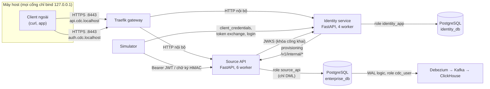
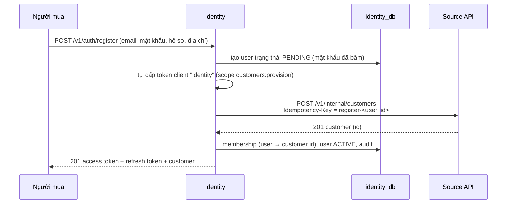
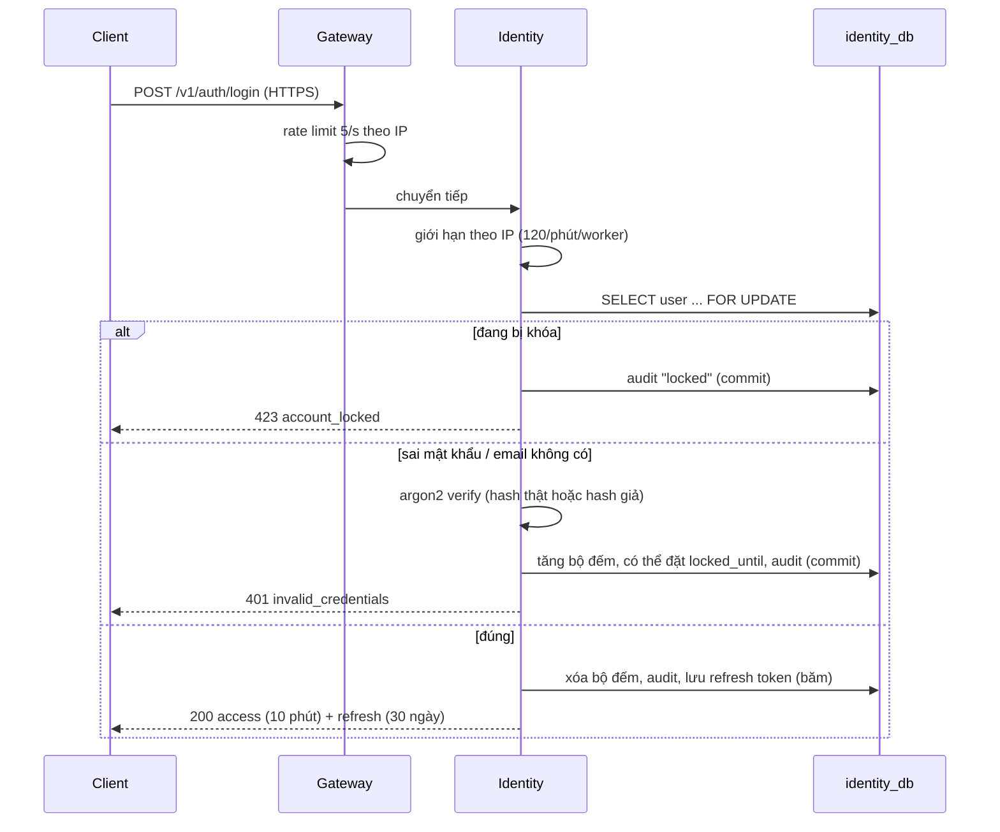
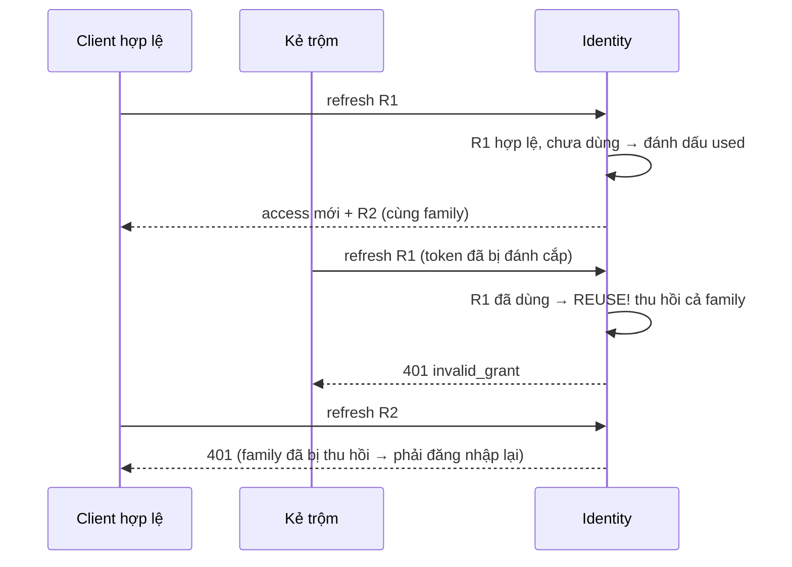
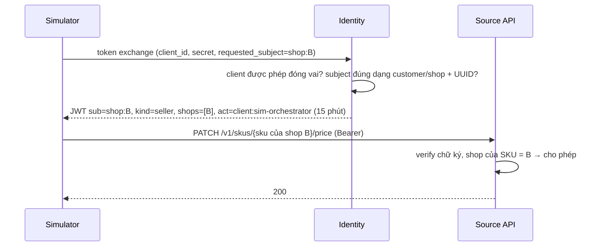

# 02 — Source API, Identity và bảo mật

[Tài liệu dự án](../README.md) / [Nghiệp vụ](README.md)

## Đọc file này để biết gì

File này giải thích **cổng ghi duy nhất** vào cơ sở dữ liệu nguồn (Source API) và mọi lớp bảo vệ quanh nó: ai được gọi API, chứng minh danh tính bằng cách nào (identity service, JWT, chữ ký HMAC của đối tác), API giữ dữ liệu đúng ra sao khi có nhiều request đồng thời (transaction, lock, idempotency, outbox), và bí mật (mật khẩu, khóa) được cất ở đâu. Cuối file là threat model: mỗi cơ chế chặn được kiểu tấn công nào, và những gì **chưa** được bảo vệ. Sau khi đọc, bạn có thể tự giải thích "một request đi từ client tới PostgreSQL như thế nào và bị kiểm tra ở những bước nào".

Luồng nghiệp vụ (giỏ hàng, checkout, thanh toán, giao hàng, đổi trả, ví người bán…) nằm ở [01-nghiep-vu-va-du-lieu-nguon.md](01-nghiep-vu-va-du-lieu-nguon.md). Phần dữ liệu đi tiếp sau PostgreSQL: [03-cdc-ingestion.md](../platform/03-cdc-ingestion.md), [04-warehouse.md](../platform/04-warehouse.md), [05-mart-va-metric.md](../platform/05-mart-va-metric.md); vận hành: [06-van-hanh.md](../operations/06-van-hanh.md). Bộ câu hỏi ôn tập: [Q&A · 02-source-api-va-bao-mat.md](../interview/02-source-api-va-bao-mat.md).

## Mục lục

1. [Bức tranh tổng thể](#1-bức-tranh-tổng-thể)
2. [Thiết kế Source API](#2-thiết-kế-source-api)
   - 2.1 Vì sao có một API là "người ghi duy nhất"
   - 2.2 Endpoint kiểu command và tiền tố /v1
   - 2.3 Một command = một transaction
   - 2.4 Chiến lược lock và cách tránh deadlock
   - 2.5 Idempotency-Key
   - 2.6 Outbox trong cùng transaction
   - 2.7 Mô hình lỗi
   - 2.8 Worker, connection pool và sức tải
   - 2.9 Background job chạy trong API
   - 2.10 Đồng hồ nghiệp vụ (business clock)
3. [Identity service](#3-identity-service)
4. [Phân quyền trong Source API](#4-phân-quyền-trong-source-api)
5. [Webhook của đối tác (HMAC)](#5-webhook-của-đối-tác-hmac)
6. [Gateway (Traefik)](#6-gateway-traefik)
7. [Quản lý secret](#7-quản-lý-secret)
8. [Phân quyền tối thiểu trong PostgreSQL](#8-phân-quyền-tối-thiểu-trong-postgresql)
9. [Simulator và test xác thực như thế nào](#9-simulator-và-test-xác-thực-như-thế-nào)
10. [Threat model](#10-threat-model)
11. [Những sự cố đã gặp và bài học](#11-những-sự-cố-đã-gặp-và-bài-học)
12. [Bảng tra nhanh](#12-bảng-tra-nhanh)

---

## 1. Bức tranh tổng thể



Ý chính:

- **Chỉ Source API ghi vào `enterprise_db`.** Simulator, test, identity service đều phải đi qua API. Nhờ vậy mọi thay đổi đều đi qua quy tắc nghiệp vụ và đều sinh ra một domain event trong outbox.
- **Identity service** là "nhà phát hành token" (issuer). Source API không biết mật khẩu, không gọi identity cho từng request; nó chỉ cần **khóa công khai** (JWKS) để tự kiểm chữ ký token.
- **Đối tác** (cổng thanh toán MOMO/VNPAY/NAPAS, hãng vận chuyển GHN/GHTK/SPX/J&T/VTP) không có token; họ ký từng callback bằng HMAC với khóa riêng.
- **Gateway** là cửa HTTPS duy nhất cho client bên ngoài; các service trong mạng Docker vẫn gọi nhau trực tiếp bằng HTTP.
- **Dữ liệu danh tính** (user, mật khẩu băm, refresh token, audit) ở database riêng `identity_db`, không bao giờ đi vào CDC.

---

## 2. Thiết kế Source API

### 2.1 Vì sao có một API là "người ghi duy nhất"

Trong dự án CDC, chất lượng dữ liệu ở warehouse phụ thuộc vào chất lượng dữ liệu nguồn. Nếu nhiều nơi ghi thẳng vào bảng (script seed, tool admin, simulator), sẽ có dòng dữ liệu "không có lý do" — ví dụ đơn hàng đổi trạng thái mà không có dòng lịch sử, hoặc tồn kho thay đổi mà không có movement. Gom mọi thao tác ghi vào một API giúp:

- mọi quy tắc (máy trạng thái đơn hàng, giới hạn voucher, không bán quá tồn kho…) được áp ở **một chỗ**;
- mỗi thay đổi đi kèm **một sự kiện nghiệp vụ** (outbox) trong cùng transaction;
- bảo mật đơn giản hơn: chỉ cần bảo vệ một cửa, và role database của API chỉ có quyền DML, không có DDL.

Ngay cả việc tạo dữ liệu ban đầu (danh mục, shop, khách hàng) cũng đi qua API — `init.sql` không seed dữ liệu nghiệp vụ nào.

### 2.2 Endpoint kiểu command và tiền tố /v1

API viết bằng **FastAPI**, các route nằm dưới **`/v1`**. Thiết kế theo kiểu **command** (hành động nghiệp vụ) thay vì CRUD thuần:

| Kiểu CRUD (không dùng) | Kiểu command (đang dùng) |
|---|---|
| `PATCH /orders/{id}` với `status=READY_TO_SHIP` | `POST /v1/orders/{id}/pack` |
| `PATCH /orders/{id}` với `status=CANCELLED` | `POST /v1/orders/{id}/cancel` (người mua) hoặc `/seller-cancel` (người bán) |
| `PUT /inventory/{sku}` | `POST /v1/skus/{id}/restock` |
| `POST /orders` | `POST /v1/checkouts` (tách giỏ thành nhiều đơn theo shop) |

Lý do: một command mang **ý định** ("người bán đóng gói"), nên API biết ai là actor (BUYER/SELLER/PAYMENT/LOGISTICS/SYSTEM), kiểm tra được bước chuyển có hợp lệ không, và ghi lịch sử với lý do. Client không thể "nhảy cóc" trạng thái bằng cách gửi một giá trị tùy ý.

Nhóm route chính: admin (danh mục, thương hiệu, voucher sàn, campaign, đồng hồ), seller (đăng sản phẩm, đổi giá, nhập kho, voucher shop, đóng gói, hủy), customer (địa chỉ, hồ sơ), cart, checkout + thanh toán, order, logistics (webhook vận chuyển, tra cứu kiện), returns + reviews, và **`/v1/internal/customers`**, **`/v1/internal/sellers`** chỉ dành cho identity service khi có người đăng ký.

**Route không version:** khi `AUTH_MODE` khác `enforce`, các router được gắn thêm một lần nữa không có `/v1` (ẩn khỏi OpenAPI) để client cũ còn chạy. Ở `enforce`, chúng biến mất hẳn — có test kiểm tra `GET /categories` (không `/v1`) trả 404.

### 2.3 Một command = một transaction

Mỗi command chạy trong **đúng một transaction PostgreSQL**: lấy một connection từ pool, chạy toàn bộ handler, **commit nếu thành công, rollback nếu có bất kỳ lỗi nào** (lỗi nghiệp vụ, lỗi phân quyền, lỗi SQL). Hệ quả:

- Không có trạng thái "làm dở": checkout tạo checkout + N đơn + order items + giữ tồn kho + dùng voucher + payment + sự kiện — hoặc tất cả cùng có, hoặc không có gì.
- Kiểm tra phân quyền có thể nằm **bên trong** transaction (ví dụ phải đọc SKU mới biết nó thuộc shop nào); nếu bị từ chối, mọi thứ đã làm cũng rollback.
- Debezium thấy từng transaction trọn vẹn trong WAL, nên phía warehouse có thể đọc dữ liệu "không bị xé" (xem [04-warehouse.md](../platform/04-warehouse.md)).

Một số lỗi ràng buộc (ví dụ email trùng) được bắt bằng **SAVEPOINT**: lùi về savepoint rồi trả lỗi nghiệp vụ 409 có mã rõ ràng thay vì để lỗi SQL thô lọt ra.

### 2.4 Chiến lược lock và cách tránh deadlock

Nhiều request cùng đụng một dòng (cùng SKU hot trong flash sale, cùng voucher, cùng đơn hàng nhận webhook trùng). API dùng lock dòng của PostgreSQL theo vài nguyên tắc:

**a) Lock dòng "chủ" trước khi đổi trạng thái — `FOR UPDATE`.**
Đổi trạng thái đơn, checkout, return, payment, ví shop đều bắt đầu bằng việc đọc dòng đó với `FOR UPDATE`, rồi **kiểm tra lại trạng thái dưới lock**. Ví dụ: job tự động hoàn tất đơn đã giao chọn ứng viên không lock, nhưng trước khi chuyển sang COMPLETED nó lock đơn và kiểm tra lại — nếu người mua vừa mở yêu cầu trả hàng thì bỏ qua.

**b) Đọc giá với `FOR SHARE`.**
Checkout đọc các SKU trong giỏ với `FOR SHARE`. Một lệnh đổi giá đang chạy (giữ `FOR UPDATE` trên SKU) sẽ khiến checkout chờ và đọc giá mới; lệnh đổi giá đến sau sẽ chờ checkout xong. Nhờ vậy giá trong đơn luôn là giá có hiệu lực tại thời điểm checkout. `FOR SHARE` chỉ xung đột với lệnh đổi giá (chỉ lock đúng một dòng), nên không tạo vòng lock.

**c) Giữ tài nguyên "nóng" muộn nhất có thể.**
Tồn kho, quota voucher và quota flash sale chỉ được **đọc không lock** trong lúc tính tiền; việc "lấy" thật sự diễn ra **ở cuối** transaction, mỗi thứ bằng một câu UPDATE có điều kiện (ví dụ "trừ tồn kho nếu còn đủ"). Nếu điều kiện không còn đúng, UPDATE không trúng dòng nào → lỗi 409 `out_of_stock` / `flash_sold_out` / `voucher_invalid`, và cả checkout rollback. Không bao giờ bán vượt, nhưng dòng hot chỉ bị lock vài mili giây.

**d) Thứ tự lock cố định ở mọi nơi.**
Deadlock xảy ra khi hai transaction lock cùng hai thứ theo thứ tự ngược nhau. API quy ước:

| Luồng | Thứ tự |
|---|---|
| Checkout | advisory lock "voucher của khách này" (chỉ khi có voucher) → giỏ hàng của khách → SKU (`FOR SHARE`, sắp theo id) → slot quota voucher (sắp theo voucher id) → tồn kho (sắp theo SKU id) → quota flash sale (sắp theo item id) |
| Webhook thanh toán | checkout → payment → các đơn (sắp theo id) |
| Hủy/hết hạn checkout | checkout → tồn kho các SKU (sắp theo id) → flash items (sắp theo id) |
| Trả lại quota voucher | theo (voucher id, slot) — giống thứ tự lấy |

Mọi danh sách đều được **sắp xếp trước khi lock**, nên hai checkout chứa cùng SKU A và B luôn lock A rồi B.

**e) Chi tiết tinh tế: `FOR NO KEY UPDATE` khi hủy checkout.** Khi hủy, API lock tồn kho và flash item với `FOR NO KEY UPDATE` thay vì `FOR UPDATE`. Lý do: một checkout khác đang chèn order item có foreign key trỏ tới flash item, nên giữ `KEY SHARE` trên dòng đó. `FOR UPDATE` xung đột với `KEY SHARE` và từng gây deadlock; `FOR NO KEY UPDATE` thì không (và đó cũng là mức lock mà câu UPDATE thường tự lấy).

**f) Chia nhỏ điểm nóng — quota voucher theo slot.** Một voucher sàn được hàng nghìn người dùng cùng lúc; nếu mọi checkout cùng UPDATE một dòng "đã dùng" thì sẽ xếp hàng. Quota được chia ra tối đa 16 dòng (slot); mỗi lần lấy chọn ngẫu nhiên một slot còn chỗ. Một lần thử chỉ chờ trên một dòng và không giữ lock nếu thất bại, nên không có vòng lock.

**g) Advisory lock theo khách hàng.** Giới hạn "mỗi khách dùng voucher tối đa N lần" cần tuần tự hóa các checkout **của cùng một khách**. API dùng `pg_advisory_xact_lock` trên khóa băm "voucher-customer:<id>": khách khác không bị chặn, và lock tự nhả khi transaction kết thúc.

**h) Lưới an toàn.** Nếu vẫn xảy ra deadlock hoặc serialization failure, toàn bộ command rollback và API trả **503 `retry`** với `Retry-After: 1`. Vì client gửi lại với cùng Idempotency-Key, việc thử lại là an toàn. Job nền gặp deadlock thì bỏ qua item đó, lượt sau làm lại.

Ví dụ: 50 người cùng mua SKU flash sale còn 10 suất. Cả 50 đều đọc được "còn 10", tính tiền song song; tới cuối, câu UPDATE "bán thêm nếu sold + qty ≤ quota" chỉ thành công cho 10 người, 40 người còn lại nhận 409 `flash_sold_out` và transaction của họ rollback sạch (không giữ tồn kho, không tốn voucher). Có test stress kiểm tra đúng tình huống này.

### 2.5 Idempotency-Key

Mạng có thể rớt sau khi server đã commit nhưng trước khi client nhận phản hồi. Nếu client gửi lại, đơn có thể bị tạo hai lần. Mọi command nhận header **`Idempotency-Key`**:

1. Khóa được ghép với **tiền tố riêng của người gọi** (16 ký tự đầu SHA-256 của `sub` trong token), rồi cắt tối đa 100 ký tự. Hai người dùng vô tình dùng cùng một chuỗi khóa sẽ không đụng nhau, và **không ai replay được phản hồi của người khác** (nếu dùng chung khóa toàn cục, kẻ đoán được khóa có thể đọc phản hồi checkout của người khác).
2. **Trong cùng transaction của command**, API chèn dòng (khóa, endpoint, hash nội dung request) vào bảng `idempotency_keys`, kiểu "chèn nếu chưa có".
3. Nếu chèn được → chạy handler → lưu mã HTTP và phản hồi vào chính dòng đó → commit cùng dữ liệu nghiệp vụ.
4. Nếu dòng đã tồn tại:
   - khác endpoint hoặc khác hash nội dung → **422 `idempotency_key_reused`** (dùng lại khóa cho request khác là lỗi của client);
   - giống → trả lại **phản hồi đã lưu**, kèm header `Idempotent-Replay: true`, không chạy lại gì.
5. Nếu request gốc **đang chạy** khi bản retry tới, câu chèn của bản retry phải chờ khóa unique của dòng đó: request gốc commit → bản retry thấy dòng và replay; request gốc rollback → bản retry chèn được và chạy lại từ đầu.
6. **Chỉ phản hồi thành công được lưu.** Command bị từ chối (409, 404, 403…) rollback luôn dòng khóa, nên lần thử sau chạy lại thật (ví dụ hết hàng lúc đầu, sau đó có hàng).
7. Dòng khóa được giữ **72 giờ theo đồng hồ thật** (không theo business clock, vì client retry theo thời gian thực), rồi job nền xóa dần (tối đa 5000 dòng mỗi lượt).

Bảng `idempotency_keys` bị loại khỏi CDC: nó là dữ liệu kỹ thuật, không phải nghiệp vụ.

Webhook cũng dùng cơ chế này: đối tác (trong simulator) gửi **event id của chính họ** làm Idempotency-Key, nên callback bị gửi lại sẽ được replay. Ngoài ra còn có chống trùng ở tầng nghiệp vụ (xem mục 5).

### 2.6 Outbox trong cùng transaction

Mỗi command ghi một **domain event** (ví dụ `OrderPlaced`, `PaymentSucceeded`, `SkuPriceChanged`) vào bảng `outbox_events` **trong cùng transaction** với thay đổi dữ liệu. Vì cùng transaction, không có trường hợp "dữ liệu đã đổi nhưng sự kiện không phát" hay ngược lại — đây là cách giải bài toán dual-write mà không cần distributed transaction.

Điểm đặc biệt: dòng outbox được **xóa ngay trong cùng transaction** sau khi chèn. Debezium đọc WAL nên vẫn thấy lệnh INSERT; Outbox Event Router chuyển nó thành message trên topic `events.<aggregatetype>` và bỏ qua lệnh DELETE. Bảng outbox vì vậy luôn rỗng, không cần job dọn. Thời điểm ghi sự kiện dùng business clock đọc **tại lúc gọi** (không phải lúc transaction bắt đầu), nên các sự kiện của cùng một aggregate được sắp đúng theo lúc chúng xảy ra. Chi tiết phía Kafka: [03-cdc-ingestion.md](../platform/03-cdc-ingestion.md).

### 2.7 Mô hình lỗi

Mọi lỗi trả về cùng một hình dạng JSON: trường `detail` chứa `code` (máy đọc được), `message` (người đọc) và có thể thêm chi tiết (ví dụ danh sách SKU thiếu hàng kèm số lượng còn).

| HTTP | Mã điển hình | Khi nào |
|---|---|---|
| 401 | `unauthenticated`, `invalid_signature` | Thiếu/sai/hết hạn token; webhook không ký, ký sai hoặc quá cũ. Có header `WWW-Authenticate: Bearer` |
| 403 | `insufficient_scope`, `wrong_partner` | Có danh tính nhưng thiếu quyền chung (người mua gọi danh sách toàn bộ khách); đối tác báo về giao dịch không phải của mình |
| 404 | `order_not_found`, `sku_not_found`, `cart_item_not_found`… | Không tồn tại **hoặc là của người khác** (xem 4.4) |
| 409 | `out_of_stock`, `invalid_transition`, `voucher_invalid`, `email_taken`, `payment_already_final`… | Vi phạm quy tắc nghiệp vụ |
| 422 | lỗi validate của FastAPI, `idempotency_key_reused` | Dữ liệu vào sai kiểu/giới hạn; dùng lại khóa cho request khác |
| 503 | `retry`, `db_busy` | Deadlock/serialization (thử lại được); hết connection DB sau 10 giây chờ. Có `Retry-After: 1` |

Identity service thêm: 401 `invalid_credentials` / `invalid_grant` / `invalid_client`, 400 `invalid_scope` / `invalid_request` / `unsupported_grant_type`, 409 `email_taken`, 423 `account_locked`, 429 `rate_limited`.

Quy ước cho client: 4xx là lỗi "của bạn", đừng thử lại nguyên xi; 5xx/503 thì thử lại **với cùng Idempotency-Key**.

### 2.8 Worker, connection pool và sức tải

- API chạy bằng uvicorn với **6 worker process** (mặc định của image là 2, compose đặt 6). Python chỉ dùng một core mỗi process (GIL); với 2 worker, load test chạm trần khoảng **380 request/giây** vì CPU của hai process đã bão hòa, không phải vì PostgreSQL.
- Mỗi worker có một connection pool tối đa **12 connection** → 6 × 12 = **72** trên tổng 200 connection của PostgreSQL, chừa chỗ cho Debezium, monitoring, identity, test.
- Endpoint là hàm đồng bộ, FastAPI chạy chúng trong threadpool. Pool của psycopg2 khi cạn sẽ **báo lỗi ngay**, nên API bọc thêm một semaphore cùng kích thước: request **xếp hàng** chờ connection, tối đa 10 giây, quá thì trả 503 `db_busy`. Đây là backpressure có kiểm soát thay vì lỗi ngẫu nhiên.
- Metrics Prometheus dùng chế độ multiprocess (thư mục chung, xóa sạch khi container khởi động) để gộp số liệu của cả 6 worker; histogram độ trễ có bucket mịn để đọc p99 của checkout so với SLO 300 ms.

### 2.9 Background job chạy trong API

Các quy tắc theo thời gian chạy như một thread nền **trong mỗi worker**, cứ 2 giây (đồng hồ thật) một lượt, với actor SYSTEM:

| Job | Làm gì |
|---|---|
| Hết hạn checkout chưa thanh toán | quá hạn thanh toán (15 phút business) → EXPIRED, trả tồn kho/voucher |
| Hủy do người bán trễ SLA | đơn TO_SHIP quá hạn đóng gói (2 ngày) → CANCELLED, shop bị cộng điểm phạt |
| Tự hoàn tất đơn đã giao | sau 3 ngày → COMPLETED |
| Bỏ giỏ hàng | giỏ có hàng, không động tới 1 ngày → ABANDONED |
| Tự duyệt trả hàng | người bán không trả lời trong 2 ngày |
| Đóng yêu cầu bị từ chối | người mua không khiếu nại trong 1 ngày |
| Cộng dồn ví & chi trả người bán | gom bút toán chờ vào số dư; payout tối đa 1 lần/ngày |
| Dọn Idempotency-Key | quá 72 giờ thật |

Vì cả 6 worker cùng chạy scheduler, mỗi item được xử lý trong **transaction riêng** và **kiểm tra lại trạng thái dưới lock**; worker "thua" sẽ gặp trạng thái đã đổi (hoặc lỗi nghiệp vụ/deadlock) và bỏ qua. Việc cộng dồn ví dùng `FOR UPDATE SKIP LOCKED` để các worker chia việc thay vì chờ nhau. Trade-off: đơn giản (không cần thêm service/cron), đổi lại làm việc trùng lặp một chút; có thể tắt bằng `RUN_JOBS=false`.

### 2.10 Đồng hồ nghiệp vụ (business clock)

Để một "ngày" mô phỏng trôi qua trong vài phút, mọi mốc thời gian nghiệp vụ dùng hàm `business_now()` trong PostgreSQL: thời gian = mốc neo + (thời gian thật đã trôi × tốc độ). Simulator đặt tốc độ mặc định 240×. Đổi tốc độ sẽ **neo lại** tại thời điểm hiện tại nên thời gian nghiệp vụ không nhảy. Đọc đồng hồ (`GET /v1/clock`) là công khai; đổi tốc độ (`PUT /v1/admin/clock`) cần scope `sim:clock`.

Liên quan tới bảo mật: những gì liên quan tới **thời gian thật** cố ý **không** dùng business clock — thời hạn token, cửa sổ chữ ký webhook (5 phút), TTL Idempotency-Key, khóa tài khoản. Nếu dùng business clock chạy 240×, cửa sổ chữ ký 5 phút sẽ thành 20 giờ thật.

---

## 3. Identity service

Một service FastAPI riêng (4 worker), database riêng `identity_db`, cấp token cho ba loại chủ thể: **người dùng** (người mua, người bán, ops, admin), **service client** (simulator, bộ test, chính identity), và **token "đóng vai"** (service hành động thay một khách/shop). Source API chỉ biết ba thứ: issuer, audience, URL JWKS — nên có thể thay identity bằng bất kỳ nhà cung cấp OIDC nào (Keycloak, Auth0…) mà không sửa logic phân quyền.

### 3.1 Đăng ký: một saga nhỏ

Đăng ký liên quan tới hai database (user ở `identity_db`, khách hàng/shop ở `enterprise_db`) nên không gói được trong một transaction. Identity làm theo kiểu **saga**:



- Bước 1 commit riêng: user ở trạng thái **PENDING**.
- Bước 2 gọi API **với token của chính identity** (scope `customers:provision` hoặc `sellers:provision`) và Idempotency-Key gắn với user id. Nếu bước 2 hoặc 3 lỗi giữa chừng, người dùng đăng ký lại cùng email: user PENDING được dùng lại, cùng Idempotency-Key, nên API **không tạo khách hàng thứ hai** mà replay kết quả cũ.
- Bước 3 gắn **membership** (user này "là" khách hàng X, hoặc chủ shop Y), chuyển ACTIVE, ghi audit và trả token luôn (đăng ký xong là đăng nhập).
- Email đã ACTIVE → 409 `email_taken`. Mật khẩu không bao giờ được gửi sang Source API.

Người bán đăng ký tương tự qua `/v1/auth/register/seller` → API tạo seller + shop + ví.

### 3.2 Đăng nhập: argon2id + pepper, khóa tài khoản

**Lưu mật khẩu:** mật khẩu trước hết được HMAC-SHA256 với **pepper** (một secret nằm trong file, không nằm trong database), rồi băm bằng **argon2id** với tham số tối thiểu OWASP (19 MiB bộ nhớ, 2 lượt). Ý nghĩa:

- argon2id là hàm băm "đắt" về bộ nhớ → brute-force bằng GPU tốn kém; mỗi hash có salt riêng.
- Pepper nằm ngoài DB → kẻ trộm được bản dump `identity_db` vẫn **không thể** thử mật khẩu offline nếu không có thêm file pepper.
- Khi đăng nhập thành công mà tham số băm đã cũ, hash được tính lại với tham số mới (rehash trong suốt).

**Chống dò tài khoản:** email không tồn tại vẫn bị cho chạy qua một lần verify argon2 với một hash giả, nên thời gian phản hồi giống hệt email có thật; thông báo lỗi cũng giống hệt: 401 `invalid_credentials` với message "Email or password is wrong" (nghĩa là "Email hoặc mật khẩu sai").

**Khóa tài khoản:** user bị lock dòng (`FOR UPDATE`) khi đăng nhập. Mỗi lần sai, bộ đếm tăng nếu lần sai đầu tiên còn trong cửa sổ 15 phút (không thì đếm lại từ 1). Đủ **10 lần sai trong 15 phút → khóa 15 phút**; trong thời gian đó, kể cả mật khẩu đúng cũng nhận **423 `account_locked`**. Đăng nhập đúng sẽ xóa bộ đếm.

Một lỗi từng gặp: ban đầu lỗi 401 được raise **bên trong** transaction, nên rollback luôn cả câu tăng bộ đếm — tài khoản không bao giờ bị khóa. Bản sửa: ghi nhận lỗi vào biến, để transaction **commit** bộ đếm, rồi mới trả lỗi sau khi ra khỏi transaction.

**Giới hạn theo IP:** mỗi worker giữ trong bộ nhớ số lần login theo IP (mặc định 120/phút) → 429. Gateway còn chặn chặt hơn (5 request/giây cho đường login).



### 3.3 Token: access token và refresh token xoay vòng

**Access token** là JWT ký **EdDSA (Ed25519)**, sống **10 phút** với người dùng (15 phút với service client và token exchange). Các claim:

| Claim | Ý nghĩa |
|---|---|
| `iss`, `aud` | nhà phát hành (identity) và người nhận (`source-api`) |
| `sub` | id user (hoặc `client:<id>`, hoặc `customer:<uuid>`/`shop:<uuid>` với token exchange) |
| `iat`, `nbf`, `exp`, `jti` | thời điểm cấp, hiệu lực từ, hết hạn, id duy nhất |
| `kind` | customer / seller / ops / admin / service |
| `cid` | id khách hàng mà user này là |
| `shops` | danh sách shop user này sở hữu |
| `scope` | quyền chung: `admin`, `ops:read`, `pii:read`, `sim:clock`, `customers:provision`, `sellers:provision` |
| `act` | (token exchange) ai thực sự đang gọi |

Claim được tính từ bảng **memberships** lúc cấp token: có membership admin → `kind=admin` và scope admin/ops:read/pii:read; ops → ops:read; có shop → seller; còn lại là customer.

**Refresh token** là chuỗi ngẫu nhiên 32 byte (không phải JWT), sống 30 ngày. DB chỉ lưu **SHA-256** của nó (lộ DB không lộ token dùng được), kèm `family` (một phiên đăng nhập), `used_at`, `revoked_at`.



- **Xoay vòng (rotation):** mỗi lần refresh, token cũ bị đánh dấu đã dùng và một token mới cùng family được cấp.
- **Phát hiện dùng lại (reuse detection):** nếu một token **đã dùng** được gửi lại, chỉ có hai khả năng — bị đánh cắp, hoặc bị replay. Identity không biết ai là người thật, nên **thu hồi cả family**: cả kẻ trộm lẫn người thật đều phải đăng nhập lại. Việc thu hồi phải được **commit**, nên nhánh này trả phản hồi 401 trực tiếp từ bên trong transaction thay vì raise lỗi (raise sẽ rollback mất việc thu hồi).
- Refresh cũng từ chối nếu user không còn ACTIVE. **Logout** thu hồi cả family của token được gửi.

### 3.4 Service client: client_credentials

Ba client được khai báo cố định, secret của mỗi client là một file `secrets/clients/<id>`:

| Client | Scope | Được đóng vai (exchange)? | Dùng cho |
|---|---|---|---|
| `sim-orchestrator` | admin, ops:read, sim:clock | có | simulator |
| `quality` | admin, ops:read, pii:read, sim:clock | có | bộ test |
| `identity` | customers:provision, sellers:provision | không | identity tự gọi API khi có người đăng ký |

Client gửi `client_id` + `client_secret` tới `/v1/auth/token` (form OAuth2) với `grant_type=client_credentials`. Secret được so bằng phép so sánh thời gian hằng (constant-time). Client có thể xin **ít scope hơn** nhưng không thể xin scope ngoài danh sách của mình → 400 `invalid_scope` (có test: client `quality` xin `customers:provision` bị từ chối).

### 3.5 Token exchange: service "đóng vai" một khách hoặc shop

Simulator mô phỏng hàng nghìn người mua và người bán. Nếu nó dùng token admin cho mọi việc, các kiểm tra quyền sở hữu sẽ không bao giờ được thử. Vì vậy nó đổi token: gửi `grant_type=urn:ietf:params:oauth:grant-type:token-exchange` và `requested_subject=customer:<uuid>` (hoặc `shop:<uuid>`). Identity trả token:

- `sub` = `customer:<uuid>`, `kind=customer`, `cid=<uuid>` (hoặc `kind=seller`, `shops=[<uuid>]`);
- **không có scope nào** — nên token này không làm được việc admin;
- claim `act` = `client:sim-orchestrator` ghi lại ai thật sự đang hành động.



Đây là biến thể **giản lược** của RFC 8693: chuẩn yêu cầu gửi kèm `subject_token` (token của người bị đóng vai); ở đây client được tin cậy dựa vào secret của nó và cờ "impersonate". Chỉ `sim-orchestrator` và `quality` có cờ này; chúng vốn đã có scope admin nên việc đóng vai không mở rộng quyền, mà ngược lại **thu hẹp** quyền để test được phân quyền như người dùng thật.

### 3.6 Khóa ký EdDSA và JWKS

- Khóa riêng Ed25519 được **sinh một lần** lúc identity khởi động lần đầu và lưu trong volume `identity_keys` (quyền file 600). Bốn worker khởi động cùng lúc nên việc sinh khóa được bảo vệ bằng file lock để chỉ một worker sinh.
- `kid` (id khóa) là 16 ký tự đầu của chuỗi base64url (bỏ dấu `=`) mã hóa SHA-256 của khóa công khai.
- Khóa công khai được công bố tại `/.well-known/jwks.json`; có cả `/.well-known/openid-configuration` (discovery).
- **Vì sao EdDSA (bất đối xứng) thay vì HS256 (khóa chung)?** Với HS256, ai kiểm được token cũng **ký** được token — Source API, và mọi service sau này, sẽ phải giữ khóa bí mật. Với EdDSA, chỉ identity có khóa riêng; các bên khác chỉ cần khóa công khai. Ed25519 còn nhanh, chữ ký ngắn, không có bẫy tham số như ECDSA.

Phía Source API: đọc `kid` trong header, tìm khóa trong cache; nếu gặp `kid` lạ thì tải lại JWKS, **tối đa 30 giây một lần** (để kẻ tấn công gửi `kid` rác không biến API thành công cụ spam identity). Sau đó verify với: thuật toán **chỉ EdDSA** (chặn tấn công `alg=none` hay nhầm lẫn thuật toán), đúng issuer, đúng audience, bắt buộc có exp/iat/sub/aud/iss, cho lệch đồng hồ 60 giây. Vì verify hoàn toàn cục bộ, **API vẫn chạy khi identity tạm chết** (chỉ đăng nhập/refresh/khóa mới là không được).

### 3.7 identity_db tách riêng, ngoài CDC

User, membership, refresh token, audit nằm trong database **`identity_db`**, do role `identity_app` sở hữu; role này không connect được vào database nào khác, và `enterprise_db` thì không cho nó connect. Lý do then chốt: **publication của PostgreSQL thuộc về một database**. Publication CDC nằm ở `enterprise_db`, nên không có cách nào cấu hình sai khiến hash mật khẩu hay refresh token chảy vào Kafka/warehouse. Đó là ranh giới vật lý, không phụ thuộc vào việc nhớ thêm bảng vào danh sách loại trừ.

Bảng `audit` ghi sự kiện đăng ký, đăng nhập (ok / bad_password / locked), refresh (kể cả reuse_detected), logout. Metrics: `identity_logins_total{outcome}`, `identity_tokens_total{grant}`; alert `LoginFailuresHigh` khi phần lớn login thất bại.

Tài khoản admin `admin@cdc.local` được tạo một lần khi khởi động, mật khẩu lấy từ `secrets/admin_password`.

---

## 4. Phân quyền trong Source API

### 4.1 Principal được dựng cho từng request

Một dependency áp cho **toàn bộ app** chạy trước mọi endpoint:

1. Có header `Authorization: Bearer …` → verify JWT (mục 3.6) → dựng **Principal**: `sub`, `kind`, `customer_id`, tập `shop_ids`, tập `scopes`, `actor`.
2. Không có token và route là **công khai** hoặc **webhook ký** → Principal ẩn danh.
3. Không có token ở route khác → 401 `unauthenticated`.

Principal được đặt vào một **context variable** để handler, các hàm kiểm tra quyền và lớp idempotency đọc được mà không phải truyền tham số qua mọi hàm. Dependency được viết dạng async để context variable nó đặt chính là context mà thread chạy endpoint kế thừa.

Có một principal đặc biệt "system" (dùng khi `AUTH_MODE=off` và cho job nền) được coi như admin.

### 4.2 AUTH_MODE: off | permissive | enforce

| Chế độ | Hành vi | Dùng khi |
|---|---|---|
| `off` | Không kiểm gì, mọi request là "system" | Chế độ cũ, trước khi có identity |
| `permissive` | Mọi quyết định vẫn được tính và đếm vào `auth_decisions_total{outcome="would_deny"}`, nhưng chỉ **ghi log**, không chặn | Giai đoạn chuyển đổi: bật lên, quan sát xem client nào sẽ bị chặn |
| `enforce` | Từ chối thật bằng 401/403/404 | Mặc định khi chạy bằng compose (`.env` và `source/compose.yml` đặt `enforce`) |

Đây là cách triển khai phân quyền an toàn cho hệ thống đang chạy: bật `permissive`, chạy simulator, xác nhận **0 would-deny**, rồi mới chuyển `enforce`. Thực tế dự án: simulator gây 0 lượt từ chối và bộ test auth 11/11 + test API đều qua ở `enforce`. Lưu ý: nếu biến `AUTH_MODE` không được đặt, chính code của API rơi về `off`; `enforce` chỉ là mặc định do `.env` và `source/compose.yml` cung cấp. Với **JWT Bearer**, token sai chữ ký luôn bị 401 ở cả permissive lẫn enforce. **Chữ ký HMAC của webhook** thì khác: chữ ký sai đi qua cùng cơ chế từ chối như phân quyền, nên ở permissive nó chỉ được đếm và ghi log rồi request vẫn chạy tiếp; ở off, webhook hoàn toàn không được kiểm.

### 4.3 Các loại kiểm tra

| Kiểm tra | Ai qua | Ví dụ route |
|---|---|---|
| Cần scope | admin, hoặc có đúng scope | tạo danh mục/campaign/voucher sàn (`admin`), danh sách khách hàng, thống kê, danh sách kiện hàng (`ops:read`), đổi tốc độ đồng hồ (`sim:clock`), provisioning (`customers:provision`, `sellers:provision`) |
| Là chính khách đó (ghi) | admin, hoặc `cid` của token = khách hàng của tài nguyên | thêm địa chỉ, sửa giỏ, checkout, hủy đơn, xác nhận đã nhận, yêu cầu trả hàng, khiếu nại, đánh giá |
| Là chủ shop (ghi) | admin, hoặc shop của tài nguyên ∈ `shops` của token | đăng sản phẩm, đổi giá, nhập kho, voucher shop, đóng gói, người bán hủy, duyệt/từ chối/kiểm hàng trả |
| Đọc của khách / của shop | như trên, **cộng thêm** ops (`ops:read`) | xem hồ sơ khách, xem checkout, giỏ đang mở |
| Đọc thứ "giữa hai bên" | người mua của đơn, shop của đơn, ops, admin | xem đơn, xem kiện hàng, xem yêu cầu trả hàng |
| Danh sách | ops thấy tất cả; người mua chỉ dòng của mình; người bán chỉ shop của mình | `GET /orders`, `GET /returns` |

**customer_id / shop_id trong body:** vì lý do tương thích, nhiều command vẫn nhận `customer_id` hoặc `shop_id` trong body. Quy tắc: nếu bỏ trống, API **lấy từ token**; nếu có, nó **phải khớp** token (không khớp → 404). Người bán sở hữu nhiều shop thì phải ghi rõ shop.

**Che PII khi ops đọc:** người có `ops:read` đọc được dữ liệu của mọi người, nhưng tên, email, số điện thoại, tên người nhận, địa chỉ bị che (giữ ký tự đầu và vài ký tự cuối, hoặc phần sau `@` của email). Muốn thấy rõ phải có `pii:read` (hoặc admin). Người mua xem dữ liệu của chính mình thì thấy rõ. Lưu ý: theo code hiện tại, **người bán** xem đơn của shop mình cũng thấy tên/địa chỉ người nhận bị che (chỉ `kind=customer` mới được miễn).

**Danh bạ shop công khai:** `GET /shops` ai cũng xem được, nhưng số dư ví chỉ hiện với ops và chính shop đó.

### 4.4 Vì sao tài nguyên của người khác trả 404 chứ không phải 403

Nếu người lạ hỏi đơn `X` và nhận 403 "không có quyền", họ vừa biết được **đơn X tồn tại**. Với id tuần tự hoặc mã đơn đoán được, đó là rò rỉ thông tin (enumeration). Vì vậy kiểm tra quyền sở hữu thất bại trả **404 với đúng mã như khi không tồn tại** (`order_not_found`, `sku_not_found`…): kẻ dò không phân biệt được "không có" với "không phải của bạn".

Còn 403 dùng khi việc **route đó tồn tại** không phải bí mật và vấn đề là **vai trò**: người mua gọi `GET /customers` (danh sách toàn bộ khách) → 403 `insufficient_scope`.

Ví dụ cụ thể (đều có trong test):

- Người bán shop A gọi đổi giá một SKU của shop B → API lock SKU, thấy nó thuộc shop B, không nằm trong `shops` của token → **404 `sku_not_found`**, transaction rollback.
- Người mua B sửa số lượng dòng giỏ hàng của người mua A → **404 `cart_item_not_found`**.
- Người mua B xem hoặc hủy đơn của A → 404; shop khác đóng gói đơn đó → 404.
- Người mua B thêm hàng vào giỏ nhưng ghi `customer_id` của A trong body → 404.
- Người mua gọi `/stats` hoặc `/customers` → 403.

### 4.5 Route công khai

Không cần token: `/health`, `/metrics`, danh mục, thương hiệu, voucher đang chạy, campaign và sản phẩm của campaign, danh sách SKU, danh sách shop, đồng hồ, `/docs`, `/openapi.json`. Đây là "catalogue" mà một người chưa đăng nhập cũng phải xem được. Hai route webhook không cần token nhưng **cần chữ ký**. Gateway không định tuyến `/health` và `/metrics` ra ngoài.

---

## 5. Webhook của đối tác (HMAC)

Cổng thanh toán và hãng vận chuyển gọi lại API để báo "đã thanh toán", "đã lấy hàng", "giao thành công"… Họ không đăng nhập; mỗi đối tác có một **khóa bí mật riêng** (`secrets/webhooks/MOMO`, `VNPAY`, `NAPAS`, `GHN`, `GHTK`, `SPX`, `JT`, `VTP`), mà cả hai bên đều giữ.

**Định dạng:** header `X-Partner` (tên đối tác, ví dụ `MOMO`; J&T chuẩn hóa thành `JT`) và `X-Signature: t=<unix giây>,v1=<hex>`, trong đó giá trị v1 là HMAC-SHA256 với khóa của đối tác, tính trên chuỗi "t" + "." + **thân request thô** (từng byte).

**API kiểm tra:**

1. Tìm khóa theo `X-Partner` (từ chối tên có dấu `/`).
2. Có `t` và `v1`, `t` là số.
3. **Độ tươi:** |đồng hồ thật hiện tại − t| ≤ 300 giây.
4. Tính lại HMAC và so sánh **thời gian hằng**.
5. Sai bất kỳ bước nào → 401 `invalid_signature`.
6. Đúng → principal là `partner:<tên>`.
7. Trong handler, sau khi tìm giao dịch: **đối tác phải là đơn vị xử lý giao dịch đó**. Thanh toán ví (WALLET) đi qua MOMO, thẻ (CARD) qua VNPAY, chuyển khoản qua NAPAS; kiện hàng thì theo hãng vận chuyển được gán. Sai → **403 `wrong_partner`**.

```mermaid
sequenceDiagram
    participant P as MOMO
    participant API as Source API
    participant DB as PostgreSQL
    P->>API: POST /v1/payments/webhook<br/>X-Partner: MOMO, X-Signature: t=..., v1=HMAC(t.body)<br/>Idempotency-Key: event id
    API->>API: khóa MOMO, t trong ±5 phút, HMAC khớp?
    API->>DB: BEGIN; claim Idempotency-Key
    API->>DB: lock checkout → lock payment
    API->>API: provider của payment = MOMO?
    alt trạng thái đã là kết quả này
        API-->>P: 200 duplicate_ignored
    else
        API->>DB: cập nhật payment, checkout PAID, đơn → TO_SHIP, outbox; COMMIT
        API-->>P: 200 paid
    end
```

**Vì sao ký cả thân request và timestamp?** Ký thân → không sửa được nội dung (đổi FAILED thành SUCCEEDED). Ký timestamp → không thể lấy một callback cũ ghi được hôm qua gửi lại hôm nay. Ký trên **byte thô** chứ không phải JSON đã parse, vì parse-rồi-serialize lại có thể đổi thứ tự key/khoảng trắng.

**Replay trong cửa sổ 5 phút** thì sao? Chữ ký vẫn hợp lệ, nhưng request được xử lý **idempotent ở hai tầng**: (1) cùng Idempotency-Key → replay phản hồi cũ; (2) tầng nghiệp vụ: thanh toán đã ở đúng trạng thái → `duplicate_ignored`; sự kiện vận chuyển có `carrier_event_id` đã thấy → `duplicate_ignored`; sự kiện cũ hơn sự kiện mới nhất đã áp → lưu nhưng không áp (`stale_ignored`). Thanh toán thành công tới muộn (checkout đã hết hạn/hủy) → tự hoàn tiền (`refunded_late_payment`). Không có kho nonce, nên hệ thống dựa vào tính idempotent của nghiệp vụ.

**Có test** (khi enforce): webhook không ký → 401; sửa timestamp → 401; VNPAY báo về giao dịch MOMO → 403; MOMO ký đúng → `paid`.

---

## 6. Gateway (Traefik)

Traefik v3 là cửa HTTPS cho client bên ngoài, lắng nghe **chỉ trên 127.0.0.1:8443**.

| Hạng mục | Cấu hình |
|---|---|
| Hostname | `api.cdc.localhost` → Source API; `auth.cdc.localhost` → identity. `*.localhost` tự trỏ về 127.0.0.1 |
| TLS | chứng chỉ do **CA cục bộ** ký (`setup-env.sh` tạo `secrets/tls`: CA 10 năm, chứng chỉ server 825 ngày, SAN gồm api/auth/app.cdc.localhost và localhost); TLS tối thiểu 1.2. Tin `secrets/tls/ca.crt` để gọi không cần `-k` |
| Định tuyến | API: chỉ `/v1/…` và `/docs`, `/openapi.json`. Identity: `/v1/auth/…` và `/.well-known/…`. **Không** ra ngoài: `/health`, `/metrics` |
| Rate limit (theo IP) | login: trung bình 5/s, burst 10; phần còn lại của identity: 50/s, burst 100; API: 300/s, burst 600 |
| CORS | chỉ origin `https://app.cdc.localhost`; method GET/POST/PUT/PATCH/DELETE; header Authorization, Content-Type, Idempotency-Key; cache preflight 10 phút |
| Security header | HSTS 1 năm, `X-Content-Type-Options: nosniff`, `X-Frame-Options: DENY`, `Referrer-Policy: no-referrer`, xóa header `Server` |
| Log | access log JSON nhưng **bỏ toàn bộ header** → không ghi `Authorization` vào log |
| Health check | Traefik tự gọi `/health` nội bộ để loại backend chết |

Vì sao rate limit login thấp hơn nhiều so với API? Một người thật không đăng nhập 5 lần mỗi giây; đường login là mục tiêu brute-force/credential stuffing. Gateway chặn số lượng, identity khóa từng tài khoản — hai lớp bổ sung nhau.

Lưu ý: các service bên trong mạng Docker (simulator, test, identity gọi API) **không đi qua gateway** và nói chuyện bằng HTTP thường. Các cổng trực tiếp `127.0.0.1:8100` (API) và `127.0.0.1:8300` (identity) vẫn mở cho máy host (tiện debug, xem `/docs`) — chúng bỏ qua TLS và rate limit của gateway.

---

## 7. Quản lý secret

### 7.1 Nguyên tắc: mỗi secret một file

Mọi secret nằm trong thư mục **`secrets/`** (có trong `.gitignore`), **mỗi secret một file**: mật khẩu các role PostgreSQL, ClickHouse, Grafana (admin và reader), PII salt, khóa S3 của tầng lưu trữ lạnh, pepper mật khẩu, mật khẩu admin của identity, secret của từng service client (`clients/`), khóa webhook của từng đối tác (`webhooks/`), và chứng chỉ TLS (`tls/`). File `.env` chỉ còn thiết lập **không bí mật** như `AUTH_MODE`.

Mỗi container chỉ mount **những file nó cần**, read-only, dưới `/run/secrets`. Ví dụ: Source API chỉ thấy mật khẩu role `source_api` và thư mục khóa webhook; simulator chỉ thấy secret của `sim-orchestrator` và khóa webhook (vì nó đóng vai đối tác); identity thấy mật khẩu DB của nó, pepper, mật khẩu admin và thư mục secret client.

### 7.2 Cách từng thành phần đọc secret

| Thành phần | Cách đọc |
|---|---|
| PostgreSQL | `POSTGRES_PASSWORD_FILE` (tính năng có sẵn của image) |
| Source API, identity, warehouse jobs, Control Center, exporter, test | biến `XXX_FILE` trỏ tới file; code đọc biến `XXX` nếu có, không thì đọc file |
| ClickHouse | `CLICKHOUSE_PASSWORD_FILE` |
| Grafana | `GF_SECURITY_ADMIN_PASSWORD__FILE` (hậu tố `__FILE` của Grafana); datasource dùng cú pháp `$__file{...}` |
| Kafka Connect / Debezium | **DirectoryConfigProvider**: cấu hình connector ghi mật khẩu là một tham chiếu kiểu "lấy file cdc_db_password trong /run/secrets"; worker Connect thay giá trị lúc chạy, nên REST API và topic cấu hình của Connect chỉ lưu tham chiếu, không lưu mật khẩu |
| Mật khẩu các role DB | script init đọc file và `ALTER ROLE … PASSWORD` |

### 7.3 Vì sao không có secret nào trong `docker inspect`

Nếu truyền mật khẩu qua biến môi trường, nó hiện trong `docker inspect`, trong `/proc/<pid>/environ`, trong file compose, và hay bị in ra log khi debug. Với `*_FILE`, môi trường chỉ chứa **đường dẫn** (`/run/secrets/...`); nội dung chỉ đọc được từ bên trong container có mount file đó. File compose cũng không chứa giá trị nào nên commit an toàn.

### 7.4 setup-env.sh làm gì

- Tạo `secrets/` với giá trị ngẫu nhiên (24 byte từ `/dev/urandom`, dạng hex), `umask 077` khi tạo.
- **Không bao giờ ghi đè** file đã có: chạy lại chỉ bổ sung cái còn thiếu (an toàn với stack đang chạy).
- **Di cư:** nếu `.env` cũ còn chứa mật khẩu, giá trị đó được **chuyển** sang file và xóa khỏi `.env`, để stack đang chạy giữ nguyên mật khẩu.
- Ghi file không có ký tự xuống dòng cuối (Debezium đọc nguyên văn file).
- Tạo `.env` từ `.env.example` nếu chưa có; bảo đảm có `AUTH_MODE`.
- Tạo pepper, mật khẩu admin, secret 3 client, khóa 8 đối tác, CA + chứng chỉ server.
- Cuối cùng chmod để user trong container đọc được (thư mục 755, file 644), **trừ khóa riêng của CA**.

Đổi một secret trên volume đã có: sửa file rồi chạy `./observability/start.sh` (áp lại role, mật khẩu, mật khẩu Grafana, cấu hình connector) — script init của PostgreSQL chỉ chạy khi volume còn trống.

**PII salt** là ngoại lệ: nó là một phần của **tên** khóa cấu hình masking trong Debezium, mà config provider chỉ thay được **giá trị**, nên `debezium/register.sh` (hoặc Control Center) phải chèn salt vào cấu hình lúc đăng ký connector. Hệ quả: salt **có** nằm trong cấu hình connector lưu ở Kafka Connect.

### 7.5 Cổng chỉ bind 127.0.0.1

Mọi cổng publish ra host (PostgreSQL 5432, API 8100, identity 8300, simulator 8200, Adminer 8081, Kafka 29092, Schema Registry 8085, Kafka UI 8080, Connect 8083, Control Center 8000, ClickHouse 8123/9000, Grafana 3000, Prometheus 9090, Alertmanager 9093, gateway 8443) đều bind **127.0.0.1**. Máy khác trong cùng mạng LAN/Wi-Fi không truy cập được, kể cả các UI không có đăng nhập. Mặc định của Docker (`0.0.0.0`) còn **vượt qua firewall của host** trên Linux, nên đây là thay đổi quan trọng.

---

## 8. Phân quyền tối thiểu trong PostgreSQL

### 8.1 Các role

| Role | Quyền | Ai dùng |
|---|---|---|
| `admin` | superuser (chủ sở hữu schema, chạy DDL/init) | chỉ init, Adminer, bộ test kiểm dữ liệu |
| `source_api` | SELECT/INSERT/UPDATE/DELETE trên mọi bảng `ecommerce` + dùng sequence; **không sở hữu gì, không DDL** | Source API |
| `app_reader` | chỉ SELECT, mặc định transaction read-only, có `pg_monitor` (đọc độ trễ slot) | warehouse-jobs (đối soát), Control Center |
| `monitor_reader` | `pg_monitor`, read-only | exporter giám sát |
| `cdc_user` | `REPLICATION` + SELECT trên `ecommerce`; chỉ ghi vào bảng heartbeat và signal của chính Debezium; **không phải superuser** | Debezium |
| `identity_app` | sở hữu `identity_db`, không connect được `enterprise_db` | identity service |

Thêm: **`REVOKE CONNECT ON DATABASE … FROM PUBLIC`** cho cả `enterprise_db` và `identity_db`, rồi chỉ GRANT CONNECT cho đúng role cần. Mặc định PostgreSQL cho **mọi role** connect vào mọi database; bỏ quyền đó đảm bảo `identity_app` không vào được dữ liệu nghiệp vụ và ngược lại.

Vì sao `source_api` không được DDL? Nếu API bị chiếm (SQL injection chẳng hạn), kẻ tấn công không thể `DROP TABLE`, `ALTER TABLE`, tạo function, hay đổi publication/REPLICA IDENTITY. Ngay cả `REPLICA IDENTITY` cũng được đặt bởi chủ bảng trong `init.sql`, vì `cdc_user` không có quyền ALTER.

`pg_hba.conf`: kết nối qua socket nội bộ container được `trust` (dùng cho script init), mọi kết nối TCP (kể cả replication) bắt buộc **scram-sha-256**.

### 8.2 Thứ tự script init 01–05 và vì sao đánh số

Image postgres chạy các file trong `docker-entrypoint-initdb.d` theo thứ tự tên, **chỉ khi volume trống**:

| File | Nội dung | Phụ thuộc |
|---|---|---|
| `01-init.sql` | schema, bảng, business clock, publication, REPLICA IDENTITY, role `cdc_user` | — |
| `02-monitoring.sql` | role `monitor_reader` | — |
| `03-roles.sql` | role `source_api`, `app_reader`; REVOKE CONNECT FROM PUBLIC; GRANT cho cả `cdc_user`, `monitor_reader` | cần 01 và 02 đã tạo role |
| `04-passwords.sh` | đặt mật khẩu mọi role từ file secret | cần mọi role đã tồn tại |
| `05-identity.sh` | role `identity_app`, database `identity_db` | — |

Sự cố từng gặp: tên cũ là `02a-roles` và `02-monitoring`. Entrypoint sắp tên file bằng glob theo collation của locale, mà collation này **bỏ qua dấu câu** (`-`, `.`) khi so sánh, nên "02a-roles" được xếp **trước** "02-monitoring". Script roles chạy khi `monitor_reader` chưa tồn tại → GRANT lỗi → init của volume mới thất bại. Giải pháp: dùng tiền tố số thuần 01–05 để thứ tự đúng với **mọi** collation. Các script roles/passwords/identity đều idempotent, nên `observability/start.sh` có thể chạy lại chúng trên volume đã có.

---

## 9. Simulator và test xác thực như thế nào

**Simulator** (client HTTP trong `source/simulator/sim/client.py`):

- Dùng client `sim-orchestrator`: token **client_credentials** cho việc admin và đọc danh sách toàn cục; token **exchange** cho từng khách/shop mà actor đang đóng vai (`customer:<id>`, `shop:<id>`). Nhờ vậy API kiểm quyền sở hữu y như với người dùng thật.
- **Cache token** theo subject cho tới **1 phút trước khi hết hạn**; cache giới hạn 20.000 mục (bỏ mục ít dùng nhất).
- Đăng ký khách/người bán **qua identity** (không gọi thẳng API). Mật khẩu của user giả được **suy ra** từ secret của client bằng HMAC trên email, nên không phải lưu ở đâu.
- Một phần phiên mua hàng bắt đầu bằng **đăng nhập mật khẩu thật**, thỉnh thoảng cố tình gõ sai (để có dữ liệu cho metric và lockout); còn lại dùng token exchange.
- **Retry khi 401:** bỏ token trong cache, lấy token mới **một lần**, rồi thôi (token hết hạn hoặc khóa ký bị xoay).
- Retry 5xx/lỗi mạng với backoff lũy thừa, **giữ nguyên Idempotency-Key** (mỗi command một khóa UUID; webhook dùng event id của đối tác).
- Webhook được **ký lại ở mỗi lần gửi** (timestamp mới), giống đối tác thật.

**Bộ test** (`quality/`): `test_source_api.py` dựng dữ liệu bằng client `quality` (admin) và ký webhook bằng khóa đối tác; `test_auth.py` (11 test) dùng **người dùng thật**: đăng ký qua identity, gọi API với token của họ, và đóng vai shop bằng token exchange. Các test bao phủ: gọi ẩn danh, token giả/hỏng, mua hộ người khác, xem đơn người khác, người bán sửa SKU shop khác, webhook ký sai/đối tác sai, Idempotency-Key tách theo người gọi, route không version đã bị bỏ, refresh rotation + reuse, khóa tài khoản, client xin vượt scope.

---

## 10. Threat model

### 10.1 Mỗi cơ chế chặn được gì

| Mối đe dọa | Cơ chế chặn |
|---|---|
| Gọi API không đăng nhập | Dependency toàn app: route không công khai cần Bearer → 401 |
| Giả mạo token, sửa claim (tự thêm `admin`) | Chữ ký EdDSA; khóa riêng chỉ ở identity |
| `alg=none`, nhầm thuật toán | Chỉ chấp nhận EdDSA |
| Token cấp cho hệ thống khác dùng ở đây | Kiểm `aud=source-api` và `iss` |
| Token cũ bị lộ | Sống 10–15 phút |
| Refresh token bị đánh cắp | Rotation + reuse detection thu hồi cả phiên; DB chỉ lưu hash |
| Mua hộ/xem đơn/sửa giỏ của người khác (IDOR) | Kiểm quyền sở hữu theo `cid`/`shops` trong token; body phải khớp token |
| Dò xem tài nguyên có tồn tại | Trả 404 giống hệt "không tồn tại" |
| Người bán động vào shop khác | Kiểm shop của tài nguyên ∈ `shops` |
| Nhân viên ops xem trộm dữ liệu cá nhân | Che PII nếu không có `pii:read` |
| Lấy phản hồi của người khác qua Idempotency-Key | Khóa có tiền tố theo người gọi |
| Gửi webhook giả "đã thanh toán" | HMAC với khóa riêng từng đối tác |
| Sửa nội dung webhook | HMAC trên toàn bộ thân thô |
| Replay webhook cũ | Cửa sổ 5 phút + idempotency nghiệp vụ |
| Đối tác này báo hộ giao dịch của đối tác khác | Kiểm provider/carrier của giao dịch → 403 |
| Brute-force mật khẩu online | Rate limit gateway, limit theo IP, khóa tài khoản sau 10 lần |
| Dò email đã đăng ký qua login | Thông báo và thời gian phản hồi giống nhau |
| Lộ DB identity | argon2id + pepper ngoài DB; refresh token lưu hash |
| Lộ secret qua `docker inspect`/compose/git | Secret là file, gitignored, mount read-only |
| SQL injection/RCE ở API phá schema | Role `source_api` không DDL, không superuser |
| Dữ liệu danh tính chảy vào Kafka | `identity_db` tách biệt; publication thuộc một database |
| Truy cập dịch vụ từ máy khác trong LAN | Mọi cổng bind 127.0.0.1 |
| Nghe lén từ client ngoài tới API | TLS ở gateway |
| Trang khác nhúng/gọi API từ trình duyệt | CORS chỉ một origin; `X-Frame-Options: DENY` |
| Lộ token trong log | Access log bỏ header |

### 10.2 Những gì CHƯA được bảo vệ (nói thẳng khi phỏng vấn)

- **Không có TLS bên trong**: Kafka, PostgreSQL, ClickHouse, và HTTP giữa các service đều là bản rõ trong mạng Docker. Kafka không có SASL/ACL. Chấp nhận được vì tất cả nằm trên một máy và chỉ bind localhost; ở môi trường thật cần TLS/SASL (lộ trình đã ghi).
- **Control Center không có đăng nhập**, chỉ lắng nghe localhost. Kafka UI, Kafka Connect REST, Adminer, Schema Registry, ClickHouse Play, simulator control cũng vậy (có hoặc không có mật khẩu riêng). Ai có shell trên máy là có quyền rộng; Connect REST còn cho xem cấu hình connector, trong đó có **PII salt**.
- **Giá trị secret cũ còn trong lịch sử git** (mật khẩu phát triển và PII salt trước khi chuyển sang file). Mọi môi trường dùng chung phải **xoay (rotate)** chúng: sửa file và chạy `./observability/start.sh`. Đổi PII salt sẽ đổi mọi hash nên chỉ đặt một lần mỗi môi trường.
- **Chưa có route `/v1/me`**: client vẫn phải biết id của mình; API vẫn nhận `customer_id`/`shop_id` trong body (bắt buộc phải khớp token). Thiết kế sạch hơn là suy toàn bộ danh tính từ token.
- **Không thu hồi được access token** trước khi hết hạn: khóa user hay logout chỉ chặn refresh; access token còn sống tối đa 10–15 phút.
- **Chưa có xoay khóa ký**: JWKS chỉ có một khóa; thay khóa (xóa volume) làm mọi token đang lưu hành mất hiệu lực ngay, không có giai đoạn chồng lấn. Khóa riêng nằm không mã hóa trong volume.
- **Khóa tài khoản có thể bị lạm dụng** để khóa người khác (DoS) bằng cách cố tình sai 10 lần; và mã 423 cho biết tài khoản đó tồn tại.
- **Giới hạn theo IP của identity nằm trong bộ nhớ mỗi worker** (4 worker → thực tế gấp 4), và identity tin header `X-Forwarded-For` từ bất kỳ ai gọi được nó; ai gọi thẳng cổng 8300 (bỏ qua gateway) có thể giả IP để lách giới hạn này (vẫn còn khóa tài khoản).
- **Webhook không có kho nonce**: trong 5 phút, cùng một request đã ký có thể được gửi lại; an toàn nhờ tính idempotent của nghiệp vụ, không nhờ chữ ký.
- **`act` trong token exchange chưa được ghi vào audit/outbox phía API**: API đọc nó vào principal nhưng không lưu, nên không truy được "service nào đã đóng vai khách này".
- **Không MFA, không xác minh email, không đổi/quên mật khẩu.**
- File secret trên host được chmod 644 (đọc được bởi mọi user trên máy) để container đọc được; chấp nhận được trên máy cá nhân, không ổn trên máy dùng chung — nên dùng Docker secrets/Vault/SOPS.
- Bộ test kiểm dữ liệu kết nối PostgreSQL bằng role `admin`.

---

## 11. Những sự cố đã gặp và bài học

| Sự cố | Nguyên nhân | Sửa |
|---|---|---|
| API kẹt ~380 req/s khi load test | 2 worker uvicorn, mỗi process một core (GIL) | 6 worker, pool 12/worker (72 connection) |
| Lỗi khi truyền UUID vào câu SQL | psycopg2 mặc định không biết chuyển kiểu UUID của Python | Đăng ký adapter UUID cho psycopg2 (cả API và identity) |
| Tài khoản không bao giờ bị khóa | Lỗi 401 raise trong transaction → rollback luôn bộ đếm sai | Ghi nhận lỗi, commit, rồi mới trả lỗi |
| Init PostgreSQL trên volume mới thất bại | Glob của entrypoint bỏ qua dấu câu: `02a-roles` chạy trước `02-monitoring` | Đánh số 01–05 |
| Deadlock khi hủy checkout song song với checkout mới | `FOR UPDATE` xung đột với `KEY SHARE` do foreign key | `FOR NO KEY UPDATE` + thứ tự lock cố định |

---

## 12. Bảng tra nhanh

| Thứ | Giá trị |
|---|---|
| Tiền tố API | `/v1` |
| AUTH_MODE mặc định | `enforce` qua compose/`.env`; code rơi về `off` nếu biến không được đặt |
| Thuật toán ký | EdDSA (Ed25519), JWKS ở `/.well-known/jwks.json` |
| TTL access token | 10 phút (user), 15 phút (client, exchange) |
| TTL refresh token | 30 ngày, xoay vòng |
| Khóa tài khoản | 10 lần sai / 15 phút → khóa 15 phút (423) |
| Băm mật khẩu | HMAC-SHA256(pepper) → argon2id (19 MiB, t=2, p=1) |
| Chữ ký webhook | `X-Partner`, `X-Signature: t=…,v1=HMAC-SHA256(key, t.body)`, ±300 s |
| TTL Idempotency-Key | 72 giờ thật |
| Worker / pool | API 6 × 12 connection; identity 4 worker |
| Rate limit gateway | login 5/s, auth 50/s, API 300/s (theo IP) |
| Gateway | `https://api.cdc.localhost:8443`, `https://auth.cdc.localhost:8443`, TLS ≥ 1.2 |
| Metrics | `auth_decisions_total{outcome}`, `identity_logins_total{outcome}`, `identity_tokens_total{grant}` |
