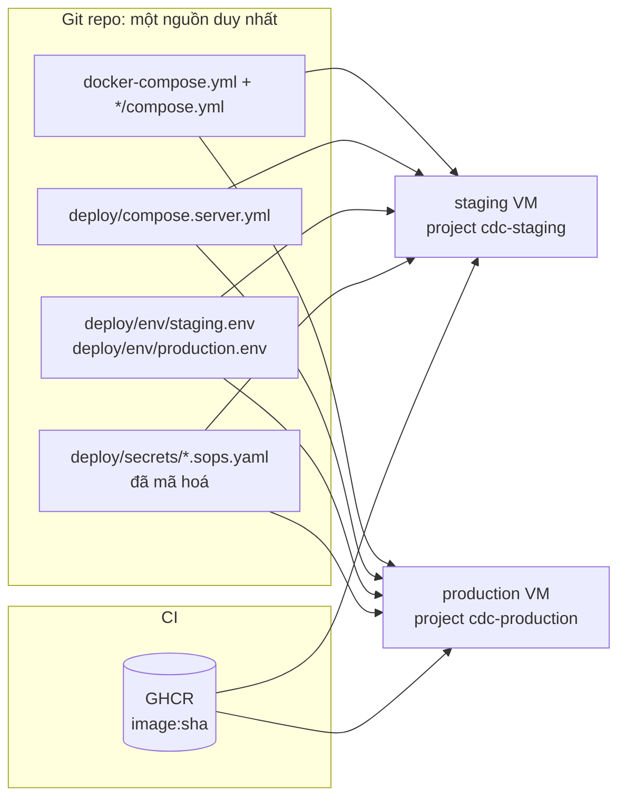
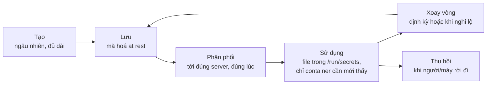
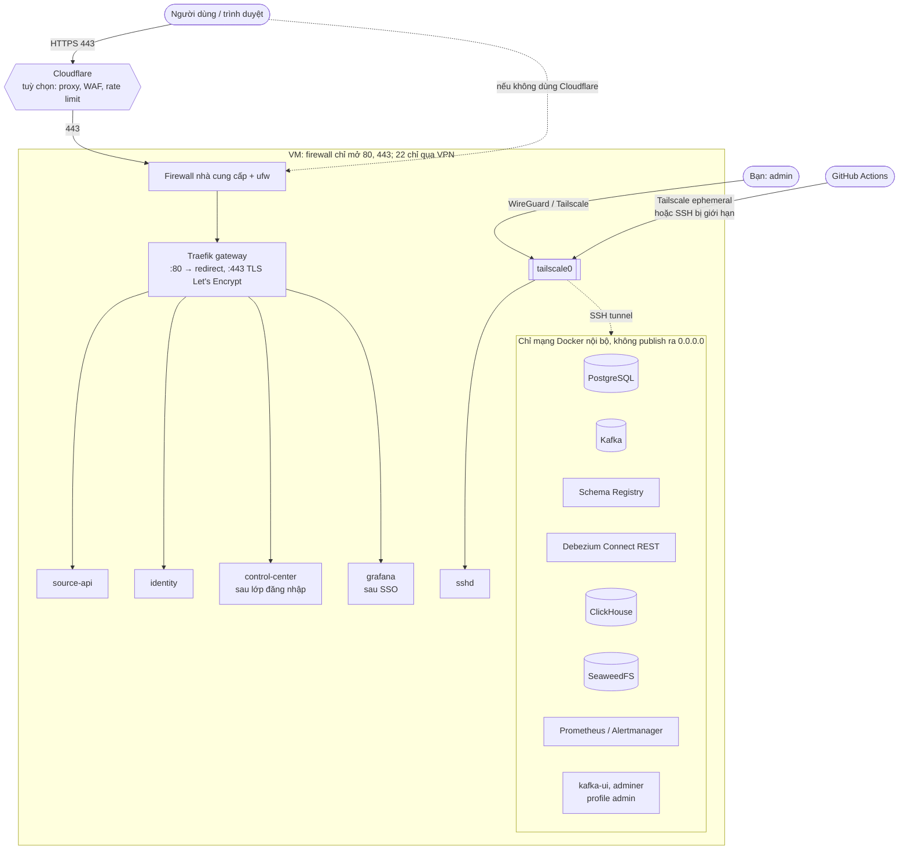
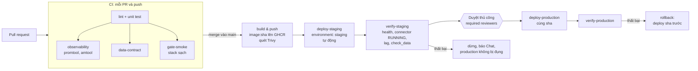
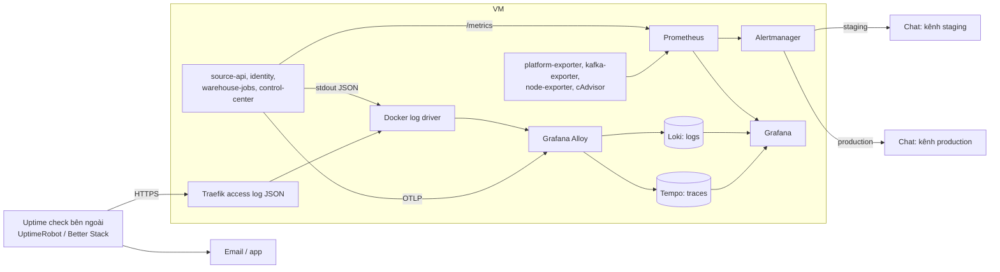
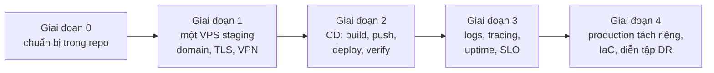

# 07 · Triển khai lên server và DevOps

[Tài liệu dự án](../README.md) / [Triển khai](README.md)

## Đọc file này để biết gì

Đến giờ toàn bộ pipeline chạy trên một máy dev: mọi cổng bind vào `127.0.0.1`, secret là file trong `secrets/` do `setup-env.sh` tạo, TLS từ một CA tự ký cho `*.cdc.localhost`, CI trên GitHub Actions chỉ kiểm tra chứ không triển khai. File này là phần "đưa nó ra thế giới thật", viết như tài liệu nhập môn cho người lần đầu tự triển khai. Mục tiêu là hiểu **cách suy nghĩ** (vì sao làm vậy, đánh đổi gì), còn từng bước chỉ là ví dụ minh hoạ:

- local khác server ở điểm nào, và những nguyên tắc 12-factor nào thật sự quan trọng với dự án này;
- chia môi trường (local, CI, staging, production): mỗi môi trường để làm gì, cái gì được khác, cái gì phải giống;
- phân loại cấu hình và secret của dự án, cách quản lý secret trên server, khi secret bị lộ thì làm gì;
- domain, DNS, TLS thật, reverse proxy, firewall, VPN: cái gì được ra Internet, cái gì không bao giờ;
- chọn nhà cung cấp hạ tầng (có giá tham khảo, có nguồn và ngày kiểm tra);
- cách triển khai: image bất biến, registry, migration schema, rollback, Infrastructure as Code;
- thiết kế một pipeline CD hợp lý cho repo này;
- observability trên server: metrics, logs tập trung, tracing, uptime check, SLO;
- quản lý tài nguyên và hiệu năng, backup và khôi phục, xử lý sự cố;
- checklist bảo mật, bảng chi phí, lộ trình bốn giai đoạn, và bảng thuật ngữ.

Tài liệu liên quan (không lặp lại ở đây):

- [02 · Source API và bảo mật](../business/02-source-api-va-bao-mat.md): gateway, identity, token, `AUTH_MODE`.
- [03 · CDC ingestion](../platform/03-cdc-ingestion.md): Debezium, replication slot, outbox.
- [04 · Warehouse](../platform/04-warehouse.md): ClickHouse, cold tier SeaweedFS.
- [06 · Vận hành](../operations/06-van-hanh.md): chạy local, alert, runbook, gate, CI hiện tại.
- Nghiên cứu High Availability (tài liệu riêng): <https://claude.ai/code/artifact/61133ce8-61eb-4076-ab92-31738254ec53>
- Câu hỏi ôn tập cho phần này: [Q&A · 07-trien-khai-va-devops.md](../interview/07-trien-khai-va-devops.md)

> **Trạng thái:** chương này là thiết kế và hướng dẫn, chưa phải bằng chứng đã deploy lên server thật. Đọc kèm [lộ trình thực hành local → staging](first-deployment.md), có các bước, điều kiện hoàn thành và phần repo còn cần viết. Domain `example.com` là mẫu; ngân sách phải xác nhận theo cấu hình/region và giá chính thức lúc mua. Phần so sánh giá cũ từ nguồn tổng hợp đã được bỏ.

## Mục lục

1. [Tư duy: từ localhost lên server, cái gì thay đổi](#1-tư-duy-từ-localhost-lên-server-cái-gì-thay-đổi)
2. [Môi trường: local, CI, staging, production](#2-môi-trường-local-ci-staging-production)
3. [Cấu hình và secret: phân loại](#3-cấu-hình-và-secret-phân-loại)
4. [Quản lý secret trên server](#4-quản-lý-secret-trên-server)
5. [Mạng, domain, TLS và truy cập quản trị](#5-mạng-domain-tls-và-truy-cập-quản-trị)
6. [Chọn nơi chạy: VPS, nhà cung cấp Việt Nam, managed service, Kubernetes](#6-chọn-nơi-chạy)
7. [Cách triển khai: image, registry, migration, rollback, IaC](#7-cách-triển-khai-image-registry-migration-rollback-iac)
8. [Pipeline CD](#8-pipeline-cd)
9. [Observability trên server](#9-observability-trên-server)
10. [Tài nguyên và hiệu năng](#10-tài-nguyên-và-hiệu-năng)
11. [Dữ liệu và độ tin cậy: backup, restore, đĩa đầy](#11-dữ-liệu-và-độ-tin-cậy-backup-restore-đĩa-đầy)
12. [Xử lý sự cố](#12-xử-lý-sự-cố)
13. [Checklist bảo mật trước khi public](#13-checklist-bảo-mật-trước-khi-public)
14. [Chi phí ước tính](#14-chi-phí-ước-tính)
15. [Lộ trình cho dự án này](#15-lộ-trình-cho-dự-án-này)
16. [Những điểm trong repo cần sửa trước khi lên server](#16-những-điểm-trong-repo-cần-sửa-trước-khi-lên-server)
17. [Thuật ngữ](#17-thuật-ngữ)
18. [Nguồn tham khảo](#18-nguồn-tham-khảo)

---

## 1. Tư duy: từ localhost lên server, cái gì thay đổi

### 1.1. Bảy điều thay đổi

Trên laptop, bạn vừa là người dùng, vừa là admin, vừa là kẻ tấn công duy nhất có thể chạm vào hệ thống. Lên server, giả định đó mất. Có bảy thay đổi lớn:

| Khía cạnh | Trên máy dev | Trên server | Hệ quả cho dự án này |
|---|---|---|---|
| **Mức phơi bày mạng** | Mọi cổng ở `127.0.0.1`, không ai ngoài máy bạn gọi được | Server có IP công khai; bot quét toàn bộ dải IPv4 trong vài phút, thử SSH, thử cổng 5432/9092/8123 | Chỉ 80/443 được ra ngoài. PostgreSQL, Kafka, ClickHouse, Connect REST… chỉ ở mạng nội bộ |
| **Ranh giới tin cậy** | Một người, một máy | Có người dùng ngoài, CI, người cùng nhóm, nhà cung cấp hạ tầng | Phải rõ ai được gọi API nào, ai được SSH, ai được đọc secret |
| **Tính bền vững của dữ liệu** | `down -v` để reset là chuyện bình thường | Dữ liệu sống lâu; không được reset để đổi schema hay đổi password | Init script của PostgreSQL/ClickHouse chỉ chạy trên volume rỗng ⇒ cần migration |
| **Khả năng tái lập** | "Chạy được trên máy tôi" | Phải dựng lại được từ đầu, giống hệt, bởi người khác hoặc bởi máy | Image có tag bất biến, cấu hình trong git, server dựng bằng script |
| **Ai truy cập được gì** | Mọi thứ | Nguyên tắc quyền tối thiểu (least privilege) | User deploy riêng, không SSH root, Grafana có đăng nhập |
| **Chi phí** | Điện và laptop | Tiền theo tháng, tiền băng thông, tiền lưu trữ | Kích thước VM, retention, backup off-site đều là quyết định tiền |
| **Lỗi** | Bạn thấy ngay, sửa ngay | Lỗi xảy ra lúc 3 giờ sáng khi bạn ngủ | Alert, uptime check từ bên ngoài, runbook, backup đã thử khôi phục |

Câu hỏi nên tự hỏi trước mỗi thay đổi trên server: **"Nếu cái này hỏng hoặc bị lộ, ai phát hiện, phát hiện bằng cách nào, và tôi khôi phục mất bao lâu?"** Nếu câu trả lời là "không ai" hoặc "không biết", đó là việc cần làm trước.

### 1.2. 12-factor: những ý quan trọng với dự án này

[The Twelve-Factor App](https://12factor.net/) là bộ nguyên tắc viết năm 2011 cho ứng dụng chạy trên cloud. Không cần thuộc cả 12, nhưng năm ý sau đây ảnh hưởng trực tiếp tới repo:

- **Config trong environment (III).** Cùng một image phải chạy được ở mọi môi trường, khác nhau chỉ ở cấu hình bên ngoài. Repo đã làm đúng phần lớn: các service đọc `PG_HOST`, `SIM_SPEED`, `AUTH_MODE`… từ biến môi trường, secret qua `*_FILE`. Chỗ còn vi phạm: `gateway/dynamic.yml` ghi cứng `api.cdc.localhost` và CORS origin `https://app.cdc.localhost`; `kafka/compose.yml` ghi cứng `CLUSTER_ID`. Lên server phải tham số hoá những chỗ đó.
- **Build một lần, deploy nhiều lần (V: build, release, run).** Image được build **một lần** trong CI, gắn tag theo git SHA, rồi chính image đó đi qua staging rồi production. Không build lại trên server, vì build lại có thể kéo phiên bản thư viện khác và bạn sẽ chạy ở production một thứ chưa từng test. Hiện tại compose dùng `build:` ở hầu hết service tự viết; đây là thay đổi lớn nhất khi lên server.
- **Dev/prod parity (X).** Càng giống nhau càng ít bất ngờ. Repo này có lợi thế lớn: local đã chạy đúng các image và cấu hình như sẽ chạy trên server (PostgreSQL 15, cp-kafka 8.3.2, ClickHouse 25.8…). Khác nhau nên chỉ ở *quy mô* và *giá trị cấu hình*, không ở *loại phần mềm*. Ví dụ tránh: local dùng SeaweedFS, server lại dùng S3 thật nhưng chưa bao giờ test với S3 thật.
- **Disposability (IX).** Container phải khởi động nhanh và dừng sạch, để có thể restart, thay thế, rollback bất kỳ lúc nào. Pipeline này chịu được restart nhờ thiết kế: Debezium tiếp tục từ offset trong Kafka, ClickHouse đọc tiếp từ consumer group, idempotency key ở Source API chống trùng khi simulator gửi lại. Đây chính là lý do deploy bằng cách thay container là an toàn.
- **Logs là luồng sự kiện (XI).** Ứng dụng chỉ ghi ra stdout/stderr; việc thu gom, lưu trữ, tìm kiếm là của hạ tầng. Lợi ích: đổi nơi lưu log (file, Loki, dịch vụ hosted) không cần sửa code. Traefik đã ghi access log dạng JSON ra stdout; các service Python nên làm tương tự.

Hai ý nữa đáng nhớ: **backing service là tài nguyên gắn vào (IV)** (PostgreSQL, Kafka, ClickHouse được trỏ tới bằng URL/host, nên có thể thay bản tự chạy bằng bản managed mà không sửa code) và **admin process chạy như một lần chạy (XII)** (migration, `register.sh`, `backup.sh` là các lệnh chạy một lần, với đúng image và cấu hình của môi trường đó).

---

## 2. Môi trường: local, CI, staging, production

### 2.1. Vì sao cần nhiều môi trường

Mỗi môi trường trả lời một câu hỏi khác nhau. Gộp chúng lại thì mất câu trả lời:

| Môi trường | Câu hỏi nó trả lời | Ai dùng | Trong dự án này |
|---|---|---|---|
| **local** | "Code của tôi có chạy không?" | Từng developer | Stack trên laptop, `quality/gate.sh quick`, dữ liệu reset tuỳ ý |
| **CI** (ephemeral) | "Thay đổi này có phá gì không, trên một stack sạch?" | Máy, mỗi PR | `gate-smoke`, `observability`, `data-contract` trên GitHub Actions; secret dùng một lần, stack bị huỷ sau job |
| **staging** | "Bản này có chạy đúng trên hạ tầng thật không: domain thật, TLS thật, dữ liệu sống lâu, migration trên dữ liệu cũ?" | Bạn, trước khi đưa lên production | Một VM, domain `*.staging.example.com`, simulator chạy liên tục, alert về kênh riêng |
| **production** | "Người dùng/khách xem demo thấy gì?" | Người ngoài | Domain chính, uptime check, alert về kênh chính, backup off-site |

Với một dự án mô phỏng, "production" nghĩa là **bản demo công khai** mà nhà tuyển dụng hay đồng nghiệp sẽ mở. Nó vẫn đáng được đối xử như production thật: nếu demo sập đúng lúc ai đó mở link, đó là sự cố thật với bạn. Và quan trọng hơn: đây là nơi bạn luyện thói quen production.

Giai đoạn đầu chỉ cần **staging** (xem [mục 15](#15-lộ-trình-cho-dự-án-này)). Thêm production khi staging đã ổn định và có CD.

### 2.2. Cái gì được khác, cái gì phải giống

Nguyên tắc: **khác về giá trị, giống về cấu trúc.**

| Phải **giống hệt** giữa các môi trường | Được **khác** giữa các môi trường |
|---|---|
| Image (cùng digest, cùng tag SHA) | Domain, chứng chỉ TLS |
| Phiên bản PostgreSQL, Kafka, ClickHouse, Debezium | Secret (mỗi môi trường một bộ riêng, không dùng chung) |
| Schema PostgreSQL, DDL ClickHouse, cấu hình connector (trừ secret) | Tốc độ simulator (`SIM_SPEED`), quy mô (`SIM_SCALE`), có seed hay không |
| File compose gốc (`docker-compose.yml` + `*/compose.yml`) | Số worker (`API_WORKERS`), pool (`DB_POOL_MAX`), heap JVM, giới hạn RAM |
| Quy tắc alert (`alerts.yml`), dashboard | Nơi nhận alert (kênh Chat staging khác production), ngưỡng mức độ ưu tiên |
| `AUTH_MODE=enforce` ở mọi nơi có domain công khai | Retention Kafka/Prometheus, lịch backup |
| Cách triển khai (cùng script deploy) | Kích thước VM, ổ đĩa |

Vì sao schema phải giống: pipeline này có **hợp đồng dữ liệu** chạy qua bốn hệ thống (PostgreSQL → Debezium → Schema Registry → ClickHouse). Nếu staging có một cột mà production không có, thì kiểm thử ở staging không chứng minh được gì cho production. Workflow `data-contract` đã kiểm tra điều này trong CI; staging là nơi kiểm tra lần nữa trên dữ liệu sống lâu.

Mỗi môi trường **không bao giờ dùng chung** PostgreSQL, Kafka, ClickHouse, Schema Registry hay bucket object storage với môi trường khác. Lý do cụ thể với CDC:

- Hai Debezium cùng đọc một PostgreSQL thì phải dùng hai replication slot; slot của môi trường bị bỏ quên sẽ giữ WAL lại cho tới `max_slot_wal_keep_size = 8GB` rồi làm đầy đĩa của môi trường kia.
- Hai môi trường dùng chung Kafka thì topic `cdc.ecommerce.orders` của staging và production lẫn vào nhau, hoặc phải đặt prefix mọi nơi; một lần quên prefix là dữ liệu test vào production.
- Schema Registry dùng chung thì một schema thử nghiệm ở staging có thể chặn (BACKWARD compatibility) một thay đổi hợp lệ ở production.
- Một lệnh `DROP` hay `--reset-offsets` gõ nhầm môi trường sẽ phá cả hai.

Chi phí của tách biệt là tiền và RAM; chi phí của dùng chung là những sự cố khó hiểu nhất. Với dự án này, tách là đúng.

### 2.3. Tổ chức trong repo

Docker Compose hỗ trợ ghép nhiều file: file sau ghi đè file trước. Cách tổ chức đề xuất:

```
docker-compose.yml              # gốc, như hiện tại (include */compose.yml)
deploy/
  compose.server.yml            # khác biệt chung cho mọi server: image: thay build:, gateway 80/443,
                                #   giới hạn tài nguyên, logging, bỏ adminer/kafka-ui khỏi mặc định
  compose.staging.yml           # riêng staging (nếu cần)
  compose.production.yml        # riêng production
  env/staging.env               # cấu hình KHÔNG bí mật của staging (commit vào git)
  env/production.env
  secrets/staging.sops.yaml     # secret đã mã hoá (xem mục 4)
  secrets/production.sops.yaml
  deploy.sh                     # script chạy trên server: pull, migrate, up, kiểm tra
```

Lệnh trên server sẽ có dạng `docker compose -p cdc-staging --env-file deploy/env/staging.env -f docker-compose.yml -f deploy/compose.server.yml -f deploy/compose.staging.yml up -d`. Bạn không gõ tay lệnh này; `deploy.sh` gõ.

Mấy điểm cần lưu ý:

- **Tên project theo môi trường** (`-p cdc-staging`, `-p cdc-production`). Compose dùng tên project làm prefix cho container, network, volume. Hiện file gốc có `name: realtime-cdc` và nhiều service đặt `container_name: cdc-…`. `container_name` cố định làm hai project không chạy được trên cùng một Docker host (trùng tên) nên phải bỏ hoặc tham số hoá ở file server. Dù staging và production nên ở hai VM khác nhau, có tên project riêng vẫn giúp nhìn `docker ps` là biết đang ở môi trường nào.
- **Profiles** (`profiles: ["tools"]`, `["load"]`) đã được dùng cho validator và simulator-load. Trên server, nên đưa `adminer` và `kafka-ui` vào profile `admin` để mặc định không chạy; khi cần thì bật và truy cập qua VPN.
- **File `.env` chỉ chứa cấu hình không bí mật** và nên được commit (dưới tên `deploy/env/<môi trường>.env`). Repo đã đi đúng hướng: `setup-env.sh` chuyển mọi password ra khỏi `.env`.
- **`docker-compose.override.yml`** được Compose tự nạp. Trên server không được có file này (nó dành cho xung đột cổng trên laptop); script deploy nên chỉ định rõ các `-f` để không vô tình nạp nó.
- **Kafka `CLUSTER_ID`** khác nhau giữa môi trường. `warehouse/backup.sh` hiện kiểm tra topic IDs và retained offsets để tránh đọc bù từ lịch sử Kafka đã reset; không dựa riêng vào cluster ID. Định danh môi trường riêng vẫn cần cho vận hành.



---

## 3. Cấu hình và secret: phân loại

### 3.1. Định nghĩa

- **Cấu hình (config)**: giá trị thay đổi theo môi trường nhưng lộ ra cũng không gây hại. Ví dụ `SIM_SPEED=240`. Có thể nằm trong git, trong log, trong `docker inspect`.
- **Secret**: giá trị mà ai biết được sẽ có thêm quyền. Ví dụ password, khoá ký, webhook URL. Không bao giờ nằm dạng rõ trong git, log, biến môi trường hiển thị được, hay ảnh chụp màn hình.

Phép thử nhanh: *"Nếu giá trị này xuất hiện trên một issue GitHub công khai, tôi có phải đổi nó không?"* Có thì là secret.

Có một nhóm ở giữa: **định danh nhạy cảm** (IP server, tên user deploy, tên database). Không phải secret, nhưng không nên quảng cáo. Có thể để trong git private.

### 3.2. Bảng phân loại cho dự án này

| Thiết lập | Ví dụ | Secret? | Khác theo môi trường? | Nơi nằm |
|---|---|---|---|---|
| `AUTH_MODE` | `enforce` | Không | Không (luôn `enforce` trên server) | `deploy/env/*.env`, nên kiểm tra lúc khởi động |
| `API_WORKERS`, `DB_POOL_MAX` | `6`, `12` | Không | Có (theo số vCPU) | env file |
| `SIM_SCALE`, `SIM_SPEED`, `SIM_AUTO_SEED` | `medium`, `240`, `true` | Không | Có (staging có thể chạy nhanh hơn để thử tải) | env file |
| `JOB_INTERVAL_S`, `MART_REFRESH_S`, `RECONCILE_S` | `5`, `15`, `30` | Không | Thường không | compose |
| Domain, CORS origin | `api.staging.example.com`, `https://app.staging.example.com` | Không | Có | env file → Traefik (hiện ghi cứng trong `gateway/dynamic.yml`) |
| `AUTH_ISSUER` | `http://identity:8300` | Không | Có thể (nếu đổi sang URL công khai) | env file |
| `GRAFANA_PUBLIC_URL` | `https://grafana.staging.example.com` | Không | Có | env file (dùng trong tin nhắn alert) |
| Kafka `CLUSTER_ID` | chuỗi base64 | Không | **Có** (mỗi môi trường một id) | env file |
| Retention Prometheus | `15d` | Không | Có | compose server |
| `IMAGE_TAG` | git SHA `d6e9796…` | Không | Có (theo bản đang deploy) | do pipeline truyền vào |
| Cấu hình PostgreSQL (`max_connections=200`, `max_slot_wal_keep_size=8GB`, `shared_buffers`) | | Không | Có (theo RAM) | `source/postgres/postgresql.conf` + override |
| `postgres_password` (superuser `admin`) | | **Có** | Có | secret store → `/run/secrets` |
| `cdc_db_password` (user replication của Debezium) | | **Có** | Có | như trên |
| `source_api_db_password`, `app_reader_password`, `identity_db_password`, `monitor_password` | | **Có** | Có | như trên |
| `clickhouse_password`, `grafana_reader_password`, `grafana_admin_password` | | **Có** | Có | như trên |
| `pii_salt` | | **Có** (ai có salt có thể dò ngược hash email/SĐT bằng từ điển) | Có | như trên; đổi giá trị là đổi mọi hash |
| `password_pepper` (identity) | | **Có** | Có | đổi giá trị là mọi password cũ không còn đăng nhập được, trừ khi có phiên bản pepper |
| `admin_password` (identity) | | **Có** | Có | |
| `clients/*` (secret của service client: sim-orchestrator, quality, identity) | | **Có** | Có | |
| `webhooks/*` (khoá ký của MOMO, VNPAY, GHN…, mô phỏng) | | **Có** | Có | |
| `cold_storage_access_key/secret_key` | | **Có** | Có | trên server nên là key của object storage thật |
| Khoá ký JWT Ed25519 của identity | volume `identity_keys` | **Có** | Có | volume, phải backup (mất là mọi token hết hiệu lực) |
| TLS private key | `secrets/tls/server.key` | **Có** | Có | trên server do Traefik + Let's Encrypt tự quản (`acme.json`) |
| Google Chat webhook URL | `observability/secrets/google-chat-webhook` | **Có** (ai có URL là gửi được tin vào kênh) | Có (kênh staging khác) | |
| Token DNS provider cho ACME DNS-01 | | **Có** | Thường chung, nhưng nên giới hạn theo zone | secret store |
| Khoá SSH của user deploy, token kéo image GHCR, khoá age, auth key Tailscale | | **Có** | Có | GitHub Environments secrets / server |

### 3.3. Đặt tên, giá trị mặc định, kiểm tra lúc khởi động

- **Đặt tên**: dự án đã có quy ước tốt, giữ nguyên: `PG_HOST`, `CLICKHOUSE_HOST`; secret luôn có hậu tố `_FILE` trỏ tới `/run/secrets/<tên>`. Lợi ích của `_FILE`: password không hiện trong `docker inspect`, không bị in khi ai đó chạy `env` để debug, không bị kế thừa sang tiến trình con.
- **Giá trị mặc định**: mặc định nên là giá trị **an toàn**, không phải giá trị tiện. `AUTH_MODE: ${AUTH_MODE:-enforce}` là ví dụ đúng: quên đặt biến thì vẫn bảo vệ. Ngược lại, secret không bao giờ có mặc định (đây chính là lỗi cũ của repo: `.env.example` từng có `POSTGRES_PASSWORD=change-me`).
- **Bắt buộc có giá trị**: trong compose có cú pháp `${VAR:?thông báo}` làm Compose dừng ngay nếu thiếu biến. Dùng cho những gì không có mặc định hợp lý, ví dụ `IMAGE_TAG`, `DOMAIN`.
- **Fail fast trong ứng dụng**: service nên kiểm tra cấu hình ngay khi khởi động và thoát với thông báo rõ nếu sai (file secret rỗng, `AUTH_MODE` không thuộc `off|permissive|enforce`, URL sai định dạng). Lỗi cấu hình lộ ra lúc deploy, được healthcheck bắt và pipeline dừng; tốt hơn nhiều so với lộ ra lúc 3 giờ sáng khi một request hiếm gặp chạm vào nó. Với FastAPI, `pydantic-settings` làm việc này gọn. Có thể thêm một quy tắc cứng: nếu `ENVIRONMENT=production` mà `AUTH_MODE!=enforce` thì từ chối khởi động.

---

## 4. Quản lý secret trên server

### 4.1. Secret đi qua những đâu

Một secret có vòng đời: **tạo → lưu → phân phối → sử dụng → xoay vòng → thu hồi**. Mỗi chặng là một chỗ có thể lộ:



Ở local, `setup-env.sh` lo cả "tạo" và "lưu" (file thường trên laptop). Lên server, câu hỏi chính là **lưu ở đâu cho an toàn và phân phối thế nào**.

### 4.2. Các mức trưởng thành

| Mức | Cách làm | Ưu | Nhược | Hợp với |
|---|---|---|---|---|
| 0 | Password trong compose/`.env` commit vào git | Dễ | Ai đọc repo cũng có password; ở mãi trong lịch sử git | Không bao giờ (repo từng ở mức này với `change-me`) |
| 1 | File trên server, quyền chặt, tạo tay bằng `setup-env.sh` trên server | Đơn giản, đúng mô hình hiện tại | Không có bản sao an toàn (mất server là mất secret), không audit, khó làm lại giống hệt | Thử nghiệm ngày đầu |
| 2 | File do **job deploy** đưa lên, giá trị lấy từ GitHub Environment secrets | Không ai cần SSH để đặt secret; có quy trình duyệt | GitHub giữ secret dạng "chỉ ghi", khó xem lại, khó so sánh; 20+ secret nhiều thao tác | Ít secret |
| 3 | **SOPS + age**: file secret mã hoá, commit vào git; server giữ khoá giải mã | Có lịch sử thay đổi, review được qua PR (thấy *tên* đổi, không thấy giá trị), không cần chạy thêm dịch vụ, miễn phí | Ai có khoá age là đọc được tất cả; xoay vòng thủ công | **Một người hoặc nhóm nhỏ, một vài VM** |
| 4 | **Secret manager**: HashiCorp Vault / OpenBao (bản fork mã nguồn mở của Vault), Infisical, Doppler, 1Password Secrets Automation, AWS Secrets Manager / GCP Secret Manager / Azure Key Vault | Phân quyền theo từng secret, audit log ai đọc lúc nào, xoay vòng tự động, secret động (Vault cấp password PostgreSQL có hạn dùng) | Thêm một hệ thống phải vận hành, backup, bảo mật (tự host), hoặc thêm một nhà cung cấp phải tin (SaaS) | Nhóm nhiều người, nhiều server, yêu cầu tuân thủ |

Docker cũng có **Docker secrets**, nhưng cần hiểu đúng: với Docker Swarm, secret được mã hoá trong cơ sở dữ liệu Raft của cluster và chỉ gửi tới node chạy service cần nó. Còn với `docker compose` thường (không Swarm), khối `secrets:` dạng `file:` thực chất chỉ là bind mount file vào `/run/secrets`, đúng như repo đang làm thủ công. Nó là cách *phân phối* gọn, không phải cách *lưu trữ* an toàn. Nghĩa là repo đã đạt "Docker secrets kiểu compose"; vấn đề còn lại là file gốc trên server lấy từ đâu.

### 4.3. Đề xuất cho dự án này: SOPS + age, rồi lên Infisical khi cần

**Giai đoạn 1–3: SOPS + age.** Lý do:

1. **Khớp hoàn toàn với mô hình hiện tại.** Các service đã đọc secret từ file trong `/run/secrets`. SOPS chỉ thay đổi *nguồn* của các file đó: thay vì `setup-env.sh` sinh ngẫu nhiên, `deploy.sh` giải mã `deploy/secrets/staging.sops.yaml` rồi ghi từng giá trị ra đúng đường dẫn mà compose đang mount. Không phải sửa dòng code nào của ứng dụng.
2. **Không thêm dịch vụ để vận hành.** Infisical tự host cần PostgreSQL và Redis riêng, chạy trên cùng VM 16 GB vốn đã chật, và chính nó trở thành mục tiêu tấn công giá trị nhất. Vault/OpenBao còn nặng hơn (unseal, storage backend, policy).
3. **Có lịch sử và review.** File mã hoá nằm trong git: thêm một secret là một PR, thấy được key nào đổi, ai đổi, lúc nào. SOPS chỉ mã hoá *giá trị*, giữ nguyên *tên khoá*, nên diff vẫn đọc được.
4. **Miễn phí, mã nguồn mở, không phụ thuộc nhà cung cấp**, đúng yêu cầu trung lập.

Cách hoạt động, bằng lời:

- Bạn tạo một cặp khoá **age** cho mỗi môi trường (một khoá cho staging, một cho production) và một khoá cho chính bạn. File `.sops.yaml` ở gốc repo khai báo: file `deploy/secrets/staging.*` được mã hoá cho khoá-staging và khoá-của-bạn; file production cho khoá-production và khoá-của-bạn.
- Private key của staging chỉ nằm trên VM staging (ví dụ `/etc/cdc/age.key`, quyền `0400`, chủ `root`). Private key của bạn nằm trong password manager. Như vậy **VM staging không đọc được secret production**, và lộ máy staging không kéo theo production.
- Khi deploy, `deploy.sh` chạy trên server: giải mã ra thư mục secret của môi trường, ghi từng file, đặt quyền, rồi `docker compose up`.
- Để sửa secret: trên máy bạn chạy `sops deploy/secrets/staging.sops.yaml`, trình soạn thảo mở bản giải mã, lưu là tự mã hoá lại, commit, PR.

Quyền file trên server cần nghĩ một chút. Các container chạy bằng user khác nhau (postgres uid 999, clickhouse uid 101, grafana uid 472…) nên `setup-env.sh` hiện đặt file `0644` để ai cũng đọc được. Trên server, cách đơn giản và đúng: thư mục chứa secret `0700` chủ `root`, file bên trong `0644`. Container vẫn đọc được vì Docker (chạy bằng root) đã mount sẵn từng file vào container, không cần đi qua thư mục cha; còn user thường trên host không vào được thư mục. Cách nâng cao: giải mã vào `tmpfs` (RAM) để secret không bao giờ nằm trên đĩa, đổi lại phải có systemd unit giải mã lại mỗi lần reboot *trước khi* Docker khởi động container.

**Khi nào chuyển lên Infisical (hoặc OpenBao):** khi có từ 3 người trở lên cần quyền khác nhau, khi cần audit "ai đọc secret nào", khi muốn xoay vòng password database tự động, hoặc khi số server tăng. Trước khi chọn secret manager cloud hoặc tự host, xác nhận plan, license, dependency và khả năng rotation thực sự được hỗ trợ; không suy tính năng tự động từ tên sản phẩm. Đường chuyển dễ vì ứng dụng không đổi: chỉ có `deploy.sh` đổi từ `sops -d` sang `infisical export`.

### 4.4. GitHub Actions: environments, required reviewers, OIDC

- **Environment secrets**: GitHub cho phép định nghĩa environment `staging` và `production`, mỗi cái một bộ secret riêng. Job khai báo `environment: production` mới đọc được secret production. Với SOPS, thứ cần nằm trong GitHub chỉ còn ít: khoá SSH (hoặc auth key Tailscale) để vào server, và có thể token GHCR. Khoá age **không** cần nằm trong GitHub, vì giải mã diễn ra trên server.
- **Required reviewers**: nếu plan và loại repo hỗ trợ, environment `production` đặt người duyệt bắt buộc. Job deploy production sẽ dừng chờ bạn bấm "Approve". Đây là cổng chặn "lỡ tay merge".
- **Deployment branch rules**: chỉ cho deploy production từ `main` hoặc tag `v*`, để một branch thử nghiệm không bao giờ deploy được production dù có ai sửa workflow.
- **OIDC thay cho khoá dài hạn**: thay vì lưu access key của nhà cung cấp cloud trong GitHub secrets (lộ là dùng được mãi), GitHub phát cho mỗi job một token OIDC ngắn hạn có chữ ký, ghi rõ repo, branch, environment. Nhà cung cấp (AWS, GCP, Azure, Tailscale, HashiCorp Vault…) được cấu hình để chỉ tin token từ đúng repo/branch/environment đó và đổi lấy quyền tạm thời. Kẻ lấy được log hay snapshot của job không có gì dùng lâu dài. Với VPS thuần (không có IAM), OIDC chủ yếu hữu ích khi dùng Tailscale (cấp khoá tham gia mạng tạm thời) hoặc khi Terraform cần quyền vào API nhà cung cấp.

### 4.5. Xoay vòng, quyền tối thiểu, audit

**Quyền tối thiểu đã có sẵn và nên giữ**: repo tách user PostgreSQL theo vai trò (`source_api` chỉ DML, `app_reader` chỉ đọc, `cdc_user` cho CDC, `monitor_reader` cho exporter), ClickHouse có `grafana_reader`. Mỗi container chỉ mount đúng file nó cần. Một chỗ chưa tối thiểu: Control Center đăng nhập ClickHouse bằng `admin`; nên có user chỉ đọc riêng.

**Xoay vòng trên môi trường sống lâu khác hẳn local.** `setup-env.sh --rotate` yêu cầu xoá volume, vì PostgreSQL và ClickHouse chỉ đặt password lúc khởi tạo. Trên server không được xoá dữ liệu, nên xoay vòng là một quy trình theo từng secret:

| Secret | Cách xoay vòng không mất dữ liệu |
|---|---|
| Password user PostgreSQL (`source_api`, `app_reader`, `cdc`, `monitor`, `identity`) | `ALTER ROLE … PASSWORD` bằng superuser → cập nhật file SOPS → deploy → restart service dùng nó. Với `cdc`: Debezium đọc `${dir:/run/secrets:cdc_db_password}` lúc task khởi động, nên restart connector. Thứ tự đúng để không gián đoạn là có hai user luân phiên, nhưng với demo thì vài giây gián đoạn chấp nhận được |
| `postgres_password`, `clickhouse_password` (admin) | Như trên, lưu ý mọi script dùng chúng (`gate.sh`, `backup.sh`, healthcheck) |
| `grafana_admin_password` | Grafana chỉ đọc biến này lần đầu; sau đó đổi bằng `grafana cli admin reset-admin-password` |
| `pii_salt` | **Không xoay vòng định kỳ.** Đổi salt là đổi toàn bộ hash; dữ liệu cũ và mới không còn ghép được. Chỉ đổi khi nghi lộ, kèm phiên bản salt |
| `password_pepper` | Tương tự: cần lưu phiên bản pepper cạnh hash để người dùng cũ vẫn đăng nhập rồi băm lại |
| Khoá ký JWT | Phát hành JWKS chứa cả khoá mới và cũ (khác `kid`), ký bằng khoá mới, gỡ khoá cũ sau khi token cũ hết hạn |
| Google Chat webhook | Tạo webhook mới trong Chat, xoá webhook cũ |
| Khoá SSH deploy, token GHCR | Tạo mới, thay trong GitHub Environment, thu hồi cái cũ |

**Audit**: với SOPS, git log là audit của *việc sửa* secret. Audit của *việc đọc* chỉ có khi dùng secret manager. Trên server, bật `auditd` hoặc ít nhất giữ log SSH (`journalctl -u ssh`) để biết ai đã đăng nhập.

### 4.6. Khi secret bị lộ: xoay vòng là bắt buộc, viết lại lịch sử thì không đủ

Repo này có một bài học có sẵn: lịch sử git chứa `.env.example` với `POSTGRES_PASSWORD=change-me` và các mật khẩu mặc định cũ.

Có hai việc khác nhau, hay bị nhầm:

- **Viết lại lịch sử git** (`git filter-repo`, BFG) xoá giá trị khỏi các commit. Nhưng một khi repo đã lên GitHub, bạn không kiểm soát được bản sao: người đã clone, fork, bộ đệm của GitHub (commit vẫn truy cập được bằng SHA cho tới khi GitHub Support dọn), các bot quét secret đã lưu lại trong vài phút sau khi push. Viết lại lịch sử còn buộc mọi người clone lại. Nó là **vệ sinh**, không phải **khắc phục**.
- **Xoay vòng (rotation)** làm cho giá trị bị lộ trở nên vô dụng. Đây là việc **bắt buộc** và phải làm **trước**.

Với trường hợp cụ thể của repo: các mật khẩu `change-me` là giá trị mặc định cũ, mọi môi trường mới do `setup-env.sh` tạo đều dùng giá trị ngẫu nhiên, và chưa có môi trường nào public. Vì vậy hành động đúng là: (1) không môi trường server nào được dùng giá trị từ lịch sử git, mọi secret server sinh mới; (2) có thể để nguyên lịch sử (đánh đổi: không đáng làm phiền), hoặc viết lại nếu muốn repo sạch trước khi chia sẻ; (3) bật **GitHub secret scanning và push protection**, thêm `gitleaks` vào pre-commit và CI để lần sau bị chặn ngay từ lúc push.

Quy trình chung khi một secret bị lộ (ví dụ lỡ commit Google Chat webhook URL):

1. **Xoay vòng ngay**: thu hồi/đổi giá trị ở hệ thống gốc (tạo webhook mới, `ALTER ROLE`, thu hồi token). Phút đầu tiên quan trọng nhất.
2. **Đánh giá phạm vi**: secret cho quyền gì, lộ từ lúc nào, có dấu hiệu bị dùng không (log truy cập, tin nhắn lạ trong kênh, đăng nhập lạ).
3. **Gỡ khỏi chỗ lộ**: xoá commit (nếu còn trong PR chưa merge thì force-push), xoá log CI có in giá trị.
4. **Ghi lại** (postmortem ngắn): vì sao lọt, chặn bằng cách nào để không lặp lại.

---

## 5. Mạng, domain, TLS và truy cập quản trị

### 5.1. Bức tranh mạng trên server



### 5.2. Domain và DNS

**Mua domain**: dùng nhà đăng ký có uy tín, có khoá chuyển (registrar lock) và xác thực hai lớp cho tài khoản: Cloudflare Registrar (bán giá gốc), Porkbun, Namecheap, hoặc nhà đăng ký Việt Nam nếu cần `.vn` (Mắt Bão, PA Vietnam, Nhân Hòa…). Tài khoản registrar là thứ quan trọng bậc nhất: ai chiếm được nó là chuyển được toàn bộ domain và cấp được chứng chỉ TLS hợp lệ cho domain của bạn. Một `.com` thường khoảng 10–15 USD/năm (ước tính).

**Các loại bản ghi cần biết:**

| Bản ghi | Ý nghĩa | Ví dụ |
|---|---|---|
| `A` | Tên → địa chỉ IPv4 | `api.staging.example.com → 203.0.113.10` |
| `AAAA` | Tên → địa chỉ IPv6 | như trên với IPv6 (nhiều VPS cho IPv6 miễn phí, IPv4 tính phí riêng) |
| `CNAME` | Tên → một tên khác | `grafana.staging.example.com → staging.example.com` |
| `CAA` | Chỉ CA nào được cấp chứng chỉ cho domain | `example.com CAA 0 issue "letsencrypt.org"`: chặn CA khác cấp nhầm |
| `TXT` | Chuỗi tuỳ ý; dùng cho xác minh (ACME DNS-01, email SPF/DMARC) | `_acme-challenge.example.com` |

**TTL** (time to live) là thời gian các resolver được nhớ bản ghi. Trước khi chuyển server, hạ TTL xuống 300 giây vài giờ trước để việc đổi IP lan nhanh; bình thường để 3600.

**Đặt tên subdomain theo service và môi trường:**

| Service | Production | Staging | Có public? |
|---|---|---|---|
| Source API (`/v1`, docs) | `api.example.com` | `api.staging.example.com` | Có |
| Identity | `auth.example.com` | `auth.staging.example.com` | Có |
| Control Center | `app.example.com` | `app.staging.example.com` | Có, **sau lớp đăng nhập** |
| Grafana | `grafana.example.com` | `grafana.staging.example.com` | Có, **sau SSO** (hoặc chỉ qua VPN) |
| Prometheus, Alertmanager, kafka-ui, adminer, ClickHouse Play | không có bản ghi DNS public | | Không, chỉ VPN |

Ba điểm tinh tế:

- **Cookie và CORS.** Cookie đặt cho `.example.com` sẽ được gửi tới cả `*.staging.example.com`. Nếu sau này có cookie phiên, đặt cookie cho host cụ thể (không có `Domain=`), hoặc dùng một domain riêng cho staging (ví dụ `example-staging.com`) để cách ly tuyệt đối. CORS origin trong `gateway/dynamic.yml` phải đổi theo môi trường: production chỉ cho phép `https://app.example.com`.
- **Cloudflare và subdomain hai cấp.** Chứng chỉ miễn phí của Cloudflare (Universal SSL) phủ `example.com` và `*.example.com`, nhưng **không** phủ `*.staging.example.com`. Nếu bật proxy Cloudflare cho `api.staging.example.com`, trình duyệt sẽ báo lỗi chứng chỉ trừ khi mua Advanced Certificate. Cách tránh: staging để "DNS only" (không proxy) và tự lấy chứng chỉ Let's Encrypt, hoặc đặt tên một cấp `api-staging.example.com`.
- **Bản ghi DNS là công khai.** Mọi tên bạn tạo đều có thể bị liệt kê (qua Certificate Transparency log của chứng chỉ TLS, bất kỳ ai cũng tra được trên crt.sh). Đừng tạo `adminer.example.com` rồi nghĩ "không ai biết tên này".

### 5.3. TLS thật với Let's Encrypt qua Traefik

Ở local, TLS đến từ CA tự ký trong `secrets/tls`; trình duyệt chỉ tin nếu bạn cài `ca.crt`. Trên server, dùng **Let's Encrypt**: CA miễn phí, được mọi trình duyệt tin, cấp chứng chỉ 90 ngày, gia hạn tự động qua giao thức **ACME**. Traefik có ACME client tích hợp (`certificatesResolvers`), nên không cần certbot.

Để cấp chứng chỉ, Let's Encrypt phải xác minh bạn kiểm soát domain. Hai cách chính:

| | HTTP-01 | DNS-01 |
|---|---|---|
| Cách xác minh | Let's Encrypt gọi `http://<tên>/.well-known/acme-challenge/<token>` qua cổng 80 | Traefik tạo bản ghi `TXT _acme-challenge.<tên>` qua API của nhà cung cấp DNS |
| Cần | Cổng 80 mở ra Internet, DNS trỏ đúng về server | Token API DNS (một **secret** mới) |
| Wildcard `*.staging.example.com` | Không | Có |
| Dùng cho tên chỉ có trong VPN | Không | Có (không cần server lộ ra ngoài) |
| Khi đứng sau Cloudflare proxy | Được, nhưng dễ rối | Ổn định |
| Rủi ro | Thấp | Token DNS lộ = kẻ tấn công sửa được DNS của bạn ⇒ tạo token chỉ có quyền sửa DNS của một zone |

Khuyến nghị: bắt đầu bằng **HTTP-01** (ít thứ phải quản), chuyển sang **DNS-01** khi cần wildcard hoặc tên nội bộ. Khi thử cấu hình, dùng **ACME staging server** của Let's Encrypt (chứng chỉ không được tin nhưng không bị giới hạn): Let's Encrypt giới hạn số chứng chỉ cấp cho mỗi domain mỗi tuần, cấu hình sai lặp đi lặp lại có thể khoá bạn vài ngày.

Những thay đổi ở gateway khi lên server (mô tả, không phải code đầy đủ):

- Thêm entrypoint `web` ở `:80` chỉ để chuyển hướng sang HTTPS và trả lời thử thách ACME; đổi `websecure` từ `:8443` sang `:443`. Đây là **hai cổng duy nhất** bind ra `0.0.0.0`.
- Thêm `certificatesResolvers.le.acme` với email liên hệ và file lưu `acme.json` (một volume, quyền `0600`: file này chứa private key).
- Các router trong `dynamic.yml` đổi `Host(...)` theo domain của môi trường và thêm `tls.certResolver: le`. File provider của Traefik hỗ trợ Go template nên có thể đọc domain từ biến môi trường, hoặc sinh `dynamic.yml` theo môi trường trong bước deploy.
- Giữ nguyên các middleware đã có: security headers (HSTS 1 năm, nosniff, frame deny), CORS, rate limit riêng cho login (5 req/s mỗi IP) và API. Đây là điểm mạnh sẵn có của repo.
- Nếu có Cloudflare đứng trước, mọi request tới từ IP Cloudflare, nên rate limit theo IP sẽ gom mọi người dùng thành một. Phải cấu hình Traefik tin header `CF-Connecting-IP`/`X-Forwarded-For` **chỉ** từ dải IP của Cloudflare (`forwardedHeaders.trustedIPs`), và firewall chỉ nhận 443 từ dải IP Cloudflare để không ai đi vòng qua.

### 5.4. Cloudflare đứng trước: có nên không?

Cloudflare (gói miễn phí) làm reverse proxy toàn cầu: ẩn IP thật của server, chặn DDoS cơ bản, cache nội dung tĩnh, có WAF với bộ luật được quản lý và rate limiting. Có **Cloudflare Access** (Zero Trust) để đặt trang đăng nhập (Google/GitHub/email OTP) trước bất kỳ subdomain nào, không cần sửa ứng dụng.

Đánh đổi: thêm một bên trung gian giải mã TLS của bạn (Cloudflare thấy toàn bộ traffic), thêm một chỗ có thể cấu hình sai, debug khó hơn (lỗi 5xx của Cloudflare hay của bạn?), và các vấn đề như subdomain hai cấp và IP thật ở trên. Với API cho simulator ở trong cùng máy, simulator gọi thẳng `source-api` trong mạng Docker nên không bị ảnh hưởng.

Khuyến nghị: **giai đoạn 1 không cần**; Traefik + Let's Encrypt + rate limit sẵn có + firewall đã đủ cho demo. Cân nhắc Cloudflare khi demo được chia sẻ rộng (bị bot để ý), hoặc dùng riêng **Cloudflare Access** cho Grafana/Control Center như một lớp đăng nhập, sau khi kiểm tra plan và giới hạn truy cập.

### 5.5. Những service không bao giờ được public

| Service | Vì sao không được public | Truy cập bằng cách nào |
|---|---|---|
| PostgreSQL 5432 | Nguồn sự thật; bot dò password liên tục; user `cdc` có quyền replication đọc toàn bộ WAL | SSH tunnel / VPN; tốt nhất không publish cổng ra host |
| Kafka 9092/29092 | Listener `PLAINTEXT`, không xác thực: ai kết nối được là đọc mọi topic (dữ liệu khách hàng đã hash một phần) và **ghi** được vào topic | Chỉ mạng Docker |
| Kafka Connect REST 8083 | Không xác thực; ai gọi được có thể `PUT` một connector mới đọc file hay kết nối tuỳ ý, xoá connector, đọc cấu hình | Chỉ mạng Docker / VPN |
| Schema Registry 8085 | Không xác thực; xoá hoặc đăng ký schema làm hỏng hợp đồng dữ liệu | Chỉ nội bộ |
| ClickHouse 8123/9000 | Có Play UI chạy SQL tuỳ ý; ClickHouse có hàm đọc URL/file | VPN |
| SeaweedFS | Bucket cold tier của bronze | Chỉ nội bộ |
| Prometheus 9090, Alertmanager 9093 | Lộ topology, tên service, có thể tắt alert (silence) | VPN |
| kafka-ui 8080, adminer 8081 | Giao diện quản trị toàn quyền (`DYNAMIC_CONFIG_ENABLED: true` cho phép sửa cấu hình từ UI) | Profile `admin`, chỉ bật khi cần, qua VPN |
| `/metrics`, `/health` của service | Lộ thông tin nội bộ | Gateway đã không route chúng ra ngoài; giữ nguyên |

Repo đã có một thói quen rất tốt: **mọi cổng publish đều bind `127.0.0.1`**. Trên server điều này còn quan trọng hơn vì một cái bẫy kinh điển: **Docker tự thêm luật iptables cho cổng được publish, đi trước các luật của `ufw`**. Một service publish `5432:5432` (không có `127.0.0.1`) sẽ mở ra Internet **dù `ufw` báo đã chặn**. Vì vậy: (1) giữ bind `127.0.0.1` cho mọi thứ trừ gateway; (2) dùng thêm **firewall của nhà cung cấp** (cloud firewall, nằm ngoài VM nên Docker không vượt qua được); (3) sau khi deploy, quét chính server từ bên ngoài (`nmap`) để kiểm chứng.

Cách tiếp cận các service nội bộ:

- **SSH tunnel** (`ssh -L 3000:127.0.0.1:3000 deploy@server`): không cần cài gì thêm; mỗi lần dùng mở một tunnel. Hợp khi chỉ một người.
- **VPN mesh: Tailscale (dựa trên WireGuard) hoặc WireGuard tự cấu hình**: máy bạn và server cùng một mạng riêng; truy cập `http://staging:3000` như ở local. Tailscale có các chính sách và hạn mức theo plan cần kiểm tra khi đăng ký, cùng cơ chế kiểm soát truy cập ("chỉ laptop của tôi được vào cổng 22 và 9090"), có ephemeral key cho CI. WireGuard thuần thì không phụ thuộc bên thứ ba nhưng phải tự quản khoá và cấu hình.
- **Bastion host**: một máy nhỏ duy nhất có SSH public, mọi máy khác chỉ nhận SSH từ bastion. Hợp khi có nhiều server; với 1–2 VM thì VPN đơn giản hơn.

Khuyến nghị: **Tailscale** cho giai đoạn 1, đóng hẳn cổng 22 ra Internet. Lý do: biến bài toán "bảo vệ SSH trước cả thế giới" thành "chỉ thiết bị của tôi thấy được SSH". Giữ một đường dự phòng (console web/VNC của nhà cung cấp) cho trường hợp Tailscale hỏng.

### 5.6. Firewall và làm cứng SSH

**Firewall** hai lớp:

- Cloud firewall của nhà cung cấp: inbound chỉ `80/tcp`, `443/tcp` từ mọi nơi (hoặc chỉ từ dải IP Cloudflare nếu dùng proxy), `41641/udp` cho Tailscale (tuỳ chọn, giúp kết nối trực tiếp), **không** mở 22. Outbound mở (cần kéo image, gửi alert, backup).
- `ufw` trên VM: mặc định chặn inbound, cho phép 80/443, cho phép SSH chỉ trên interface `tailscale0`. Nhớ lại: `ufw` không chặn được cổng Docker publish, nên nó là lớp phụ.

**SSH:**

- Chỉ đăng nhập bằng khoá (`PasswordAuthentication no`, `KbdInteractiveAuthentication no`). Khoá ed25519, có passphrase, tốt nhất nằm trong ssh-agent hoặc khoá phần cứng.
- Không cho root đăng nhập (`PermitRootLogin no`); làm việc bằng user thường có `sudo`.
- Một user **deploy** riêng cho CI: không sudo đầy đủ, chỉ có quyền chạy `docker compose` trong thư mục của môi trường, hoặc tốt hơn nữa là khoá SSH của nó bị gắn `command="/opt/cdc/deploy.sh"` trong `authorized_keys` (forced command) để khoá đó chỉ làm được đúng một việc. Lưu ý: user trong nhóm `docker` về thực chất có quyền tương đương root (mount được `/` vào container), nên forced command có giá trị thật.
- `fail2ban` chặn IP thử sai nhiều lần. Nếu SSH đã chỉ qua VPN thì fail2ban ít quan trọng hơn, nhưng vẫn hữu ích cho các log khác.
- `unattended-upgrades` tự cài bản vá bảo mật của hệ điều hành; đặt lịch reboot trong khung giờ ít người xem demo.

### 5.7. Bảo vệ Grafana và Control Center

**Control Center hiện không có đăng nhập** (nó điều khiển simulator, đổi tốc độ đồng hồ nghiệp vụ, đăng ký connector, đọc PostgreSQL/ClickHouse). Để public nguyên trạng thì bất kỳ ai cũng bật được simulator ×1440 và đẩy server tới giới hạn. Phải có một lớp xác thực trước nó. Các lựa chọn, từ đơn giản tới mạnh:

| Cách | Cách hoạt động | Ưu | Nhược |
|---|---|---|---|
| Basic auth ở Traefik | Middleware `basicAuth` với hash bcrypt | 5 phút là xong | Một password chung, không có đăng xuất, không MFA; chỉ là mức tối thiểu |
| Chỉ qua VPN | Không route qua gateway public | Không cần đăng nhập thêm | Người xem demo không mở được |
| **oauth2-proxy** | Proxy đứng trước, bắt đăng nhập Google/GitHub, Traefik dùng `forwardAuth` | Đăng nhập thật, giới hạn theo email | Thêm một container, một OAuth app |
| **Cloudflare Access** | Trang đăng nhập ở edge của Cloudflare | Không chạy gì thêm trên server, có MFA | Phải đưa domain qua Cloudflare proxy |
| Tích hợp identity sẵn có | Control Center đòi token từ identity service | Đồng nhất với kiến trúc | Phải viết code |

Grafana có đăng nhập riêng và đã tắt đăng ký (`GF_USERS_ALLOW_SIGN_UP=false`). Trên server: bật OAuth (Grafana hỗ trợ GitHub/Google OAuth trực tiếp qua biến `GF_AUTH_GITHUB_*`), đặt `GF_SERVER_ROOT_URL` đúng domain, cân nhắc bật anonymous viewer chỉ cho dashboard nghiệp vụ nếu muốn khách xem demo, và **không bao giờ** để admin dùng password mặc định.

---

## 6. Chọn nơi chạy

### 6.1. Cần bao nhiêu tài nguyên

Số liệu thật của dự án: khoảng 20 container, dùng **8–12 GB RAM** khi chạy, dữ liệu **≤ 10 GB** (Kafka ~4,4 GB với retention 7 ngày, ClickHouse ~3,7 GB và tăng dần vì bronze giữ mãi). Image `realtime-cdc/debezium` đã ~2,2 GB, tổng image vài GB. Load test peak dùng 16 core trên laptop, nhưng chế độ demo bình thường (`SIM_SPEED=240`) nhẹ hơn nhiều.

Suy ra cấu hình tối thiểu hợp lý:

- **RAM 16 GB là tối thiểu, 24–32 GB là thoải mái.** 8–12 GB cho tiến trình, phần còn lại cho page cache: Kafka đọc/ghi qua page cache của hệ điều hành, ClickHouse dùng page cache cho merge và truy vấn. RAM sát nút sẽ làm Linux OOM killer giết container lớn nhất (thường là ClickHouse hoặc Kafka) vào lúc tải cao.
- **4–8 vCPU.** Source API 6 worker, ClickHouse merge, Debezium, Kafka. Với demo 4 vCPU chạy được; load test thì cần 8.
- **Đĩa NVMe ≥ 160 GB.** Dữ liệu 10 GB nghe nhỏ, nhưng: WAL PostgreSQL có thể phình tới `max_slot_wal_keep_size = 8GB` + `max_wal_size = 2GB` khi Debezium dừng; image Docker ~10 GB và lớp build cũ; log container; backup local trước khi đẩy off-site; bronze tăng mãi. Đĩa đầy là sự cố phổ biến nhất của hệ thống kiểu này (xem [mục 11.5](#115-kịch-bản-đĩa-đầy)).
- **CPU kiến trúc x86_64** để tránh rắc rối: một số image (ví dụ image Debezium tự build, exporter) cần kiểm tra có bản `arm64`. ARM rẻ hơn nhưng phải build image đa kiến trúc.

### 6.2. VPS: cách so sánh có căn cứ

Bắt đầu shortlist từ [DigitalOcean Droplets](https://www.digitalocean.com/pricing/droplets), [Hetzner Cloud](https://www.hetzner.com/cloud/) và [AWS Lightsail](https://aws.amazon.com/lightsail/pricing/). Đây là các lựa chọn để khảo sát, không phải bảng xếp hạng tốc độ hoặc bảo đảm giá rẻ nhất. Hetzner có [location Singapore](https://docs.hetzner.com/cloud/general/locations/); vẫn cần kiểm gói, traffic và giá tại location định chọn.

Ví dụ kiểm tra trên trang chính thức DigitalOcean: Basic Regular 8 vCPU / 16 GiB / 320 GiB $96/tháng, General Purpose 4 vCPU / 16 GiB / 50 GiB $126/tháng. Hai gói khác loại CPU và dung lượng đĩa, không so chỉ bằng RAM. Chưa cộng thuế hay các dịch vụ phụ; xác nhận lại trước khi mua. [Nguồn](https://www.digitalocean.com/pricing/droplets).

### 6.3. Tiêu chí trước khi chốt nhà cung cấp

Chọn region từ người dùng và nơi lưu backup, kiểm x86_64/arm64, cloud firewall, quyền console cứu hộ, tốc độ disk, network và cách tính phí. Nếu chọn nhà cung cấp Việt Nam, lấy báo giá trực tiếp theo cùng cấu hình, hỏi IOPS/CPU dùng chung, phí IP/traffic, backup và hỗ trợ. Không dùng bảng giá tổng hợp cũ làm bằng chứng chi phí hiện tại.

### 6.4. Managed service hay tự chạy trên một VM

Managed chuyển một phần công việc backup, nâng cấp, storage hoặc failover sang nhà cung cấp; phạm vi cụ thể phải đọc theo sản phẩm và plan. Không được suy mọi managed database đều có logical replication hoặc PITR theo nhu cầu của bạn. Với PostgreSQL cần xác nhận quyền/giới hạn slot và WAL; với Kafka cần mạng, authentication và khả năng chạy Connect; với ClickHouse cần xác nhận ingestion tương thích vì mô hình dịch vụ cloud có thể khác Kafka engine đang tự vận hành.

Chọn tự chạy một VM cho staging đầu tiên vì mục tiêu là học vận hành và repo đã dùng Compose. Khi chọn managed, lập tổng chi phí cả compute, storage, transfer, backup và service phụ; không dùng bảng giá khởi điểm để kết luận toàn pipeline rẻ hơn. Cả hai phương án vẫn cần kiểm chứng restore và tính đúng của CDC.

### 6.5. Kubernetes (k3s) hay Docker Compose

| | Docker Compose trên 1 VM | k3s (Kubernetes nhẹ) |
|---|---|---|
| Độ phức tạp | Thấp; repo đã dùng | Cao: manifest/Helm, Ingress, PersistentVolume, operator cho Kafka (Strimzi), ClickHouse (Altinity operator) |
| Rolling update, tự phục hồi | Hạn chế (`restart: unless-stopped`, healthcheck) | Có (Deployment, readiness probe) |
| Đa node, HA | Không | Có, nhưng các dịch vụ có trạng thái vẫn cần replication riêng |
| Tài nguyên phụ | Gần 0 | ~0,5–1 GB RAM cho control plane |
| Học được gì | Nền tảng: container, mạng, volume, secret, deploy | Kỹ năng được thị trường đòi hỏi |

Khuyến nghị: **Compose cho giai đoạn 1–4.** Kubernetes giải quyết bài toán nhiều node, nhiều team, nhiều service tự scale; ở đây có một node và các thành phần nặng nhất là stateful (PostgreSQL, Kafka, ClickHouse), đúng loại khó chạy nhất trên Kubernetes. Chuyển sang k3s nên là một dự án học riêng sau khi Compose trên server đã vững, và khi đó các khái niệm (image bất biến, secret qua file, healthcheck, giới hạn tài nguyên) đều mang sang được.

### 6.6. Khuyến nghị cụ thể

Bắt đầu một VM x86_64 staging chạy Compose; 8 vCPU, 16–24 GiB RAM và khoảng 160 GiB SSD trở lên là cấu hình ứng viên để benchmark, chưa phải mức tối thiểu đã đo trên cloud. Chọn một trong shortlist sau khi cân budget/region và test IO. Khi có production thật, tách host và credential khỏi staging; khi Kafka/ClickHouse tranh IO hoặc RAM, dùng số đo để quyết định tách service. HA chỉ thêm sau khi có yêu cầu uptime và bài thử failover.

---

## 7. Cách triển khai: image, registry, migration, rollback, IaC

### 7.1. Image bất biến và registry

Luồng chuẩn: **CI build image → đẩy lên registry với tag = git SHA → server kéo đúng tag đó → chạy.**

- **Registry**: GitHub Container Registry (GHCR, `ghcr.io/<owner>/cdc-source-api`) là lựa chọn tự nhiên vì repo đã ở GitHub, job CI xác thực bằng `GITHUB_TOKEN` có sẵn, cần kiểm tra chính sách storage/transfer và quyền package theo tài khoản. Server cần một token chỉ có quyền đọc package (nếu repo private).
- **Các image cần build**: `source-api`, `identity`, `simulator`, `warehouse-jobs`, `control-center`, `debezium` (Dockerfile thêm JSON Schema converter), `observability/service` (chat-webhook và platform-exporter dùng chung), `quality` (validator). Image bên thứ ba (postgres, cp-kafka, clickhouse…) đã ghim phiên bản; tốt hơn nữa là ghim theo digest (`postgres:15@sha256:…`), vì tag `15` của Docker Hub thay đổi theo bản vá.
- **Tag bất biến**: tag `latest` hay `main` bị ghi đè mỗi lần build, nên "đang chạy bản nào" không trả lời được và rollback không có đích. Tag SHA không bao giờ thay đổi: `ghcr.io/…/cdc-source-api:d6e9796` mãi là đúng một bản. Có thể thêm tag `v1.4.0` cho bản phát hành, nhưng deploy luôn tham chiếu SHA hoặc digest.
- **Compose trên server dùng `image:` thay vì `build:`**: file `deploy/compose.server.yml` đặt `image: ghcr.io/<owner>/cdc-source-api:${IMAGE_TAG:?}` cho từng service tự viết. Compose cho phép một service có cả `build:` và `image:`; local vẫn build, server chỉ pull.
- **Chất lượng image**: quét lỗ hổng (Trivy, Grype) trong CI, sinh SBOM, chạy container bằng user không phải root, có thể ký image (cosign) để server chỉ chạy image do CI của bạn ký.

### 7.2. Migration: vì sao init script không đủ

Đây là thay đổi tư duy quan trọng nhất khi đi từ local sang môi trường sống lâu.

`source/postgres/init.sql` và các script `01–05` được mount vào `/docker-entrypoint-initdb.d`. Entrypoint của PostgreSQL **chỉ chạy chúng khi thư mục dữ liệu rỗng**. ClickHouse cũng vậy với `warehouse/clickhouse/init`. Ở local, đổi schema là `down -v` rồi dựng lại (gate `smoke`/`full` làm đúng điều đó). Trên staging/production, dữ liệu phải sống qua mọi lần deploy, nên **sửa `init.sql` không có tác dụng gì với database đang chạy**.

Cần một **công cụ migration**: mỗi thay đổi schema là một file có số thứ tự (`0007_add_order_note.sql`), công cụ ghi lại file nào đã chạy vào một bảng (`schema_migrations`), và mỗi lần deploy chỉ chạy những file mới, đúng thứ tự, đúng một lần.

| Công cụ | Ngôn ngữ migration | Hợp với dự án vì |
|---|---|---|
| **Alembic** | Python (có thể viết SQL thuần) | Service đã là Python/FastAPI; nhưng repo không dùng ORM SQLAlchemy cho schema nên lợi ích autogenerate không có |
| **Flyway** | SQL thuần | Schema đã là SQL; hỗ trợ PostgreSQL và ClickHouse (qua plugin); phổ biến trong doanh nghiệp |
| **sqitch** | SQL, có deploy/revert/verify | Kỷ luật cao, phụ thuộc giữa các thay đổi |
| **dbmate**, **golang-migrate** | SQL thuần, một binary | Nhẹ nhất; golang-migrate hỗ trợ cả ClickHouse |

Gợi ý: một công cụ SQL thuần (Flyway hoặc dbmate) cho PostgreSQL, chạy như một container một lần trong `deploy.sh` trước khi `up` các service ứng dụng. Identity service đã có `store.migrate()` tự chạy lúc khởi động; điều đó ổn cho một service, nhưng nên thống nhất một cơ chế. Bước chuyển: lấy `init.sql` hiện tại làm **baseline** (migration số 1, đánh dấu "đã chạy" trên môi trường đã tồn tại), mọi thay đổi sau là file mới.

**ClickHouse DDL** cần cách tương tự: thư mục migration có số thứ tự và bảng theo dõi (ví dụ `ops.schema_migrations`). Lưu ý riêng của ClickHouse: `ALTER TABLE … ADD COLUMN` nhẹ (chỉ metadata), nhưng đổi `ORDER BY`, đổi kiểu cột, hay sửa materialized view đọc từ Kafka engine table thường phải tạo bảng mới, chép dữ liệu, đổi tên. Với Kafka engine table, phải `DETACH` trước khi sửa view để không mất/trùng message, giống cách `backup.sh` làm.

**Debezium connector**: cấu hình nằm trong `debezium/postgres-connector.json`, `register.sh` gửi bằng `PUT /connectors/<tên>/config`. `PUT` là **idempotent**: tạo nếu chưa có, cập nhật nếu đã có, gửi lại cùng nội dung không đổi gì. Vì vậy `deploy.sh` có thể gọi `register.sh` ở mọi lần deploy (thông qua mạng nội bộ, không qua cổng public) và kiểm tra trạng thái `RUNNING`.

### 7.3. Thay đổi schema an toàn trong pipeline CDC: expand / contract

Trong pipeline này một thay đổi schema chạm tới bốn chỗ: PostgreSQL, payload Debezium (qua Schema Registry với BACKWARD compatibility), ClickHouse bronze/silver/gold, và code. Không thể đổi cả bốn cùng một khoảnh khắc. Nguyên tắc **expand rồi contract** (mở rộng trước, thu hẹp sau):

- **Thêm cột** (an toàn nếu đúng thứ tự): (1) ClickHouse chấp nhận cột mới trước (cột có giá trị mặc định); (2) PostgreSQL thêm cột nullable hoặc có default; Debezium tự nhận schema mới qua pgoutput, Schema Registry chấp nhận vì thêm trường tuỳ chọn là BACKWARD compatible; (3) code bắt đầu ghi cột; (4) backfill nếu cần.
- **Xoá cột** (ngược lại): (1) code ngừng dùng; (2) ClickHouse ngừng đọc (nhưng vẫn chịu được khi có); (3) PostgreSQL xoá cột ở một bản deploy **sau**; (4) dọn ClickHouse.
- **Đổi tên/đổi kiểu**: không làm trực tiếp; thêm cột mới, ghi cả hai, chuyển người đọc, xoá cột cũ.
- **Thêm bảng**: kiểm tra publication của PostgreSQL và `table.include.list` của connector có bao gồm bảng mới, đã có silver spec tương ứng (`check_contract.py` của workflow `data-contract` bắt trường hợp thiếu).

Lợi ích lớn của expand/contract: **ở mọi thời điểm, cả bản code cũ và mới đều chạy được với schema hiện tại**. Đó là điều kiện để rollback được (mục sau).

### 7.4. Downtime và rollback

**Downtime khi deploy trên một VM**: `docker compose up -d` thay những container có image/cấu hình đổi. Service stateless (source-api, identity, control-center, simulator) restart trong vài giây; trong lúc đó gateway trả 502/503 cho vài request; simulator gặp lỗi thì thử lại, idempotency key đảm bảo không tạo trùng đơn. Pipeline CDC không mất dữ liệu: Debezium đọc tiếp từ offset, ClickHouse tiếp tục từ consumer group. Lag tăng tạm thời rồi tự thu hẹp. Với demo, như vậy là chấp nhận được.

Muốn gần như không downtime cho service stateless: chạy hai bản (ví dụ `source-api` scale 2 không có `container_name`), Traefik load balance kèm healthcheck, thay từng bản một (công cụ `docker rollout` làm việc này cho Compose). Service stateful một node (PostgreSQL, Kafka, ClickHouse) thì không tránh được gián đoạn khi nâng cấp; lên lịch và thông báo.

**Rollback** có hai loại, khác nhau hoàn toàn:

- **Rollback code**: deploy lại tag SHA trước đó. Nhờ image bất biến, việc này nhanh (image còn trong cache) và chắc chắn (đúng bản đã chạy ổn). Pipeline nên có sẵn nút "deploy tag X".
- **Rollback dữ liệu/schema**: gần như **không bao giờ** làm bằng cách chạy migration ngược trên production. Migration ngược có thể mất dữ liệu đã ghi vào cột mới, và trong pipeline CDC, thay đổi đã chảy sang Kafka và ClickHouse rồi. Thay vào đó: viết migration **forward-compatible** (expand/contract) để code cũ chạy được với schema mới, rồi chỉ rollback code. Nếu một migration thật sự sai, sửa bằng **một migration mới tiến lên** (roll forward).

Nếu migration đã chạy mà phải quay lại code cũ: kiểm tra code cũ có chịu được schema mới không (đó là lý do phải expand/contract); nếu chịu được, deploy SHA cũ; nếu không (ví dụ đã đổi tên cột), lựa chọn là roll forward bằng bản sửa nhanh, hoặc khôi phục từ backup (mất dữ liệu từ lúc backup, và với CDC phải dựng lại Debezium snapshot, xem mục 11).

### 7.5. Infrastructure as Code: Terraform/OpenTofu và Ansible

"Infrastructure as Code" nghĩa là mô tả hạ tầng bằng file trong git thay vì bấm trên giao diện web. Lợi ích: dựng lại được, review được, biết ai đổi gì, không phụ thuộc trí nhớ.

| Công cụ | Trả lời câu hỏi | Ví dụ trong dự án |
|---|---|---|
| **Terraform / OpenTofu** (OpenTofu là bản fork mã nguồn mở của Terraform sau khi Terraform đổi giấy phép năm 2023) | "Hạ tầng gồm những tài nguyên nào?" (declarative: mô tả trạng thái mong muốn, công cụ tự tính phần chênh) | VM, cloud firewall, bản ghi DNS, bucket object storage, khoá SSH đăng ký với nhà cung cấp |
| **Ansible** | "Bên trong máy phải được cấu hình thế nào?" | Tạo user, cấu hình SSH, ufw, cài Docker, cấu hình `daemon.json` (log rotation), cài Tailscale, sops, age, unattended-upgrades, tạo thư mục `/opt/cdc` |
| **cloud-init** | "Lúc máy khởi động lần đầu chạy gì?" | Phiên bản tối giản thay Ansible: một file YAML truyền vào khi tạo VM |
| **Docker Compose** | "Các container nào chạy với cấu hình gì?" | Đã có |

Ba lưu ý về Terraform: (1) **state file** ghi lại tài nguyên đang có và thường chứa secret (IP, password database managed), nên không commit vào git; lưu ở remote backend (bucket có mã hoá, hoặc Terraform/OpenTofu cloud backend) và OpenTofu có tính năng mã hoá state; (2) luôn đọc `plan` trước `apply`, vì một thay đổi tưởng nhỏ có thể có nghĩa là "xoá VM và tạo lại"; (3) token API nhà cung cấp là secret mạnh nhất (tạo được và xoá được mọi thứ).

Lộ trình áp dụng tối thiểu, đừng làm tất cả một lúc:

1. **Làm tay, ghi lại**: tạo VM bằng giao diện, nhưng viết mọi lệnh vào một checklist trong repo. Lần đầu mục tiêu là hiểu.
2. **cloud-init hoặc một playbook Ansible**: biến checklist thành code; thử bằng cách xoá VM, dựng lại, xem có ra đúng như cũ không.
3. **Terraform/OpenTofu** cho VM + firewall + DNS + bucket. Từ đây dựng staging thứ hai, hoặc production, chỉ là đổi biến.

---

## 8. Pipeline CD

### 8.1. Nguyên tắc

- **Build một lần, đẩy cùng một artifact qua các môi trường.** Production chạy đúng image đã qua staging.
- **Mọi deploy đi qua pipeline**, không deploy từ laptop. Laptop có code chưa commit, có thay đổi local, không để lại dấu vết; pipeline thì có log, có người duyệt, có SHA.
- **Staging tự động, production có người duyệt.**
- **Kiểm tra sau deploy là một phần của deploy.** Deploy chưa "xong" cho tới khi smoke check trên môi trường đó qua.
- **Một deploy tại một thời điểm cho mỗi môi trường** (`concurrency`), không huỷ giữa chừng một deploy đang chạy.

### 8.2. Sơ đồ



### 8.3. Từng job

**CI (đã có phần lớn).** Trên mỗi PR: lint (ví dụ `ruff` cho Python, `shellcheck` cho các script bash như `gate.sh`, `backup.sh`, `setup-env.sh`), unit test, `observability` (kiểm tra cấu hình Prometheus, unit test alert bằng `promtool`, `amtool`, dashboard sinh ra khớp nguồn), `data-contract` (schema ↔ silver spec ↔ connector), và `gate-smoke` (stack sạch, 4 phút traffic ×1440, probe torn-read, `check_data`). Thêm `gitleaks` để chặn secret, và kiểm tra `docker compose config` với file server để bắt lỗi cú pháp override. Mục tiêu của CI: **không có gì hỏng đi được tới `main`**.

**Build & push.** Chạy khi có commit trên `main`. Build từng image, gắn tag SHA, đẩy lên GHCR. Dùng cache của buildx để nhanh. Quét lỗ hổng và dừng nếu có lỗi nghiêm trọng (CRITICAL) chưa có lý do chấp nhận. Kết quả của job là một danh sách "SHA này có đủ image" để các job sau dùng. Có thể bỏ qua build lại image không đổi, nhưng **vẫn gắn tag SHA mới** cho chúng để mọi image của một lần deploy có cùng tag.

**Deploy staging.** Job khai báo `environment: staging`, `concurrency: deploy-staging`. Nó kết nối tới server (xem 8.4) và gọi `deploy.sh <sha>`. Trên server, `deploy.sh` làm theo thứ tự:

1. Lấy đúng phiên bản file compose và cấu hình của SHA đó (git checkout của một bản sao chỉ đọc, hoặc giải nén một gói do CI tạo).
2. Giải mã secret bằng SOPS ra thư mục secret của môi trường.
3. `docker compose pull` các image của SHA đó. Nếu thiếu image, dừng tại đây; hệ thống đang chạy không bị ảnh hưởng.
4. Chạy migration PostgreSQL và ClickHouse (container một lần). Nếu lỗi, dừng; đây là lý do migration phải tương thích với code đang chạy.
5. `docker compose up -d --wait`: Compose chờ healthcheck của các service. Repo đã có healthcheck cho hầu hết service, đây là lúc chúng phát huy tác dụng.
6. `register.sh` (PUT connector config) qua mạng nội bộ.
7. Ghi lại SHA đang chạy (ví dụ một file `DEPLOYED_SHA` và một label), để rollback biết quay về đâu.

**Verify staging.** Một job riêng (để log rõ ràng), kiểm tra từ *bên ngoài* lẫn *bên trong*:

- Từ Internet: `https://api.staging.example.com/docs` trả 200 với chứng chỉ hợp lệ; `https://auth.staging.example.com/.well-known/jwks.json` trả JWKS; một luồng đăng nhập thử bằng service client `quality`.
- Bên trong (qua kết nối tới server): connector `RUNNING` và mọi task `RUNNING`; replication slot `active`; lag CDC (Prometheus) dưới ngưỡng sau vài phút; không có alert `firing` mới; chạy validator (`check_data.py`) đối chiếu PostgreSQL và ClickHouse. Đây chính là bộ kiểm tra của `gate.sh` nhưng **không reset dữ liệu**: staging sống lâu, nên nó còn kiểm tra được migration trên dữ liệu cũ.

**Duyệt thủ công.** Environment `production` có required reviewer. GitHub hiển thị nút duyệt; bạn xem kết quả verify staging, xem Grafana staging, rồi duyệt. Đặt thêm "wait timer" vài phút nếu muốn staging chạy một lúc trước khi được phép duyệt.

**Deploy production.** Giống hệt deploy staging, cùng `deploy.sh`, cùng SHA, khác environment (khác secret, khác server). Tiếp theo là verify production. Nếu verify thất bại, có hai lựa chọn: tự động deploy lại SHA trước (với điều kiện migration tương thích), hoặc báo động và để người quyết định. Với demo, tự động rollback code là hợp lý.

### 8.4. Push qua SSH hay pull bằng agent

| | **Push** (CI SSH vào server) | **Pull** (server tự kéo bản mới) |
|---|---|---|
| Cách làm | Job CI kết nối (qua Tailscale hoặc SSH giới hạn IP), chạy `deploy.sh <sha>` | Một agent/timer trên server định kỳ đọc "phiên bản mong muốn" (ví dụ file trong git, hoặc tag trong registry) rồi tự deploy |
| Ưu | Đơn giản, kết quả deploy nằm ngay trong log CI, dễ xếp thứ tự staging → verify → production | Server không nhận kết nối vào từ CI; CI không giữ khoá vào server |
| Nhược | CI cần đường vào server (khoá SSH hoặc Tailscale key) | Khó biết deploy xong chưa, kết quả nằm trên server; phải tự viết hoặc dùng GitOps (Argo CD/Flux chủ yếu cho Kubernetes) |
| Đề xuất | **Chọn cho dự án này** | Cân nhắc khi lên Kubernetes |

Cách push an toàn cho dự án:

- Job CI tham gia mạng Tailscale bằng **ephemeral auth key** (hoặc OAuth client với tag riêng); node tự biến mất khi job kết thúc. ACL Tailscale chỉ cho tag `ci` tới cổng 22 của đúng server.
- SSH vào user `deploy` có khoá bị gắn forced command `deploy.sh`; khoá này không mở được shell.
- Khoá SSH và known_hosts lưu trong **environment secret** (staging và production riêng).

Không dùng **Watchtower** (tự cập nhật container khi tag `latest` đổi) cho dự án này: nó deploy mà không qua verify, không có thứ tự, không có người duyệt, và dựa vào tag thay đổi được.

### 8.5. Phác thảo workflow (minh hoạ)

Chỉ để hình dung cấu trúc; chi tiết sẽ khác khi viết thật.

```yaml
on: { push: { branches: [main] } }
jobs:
  build:        # matrix theo image; push ghcr.io/<owner>/cdc-<svc>:${{ github.sha }}
  deploy-staging:
    needs: build
    environment: staging
    concurrency: { group: deploy-staging, cancel-in-progress: false }
    # tailscale join (ephemeral) → ssh deploy@staging "<sha>"
  verify-staging:
    needs: deploy-staging
  deploy-production:
    needs: verify-staging
    environment: production        # required reviewers, chỉ từ main
    concurrency: { group: deploy-production, cancel-in-progress: false }
```

### 8.6. Những điều không nên làm

- **In secret ra log.** GitHub che các giá trị đã đăng ký là secret, nhưng không che giá trị được *biến đổi* (base64, cắt chuỗi, JSON có secret bên trong). Không dùng `set -x` trong bước có secret; không `cat` file secret; không `docker compose config` (lệnh này in ra cấu hình đã nội suy biến) trong log công khai.
- **Dùng tag `latest`** hay tag thay đổi được để deploy.
- **Deploy từ laptop** "chỉ lần này thôi". Một lần là mất dấu SHA đang chạy.
- **Build lại image trên server.**
- **Cho workflow từ fork chạy với secret** (`pull_request_target` kết hợp checkout code của PR là lỗ hổng kinh điển).
- **Một job toàn quyền** vừa build vừa deploy production. Tách quyền: job build không cần secret deploy.
- **Dùng action bên thứ ba theo tag thay đổi được** (`@v4` có thể bị thay nội dung). Với action không phải của GitHub, ghim theo SHA commit.
- **`cancel-in-progress: true` cho job deploy**: huỷ giữa chừng một deploy (đang chạy migration) nguy hiểm hơn để nó chạy xong. (Với `gate-smoke` thì huỷ là đúng, như repo đang làm.)

---

## 9. Observability trên server

Ba trụ cột: **metrics** (con số theo thời gian: có vấn đề không?), **logs** (sự kiện chi tiết: chuyện gì đã xảy ra?), **traces** (hành trình của một request qua nhiều service: chậm ở đâu?). Thêm trụ thứ tư hay bị quên: **kiểm tra từ bên ngoài** (người dùng có thấy hệ thống đang chạy không?).



### 9.1. Metrics

Đã có nền rất tốt: Prometheus (retention 15 ngày), 10 job scrape (prometheus, alertmanager, platform, kafka, node, source-api, identity, gateway, chat-webhook, warehouse-jobs), 32 alert có unit test, dashboard Platform Health và Business Analytics. Trên server bổ sung:

- **cAdvisor** (hoặc Docker metrics) để thấy RAM/CPU *theo container*; node-exporter chỉ thấy cả máy. Khi bị OOM, bạn cần biết container nào.
- **Nhãn môi trường**: `external_labels: {env: staging}` trong cấu hình Prometheus, để alert và dashboard luôn ghi rõ môi trường.
- **Retention theo dung lượng** (`--storage.tsdb.retention.size`) bên cạnh theo thời gian, để Prometheus không làm đầy đĩa.
- **Theo dõi chính hệ thống giám sát**: nếu Prometheus chết thì không còn alert nào. Uptime check bên ngoài và một "dead man's switch" (alert luôn firing gửi tới dịch vụ ngoài; khi nó *ngừng* tới tức là giám sát hỏng) giải quyết điều này.

### 9.2. Logs tập trung

Hiện tại log nằm trong `docker logs` của từng container. Trên server, vấn đề: log mất khi container bị tạo lại, không tìm được qua nhiều service, và **log driver mặc định `json-file` không giới hạn dung lượng**: một container ồn có thể làm đầy đĩa.

Bước 1 (bắt buộc ngay): cấu hình log rotation cho Docker trong `/etc/docker/daemon.json` (ví dụ `max-size` 50 MB, `max-file` 5), hoặc dùng driver `local`.

Bước 2: tập trung log với **Loki** (lưu log, đánh chỉ mục theo nhãn chứ không theo toàn văn, nên rẻ) và **Grafana Alloy** (agent thu log từ Docker, gắn nhãn `service`, `env`, gửi tới Loki). Promtail, agent cũ của Loki, đã ngừng phát triển; Grafana khuyến nghị chuyển sang Alloy. Loki chạy cạnh Grafana sẵn có, xem log ngay trong dashboard. Đổi lại: thêm ~0,5–1 GB RAM và dung lượng đĩa; đặt retention (ví dụ 7–14 ngày). Phương án hosted: Grafana Cloud (gói miễn phí), Better Stack, Axiom; không tốn RAM server nhưng log ra khỏi máy của bạn.

**Log có cấu trúc (JSON)** để tìm và lọc được: mỗi dòng là một object với `ts`, `level`, `service`, `env`, `msg`, `request_id`, `trace_id`, và trường nghiệp vụ (`order_id`, `command`). Traefik đã ghi access log JSON và đã bỏ header (không lộ `Authorization`); các service Python nên làm tương tự. Không log password, token, PII chưa hash.

**Correlation ID xuyên pipeline.** Đây là phần thú vị riêng của dự án. Một lệnh đi qua: gateway → source-api → transaction PostgreSQL (kèm dòng outbox) → WAL → Debezium → Kafka → ClickHouse bronze → silver/gold. Cách nối:

1. Traefik (hoặc source-api) gán `X-Request-ID` nếu request chưa có; source-api ghi nó vào mọi dòng log của request.
2. source-api ghi `request_id` (hoặc `trace_id`) vào **dòng outbox** cùng transaction với thay đổi nghiệp vụ.
3. Debezium Outbox Event Router có thể đưa một cột của outbox vào **Kafka header** hoặc payload.
4. ClickHouse lưu trường đó trong `bronze.domain_events`.

Từ đó, khi một đơn hàng sai trên dashboard, bạn tìm được request đã tạo ra nó, log của request đó, và thời điểm nó tới ClickHouse. Repo hiện **chưa có** request ID; đây là một việc nhỏ nhưng giá trị cao.

### 9.3. Tracing với OpenTelemetry

**OpenTelemetry (OTel)** là chuẩn mở cho traces/metrics/logs: SDK trong ứng dụng tạo **span** (một đoạn công việc có thời điểm bắt đầu, kết thúc, thuộc tính), gửi qua giao thức OTLP tới collector (Alloy, OTel Collector), lưu ở backend (Grafana Tempo, Jaeger). Các span của một request chung một `trace_id`, được truyền giữa service qua header W3C `traceparent`.

Span có ý nghĩa trong pipeline này:

| Span | Ở đâu | Trả lời câu hỏi |
|---|---|---|
| `HTTP POST /v1/checkouts` | Traefik (có hỗ trợ OTel) và source-api (instrumentation FastAPI) | Request mất bao lâu, ở gateway hay ở app? |
| Xác thực token (JWKS) | source-api | Có chậm vì gọi identity không? |
| `db.transaction` với các câu SQL con | source-api (instrumentation psycopg) | SQL nào chậm? Muốn tách lock wait khỏi tổng SQL duration cần đối chiếu pg_stat_activity/locks. |
| Ghi outbox | source-api | |
| Commit | source-api | Thời điểm thay đổi vào WAL; `source_ts` của Debezium tương ứng với nó |
| Webhook từ simulator (cổng thanh toán, hãng vận chuyển) | simulator → source-api | Luồng bất đồng bộ nối với trace của đơn ban đầu |
| Job của warehouse-jobs (refresh mart, reconciliation) | warehouse-jobs | Job nào chậm, truy vấn ClickHouse nào nặng? |

**Không giữ một HTTP span mở chờ toàn bộ luồng PostgreSQL → Kafka → ClickHouse.** Không có một request nào "chờ" ClickHouse; độ trễ CDC là thuộc tính của luồng, không của request. Dự án đã đo nó đúng cách: `dateDiff(source_ts, ingested_at)` cho từng sự kiện, gom thành `avg_lag_s` và `p95_lag_s` trong gold (p50 1,2 s, p95 2,3 s trong lần chạy 16 phút). Cách nối trace với phần đó là lưu `trace_id` vào outbox như trên; Debezium cũng có SMT `ActivateTracingSpan` dành cho outbox (cần thêm thư viện OpenTelemetry vào image Connect, kiểm tra theo phiên bản 2.7). Khuyến nghị: bắt đầu bằng tracing ở source-api/identity/gateway, lấy mẫu (sampling) 10–20% để giảm chi phí, giữ 100% cho request lỗi nếu collector hỗ trợ tail sampling.

### 9.4. Kiểm tra từ bên ngoài

Mọi giám sát trong VM đều chết cùng VM. Cần ít nhất một dịch vụ bên ngoài gọi vào định kỳ: **UptimeRobot**, **Better Stack**, **Healthchecks.io** (cho dead man's switch / cron), hoặc Grafana Cloud Synthetic Monitoring; cần kiểm tra plan, hạn mức và chính sách hiện hành trước khi chọn. Kiểm tra: `https://api.example.com/docs` trả 200, chứng chỉ còn hơn 14 ngày, `https://app.example.com` trả trang đăng nhập. Gửi tới email/app điện thoại, **khác kênh** với Google Chat (nếu Chat bridge hỏng, bạn vẫn biết).

### 9.5. Định tuyến alert theo môi trường

Hiện Alertmanager có một receiver `google-chat` qua `chat-webhook`. Trên server: mỗi môi trường có Alertmanager riêng (đi kèm stack) với webhook URL riêng: staging gửi vào kênh "cdc-staging" (ồn cũng được, không ai bị đánh thức), production vào kênh "cdc-alerts". Dùng nhãn `severity` để: `critical` ở production còn gửi thêm qua kênh đánh thức được (email, app điện thoại, Pushover, ntfy); `warning` chỉ vào Chat. `GRAFANA_PUBLIC_URL` đặt đúng domain để link trong tin nhắn alert mở được.

### 9.6. SLO

**SLI** (indicator) là con số đo được; **SLO** (objective) là mục tiêu cho con số đó trong một khoảng thời gian; **error budget** là phần được phép vi phạm. Với demo, đặt SLO giúp quyết định khi nào "đủ tốt" và khi nào phải dừng thêm tính năng để sửa độ ổn định.

| SLI | SLO đề xuất | Đã có gì |
|---|---|---|
| Độ trễ CDC (commit → ClickHouse), p95 | < 5 s trong 99% các cửa sổ 5 phút | Đo sẵn trong gold và Prometheus; thực tế p95 2,3 s |
| Checkout p99 | < 300 ms | Đã đo 162 ms (11.11, ×1440) |
| Tỉ lệ request API thành công (không 5xx) | ≥ 99,5% theo tháng (~3,6 giờ downtime) | Metric Traefik và source-api |
| Đối soát PostgreSQL ↔ ClickHouse | 0 lệch kéo dài quá 2 chu kỳ reconcile | warehouse-jobs mỗi 30 s |
| Uptime nhìn từ bên ngoài | ≥ 99,5% | Cần thêm uptime check |

Alert nên dựa trên **tốc độ đốt error budget** (burn rate) thay vì ngưỡng tức thời, để giảm báo động giả. Đây là bước nâng cao sau khi có dữ liệu vài tuần.

---

## 10. Tài nguyên và hiệu năng

### 10.1. Giới hạn tài nguyên cho từng container

Hiện không container nào có giới hạn RAM/CPU (trừ heap của Schema Registry `-Xmx256m`). Trên laptop, Docker Desktop/WSL có giới hạn chung; trên server, một container rò rỉ bộ nhớ sẽ đẩy cả máy vào OOM, và OOM killer của Linux chọn tiến trình lớn nhất, thường là thứ bạn cần nhất.

Đặt `mem_limit` (và `cpus` cho service có thể ăn hết CPU) trong `deploy/compose.server.yml`. Phân bổ tham khảo cho VM 16 GB (ước tính, phải điều chỉnh theo đo đạc thực tế bằng cAdvisor):

| Service | RAM giới hạn | Ghi chú |
|---|---|---|
| ClickHouse | 4 GB | Đặt kèm cấu hình bộ nhớ của ClickHouse (bên dưới) |
| Kafka | 2 GB (heap 1 GB) | Phần còn lại cho off-heap; dữ liệu đi qua page cache của host |
| Debezium / Connect | 1,5 GB (heap 1 GB) | |
| PostgreSQL | 1,5 GB | `shared_buffers` 256 MB hiện tại có thể tăng lên ~512 MB–1 GB |
| Schema Registry | 512 MB | heap 256 MB như hiện tại |
| source-api (6 worker) | 1 GB | Mỗi worker Python ~100–150 MB |
| identity, simulator, warehouse-jobs, control-center | 256–512 MB mỗi cái | |
| Prometheus, Grafana, Alertmanager, exporter | ~1,5 GB tổng | |
| SeaweedFS, Traefik | ~512 MB tổng | |
| Hệ điều hành + page cache | phần còn lại (≥ 2–3 GB) | Đừng cấp phát hết RAM cho container |

**JVM (Kafka, Connect, Schema Registry)**: JVM cấp phát heap theo `-Xmx` chứ không theo giới hạn container nếu không được bảo. Đặt `KAFKA_HEAP_OPTS="-Xms1g -Xmx1g"` cho Kafka, `HEAP_OPTS` cho image Debezium Connect, và luôn để `mem_limit` lớn hơn heap khoảng 30–50% (JVM còn dùng metaspace, thread stack, direct buffer). Đặt `-Xms` bằng `-Xmx` để tránh JVM co giãn heap giữa chừng.

**ClickHouse**: ClickHouse tự đọc giới hạn cgroup của container và mặc định dùng tối đa 90% (`max_server_memory_usage_to_ram_ratio`). Thêm giới hạn cho từng truy vấn (`max_memory_usage` trong profile của `grafana_reader`) để một dashboard nặng không làm ingestion bị nghẹn, và `max_bytes_before_external_group_by` để GROUP BY lớn ghi tạm ra đĩa thay vì thất bại. ClickHouse tốn RAM cho merge; nếu thấy lỗi `MEMORY_LIMIT_EXCEEDED` trong merge, tăng giới hạn hoặc giảm số merge song song.

**Python service**: số worker Uvicorn nên bằng số vCPU dành cho API, không nhiều hơn. Pool kết nối: tổng `API_WORKERS × DB_POOL_MAX` (6 × 12 = 72) cộng các service khác phải dưới `max_connections = 200`.

### 10.2. Đĩa và IOPS

- **Loại đĩa**: NVMe/SSD local. Kafka ghi tuần tự và fsync; ClickHouse merge liên tục; PostgreSQL fsync mỗi commit. Đĩa mạng chậm (HDD, block storage tiết kiệm) làm checkout p99 và lag CDC tăng rõ.
- **Kích thước** (xem mục 6.1): ≥160 GB cho dữ liệu ≤10 GB vì các khoản "ẩn": WAL giữ lại do slot, image, log, backup local.
- **Cold tier trên server**: ở local, bronze cũ hơn 30 ngày chuyển sang SeaweedFS, nhưng SeaweedFS chạy trên **cùng đĩa**, nên không tiết kiệm chỗ; nó chỉ chứng minh cơ chế. Trên server, trỏ disk `cold` trong `warehouse/clickhouse/config.d/storage.xml` sang object storage thật (S3-compatible của nhà cung cấp, Backblaze B2, Cloudflare R2). Khi đó cold tier mới có giá trị thật: đĩa local chỉ giữ 30 ngày, phần còn lại rẻ hơn nhiều lần. Đánh đổi: truy vấn dữ liệu cũ chậm hơn, có phí truy xuất ở một số nhà cung cấp.
- **Theo dõi**: alert khi đĩa vượt 75% và 90% (node-exporter đã có metric), alert theo *tốc độ* đầy ("với tốc độ hiện tại, đầy trong 24 giờ").

### 10.3. Log rotation và dọn dẹp

- Log Docker: như mục 9.2.
- Log PostgreSQL: repo ghi log vào `/var/lib/postgresql/data/logs` (`gate.sh` đọc deadlock từ đó); đặt `log_rotation_age`/`log_rotation_size` và giới hạn số file.
- Image cũ: mỗi lần deploy kéo image mới; chạy `docker image prune` định kỳ nhưng **giữ lại vài SHA gần nhất** để rollback nhanh.
- `journald`: đặt `SystemMaxUse`.

### 10.4. Load test trên staging và lập kế hoạch dung lượng

`quality/load_test.sh` chạy simulator chính và N simulator phụ ở tốc độ đồng hồ nghiệp vụ cho trước, báo cáo throughput theo phút, lag, độ trễ API, lỗi và deadlock. Trên laptop 16 core đã đạt checkout p99 162 ms ở ~250 request/s và 875 sự kiện/s với lag p95 1,8 s.

Trên staging:

1. Chạy load test **ở cùng cấu hình** với laptop, so sánh. VM 8 vCPU shared sẽ thấp hơn; con số đó mới là năng lực thật.
2. Tăng dần cho tới khi một SLO bị vi phạm; ghi lại điểm gãy và **thành phần nào gãy trước** (CPU source-api? lock PostgreSQL? ClickHouse insert? đĩa?). Đó là nút thắt cổ chai, cũng là nơi cần đầu tư đầu tiên khi tách máy.
3. Không chạy load test trên production; nếu bắt buộc, làm trong khung giờ đã báo và có cách dừng nhanh.

**Capacity planning** là trả lời "bao giờ hết chỗ": đo tốc độ tăng của bronze (GB/ngày ở `SIM_SPEED` của môi trường), dung lượng Kafka (retention 7 ngày × throughput), WAL; vẽ xu hướng trong Grafana; đặt alert cho "còn dưới 30 ngày". Ở demo, cách đơn giản nhất để kiểm soát là chọn `SIM_SPEED` và `SIM_SCALE` hợp lý cho môi trường chạy lâu (staging không cần chạy ×1440 suốt ngày đêm).

---

## 11. Dữ liệu và độ tin cậy: backup, restore, đĩa đầy

### 11.1. Cái gì cần backup, và vì sao

Câu hỏi đầu tiên không phải "backup thế nào" mà là **"nếu mất cái này, dựng lại từ đâu, mất bao lâu, mất bao nhiêu dữ liệu?"** Hai con số: **RPO** (recovery point objective, chấp nhận mất tối đa bao nhiêu dữ liệu tính theo thời gian) và **RTO** (recovery time objective, mất bao lâu để chạy lại).

| Dữ liệu | Vai trò | Có thể dựng lại không? | Backup |
|---|---|---|---|
| PostgreSQL `enterprise_db` | Nguồn sự thật | Không (với dữ liệu thật). Với mô phỏng: có (seed lại), nhưng mất lịch sử | **Có**: pg_dump hằng đêm; pgBackRest/WAL-G nếu cần PITR |
| PostgreSQL `identity_db` | Tài khoản người dùng | Không | **Có**, cùng cơ chế |
| Volume `identity_keys` | Khoá ký JWT | Có thể tạo khoá mới, nhưng mọi token hiện có mất hiệu lực | **Có** (nhỏ, mã hoá) |
| Kafka | Bộ đệm, giữ 7 ngày | Có, từ PostgreSQL (snapshot Debezium) | Thường **không**; ClickHouse bronze đã giữ toàn bộ lịch sử sự kiện |
| ClickHouse (bronze/silver/gold/mart/ops) | Warehouse; bronze là lịch sử sự kiện duy nhất | Silver/gold dựng lại được từ bronze; bronze thì không (Kafka chỉ giữ 7 ngày) | **Có**: `warehouse/backup.sh` + đẩy off-site |
| SeaweedFS / object storage (cold tier) | Bronze cũ | Không | Bản thân object storage thật có độ bền cao; vẫn nên có versioning/bản sao |
| Grafana volume | Dashboard được provision từ git; user, API key thì không | Phần lớn có | Tuỳ chọn |
| Prometheus | Metric 15 ngày | Không cần | Không |
| Secret | | Có thể tạo lại nhưng phải ALTER mọi thứ | Bản mã hoá trong git (SOPS); **khoá age phải có bản sao offline**, mất khoá là mất toàn bộ secret |
| Cấu hình, compose, schema | | Có, từ git | Git chính là backup |

### 11.2. `warehouse/backup.sh`: những gì nó làm và còn thiếu gì trên server

Script xử lý bài toán: **backup nhất quán một warehouse đang nhận dữ liệu liên tục**.

- `backup` dùng `BACKUP … TO Disk('backups', …)` của chính ClickHouse, hỗ trợ `--incremental` (chỉ các part thay đổi so với bản full gần nhất). Trong lúc backup, nó **detach các Kafka engine table** và dừng `warehouse-jobs` (vài giây tới một phút), nên mọi bảng được chụp ở cùng một vị trí Kafka; Kafka giữ các sự kiện mới trong lúc đó. Mỗi bản có file manifest ghi `kafka_id`, kèm `.topics` và `.offsets` lưu danh tính topic và vị trí replay.
- `restore` khôi phục database, rồi **dời consumer group của ClickHouse tới offset đầu tiên chưa có trong backup** (tính từ offset lưu trong bronze), tạo lại Kafka table; ClickHouse đọc lại phần sau backup từ Kafka, theo vị trí replay đã lưu. Nó từ chối khôi phục nếu topic Kafka đã được tạo lại (dữ liệu đã reset) hoặc các offset cần thiết đã bị retention xoá.
- `prune` giữ N bản full mới nhất cùng các incremental của chúng.

Trên server cần bổ sung:

1. **Off-site.** Backup nằm ở `warehouse/backups` trên **cùng đĩa, cùng máy**. Mất VM là mất cả dữ liệu lẫn backup. Thêm bước đẩy lên object storage ở nhà cung cấp hoặc vùng khác (`rclone`, `restic` có mã hoá và khử trùng lặp), hoặc dùng thẳng `BACKUP … TO S3(…)` của ClickHouse.
2. **Lịch.** systemd timer (hoặc cron): incremental mỗi vài giờ, full hằng đêm/tuần, `prune` sau mỗi full. Chạy khi tải thấp vì có detach Kafka table.
3. **Cửa sổ 7 ngày.** Restore có catch-up chỉ chạy được khi Kafka còn giữ sự kiện sau backup, tức backup không được cũ hơn retention 7 ngày. Nếu chỉ có backup cũ hơn, chỉ có thể restore offline bằng `--force`, không tự bật consumers/jobs và không trộn lịch sử. Đây là ràng buộc giữa **lịch backup** và **retention Kafka**: backup ít nhất mỗi ngày giữ biên an toàn rộng.
4. **Giám sát backup.** Một backup không chạy mà không ai biết còn tệ hơn không có. Ghi metric "thời điểm backup thành công gần nhất" (node-exporter textfile collector hoặc ping Healthchecks.io) và alert khi quá 26 giờ.
5. **Mã hoá** bản off-site và giới hạn quyền: key của bucket backup chỉ được ghi, không được xoá (hoặc bật object lock/versioning), để kẻ chiếm được server không xoá được cả backup (ransomware).

### 11.3. PostgreSQL trên server

Ở local không cần backup PostgreSQL (dữ liệu mô phỏng, seed lại được). Trên server sống lâu thì cần, ít nhất để luyện:

- **`pg_dump`** (logical): đơn giản, một file cho mỗi database, khôi phục được sang phiên bản khác. RPO = khoảng cách giữa hai lần dump (ví dụ 24 giờ). Hợp với giai đoạn 1.
- **pgBackRest hoặc WAL-G** (physical + lưu trữ WAL liên tục): khôi phục tới **một thời điểm bất kỳ** (PITR), RPO vài giây/phút, đẩy thẳng lên object storage. Hợp khi dữ liệu có giá trị.

**Điểm tinh tế với CDC khi khôi phục PostgreSQL:** replication slot **không** nằm trong `pg_dump`, và sau khi khôi phục, LSN của database không khớp với offset Debezium lưu trong Kafka. Hệ quả: connector không tiếp tục được (slot không còn, hoặc offset trỏ tới LSN không tồn tại). Quy trình đúng: khôi phục PostgreSQL → tạo lại slot/publication (init script đã làm điều đó khi dựng mới) → xoá offset của connector (hoặc đổi tên connector) để Debezium chụp **snapshot mới** → ClickHouse nhận lại toàn bộ trạng thái; silver dùng phiên bản (ReplacingMergeTree) nên chịu được, nhưng bronze sẽ có sự kiện snapshot lặp lại. Đối soát của warehouse-jobs sẽ cho biết khi nào hai bên khớp lại. Thứ tự khôi phục toàn hệ thống: **PostgreSQL trước, rồi Kafka/Debezium, rồi ClickHouse**, và chấp nhận ClickHouse có thể "biết nhiều hơn" PostgreSQL đã khôi phục (dữ liệu sau thời điểm backup PostgreSQL); reconciliation sẽ báo lệch đó.

### 11.4. Diễn tập khôi phục

**Một backup chưa từng được khôi phục thử thì coi như chưa có.** Lỗi thường chỉ lộ ra lúc khôi phục: thiếu quyền, thiếu file manifest, thiếu khoá giải mã, khôi phục mất 6 giờ thay vì 30 phút.

Đề xuất: mỗi tháng (hoặc mỗi lần đổi cơ chế backup) dựng một VM tạm, kéo backup off-site về, khôi phục PostgreSQL và ClickHouse, chạy `check_data.py`, ghi lại thời gian (đó là RTO thật của bạn), rồi xoá VM. Khi đã có Terraform, việc này gần như tự động. Riêng `backup.sh restore` có thể diễn tập ngay trên staging.

### 11.5. Kịch bản đĩa đầy

Đĩa đầy là sự cố hay gặp nhất của pipeline CDC, và hậu quả lan dây chuyền:

1. **Nguyên nhân thường gặp**: Debezium dừng (lỗi, bị pause, connector FAILED) → replication slot giữ WAL → WAL tăng tới `max_slot_wal_keep_size = 8GB` (giới hạn này repo đã đặt, rất đúng: không có nó, WAL tăng tới khi đầy đĩa và PostgreSQL ngừng nhận ghi). Hoặc: log container không giới hạn; backup local tích tụ; bronze tăng mãi không có cold tier thật; image cũ.
2. **Hậu quả**: PostgreSQL không ghi được ⇒ API lỗi 5xx; Kafka không ghi được ⇒ broker dừng; ClickHouse không merge được ⇒ "too many parts" ⇒ từ chối insert.
3. **Khi slot vượt 8 GB**, PostgreSQL **vô hiệu hoá slot** để tự cứu; Debezium không đọc tiếp được, phải snapshot lại (ClickHouse nhận lại toàn bộ trạng thái). Đây là đánh đổi có chủ đích: mất tính liên tục của CDC còn hơn mất database nguồn.
4. **Phòng ngừa**: alert đĩa 75/90%, alert kích thước WAL giữ bởi slot (exporter đã có metric slot), alert connector không RUNNING, log rotation, retention theo dung lượng cho Prometheus/Loki, cold tier ra object storage thật, `prune` backup.
5. **Xử lý khi đã đầy**: giải phóng chỗ an toàn trước (xoá image cũ, log cũ, backup local đã có bản off-site), **không** xoá file trong thư mục dữ liệu PostgreSQL/Kafka bằng tay; sau đó tìm nguyên nhân gốc (thường là Debezium) và sửa; mở rộng đĩa nếu nhà cung cấp cho phép.

### 11.6. Kafka retention và HA

Kafka để retention mặc định 7 ngày, một broker, replication factor 1. Nghĩa là: mất đĩa Kafka thì mất các sự kiện chưa vào ClickHouse, và Debezium phải snapshot lại. Với demo, chấp nhận được vì PostgreSQL là nguồn sự thật và bronze giữ lịch sử. Tài liệu nghiên cứu HA (link ở đầu file) phân tích khi nào cần ba broker, standby PostgreSQL và ClickHouse replica; kết luận cho demo: **một node + backup off-site + diễn tập khôi phục** là mức hợp lý, đầu tư HA chỉ khi có yêu cầu uptime thật.

---

## 12. Xử lý sự cố

Runbook chi tiết theo từng alert nằm ở [06-van-hanh.md](../operations/06-van-hanh.md). Ở đây là khung tư duy khi có sự cố trên server:

1. **Phát hiện**: alert, uptime check, hoặc ai đó báo. Ghi lại thời điểm.
2. **Ổn định trước, tìm nguyên nhân sau.** Mục tiêu đầu tiên là ngăn thiệt hại lan rộng và khôi phục dịch vụ: rollback bản deploy vừa rồi, dừng simulator nếu nó đang đẩy tải, tạm tắt dashboard nặng. "Có deploy nào trong 30 phút qua không?" là câu hỏi đầu tiên, vì phần lớn sự cố đến từ thay đổi.
3. **Thu thập bằng chứng trước khi restart**: `docker compose ps`, log của service lỗi, ảnh chụp dashboard, trạng thái connector. Restart xoá mất trạng thái lỗi.
4. **Giao tiếp**: ngay cả với demo, ghi một dòng vào kênh ("đang xử lý lag tăng trên production, đã rollback").
5. **Sửa triệt để** sau khi ổn định.
6. **Postmortem không đổ lỗi** (blameless): dòng thời gian, nguyên nhân gốc, vì sao không phát hiện sớm hơn, hành động để không lặp lại. Phần "sự cố và bài học" trong 06-van-hanh.md chính là dạng này.

Ví dụ: **deploy xong, lag CDC tăng vọt.** Kiểm tra theo thứ tự: connector còn RUNNING không, task có lỗi không (`/connectors/<tên>/status`) → lag nằm ở đâu: giữa PostgreSQL và Kafka (slot lag tăng: Debezium chậm hoặc dừng) hay giữa Kafka và ClickHouse (consumer group lag tăng: ClickHouse chậm insert, merge, hết RAM)? → bản deploy có đổi schema không (ClickHouse có thể đang đẩy message vào `ingest_errors`)? → tài nguyên máy (CPU, đĩa, IOPS) có bất thường không? Nếu không xác định nhanh được và bản trước ổn, rollback code; CDC sẽ tự thu hẹp lag.

---

## 13. Checklist bảo mật trước khi public

| # | Hạng mục | Kiểm tra bằng cách | Trạng thái hiện tại của repo |
|---|---|---|---|
| 1 | Chỉ 80/443 mở ra Internet | `nmap` từ máy ngoài; cloud firewall | Local: mọi cổng ở 127.0.0.1 (tốt); gateway cần đổi sang 80/443 |
| 2 | SSH không public, chỉ khoá, không root | `ssh` từ ngoài VPN phải thất bại | Chưa có server |
| 3 | Secret riêng cho môi trường, sinh mới, không lấy từ lịch sử git | so với `git log -p` | `setup-env.sh` sinh ngẫu nhiên (tốt); lịch sử có `change-me` cũ |
| 4 | Secret được mã hoá at rest, có bản sao khoá offline | | Cần SOPS + age |
| 5 | TLS hợp lệ, HSTS, TLS ≥ 1.2 | SSL Labs test | HSTS và TLS 1.2 đã cấu hình; cần Let's Encrypt |
| 6 | `AUTH_MODE=enforce` | | Mặc định enforce (tốt) |
| 7 | Control Center có đăng nhập | Mở ẩn danh phải bị chặn | **Chưa có** |
| 8 | Grafana: OAuth hoặc password mạnh, không sign-up, `GF_SERVER_ROOT_URL` đúng | | Sign-up đã tắt |
| 9 | Kafka, Connect REST, Schema Registry, ClickHouse, PostgreSQL, SeaweedFS, Prometheus, kafka-ui, adminer không public | | Đúng ở local; giữ khi lên server, đưa kafka-ui/adminer vào profile admin |
| 10 | Rate limit, đặc biệt cho login | Thử > 10 req/s vào `/v1/auth/login` | Đã có (5/s, burst 10) |
| 11 | CORS chỉ cho domain thật của app | | Đang ghi cứng `app.cdc.localhost` |
| 12 | `/metrics`, `/health` không qua gateway | | Đã đúng |
| 13 | Log không chứa token/password/PII | Tìm thử trong log | Traefik đã bỏ header; app cần kiểm tra |
| 14 | Image quét lỗ hổng, ghim phiên bản, user không phải root | Trivy trong CI | Phiên bản đã ghim (tốt); chưa quét |
| 15 | Bản vá OS tự động | `unattended-upgrades` | |
| 16 | Backup off-site, mã hoá, đã diễn tập khôi phục | | `backup.sh` có; chưa off-site; chưa có backup PostgreSQL |
| 17 | Alert và uptime check bên ngoài hoạt động | Tắt thử một service | Alert có; uptime check chưa |
| 18 | GitHub: secret scanning, push protection, branch protection, environment reviewers | | |
| 19 | Tài khoản registrar, nhà cung cấp cloud, GitHub, DNS đều bật MFA | | |
| 20 | CAA record chỉ cho Let's Encrypt | `dig CAA` | |
| 21 | Control Center dùng user ClickHouse chỉ đọc | | Đang dùng `admin` |
| 22 | Kafka listener chỉ trong mạng nội bộ (`PLAINTEXT_HOST` không publish) | | Đang publish `127.0.0.1:29092`; bỏ trên server |

---

## 14. Chi phí ước tính

Dự toán theo từng khoản: VM, disk/IP tính riêng, backup object storage, snapshot, transfer/egress, domain gia hạn, CI/registry và observability vượt hạn mức, cộng thuế. Giá VM một mình không phải tổng chi phí. Tắt VM có thể vẫn bị tính disk, IP hay snapshot; free tier còn phụ thuộc plan và điều kiện sử dụng.

Dùng bảng giá chính thức ở mục 6 và [bài thực hành](first-deployment.md#4-chọn-host-và-dự-trù-tiền) để điền ngân sách trước khi mua. Không giữ bảng tổng giá rẻ suy từ các gói không tương đương hoặc chưa xác nhận còn đặt được. Đặt billing alert và ngày xem lại chi phí; lưu riêng workload, cấu hình VM và hóa đơn để biết tiền tăng vì tải, lưu trữ hay dịch vụ phát sinh.

---

## 15. Lộ trình cho dự án này



**Giai đoạn 0: chuẩn bị trong repo (trên laptop).**
- Tạo `deploy/compose.server.yml`: `image:` theo `${IMAGE_TAG}`, gateway 80/443 với Let's Encrypt, bỏ `container_name` cố định, `mem_limit`, heap JVM, đưa kafka-ui/adminer vào profile `admin`, bỏ publish `29092`.
- Tham số hoá domain và CORS trong `gateway/dynamic.yml`; `CLUSTER_ID` theo môi trường.
- Thêm lớp đăng nhập trước Control Center (tối thiểu basic auth, tốt hơn oauth2-proxy).
- Thêm `.sops.yaml`, `deploy/secrets/staging.sops.yaml`, `deploy.sh`.
- Thử toàn bộ trên laptop với `-p cdc-staging` và file server (domain giả `*.localhost`, ACME staging chưa dùng được ở local, giữ TLS tự ký).

**Giai đoạn 1: một VPS staging, làm tay có ghi chép.**
- Mua domain, bật MFA ở mọi tài khoản, đặt CAA.
- Tạo VM (8 vCPU, 16–24 GB, ≥160 GB NVMe), cloud firewall chỉ 80/443.
- Cấu hình server: user thường + sudo, SSH chỉ khoá, không root, Tailscale, đóng 22 ra ngoài, ufw, unattended-upgrades, Docker với log rotation, sops + age, khoá age của staging.
- DNS: `api.staging`, `auth.staging`, `app.staging`, `grafana.staging` trỏ về VM.
- Deploy lần đầu **bằng tay qua `deploy.sh`** (image build trên laptop và đẩy lên GHCR, hoặc build một lần trên CI chạy tay). Xác nhận chứng chỉ, đăng nhập, connector RUNNING, lag, check_data.
- `nmap` từ ngoài để chắc chỉ 80/443 mở.
- Backup ClickHouse theo lịch, đẩy off-site và thử restore. Trong staging simulation giữ lựa chọn hiện tại là không backup PG; nếu dữ liệu nguồn trở nên có giá trị thì quyết định lại RPO và backup riêng.
- Alert staging về kênh Chat riêng; uptime check ngoài cho API.

**Giai đoạn 2: CD.**
- Workflow build & push image theo SHA, quét Trivy.
- GitHub environment `staging` (secret SSH/Tailscale), deploy tự động khi merge `main`, verify sau deploy.
- Nút deploy lại một SHA bất kỳ (rollback).
- Đưa migration tool vào (baseline từ `init.sql`), chạy trong `deploy.sh`.
- gitleaks, secret scanning, branch protection.

**Giai đoạn 3: logs, tracing, SLO.**
- Loki + Alloy, log JSON trong các service Python, request ID xuyên outbox → Kafka header → bronze.
- OpenTelemetry ở gateway, source-api, identity; Tempo; sampling.
- cAdvisor, dashboard SLO, dead man's switch, alert tốc độ đầy đĩa, metric backup thành công.
- Load test trên staging, ghi lại năng lực và nút thắt.

**Giai đoạn 4: production tách riêng.**
- Terraform/OpenTofu cho VM, firewall, DNS, bucket; Ansible/cloud-init cho cấu hình máy. Dựng production bằng code, không bấm tay.
- Environment `production` với required reviewers, chỉ từ `main`; khoá age riêng.
- Domain chính, Cloudflare (tuỳ chọn) và Cloudflare Access/oauth2-proxy cho Grafana và Control Center.
- Alert production có kênh đánh thức được; lịch diễn tập khôi phục hằng tháng.
- Đọc lại tài liệu HA khi (và chỉ khi) có yêu cầu uptime cao hơn.

---

## 16. Những điểm trong repo cần sửa trước khi lên server

Tổng hợp những gì đã nêu rải rác ở trên, để làm checklist kỹ thuật:

| Vị trí | Hiện tại | Trên server | Vì sao |
|---|---|---|---|
| Các `compose.yml` | `build:` cho service tự viết | `image: ghcr.io/…:${IMAGE_TAG}` (giữ `build:` cho local) | Build once, deploy many |
| Các `compose.yml` | `container_name: cdc-…` cố định | Bỏ trong file server | Cho phép project theo môi trường, scale service stateless |
| `docker-compose.yml` | `name: realtime-cdc` | `-p cdc-<env>` | Phân biệt môi trường; lưu ý `setup-env.sh --rotate` lọc theo label project này |
| `gateway/compose.yml` | `127.0.0.1:8443` | `0.0.0.0:80`, `0.0.0.0:443`, ACME resolver, volume `acme.json` | TLS thật |
| `gateway/dynamic.yml` | Host `*.cdc.localhost`, CORS `https://app.cdc.localhost`, chứng chỉ mặc định từ `secrets/tls` | Domain theo môi trường, `certResolver` | Config trong environment |
| `kafka/compose.yml` | `CLUSTER_ID` cố định; `PLAINTEXT_HOST` publish `127.0.0.1:29092`; `AUTO_CREATE_TOPICS_ENABLE: true` | `CLUSTER_ID` theo môi trường; không publish; cân nhắc tắt auto-create và tạo topic tường minh | Bảo vệ của `backup.sh`; giảm bề mặt; tránh topic sinh ra do gõ nhầm |
| `kafka/compose.yml` | `kafka-ui` chạy mặc định, `DYNAMIC_CONFIG_ENABLED: true` | Profile `admin` | Giao diện toàn quyền |
| `source/compose.yml` | `adminer` chạy mặc định | Profile `admin` | |
| `source/compose.yml` | `./postgres/data` bind mount | Volume có tên hoặc đường dẫn cố định `/srv/cdc/<env>/postgres` | Rõ ràng nơi dữ liệu nằm, dễ backup |
| `apps/compose.yml` | Control Center không đăng nhập, dùng ClickHouse `admin` | Lớp xác thực; user ClickHouse chỉ đọc | Least privilege |
| Mọi service | Không `mem_limit`, không heap JVM cho Kafka/Connect | Đặt giới hạn (mục 10) | Tránh OOM dây chuyền |
| Docker daemon | Log `json-file` không giới hạn | Log rotation | Đĩa đầy |
| `warehouse/clickhouse/config.d/storage.xml` | Cold tier trỏ SeaweedFS cùng máy | Object storage thật | Cold tier có ý nghĩa thật |
| `warehouse/backup.sh` | Backup vào `warehouse/backups` cùng máy | Thêm đẩy off-site, lịch, metric | Mất máy không mất backup |
| `setup-env.sh` | Sinh secret ngẫu nhiên, file `0644` | Server dùng SOPS; thư mục secret `0700` | Nguồn secret có kiểm soát |
| PostgreSQL / ClickHouse init | Chỉ chạy trên volume rỗng | Thêm migration tool | Môi trường sống lâu |
| `observability/alertmanager.yml` | Một receiver | Receiver theo môi trường và mức độ | Staging không làm ồn kênh chính |
| `observability/prometheus/prometheus.yml` | Không có `external_labels` | `env: <môi trường>` | Biết alert từ đâu |
| Service Python | Log văn bản, không request ID | Log JSON, request ID, OTel | Debug xuyên pipeline |

---

## 17. Thuật ngữ

| Thuật ngữ | Giải thích ngắn |
|---|---|
| **VPS / VM** | Máy ảo thuê theo tháng/giờ; bạn có quyền root trên nó |
| **Environment (môi trường)** | Một bản chạy độc lập của toàn hệ thống: local, CI, staging, production |
| **Staging** | Môi trường giống production nhất có thể, dùng để kiểm tra trước khi phát hành |
| **12-factor** | Bộ 12 nguyên tắc thiết kế ứng dụng chạy trên cloud |
| **Config vs secret** | Cấu hình lộ ra không hại vs giá trị lộ ra cho thêm quyền |
| **SOPS** | Công cụ mã hoá giá trị trong file YAML/JSON/env, giữ nguyên tên khoá |
| **age** | Công cụ mã hoá file hiện đại, khoá ngắn gọn; SOPS dùng nó làm backend |
| **Secret manager** | Hệ thống chuyên lưu, phân quyền, audit, xoay vòng secret (Vault, OpenBao, Infisical, Doppler…) |
| **Rotation (xoay vòng)** | Thay secret bằng giá trị mới và vô hiệu giá trị cũ |
| **OIDC** | Chuẩn danh tính; GitHub Actions dùng nó để nhận quyền tạm thời thay cho khoá dài hạn |
| **Least privilege** | Mỗi người/máy chỉ có đúng quyền cần thiết |
| **DNS, A, AAAA, CNAME, TXT, CAA, TTL** | Hệ thống tên miền và các loại bản ghi (mục 5.2) |
| **Reverse proxy** | Máy chủ đứng trước ứng dụng, nhận request từ ngoài, chuyển vào trong (Traefik) |
| **TLS / chứng chỉ** | Mã hoá kết nối và chứng minh danh tính server |
| **Let's Encrypt / ACME** | CA miễn phí và giao thức tự động cấp/gia hạn chứng chỉ |
| **HTTP-01 / DNS-01** | Hai cách chứng minh quyền sở hữu domain với Let's Encrypt |
| **HSTS** | Header bảo trình duyệt chỉ dùng HTTPS cho domain này |
| **CORS** | Cơ chế trình duyệt cho phép trang ở domain A gọi API ở domain B |
| **WAF** | Tường lửa ứng dụng web, chặn request độc hại theo mẫu |
| **Firewall / ufw / cloud firewall** | Lọc kết nối mạng; ufw ở trong VM, cloud firewall ở ngoài VM |
| **VPN, WireGuard, Tailscale** | Mạng riêng mã hoá; Tailscale là dịch vụ quản lý WireGuard |
| **Bastion** | Máy trung gian duy nhất được SSH từ ngoài |
| **SSH tunnel** | Chuyển tiếp một cổng qua kết nối SSH |
| **fail2ban** | Chặn IP sau nhiều lần đăng nhập sai |
| **Registry / GHCR** | Kho lưu image container; GHCR của GitHub |
| **Immutable tag** | Tag không bao giờ trỏ sang image khác (git SHA) |
| **Digest** | Mã băm nội dung image (`sha256:…`), định danh tuyệt đối |
| **CI / CD** | Tích hợp liên tục (kiểm tra mỗi thay đổi) / triển khai liên tục |
| **GitHub Environment** | Khái niệm của GitHub Actions: nhóm secret + quy tắc duyệt cho một môi trường |
| **Required reviewers** | Người phải duyệt trước khi job deploy chạy |
| **Concurrency** | Giới hạn chỉ một job/nhóm chạy cùng lúc |
| **Push vs pull deploy** | CI đẩy vào server vs server tự kéo bản mới |
| **GitOps** | Trạng thái mong muốn nằm trong git, agent tự đồng bộ (Argo CD, Flux) |
| **Migration** | Thay đổi schema có số thứ tự, chạy đúng một lần, có theo dõi |
| **Expand / contract** | Mở rộng schema trước, thu hẹp sau, để code cũ và mới cùng chạy được |
| **Rollback / roll forward** | Quay về bản trước / sửa bằng một bản mới tiến lên |
| **Blue/green, rolling update** | Chạy song song bản mới và cũ rồi chuyển traffic / thay dần từng bản |
| **IaC, Terraform, OpenTofu** | Mô tả hạ tầng bằng code; OpenTofu là bản fork mã nguồn mở của Terraform |
| **Terraform state** | File ghi lại tài nguyên Terraform đang quản lý; nhạy cảm |
| **Ansible, cloud-init** | Cấu hình bên trong máy bằng code / script chạy lúc khởi động đầu tiên |
| **Kubernetes, k3s** | Hệ thống điều phối container nhiều node; k3s là bản nhẹ |
| **Observability** | Khả năng hiểu trạng thái bên trong từ tín hiệu bên ngoài: metrics, logs, traces |
| **Loki, Alloy, Tempo** | Lưu log, agent thu thập, lưu trace (của Grafana Labs) |
| **OpenTelemetry, span, trace, OTLP** | Chuẩn mở cho telemetry; một đoạn công việc; chuỗi span của một request; giao thức gửi |
| **Sampling** | Chỉ giữ một phần trace để giảm chi phí |
| **Correlation / request ID** | Mã gắn với một request, xuất hiện trong mọi log liên quan |
| **SLI, SLO, error budget, burn rate** | Chỉ số đo; mục tiêu; phần được phép vi phạm; tốc độ tiêu phần đó |
| **Uptime check / synthetic monitoring** | Dịch vụ bên ngoài định kỳ gọi vào hệ thống |
| **Dead man's switch** | Tín hiệu phải tới đều đặn; khi nó ngừng tới tức là có gì đó hỏng |
| **OOM killer** | Cơ chế Linux giết tiến trình khi hết RAM |
| **Heap (JVM)** | Vùng nhớ đối tượng của Java; Kafka/Connect cần đặt kích thước |
| **IOPS** | Số thao tác đọc/ghi đĩa mỗi giây |
| **Page cache** | RAM hệ điều hành dùng để đệm file; Kafka dựa nhiều vào nó |
| **Capacity planning** | Dự báo khi nào hết tài nguyên và chuẩn bị trước |
| **RPO / RTO** | Lượng dữ liệu tối đa được mất / thời gian tối đa để khôi phục |
| **PITR** | Khôi phục database về một thời điểm bất kỳ |
| **Off-site backup** | Bản sao lưu ở nơi khác máy chính (nhà cung cấp/vùng khác) |
| **Restore drill** | Diễn tập khôi phục từ backup |
| **Replication slot** | Cơ chế PostgreSQL giữ WAL cho tới khi consumer (Debezium) đọc xong |
| **Postmortem (blameless)** | Báo cáo sau sự cố tập trung vào hệ thống, không đổ lỗi cá nhân |
| **HA (high availability)** | Thiết kế để hệ thống tiếp tục chạy khi một thành phần hỏng |

---

## 18. Nguồn tham khảo

Ưu tiên nguồn chính thức; nội dung giá/plan có thể thay đổi, kiểm tra lại theo region khi mua.

- [DigitalOcean Droplet pricing](https://www.digitalocean.com/pricing/droplets).
- [Hetzner Cloud](https://www.hetzner.com/cloud/), [locations](https://docs.hetzner.com/cloud/general/locations/).
- [AWS Lightsail pricing](https://aws.amazon.com/lightsail/pricing/).
- [Docker: cài trên Ubuntu](https://docs.docker.com/engine/install/ubuntu/), [packet filtering và firewall](https://docs.docker.com/engine/network/packet-filtering-firewalls/).
- [SOPS documentation](https://getsops.io/docs/).
- [GitHub deployment controls](https://docs.github.com/en/actions/how-tos/deploy/configure-and-manage-deployments/control-deployments), [OpenID Connect](https://docs.github.com/en/actions/concepts/security/openid-connect).
- [OpenTelemetry traces](https://opentelemetry.io/docs/concepts/signals/traces/).
