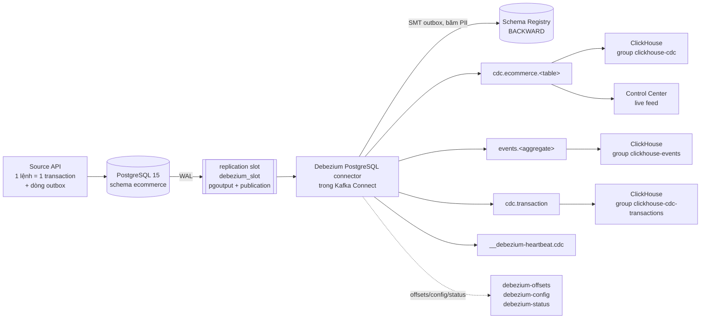
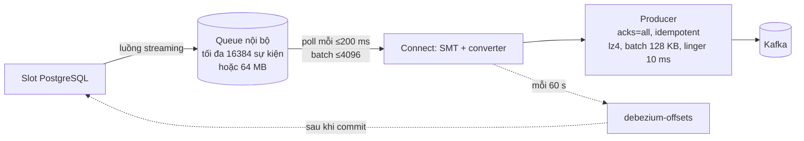
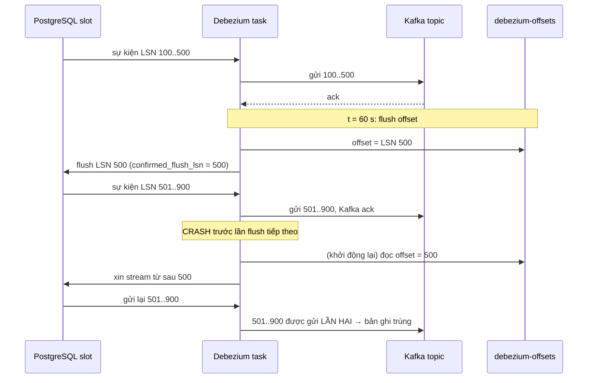
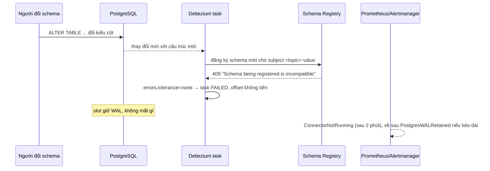
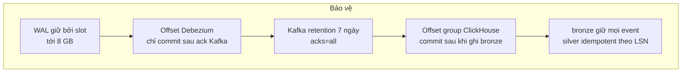

# 03 · Luồng CDC: PostgreSQL → Debezium → Kafka

[Tài liệu dự án](../README.md) / [Data platform](README.md)

## Đọc file này để biết gì

File này giải thích phần lõi của dự án: một thay đổi dữ liệu trong PostgreSQL đi ra Kafka như thế nào, vì sao nó không bị mất, khi nào nó bị gửi lặp, và người vận hành thấy gì khi có sự cố. Đọc xong bạn sẽ:

- Hiểu các khái niệm CDC trên PostgreSQL (WAL, logical decoding, pgoutput, publication, replication slot, LSN, REPLICA IDENTITY, snapshot và streaming) đủ để giải thích cho người mới.
- Biết vai trò riêng của Kafka Connect (runtime) và Debezium (plugin), cách offset được lưu và vì sao đảm bảo giao nhận là **at-least-once**.
- Đọc được cấu hình connector theo từng nhóm và biết lý do của từng lựa chọn (outbox, băm PII, transaction metadata, Schema Registry, tinh chỉnh throughput R10).
- Biết Kafka được tổ chức ra sao (topic, key, partition, retention, consumer group) và cái gì có thứ tự, cái gì không.
- Nắm các kịch bản lỗi từ đầu đến cuối và cách dữ liệu được bảo vệ trong từng trường hợp.

Những phần liên quan nằm ở file khác, ở đây chỉ nhắc khi cần:

| File | Nội dung |
|------|----------|
| [01-nghiep-vu-va-du-lieu-nguon.md](../business/01-nghiep-vu-va-du-lieu-nguon.md) | Nghiệp vụ marketplace, các bảng nguồn |
| [02-source-api-va-bao-mat.md](../business/02-source-api-va-bao-mat.md) | Source API, transaction mỗi lệnh, ghi outbox, secrets, quyền |
| [04-warehouse.md](04-warehouse.md) | ClickHouse bronze/silver/consistent/gold, watermark, snapshot |
| [05-mart-va-metric.md](05-mart-va-metric.md) | Mart, định nghĩa metric |
| [06-van-hanh.md](../operations/06-van-hanh.md) | Vận hành, giám sát, alert, runbook |

## Mục lục

1. [Bức tranh tổng thể](#1-bức-tranh-tổng-thể)
2. [Khái niệm CDC cho người mới](#2-khái-niệm-cdc-cho-người-mới)
3. [Vì sao CDC, không phải polling hay dual write](#3-vì-sao-cdc-không-phải-polling-hay-dual-write)
4. [Table CDC và Outbox: dự án làm cả hai](#4-table-cdc-và-outbox-dự-án-làm-cả-hai)
5. [Phía PostgreSQL: cấu hình, user, publication, replica identity](#5-phía-postgresql-cấu-hình-user-publication-replica-identity)
6. [Kafka Connect và Debezium](#6-kafka-connect-và-debezium)
7. [Offset và đảm bảo at-least-once](#7-offset-và-đảm-bảo-at-least-once)
8. [Cấu hình connector theo từng nhóm](#8-cấu-hình-connector-theo-từng-nhóm)
9. [Image tùy biến, secrets, metrics, đăng ký connector](#9-image-tùy-biến-secrets-metrics-đăng-ký-connector)
10. [Kafka: broker, topic, key, thứ tự, consumer](#10-kafka-broker-topic-key-thứ-tự-consumer)
11. [Schema Registry (R9)](#11-schema-registry-r9)
12. [Vì sao chỉ có MỘT connector](#12-vì-sao-chỉ-có-một-connector)
13. [Hiệu năng đo được](#13-hiệu-năng-đo-được)
14. [Kịch bản lỗi từ đầu đến cuối](#14-kịch-bản-lỗi-từ-đầu-đến-cuối)
15. [Bản ghi trùng: ai xử lý, ở đâu](#15-bản-ghi-trùng-ai-xử-lý-ở-đâu)
16. [HA: tóm tắt](#16-ha-tóm-tắt)
17. [Bài học rút ra](#17-bài-học-rút-ra)

---

## 1. Bức tranh tổng thể

Source API ghi mỗi lệnh nghiệp vụ (đặt đơn, thanh toán, giao hàng...) trong **một transaction PostgreSQL**. Cùng transaction đó ghi thêm một dòng vào bảng outbox để mô tả sự kiện nghiệp vụ. PostgreSQL ghi mọi thay đổi vào WAL. Debezium, chạy bên trong Kafka Connect, đọc WAL qua một replication slot và đẩy ra ba loại topic:

- `cdc.ecommerce.<table>`: thay đổi từng dòng của 31 bảng nghiệp vụ (trạng thái trước và sau).
- `events.<aggregate>`: sự kiện nghiệp vụ lấy từ outbox (ví dụ `events.order`, `events.payment`).
- `cdc.transaction`: một bản ghi BEGIN và một bản ghi END cho mỗi transaction, kèm số sự kiện theo từng bảng. Đây là nền của watermark ở warehouse.

ClickHouse đọc thẳng từ Kafka bằng Kafka engine, không cần sink connector hay stream processor.



Đường đi của một thay đổi, theo thời gian:

```mermaid
sequenceDiagram
    participant API as Source API
    participant PG as PostgreSQL
    participant DBZ as Debezium (Connect task)
    participant K as Kafka
    participant CH as ClickHouse
    API->>PG: BEGIN; UPDATE orders; INSERT ledger; INSERT+DELETE outbox; COMMIT
    PG->>PG: ghi WAL (có LSN), fsync khi COMMIT
    PG-->>DBZ: logical decoding (pgoutput) gửi transaction đã commit
    DBZ->>DBZ: dựng event before/after, băm PII, outbox router
    DBZ->>K: gửi event vào cdc.ecommerce.*, events.*, cdc.transaction (acks=all)
    K-->>DBZ: ack
    Note over DBZ: mỗi 60 s: Connect ghi offset (LSN) vào debezium-offsets
    DBZ-->>PG: báo flush LSN → confirmed_flush_lsn tiến lên, WAL cũ được giải phóng
    CH->>K: poll theo consumer group, ghi bronze, commit offset Kafka
```

---

## 2. Khái niệm CDC cho người mới

**Change Data Capture (CDC)** là kỹ thuật bắt từng thay đổi (INSERT, UPDATE, DELETE) của database và phát chúng ra như một dòng sự kiện, theo đúng thứ tự commit, gần như tức thì. Có nhiều cách làm CDC (trigger, polling theo cột thời gian, đọc log). Dự án dùng cách **log-based**: đọc log giao dịch của chính PostgreSQL.

### WAL (Write-Ahead Log)

Trước khi sửa dữ liệu trên đĩa, PostgreSQL ghi thay đổi vào WAL, một log chỉ ghi nối tiếp. Khi COMMIT, WAL được fsync; nếu máy sập, PostgreSQL phát lại WAL để phục hồi. Vì mọi thay đổi đã commit đều có trong WAL theo thứ tự, WAL là nguồn tự nhiên cho CDC: không cần sửa ứng dụng, không cần trigger.

### LSN (Log Sequence Number)

LSN là vị trí (byte offset) trong WAL, chỉ tăng. Mỗi bản ghi WAL có một LSN. Trong dự án, LSN của mỗi sự kiện được dùng làm **phiên bản dòng** ở silver: phiên bản nào có LSN lớn hơn là mới hơn. Nhờ vậy gửi lặp không gây hại (xem [mục 15](#15-bản-ghi-trùng-ai-xử-lý-ở-đâu)).

### Logical decoding và pgoutput

WAL vốn ở dạng vật lý (trang, block), không đọc được như dòng dữ liệu. **Logical decoding** là cơ chế của PostgreSQL dịch WAL thành thay đổi logic: "bảng X, dòng có khóa Y, giá trị cũ, giá trị mới". Việc dịch do một **output plugin** làm. `pgoutput` là plugin có sẵn trong PostgreSQL từ bản 10 (cũng là plugin của logical replication gốc), nên không phải cài thêm gì vào server. Logical decoding chỉ gửi những transaction **đã commit**, theo thứ tự commit, và gửi cả transaction một lượt.

Điều kiện: `wal_level = logical`, để WAL chứa đủ thông tin cho việc dịch.

### Publication

Publication là danh sách bảng mà pgoutput được phép phát ra. Dự án tạo `cdc_publication` cho **tất cả bảng trong schema ecommerce** (kể cả bảng tạo sau này). Việc chọn bảng nào thực sự được stream do Debezium quyết định qua `table.include.list`. Publication do chủ sở hữu bảng tạo trong init.sql; Debezium không được tự tạo (`publication.autocreate.mode = disabled`) vì user của nó không có quyền đó.

### Replication slot

Replication slot là "dấu trang" bền vững trên server cho một consumer. Nó ghi nhớ consumer đã xác nhận đến đâu, và **giữ lại WAL** từ điểm đó trở đi, kể cả khi consumer đang offline. Đây là thứ giúp không mất thay đổi khi Debezium dừng: WAL chưa được xác nhận sẽ không bị xóa. Mặt trái: nếu consumer dừng lâu, WAL phình lên và có thể làm đầy đĩa, nên dự án đặt giới hạn `max_slot_wal_keep_size = 8GB` (mục 5).

Slot của dự án tên `debezium_slot`, kiểu logical, dùng plugin pgoutput.

### restart_lsn và confirmed_flush_lsn

Mỗi slot có hai vị trí quan trọng (xem trong `pg_replication_slots`, hoặc view `ecommerce.cdc_replication_status`):

| Cột | Ý nghĩa |
|-----|---------|
| `confirmed_flush_lsn` | Consumer đã xác nhận đã xử lý xong đến LSN này. Khi kết nối lại, PostgreSQL gửi tiếp từ đây. |
| `restart_lsn` | LSN cũ nhất mà server phải giữ để có thể decode lại (có thể cũ hơn confirmed_flush_lsn vì cần đọc từ đầu các transaction đang dở). WAL trước điểm này mới được xóa. |

Khoảng cách từ LSN hiện tại đến `restart_lsn` là lượng WAL bị giữ lại; exporter công bố nó thành metric `cdc_postgres_slot_retained_wal_bytes`.

### REPLICA IDENTITY

Khi UPDATE hoặc DELETE, WAL cần chứa đủ thông tin để xác định dòng cũ. REPLICA IDENTITY quyết định phần "giá trị cũ" (`before`) gồm gì:

| Chế độ | `before` chứa | Dùng trong dự án cho |
|--------|---------------|----------------------|
| DEFAULT | Chỉ khóa chính | Bảng append-only (`order_status_history`, `inventory_movements`, `shipment_events`, `price_history`, `seller_ledger_entries`) và `outbox_events` |
| FULL | Toàn bộ dòng cũ | Mọi bảng trạng thái còn lại |

Vì sao FULL cho bảng trạng thái: silver cần dòng cũ đầy đủ để ghi một bản "đã xóa" khi có DELETE, và `consistent.*` cần ảnh `before` để hiển thị dòng như trước một transaction chưa đến đủ (xem [04-warehouse.md](04-warehouse.md)). Vì sao DEFAULT cho bảng append-only: chúng không bị sửa, nên FULL chỉ làm WAL to thêm mà không có lợi. REPLICA IDENTITY do chủ bảng đặt trong init.sql, vì `cdc_user` không có quyền ALTER TABLE. Script kiểm tra hợp đồng dữ liệu (check_contract.py) báo lỗi nếu có bảng trạng thái thiếu FULL.

### Snapshot và streaming

Slot chỉ chứa thay đổi **từ lúc tạo slot**. Dữ liệu có từ trước phải được đọc riêng. Debezium làm hai pha:

1. **Snapshot**: tạo slot, lấy đúng thời điểm nhất quán của slot, rồi đọc toàn bộ bảng trong một transaction REPEATABLE READ ở đúng thời điểm đó. Mỗi dòng phát ra với `op = r` (read).
2. **Streaming**: đọc slot từ đúng điểm snapshot, phát `c` (insert), `u` (update), `d` (delete).

Vì snapshot và slot dùng chung một điểm, không có khoảng hở (mất thay đổi) hay chồng lặp. Ở dự án, `snapshot.mode = initial`: chỉ snapshot khi connector chạy lần đầu (chưa có offset), sau đó chỉ stream. Thực tế dữ liệu được tạo qua API sau khi stack chạy, nên snapshot ban đầu thường gần như rỗng.

Ngoài ra Debezium có **incremental snapshot**: snapshot lại một số bảng trong khi vẫn stream, kích hoạt bằng cách chèn một dòng "signal" vào bảng `ecommerce.debezium_signals`. Đây là đường phục hồi khi slot bị mất (mục 14).

### Hình dạng một sự kiện

Mỗi sự kiện của table topic là một "envelope" gồm: `before` (dòng cũ hoặc null), `after` (dòng mới hoặc null), `op` (c/u/d/r), `ts_ms` (lúc Debezium xử lý), `source` (bảng, LSN, txId, `ts_ms` là lúc commit ở PostgreSQL) và khối `transaction` (id transaction, thứ tự trong transaction). Dự án **cố ý giữ nguyên envelope**, không dùng SMT "unwrap" (ExtractNewRecordState) vì unwrap bỏ mất `before`, mà warehouse cần `before`.

---

## 3. Vì sao CDC, không phải polling hay dual write

| Cách | Cách làm | Vấn đề |
|------|----------|--------|
| Polling | Định kỳ query `WHERE updated_at > lần trước` | Không thấy DELETE; bỏ sót thay đổi nếu nhiều update giữa hai lần poll (chỉ thấy trạng thái cuối); tốn tải query trên DB nguồn; độ trễ bằng chu kỳ poll; phụ thuộc cột updated_at được cập nhật đúng; khó bắt transaction dài commit muộn với timestamp cũ |
| Dual write | Ứng dụng vừa ghi DB vừa gửi Kafka | Hai hệ thống không có transaction chung: ghi DB xong mà gửi Kafka lỗi (hoặc ngược lại) là lệch dữ liệu vĩnh viễn; thứ tự có thể đảo |
| Trigger | Trigger ghi vào bảng log | Thêm tải vào mỗi lệnh ghi, phải bảo trì trigger cho từng bảng |
| **Log-based CDC** | Đọc WAL | Thấy mọi thay đổi kể cả DELETE, đúng thứ tự commit, chỉ transaction đã commit, tải thấp, không sửa ứng dụng |

Với dự án này, lý do chính là **tính đúng**: mọi lệnh nghiệp vụ là một transaction, và CDC trả về đúng các transaction đó, đúng thứ tự, không thiếu không thừa (trừ lặp, sẽ nói sau). Chi phí là phải vận hành slot cẩn thận.

---

## 4. Table CDC và Outbox: dự án làm cả hai

### Table CDC

Mỗi bảng có một topic; mỗi sự kiện là thay đổi của một dòng. Ưu điểm: phản ánh đúng trạng thái DB, không cần ứng dụng làm gì. Nhược điểm: sự kiện gắn với cấu trúc bảng (đổi schema bảng là đổi "hợp đồng" với consumer), và không mang ý nghĩa nghiệp vụ ("đơn bị hủy vì hết hạn thanh toán" chỉ thấy là `status` đổi từ A sang B).

Warehouse dùng table CDC vì nó cần trạng thái đầy đủ của từng bảng.

### Outbox pattern

Ứng dụng ghi **một dòng sự kiện nghiệp vụ** vào bảng `outbox_events` **trong cùng transaction** với thay đổi nghiệp vụ. Vì cùng transaction, sự kiện tồn tại khi và chỉ khi thay đổi được commit: giải quyết bài toán dual write mà không cần distributed transaction. CDC đọc dòng outbox từ WAL và chuyển thành message.

Cách dự án làm (xem source-api `outbox.py` và [02-source-api-va-bao-mat.md](../business/02-source-api-va-bao-mat.md)):

- Mỗi sự kiện có `aggregatetype` (order, payment...), `aggregateid`, `type` (tên sự kiện), `payload` (JSON) và `created_at` theo đồng hồ nghiệp vụ.
- Dòng outbox được **INSERT rồi DELETE ngay trong cùng transaction**. WAL vẫn chứa lệnh INSERT, nên Debezium vẫn thấy sự kiện; còn bảng thì luôn rỗng, không cần job dọn dẹp.
- SMT **Outbox Event Router** của Debezium bắt sự kiện của topic `cdc.ecommerce.outbox_events`, đổi đích thành `events.<aggregatetype>`, dùng `aggregateid` làm key, đưa id/type/aggregate/thời điểm vào message. Lệnh DELETE bị router bỏ qua.
- Payload giữ dạng **chuỗi JSON**, không bung thành object: các loại sự kiện trong cùng một topic có hình dạng khác nhau, nếu bung ra thì schema của topic thay đổi liên tục và không giữ được tương thích BACKWARD.

| | Table CDC | Outbox |
|--|-----------|--------|
| Hợp đồng | Cấu trúc bảng | Sự kiện nghiệp vụ do ứng dụng định nghĩa |
| Ứng dụng phải làm | Không | Ghi outbox trong mỗi transaction |
| Thấy DELETE, trạng thái cũ | Có | Chỉ những gì ứng dụng ghi |
| Dùng cho | Warehouse (bronze → silver) | Consumer cần ý nghĩa nghiệp vụ, `bronze.domain_events` |
| Topic | `cdc.ecommerce.<table>` | `events.<aggregate>` |

Một điểm tinh tế: các sự kiện outbox vẫn được tính trong bản ghi END của `cdc.transaction` (mỗi sự kiện = 1 insert + 1 delete). ClickHouse trừ phần này ra khi tính số sự kiện cần đến bronze của mỗi transaction.

---

## 5. Phía PostgreSQL: cấu hình, user, publication, replica identity

### postgresql.conf

| Setting | Giá trị | Ý nghĩa | Vì sao |
|---------|---------|---------|--------|
| `wal_level` | logical | WAL chứa đủ thông tin để logical decoding | Bắt buộc cho CDC |
| `max_wal_senders` | 10 | Số tiến trình gửi WAL đồng thời | Debezium dùng 1; dư cho công cụ khác |
| `max_replication_slots` | 10 | Số slot tối đa | Dự án dùng 1 |
| `max_slot_wal_keep_size` | 8GB | WAL tối đa một slot được giữ; vượt quá thì slot bị **invalidate** | Đổi "đầy đĩa làm sập DB nguồn" lấy "phải snapshot lại". DB nghiệp vụ quan trọng hơn pipeline phân tích |
| `wal_keep_size` | 1GB | WAL giữ thêm cho standby vật lý | Dự phòng; không liên quan trực tiếp đến slot |
| `max_wal_size` / `min_wal_size` | 2GB / 100MB | Ngưỡng checkpoint | Tránh checkpoint quá dày khi tải cao |
| `max_connections` | 200 | Số kết nối tối đa | Debezium chỉ dùng vài kết nối (replication + JDBC); phần lớn là pool của Source API. Alert khi vượt 80% |
| `log_replication_commands` | on | Ghi log lệnh replication | Dễ điều tra khi slot có vấn đề |
| `log_statement` | ddl | Ghi log mọi DDL | DDL là nguồn gây lỗi schema ở CDC |

Vì sao 8 GB: với tốc độ ghi của dự án, đó là khoảng đủ để Debezium có thể ngừng một thời gian dài (nhiều giờ ở tải thường) mà vẫn đuổi kịp, nhưng vẫn nhỏ hơn nhiều so với dung lượng đĩa. Alert `PostgresWALRetained` bắn khi slot giữ hơn 1 GiB, `PostgresSlotWALAtRisk` khi chỉ còn dưới 2 GiB trước khi bị invalidate (dựa trên cột `safe_wal_size`), nên người vận hành có thời gian xử lý trước khi mất slot.

### pg_hba.conf

Cho phép kết nối replication bằng `scram-sha-256` từ mạng. Cổng PostgreSQL chỉ publish ra `127.0.0.1` trên host; trong mạng docker, Debezium kết nối bằng hostname `postgres`.

### User replication: cdc_user

Debezium không dùng superuser. `cdc_user` có đúng những gì cần:

| Quyền | Để làm gì |
|-------|-----------|
| Thuộc tính `REPLICATION` | Mở kết nối replication, tạo và đọc slot |
| `SELECT` trên mọi bảng của schema, kể cả bảng tạo sau (default privileges) | Đọc snapshot |
| `INSERT, UPDATE` trên `cdc_heartbeat` | Câu heartbeat |
| `INSERT` trên `debezium_signals` | Debezium ghi các mốc cửa sổ của incremental snapshot |
| `CONNECT` trên database | Kết nối |

Nó không sở hữu bảng nào, không ALTER được bảng, không tạo được publication. Vì vậy publication và REPLICA IDENTITY phải do chủ bảng tạo sẵn. Mật khẩu nằm trong file secret, được `passwords.sh` áp dụng.

### Các bảng hạ tầng

- `cdc_heartbeat`: một dòng, Debezium cập nhật mỗi 10 giây (mục 8.3).
- `debezium_signals`: bảng tín hiệu điều khiển Debezium (incremental snapshot).
- `cdc_replication_status`: view tiện cho người vận hành, cho thấy slot có active không, restart_lsn, confirmed_flush_lsn và độ trễ theo byte.

---

## 6. Kafka Connect và Debezium

Hai thứ hay bị gộp làm một:

| | Kafka Connect | Debezium PostgreSQL connector |
|--|---------------|-------------------------------|
| Là gì | Runtime (framework) của Kafka để chạy connector | Một plugin source connector chạy trong Connect |
| Làm gì | Quản lý vòng đời connector/task, REST API, gửi message bằng producer, lưu offset, chạy converter và SMT | Kết nối PostgreSQL, tạo/đọc slot, snapshot, dịch thay đổi thành record |
| Ở dự án | Container `cdc-debezium` (image debezium/connect 2.7.3.Final), cổng 8083 | Class PostgresConnector, cấu hình trong `postgres-connector.json` |

Các khái niệm của Connect:

- **Worker**: tiến trình JVM chạy Connect. Ở dự án có một worker ở chế độ distributed, `group.id = debezium-cluster`. Thêm worker cùng group sẽ thành cluster và chia task.
- **Connector**: một cấu hình logic (ở đây `postgres-connector`). **Task**: đơn vị chạy thật. Connector PostgreSQL luôn có **đúng một task**, vì một slot chỉ có một người đọc.
- **REST API** (cổng 8083): tạo, sửa (PUT config), xem trạng thái, restart, pause connector. Control Center và exporter dùng API này.
- **Internal topics**:

| Topic | Chứa | Cấu hình hiện tại |
|-------|------|-------------------|
| `debezium-config` | Cấu hình connector (đã lưu, chưa thay secret) | 1 partition, compact |
| `debezium-offsets` | Offset nguồn của mỗi connector (vị trí LSN) | 25 partition, compact |
| `debezium-status` | Trạng thái connector/task | 5 partition, compact |

Cả ba có replication factor 1 vì chỉ có một broker. Vì cấu hình và offset nằm trong Kafka, worker không có trạng thái riêng: xóa container rồi tạo lại, connector chạy tiếp đúng chỗ cũ.

- **Converter**: chuyển record nội bộ của Connect thành byte. Mặc định của worker là JsonConverter không schema; connector ghi đè cho value bằng JsonSchemaConverter (mục 11).
- **SMT (Single Message Transform)**: biến đổi nhẹ từng record trước khi gửi (ở đây: outbox router).
- **Offset flush interval**: `offset.flush.interval.ms = 60000` (mặc định của image). Mỗi 60 giây Connect ghi offset một lần. Con số này quyết định lượng sự kiện bị gửi lại sau sự cố (mục 7).

Bên trong task, Debezium có hai luồng: một luồng đọc slot và đẩy sự kiện vào **hàng đợi nội bộ** (queue), và luồng `poll()` của Connect lấy từng **batch** từ hàng đợi để gửi cho producer. Các setting R10 điều chỉnh đúng hai thứ này.



---

## 7. Offset và đảm bảo at-least-once

### Offset là gì

Offset của Debezium PostgreSQL không phải offset Kafka, mà là vị trí trong nguồn: LSN đã xử lý, LSN commit của transaction gần nhất, txId, và cờ đang snapshot hay không. Nó được lưu trong topic `debezium-offsets`, key theo tên connector và server.

### Chuỗi xác nhận

1. Debezium đọc sự kiện từ slot, đưa vào queue, Connect gửi sang Kafka.
2. Producer nhận ack từ broker (`acks=all`).
3. Mỗi 60 giây, Connect chờ mọi record đã gửi được ack, rồi ghi offset mới nhất vào `debezium-offsets`.
4. Sau khi offset được ghi, Connect báo cho task; Debezium gửi "flush LSN" cho PostgreSQL. `confirmed_flush_lsn` của slot tiến lên, WAL cũ được giải phóng.

Điểm then chốt: **slot chỉ tiến sau khi offset đã được commit, và offset chỉ được commit sau khi Kafka đã ack**. Vì vậy không bao giờ có trường hợp PostgreSQL bỏ WAL của một thay đổi mà Kafka chưa có. Đó là lý do không mất dữ liệu.



### Khi nào có trùng

Trùng xuất hiện khi task dừng **không sạch** giữa hai lần flush offset: worker crash, container bị kill, task FAILED (ví dụ do Schema Registry chặn), mất kết nối lâu, hoặc rebalance. Tối đa khoảng 60 giây sự kiện (ở ~1.000 sự kiện/giây là cỡ vài chục nghìn message) bị gửi lại. Dừng có kiểm soát (graceful) thường flush offset trước khi tắt, nên ít hoặc không trùng.

Producer idempotence (`enable.idempotence`) **không** chống được loại trùng này: nó chỉ chống trùng do producer tự retry trong một phiên. Sau khi restart là một producer mới, gửi lại từ đầu như message mới với offset Kafka mới.

Ngoài ra còn trùng ở phía consumer: ClickHouse Kafka engine ghi block vào bảng rồi mới commit offset Kafka; nếu ClickHouse chết giữa hai bước này, nó đọc lại các message đó (cùng offset Kafka).

### Downstream phải làm gì

Consumer phải **idempotent**: xử lý một sự kiện hai lần cho cùng kết quả. Ở dự án:

- Sự kiện bảng: dùng (khóa chính, LSN) làm danh tính. Silver là ReplacingMergeTree với version = LSN, nên bản trùng gộp về một.
- Sự kiện domain: dùng `eventId` (UUID của dòng outbox) làm danh tính.

Chi tiết ở [mục 15](#15-bản-ghi-trùng-ai-xử-lý-ở-đâu).

### Vì sao không exactly-once

Kafka Connect (từ 3.3) có exactly-once cho source connector bằng transaction Kafka, nhưng: (1) phần đọc của ClickHouse Kafka engine vẫn là at-least-once, nên đầu cuối vẫn phải idempotent; (2) thêm độ phức tạp và độ trễ (offset ghi trong transaction); (3) với LSN làm version, idempotent ở sink vừa rẻ vừa chắc chắn. Do đó dự án chọn **at-least-once + sink idempotent**, tương đương "effectively-once" ở các lớp đọc.

---

## 8. Cấu hình connector theo từng nhóm

File: `debezium/postgres-connector.json`. Các khóa bắt đầu bằng `_comment` hoặc `_transforms` là ghi chú/cấu hình tắt, Connect bỏ qua.

### 8.1 Kết nối và nguồn

| Setting | Giá trị | Ý nghĩa | Vì sao |
|---------|---------|---------|--------|
| `connector.class` | PostgresConnector | Plugin Debezium cho PostgreSQL | |
| `database.hostname/port/dbname` | postgres:5432, enterprise_db | Địa chỉ nguồn | |
| `database.user` | cdc_user | User tối thiểu quyền | Không dùng superuser |
| `database.password` | tham chiếu `${dir:/run/secrets:cdc_db_password}` | Worker đọc từ file secret lúc chạy | Mật khẩu không nằm trong config đã lưu |
| `topic.prefix` | cdc | Tiền tố mọi topic | Ra `cdc.ecommerce.<table>`, `cdc.transaction` |
| `plugin.name` | pgoutput | Output plugin | Có sẵn trong PostgreSQL |
| `publication.name` | cdc_publication | Publication dùng | Tạo sẵn bởi chủ bảng |
| `publication.autocreate.mode` | disabled | Không tự tạo publication | cdc_user không có quyền |
| `slot.name` | debezium_slot | Tên slot | Alert theo dõi đúng tên này |

### 8.2 Chọn bảng

`table.include.list` là regex: **mọi bảng trong schema ecommerce, trừ** các bảng hạ tầng/nội bộ: `cdc_heartbeat`, `cdc_metrics`, `audit_logs`, `idempotency_keys`, `sim_clock`, `wallet_pending`, `voucher_quota_slots`. Dùng loại trừ thay vì liệt kê: bảng nghiệp vụ mới tự được stream mà không cần sửa file. Cái giá là bảng mới phải có spec silver, nếu không check_contract.py sẽ báo lỗi.

### 8.3 Snapshot, heartbeat, signal

| Setting | Giá trị | Ý nghĩa | Vì sao |
|---------|---------|---------|--------|
| `snapshot.mode` | initial | Snapshot khi chưa có offset, rồi stream | Mặc định an toàn |
| `snapshot.locking.mode` | shared | Chỉ giữ lock nhẹ khi đọc cấu trúc bảng (chặn DDL, không chặn ghi) | Không chặn Source API |
| `snapshot.fetch.size` | 10000 | Số dòng mỗi lần fetch khi snapshot | Cân bằng bộ nhớ/tốc độ |
| `snapshot.max.threads` | 1 | Số luồng snapshot | Nhẹ cho DB nguồn |
| `signal.enabled.channels` / `signal.data.collection` | source / ecommerce.debezium_signals | Nhận lệnh qua bảng signal | Incremental snapshot để phục hồi |
| `heartbeat.interval.ms` | 10000 | Phát heartbeat mỗi 10 s | Giữ slot tiến lên |
| `heartbeat.action.query` | upsert vào cdc_heartbeat | Ghi một dòng vào DB nguồn mỗi heartbeat | Tạo WAL đi qua publication |

**Vì sao cần heartbeat**: slot chỉ tiến khi Debezium xác nhận một LSN. Nếu một thời gian chỉ có thay đổi ở bảng không được stream (ví dụ `idempotency_keys`) hay ở database khác, WAL vẫn tăng nhưng Debezium không nhận sự kiện nào để xác nhận, nên slot đứng yên và WAL bị giữ lại vô ích. Heartbeat gửi message vào topic `__debezium-heartbeat.cdc` để có offset mới, còn câu action query tạo một thay đổi thật trong WAL để luồng replication luôn có dữ liệu đi qua. ClickHouse không đọc topic heartbeat.

### 8.4 Hình dạng dữ liệu

| Setting | Giá trị | Ý nghĩa | Vì sao |
|---------|---------|---------|--------|
| `tombstones.on.delete` | false | Không phát message null sau DELETE | Không topic nào dùng log compaction; message null sẽ làm hỏng ingest ở ClickHouse |
| `decimal.handling.mode` | string | DECIMAL thành chuỗi chính xác | Không làm tròn qua số thực |
| `time.precision.mode` | connect | Kiểu thời gian theo kiểu chuẩn của Kafka Connect | Đơn giản cho consumer |
| SMT unwrap | **tắt** | | Giữ `before` cho silver và consistent |

Tiền trong dự án là BIGINT (VND), nên phần lớn không bị ảnh hưởng bởi decimal; setting này là lưới an toàn cho cột DECIMAL.

### 8.5 Transaction metadata

`provide.transaction.metadata = true`: Debezium phát vào topic `cdc.transaction` một bản ghi **BEGIN** và một bản ghi **END** cho mỗi transaction. Bản END có id transaction, tổng số sự kiện, và số sự kiện theo từng bảng. Mỗi sự kiện dữ liệu cũng mang khối `transaction` cho biết nó thuộc transaction nào.

Vì sao quan trọng: mỗi bảng một topic, ClickHouse đọc các topic độc lập, nên tại một thời điểm có thể đã có `orders` mới mà chưa có `seller_ledger_entries` của cùng transaction (một lần đo dưới tải thấy 20 đơn như vậy). Topic `cdc.transaction` có **một partition**, nên các bản END nằm đúng thứ tự commit. ClickHouse đếm: transaction đầu tiên mà số sự kiện đã đến bronze còn ít hơn số trong bản END chính là **watermark**; mọi transaction trước đó đều đã đủ. Lớp `consistent.*` chỉ hiển thị dữ liệu trước watermark. Chi tiết ở [04-warehouse.md](04-warehouse.md).

### 8.6 SMT: Outbox Event Router

| Setting | Ý nghĩa |
|---------|---------|
| `transforms = outbox`, type EventRouter | Bật router |
| `predicate = isOutbox` (TopicNameMatches `cdc.ecommerce.outbox_events`) | Chỉ áp cho topic outbox; record của bảng khác đi qua nguyên vẹn |
| `route.topic.replacement = events.${routedByValue}` | Topic đích theo giá trị cột `aggregatetype` |
| `table.expand.json.payload = false` | Payload giữ là chuỗi JSON (lý do ở mục 4) |
| `table.fields.additional.placement` | Đưa `id`→`eventId`, `type`→`eventType`, `aggregatetype`→`aggregateType`, `aggregateid`→`aggregateId`, `created_at`→`occurredAt` vào message |

Key của message là `aggregateid`, nên mọi sự kiện của cùng một đơn hàng đi cùng một partition và giữ thứ tự.

### 8.7 Băm PII

Setting `column.mask.hash.v2.SHA-256.with.salt.<salt>` liệt kê các cột cá nhân: tên, email, điện thoại của khách; tên người nhận, điện thoại, đường của địa chỉ; tên và địa chỉ giao hàng trên đơn; email người bán. Debezium thay giá trị bằng SHA-256 có salt **trước khi ra khỏi Debezium**: Kafka và warehouse không bao giờ thấy dữ liệu gốc, nhưng vẫn join và đếm được người mua (cùng giá trị → cùng hash).

- Salt nằm trong file `secrets/pii_salt`, đặt một lần cho mỗi môi trường: đổi salt là đổi mọi hash, phá join với lịch sử.
- Salt có salt để chống tra ngược bằng bảng hash có sẵn (email, số điện thoại có không gian nhỏ, dễ brute force nếu không có salt).
- `v2` là phiên bản thuật toán băm của Debezium cho kết quả ổn định theo giá trị chuỗi.
- Salt là **một phần của tên setting**, không phải giá trị, nên config provider của Connect không thay được; register.sh thay nó vào trước khi gửi config (mục 9). Hệ quả: salt có mặt trong config đã lưu ở `debezium-config` và đọc được qua REST API của Connect, nên cổng 8083 chỉ mở trên localhost.
- Sự kiện domain không chứa PII. `check_data.py` báo lỗi nếu email/điện thoại/địa chỉ dạng rõ xuất hiện trong ClickHouse.

### 8.8 Converter

| Setting | Giá trị | Vì sao |
|---------|---------|--------|
| `key.converter` | JsonConverter, không kèm schema | Key là JSON gọn (khóa chính), dễ đọc |
| `value.converter` | JsonSchemaConverter của Confluent | Đăng ký schema của value vào Schema Registry |
| `value.converter.schema.registry.url` | http://schema-registry:8081 | |
| `value.converter.auto.register.schemas` | true | Schema mới được tự đăng ký nếu tương thích |

### 8.9 Xử lý lỗi

| Setting | Giá trị | Ý nghĩa |
|---------|---------|---------|
| `errors.tolerance` | none | Gặp record không chuyển đổi được thì task FAILED, không bỏ qua |
| `errors.log.enable`, `errors.log.include.messages` | true | Ghi lỗi kèm nội dung record vào log |

Triết lý **fail fast**: thà dừng pipeline và báo động (`ConnectorNotRunning`) còn hơn lặng lẽ bỏ dữ liệu. Khi task dừng, slot giữ WAL, nên sửa xong chạy lại là đủ. Không dùng dead letter queue vì DLQ của Connect chỉ áp dụng cho sink connector; và một sự kiện bị bỏ sẽ làm watermark kẹt (transaction thiếu sự kiện).

### 8.10 Throughput (R10)

| Setting | Giá trị (mặc định Debezium) | Ý nghĩa | Hiệu ứng |
|---------|-----------------------------|---------|----------|
| `max.batch.size` | 4096 (2048) | Số sự kiện tối đa mỗi lần poll | Ít vòng poll hơn khi burst |
| `max.queue.size` | 16384 (8192) | Sức chứa queue giữa luồng đọc slot và poll | Hấp thụ đột biến 11.11 mà luồng đọc không phải chờ |
| `max.queue.size.in.bytes` | 64 MB (không giới hạn) | Giới hạn queue theo byte | Dòng to (FULL, JSON) không làm tràn heap JVM |
| `poll.interval.ms` | 200 (500) | Thời gian chờ sự kiện mới khi queue rỗng | Giảm độ trễ khi tải thấp |
| `producer.override.acks` | all | Chờ mọi replica in-sync ghi | Bền vững; với 1 broker bằng acks=1 nhưng sẵn sàng cho RF=3 |
| `producer.override.enable.idempotence` | true | Producer gắn số thứ tự để broker loại trùng khi retry | Retry không sinh trùng/đảo thứ tự trong một phiên |
| `producer.override.compression.type` | lz4 (trước đó gzip) | Nén batch | lz4 tốn CPU ít hơn nhiều gzip; ClickHouse đọc được |
| `producer.override.linger.ms` | 10 | Chờ tối đa 10 ms để gom batch | Batch to hơn, đổi lấy ≤10 ms trễ |
| `producer.override.batch.size` | 131072 (16384) | Kích thước batch mỗi partition | Ít request, nén tốt hơn |

Ràng buộc: `max.queue.size` phải lớn hơn `max.batch.size`. Các khóa `producer.override.*` ghi đè cấu hình producer cho riêng connector này; chúng có hiệu lực vì chính sách ghi đè mặc định của worker cho phép.

Kết quả đo ở mục 13. Khi queue gần đầy (`DebeziumQueueFilling`), nghĩa là Kafka/producer không theo kịp; khi `DebeziumBehindSource` cao, Debezium đọc chậm hơn PostgreSQL ghi.

---

## 9. Image tùy biến, secrets, metrics, đăng ký connector

### debezium/Dockerfile

Image gốc `debezium/connect:2.7.3.Final` không có converter JSON Schema của Confluent. Dockerfile tải plugin `kafka-connect-json-schema-converter` bản **7.9.0** từ Confluent Hub, **kiểm tra sha256** trước khi giải nén vào thư mục plugin của Connect. Kiểm tra hash để build tái lập được và chống tải phải file bị thay đổi (supply chain). Image ra: `realtime-cdc/debezium:2.7.3-jsonschema`.

### DirectoryConfigProvider

Worker bật config provider tên `dir` (lớp DirectoryConfigProvider của Kafka). Trong config connector, một giá trị có dạng tham chiếu đến thư mục và tên file sẽ được worker thay bằng nội dung file **lúc chạy**. File mật khẩu được mount chỉ đọc vào `/run/secrets/cdc_db_password`. Kết quả: config lưu trong Kafka và trả về qua REST chỉ chứa tham chiếu, không có mật khẩu; `docker inspect` cũng không thấy. Chi tiết chính sách secrets ở [02-source-api-va-bao-mat.md](../business/02-source-api-va-bao-mat.md).

### Jolokia (JMX qua HTTP)

`ENABLE_JOLOKIA` bật agent Jolokia ở cổng 8778 (chỉ trong mạng compose). Platform exporter đọc MBean streaming của Debezium: `MilliSecondsBehindSource` (trễ giữa commit và lúc xử lý), `QueueRemainingCapacity`/`QueueTotalCapacity`, `Connected`, `MilliSecondsSinceLastEvent`, `TotalNumberOfEventsSeen`. Trạng thái connector/task lấy từ REST API (`/connectors?expand=status`).

### register.sh

1. Đọc salt từ `secrets/pii_salt` (dừng với hướng dẫn chạy `setup-env.sh` nếu thiếu).
2. Đọc `postgres-connector.json`, thay chỗ giữ chỗ salt bằng salt thật.
3. Gửi **PUT** `/connectors/postgres-connector/config`: tạo mới nếu chưa có, cập nhật nếu đã có (idempotent, chạy lại bao nhiêu lần cũng được). Đổi config sẽ khiến Connect khởi động lại task, task đọc tiếp từ offset cũ.

Bước này **bắt buộc** sau khi dựng stack; không có connector thì Kafka không nhận gì. `observability/start.sh` gọi lại register.sh; Control Center cũng có nút "register" (gửi POST tạo connector).

### Thứ tự khởi động

Container Debezium chỉ khởi động khi Kafka, Schema Registry và PostgreSQL đều healthy. Healthcheck của Debezium gọi REST cổng 8083.

---

## 10. Kafka: broker, topic, key, thứ tự, consumer

### Broker KRaft

Một broker `confluentinc/cp-kafka:8.3.2` ở chế độ **KRaft**: cùng tiến trình vừa là broker vừa là controller, metadata lưu trong log Raft nội bộ, **không có ZooKeeper**. Ít thành phần hơn, khởi động nhanh hơn, và ZooKeeper đã bị loại bỏ trong Kafka 4.x. Hai listener: `kafka:9092` cho container, `localhost:29092` cho máy host. Mọi replication factor bằng 1.

### Topic

| Topic | Key | Partition | Nội dung |
|-------|-----|-----------|----------|
| `cdc.ecommerce.<table>` (31 bảng) | Khóa chính dạng JSON | 1 | Envelope before/after/op/source |
| `events.<aggregate>` (13 topic: order, payment, checkout, cart, customer, shop, product, inventory, catalog, promotion, return, review, shipment) | aggregateId | 1 | Sự kiện domain |
| `cdc.transaction` | id transaction | 1 | BEGIN/END |
| `__debezium-heartbeat.cdc` | server | 1 | Heartbeat |
| `debezium-config/-offsets/-status` | | 1/25/5 | Nội bộ Connect |
| `_schemas` | | 1 | Kho schema của Schema Registry |

Topic được **tự tạo** khi có message đầu tiên (auto create bật), nên nhận cấu hình mặc định của broker: 1 partition, retention 7 ngày (168 giờ), `cleanup.policy = delete`. Bảng nào chưa từng có thay đổi thì chưa có topic. Có topic `cdc.ecommerce.zz_contract_probe` còn lại từ bài kiểm tra Schema Registry.

Retention 7 ngày nghĩa là ClickHouse có thể dừng tối đa 7 ngày mà không mất gì; dựng lại warehouse sẽ đọc lại được những gì còn trong Kafka. Lưu trữ lâu dài là việc của bronze (giữ vĩnh viễn, phần cũ hơn 30 ngày chuyển xuống S3/SeaweedFS).

### Cái gì có thứ tự, cái gì không

- Kafka chỉ đảm bảo thứ tự **trong một partition**. Vì mỗi topic có một partition, mọi thay đổi của một bảng có thứ tự đúng theo commit. Nếu sau này tăng partition, key là khóa chính nên thứ tự **theo từng dòng** vẫn được giữ.
- Sự kiện domain có key là aggregateId: thứ tự theo từng aggregate (ví dụ từng đơn) được giữ.
- **Giữa các topic không có thứ tự**: ClickHouse có thể thấy thay đổi `orders` trước `order_items` của cùng transaction. Transaction metadata và watermark giải quyết việc này.
- `cdc.transaction` phải luôn một partition: watermark dựa vào offset của nó làm thứ tự commit.
- Sau gửi lặp, một sự kiện cũ xuất hiện lại ở offset mới: thứ tự theo offset không còn trùng với thứ tự LSN, nên downstream so sánh bằng LSN chứ không bằng offset.

### Consumer group

| Group | Ai | Đọc | Commit offset |
|-------|----|-----|---------------|
| `clickhouse-cdc` | ClickHouse Kafka engine `bronze.kafka_cdc_events` | regex `^cdc\.ecommerce\..*` (cả topic mới) | Sau khi ghi block, at-least-once |
| `clickhouse-cdc-transactions` | `bronze.kafka_cdc_transactions` | `cdc.transaction` | như trên |
| `clickhouse-events` | `bronze.kafka_domain_events` | regex `^events\..*` | như trên |
| `cdc-webapp-<ngẫu nhiên>` | Control Center live feed | các topic `cdc.ecommerce.*` | Không commit, bắt đầu từ `latest` |

ClickHouse đọc mỗi message như một chuỗi thô (định dạng RawBLOB), bỏ 5 byte header của Schema Registry, rồi tách JSON trong materialized view. Message không đọc được đi vào `bronze.ingest_errors` thay vì bị bỏ (alert `IngestErrors`). Control Center dùng group id ngẫu nhiên mỗi lần chạy và không commit, nên nó chỉ là người xem, không ảnh hưởng đến ClickHouse; nó cũng tự bỏ header 5 byte.

---

## 11. Schema Registry (R9)

### Là gì, vì sao

Schema Registry (`confluentinc/cp-schema-registry:8.3.2`, cổng 8085 trên host) là dịch vụ lưu schema của message theo **subject**, mỗi schema có một id. Với JsonSchemaConverter, mỗi topic có subject `<topic>-value`. Trước khi gửi, converter đăng ký schema (hoặc tìm id có sẵn); registry kiểm tra schema mới có **tương thích** với các phiên bản trước không.

Mục đích: biến hợp đồng dữ liệu giữa nguồn và consumer thành thứ được **kiểm tra tự động**. Không có registry, một cột đổi kiểu ở PostgreSQL sẽ trôi thẳng xuống ClickHouse và làm hỏng parse âm thầm. Có registry, thay đổi phá vỡ bị chặn ngay ở Debezium.

### Định dạng message

Message vẫn là JSON như trước, nhưng có thêm **5 byte đầu**: 1 byte "magic" bằng 0 và 4 byte id schema. Consumer biết schema nào đã dùng để ghi message. ClickHouse và Control Center kiểm tra byte đầu là 0 thì bỏ 5 byte rồi parse JSON; nhờ vậy silver và các lớp trên không phải thay đổi. Key vẫn là JSON thường, không qua registry.

Schema lưu trong topic `_schemas` của Kafka.

### BACKWARD compatibility

Mức tương thích toàn cục là **BACKWARD**: consumer dùng schema mới phải đọc được dữ liệu ghi bằng schema cũ. Trong thực tế với CDC:

- Thêm cột nullable: tương thích (trường mới là optional).
- Đổi kiểu cột (ví dụ INT thành TEXT): **không tương thích**, bị chặn. Đã kiểm chứng bằng một bảng probe.
- Thêm cột bắt buộc không có giá trị mặc định: có thể bị chặn.

BACKWARD là mặc định phổ biến vì nó cho phép nâng cấp consumer trước, producer sau; và consumer chính (ClickHouse) đọc lại cả dữ liệu cũ trong Kafka.

### Khi có thay đổi không tương thích



**Runbook**:

1. Xem lỗi task qua REST status của connector. Thông báo "Schema being registered is incompatible" xác nhận nguyên nhân.
2. Nếu thay đổi là nhầm: sửa lại nguồn (đổi kiểu về như cũ) rồi restart task.
3. Nếu thay đổi là có chủ đích: chuẩn bị consumer trước (spec silver, chạy gen_silver.py, check_contract.py); sau đó đặt compatibility của **đúng subject đó** thành NONE, restart các task FAILED của connector, rồi xóa cấu hình riêng của subject để quay lại BACKWARD.
4. Kiểm tra slot đã tiến lại, alert tự hết, `bronze.ingest_errors` rỗng.

Khi restart, task đọc từ offset cũ và gửi lại phần chưa commit, nên không có khoảng trống.

### Sự cố đã gặp

- **Healthcheck dùng curl**: healthcheck đầu tiên của Schema Registry gọi curl, nhưng image không có curl, nên container không bao giờ healthy và Debezium (phụ thuộc vào nó) không khởi động trong vài phút. Không mất dữ liệu, vì slot giữ WAL; khi Debezium chạy, nó đuổi kịp. Sửa bằng healthcheck HTTP thuần qua `/dev/tcp` của bash.
- **Xóa dòng probe khỏi bronze**: sau bài thử bảng probe, các dòng của nó bị xóa khỏi bronze để "dọn". Nhưng watermark đếm số sự kiện của từng transaction trong bronze; transaction đó trở thành "chưa đủ" và giữ lại mọi transaction sau nó (đến khi ra khỏi cửa sổ 60 phút), `TransactionWatermarkStalled` bắn. Bài học: **không bao giờ xóa dòng khỏi bronze**.
- Warehouse tạo trước R9 phải chạy script chuyển Kafka table sang RawBLOB **trước** khi Debezium dùng converter mới, nếu không message có header sẽ rơi vào ingest_errors.

---

## 12. Vì sao chỉ có MỘT connector

Có thể chia bảng thành nhiều connector để song song hóa, nhưng dự án cố ý dùng một:

- **Watermark cần một dòng thời gian commit duy nhất.** Mỗi connector có slot riêng và topic transaction riêng; bản END của connector A chỉ đếm các bảng của A. Một transaction chạm cả hai nhóm bảng sẽ có hai bản END ở hai topic với offset không so sánh được với nhau. ClickHouse không còn xác định được "mọi transaction trước v đều đủ".
- Hai slot đọc ở hai vị trí khác nhau: một connector có thể đi trước connector kia vài giây hoặc vài giờ (nếu một cái dừng), làm trạng thái các bảng lệch nhau.
- Mỗi slot decode toàn bộ WAL, nên N connector là N lần chi phí decode trên PostgreSQL và N lần WAL bị giữ.
- Debezium PostgreSQL chỉ có một task mỗi connector, nhưng một task đã đạt hơn tải tối đa đo được (CPU 5–17% một nhân ở ~990 sự kiện/giây). Nút thắt nằm ở đường ghi nguồn, không phải CDC.

Muốn scale CDC sau này: tăng partition (giữ key theo khóa chính), thêm worker cho HA chứ không phải để chia bảng, và giữ `cdc.transaction` một partition.

---

## 13. Hiệu năng đo được

| Đo | Kết quả |
|----|---------|
| Trễ commit → ClickHouse, ~990 sự kiện/giây khi 11.11, trước R10 | p50 1,17 s, p95 1,86 s |
| Sau R10 | p50 0,92 s, p95 1,57 s |
| Debezium sau R10 | 5–17% một nhân CPU, tối đa 0,33 s sau PostgreSQL |
| Dưới tải nặng | p95 khoảng 1,6 s |
| Thông lượng tối đa toàn hệ thống | khoảng 1.800 sự kiện/giây, giới hạn bởi đường ghi nguồn (khóa dòng SKU bán chạy), không phải CDC |
| SLO freshness | p95 ≤ 5 s (≤ 30 s lúc cao điểm) |

Trễ được đo trong ClickHouse bằng hiệu `ingested_at − source.ts_ms` (lúc commit), bỏ các dòng snapshot. Debezium chỉ chiếm tối đa khoảng 0,33 s; một phần đáng kể còn lại là chu kỳ flush 1 giây của Kafka engine ClickHouse (`kafka_flush_interval_ms`).

---

## 14. Kịch bản lỗi từ đầu đến cuối

| Sự cố | Chuyện gì xảy ra | Cái gì bảo vệ dữ liệu | Người vận hành thấy | Phục hồi |
|-------|-------------------|-----------------------|---------------------|----------|
| **Debezium/Connect dừng** | Không ai đọc slot; Source API vẫn chạy bình thường | Slot giữ WAL từ confirmed_flush_lsn | `TargetDown`/`DependencyDown`, `ConnectorNotRunning`, sau đó `PostgresWALRetained` (>1 GiB), `PostgresSlotWALAtRisk` (<2 GiB còn lại), `CDCLagHigh` | Khởi động lại; task đọc từ offset, gửi lại phần chưa commit (trùng) |
| **Kafka dừng** | Producer không gửi được, retry; queue Debezium đầy, Debezium ngừng đọc slot; ClickHouse không có gì để đọc | Offset chưa tiến nên slot giữ WAL; dữ liệu đã có trong Kafka nằm trên volume | `DebeziumQueueFilling`, `DebeziumBehindSource`, `TargetDown`, rồi WAL retained | Kafka lên lại, producer gửi tiếp; nếu task đã FAILED thì restart task |
| **ClickHouse dừng** | Debezium và Kafka chạy bình thường; message tích trong Kafka | Retention 7 ngày; offset của consumer group ClickHouse chưa commit | `KafkaBacklogGrowing`, `TargetDown`, mart cũ dần | ClickHouse lên lại, đọc tiếp từ offset đã commit; có thể trùng block cuối |
| **PostgreSQL restart** | Kết nối replication đứt; Debezium thử kết nối lại | Slot logical là bền vững, sống qua restart; confirmed_flush_lsn được lưu | `DependencyDown`, có thể `ConnectorNotRunning` nếu task fail | Debezium tự nối lại hoặc restart task; tiếp tục từ confirmed_flush_lsn |
| **Slot bị invalidate** (WAL giữ vượt 8 GB) | PostgreSQL xóa WAL mà slot còn cần; `wal_status = lost`; Debezium không stream được nữa | Không gì: thay đổi trong khoảng đó **đã mất khỏi WAL** | `PostgresSlotWALAtRisk` trước đó, rồi `PostgresSlotLost` | Tạo lại slot, **snapshot lại** (incremental snapshot qua bảng signal) rồi chạy reconciliation |
| **Slot bị xóa / failover** | Debezium có thể tạo slot mới ở LSN hiện tại và bỏ qua thay đổi một cách âm thầm | Không gì | `PostgresSlotMissing` | Như trên: snapshot lại + reconciliation |
| **Restart connector / crash Connect** | Đọc lại từ offset commit cuối | At-least-once | Thường không có alert; check_data cảnh báo trùng trong bronze | Không cần làm gì: silver idempotent |
| **Thay đổi schema không tương thích** | Registry từ chối, task FAILED | Slot giữ WAL | `ConnectorNotRunning` với thông báo incompatible | Runbook mục 11 |
| **Message không parse được ở ClickHouse** | Đưa vào `bronze.ingest_errors` | Không bị bỏ, giữ để phát lại | `IngestErrors`, có thể `TransactionWatermarkStalled` | Sửa hợp đồng, phát lại |

Ghi chú:

- **Đừng xóa slot như phản xạ đầu tiên** khi WAL phình: xóa slot là mất vị trí, buộc snapshot lại. Hãy khôi phục tiến độ của connector trước.
- Incremental snapshot lấy lại trạng thái hiện tại của các dòng còn tồn tại, nhưng không thể tái tạo các DELETE xảy ra trong khoảng bị mất; reconciliation so sánh PostgreSQL với warehouse để phát hiện phần lệch còn lại.
- Ở cả bốn sự cố "một thành phần dừng" đầu bảng, nguyên lý chung là: mỗi tầng chỉ xác nhận cho tầng trước khi đã ghi bền vững ở tầng sau (PostgreSQL slot ← offset Connect ← ack Kafka; offset Kafka ← ghi ClickHouse). Vì vậy dừng ở đâu thì tầng trước đó giữ dữ liệu.



---

## 15. Bản ghi trùng: ai xử lý, ở đâu

| Nơi | Trùng có đến không | Xử lý |
|-----|--------------------|-------|
| `bronze.cdc_events` | Có: bronze append-only, ghi cả hai bản | Cố ý giữ (audit). check_data đếm trùng ở mức cảnh báo |
| `silver.<table>` (bảng trạng thái) | Không ảnh hưởng | ReplacingMergeTree theo khóa chính, version = LSN: hai bản cùng LSN cùng nội dung gộp làm một; đọc bằng FINAL |
| `silver.<table>` (bảng append-only) | Không ảnh hưởng | ReplacingMergeTree theo khóa, gộp bản trùng |
| Watermark | Không ảnh hưởng | Đếm sự kiện đã đến theo số **khác nhau** của (bảng, LSN), và gộp bản END trùng theo tx_id |
| consistent / snap / mart | Không ảnh hưởng | Đọc từ silver và watermark |
| `bronze.domain_events` | Có: MergeTree thường | Consumer phải khử trùng theo `event_id`; check_data đếm theo số event_id khác nhau |
| Control Center live feed | Có | Chỉ hiển thị |
| Metric trễ | Bản gửi lại có `ingested_at` mới nhưng commit cũ | Có thể làm p95 trễ tăng tạm thời sau một lần restart |

---

## 16. HA: tóm tắt

Môi trường local chạy **single-node có chủ đích** (một PostgreSQL, một broker, một worker, RF = 1) để chạy được trên một máy. Phân tích đầy đủ về HA nằm trong tài liệu nghiên cứu riêng: https://claude.ai/code/artifact/61133ce8-61eb-4076-ab92-31738254ec53.

Điểm cần nhớ khi phỏng vấn:

- Trên **PostgreSQL 15, logical replication slot không được sao chép sang standby**. Nếu failover sang standby mà không có cơ chế như permanent slots của Patroni, primary mới không có slot; Debezium có thể tạo slot mới ở vị trí hiện tại và **mất các thay đổi trong khoảng failover một cách âm thầm**. Alert `PostgresSlotMissing` tồn tại vì lý do này.
- **PostgreSQL 17** có failover slots: slot logical được đồng bộ sang standby, standby được thăng cấp tiếp tục từ đúng vị trí.
- Kafka production: 3 broker, RF = 3, `min.insync.replicas = 2`; lúc đó `acks=all` mới có ý nghĩa đầy đủ (alert `KafkaUnderReplicated` đã sẵn sàng).
- Connect: nhiều worker cùng group để task được chuyển sang worker khác khi một worker chết (vẫn chỉ một task đọc slot).

---

## 17. Bài học rút ra

1. Slot là con dao hai lưỡi: bảo vệ dữ liệu nhưng có thể làm đầy đĩa. Luôn đặt `max_slot_wal_keep_size` và alert theo `safe_wal_size`.
2. At-least-once là thực tế; thiết kế sink idempotent bằng một version tăng đơn điệu (LSN) rẻ hơn và chắc hơn exactly-once.
3. Giữ `before` (REPLICA IDENTITY FULL, không unwrap) cho bảng trạng thái nếu downstream cần xóa hoặc nhìn lại quá khứ.
4. Fail fast (errors.tolerance none + Schema Registry) tốt hơn bỏ qua lỗi; slot làm cho việc dừng là an toàn.
5. Transaction metadata trên một partition là cách rẻ để có đọc nhất quán theo transaction ở warehouse; đổi lại phải giữ một connector.
6. Bronze là sổ cái: không bao giờ xóa dòng trong đó.
7. Healthcheck phải dùng công cụ có trong image; một healthcheck sai có thể chặn cả chuỗi phụ thuộc.
