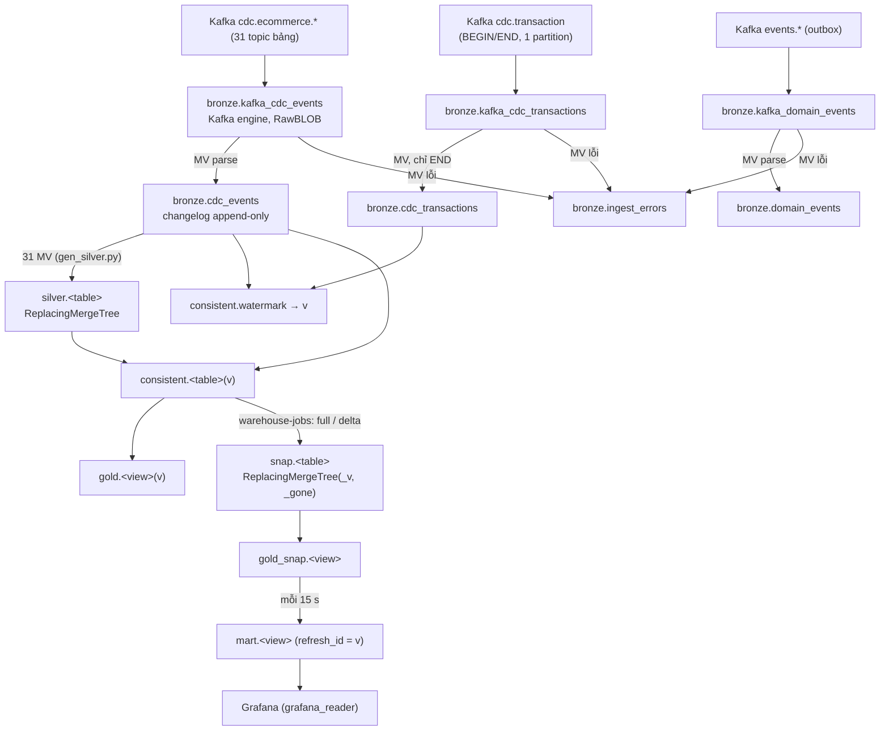
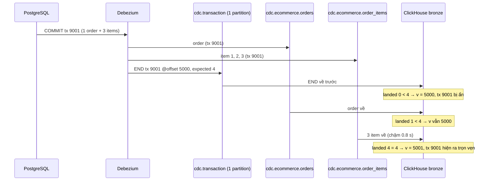
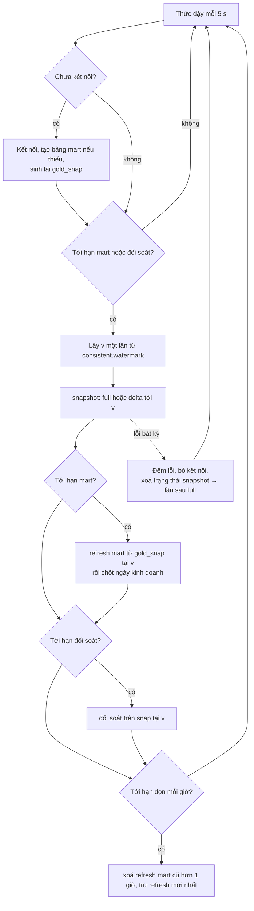
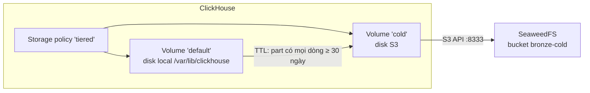

# 04 — Data warehouse ClickHouse: bronze → silver → consistent → gold → snapshot, storage

[Tài liệu dự án](../README.md) / [Data platform](README.md)

## Đọc file này để biết gì

- ClickHouse nhận dữ liệu CDC thẳng từ Kafka ra sao, không cần Spark/Flink hay sink connector nào.
- Mỗi lớp (bronze, silver, consistent, gold, snap, mart, ops) chứa gì, dùng engine nào, và **tại sao** chọn như vậy.
- **Watermark** `v` là gì, sinh ra từ topic `cdc.transaction` như thế nào, và nó chặn "giao dịch rách" (thấy order mà chưa thấy item) ra sao.
- **Incremental snapshot (R20)**: cách đưa bảng snapshot tới watermark mới mà chỉ đọc lại những key bị đụng, kèm ví dụ từng bước và các lỗi đã gặp.
- Service `warehouse-jobs` chạy vòng lặp nào, theo thứ tự nào.
- Storage: MergeTree, part, merge, partition, FINAL; tiered storage với ổ S3 trên SeaweedFS.
- User và quyền trong ClickHouse, ai đọc gì; số liệu hiệu năng; giới hạn hiện tại.

Tài liệu liên quan (không lặp lại ở đây):
[01 — nghiệp vụ và dữ liệu nguồn](../business/01-nghiep-vu-va-du-lieu-nguon.md) ·
[02 — Source API và bảo mật](../business/02-source-api-va-bao-mat.md) ·
[03 — CDC ingestion (PostgreSQL → Debezium → Kafka, Schema Registry)](03-cdc-ingestion.md) ·
[05 — Mart và metric](05-mart-va-metric.md) ·
[06 — Vận hành](../operations/06-van-hanh.md) ·
Bộ câu hỏi ôn phỏng vấn: [Q&A · 04-warehouse.md](../interview/04-warehouse.md)

## Mục lục

1. [Bức tranh tổng thể](#1-bức-tranh-tổng-thể)
2. [Kiến thức MergeTree cần có trước](#2-kiến-thức-mergetree-cần-có-trước)
3. [Bronze: nhận thô từ Kafka](#3-bronze-nhận-thô-từ-kafka)
4. [Silver: trạng thái hiện tại của từng bảng](#4-silver-trạng-thái-hiện-tại-của-từng-bảng)
5. [Watermark: "đã đầy đủ tới đâu"](#5-watermark-đã-đầy-đủ-tới-đâu)
6. [Consistent: đọc trạng thái tại watermark v](#6-consistent-đọc-trạng-thái-tại-watermark-v)
7. [Gold, mart và ops](#7-gold-mart-và-ops)
8. [Incremental snapshot (R20)](#8-incremental-snapshot-r20)
9. [warehouse-jobs: vòng lặp chạy nền](#9-warehouse-jobs-vòng-lặp-chạy-nền)
10. [Storage: tiered storage và SeaweedFS](#10-storage-tiered-storage-và-seaweedfs)
11. [Backup và khôi phục](#11-backup-và-khôi-phục)
12. [User, quyền và ai đọc gì](#12-user-quyền-và-ai-đọc-gì)
13. [Kiểm chứng tính nhất quán](#13-kiểm-chứng-tính-nhất-quán)
14. [Hiệu năng](#14-hiệu-năng)
15. [Sự cố và edge case](#15-sự-cố-và-edge-case)
16. [Giới hạn đã biết](#16-giới-hạn-đã-biết)
17. [Bản đồ file](#17-bản-đồ-file)

---

## 1. Bức tranh tổng thể

ClickHouse (image `clickhouse/clickhouse-server:25.8`, một node) tự làm Kafka consumer. Mọi thứ phía sau đều là bảng và view SQL bên trong ClickHouse, cộng một service Python nhỏ (`warehouse-jobs`) chạy định kỳ. Các file SQL trong `warehouse/clickhouse/init/` chạy tự động khi volume `clickhouse_data` được tạo lần đầu.

| Lớp | Database | Vai trò ngắn gọn | Engine / loại |
|-----|----------|------------------|---------------|
| Bronze | `bronze` | Lưu nguyên mỗi message Kafka, không bao giờ xoá | Kafka engine + MergeTree |
| Silver | `silver` | Trạng thái mới nhất của mỗi bảng nguồn, có kiểu dữ liệu | ReplacingMergeTree |
| Consistent | `consistent` | Silver nhìn tại watermark `v` (chỉ giao dịch đã về đủ) | Parameterized view |
| Gold | `gold` | Định nghĩa metric nghiệp vụ trên `consistent.*(v)` | Parameterized view (+ 1 bảng `daily_sales_closed`) |
| Snap | `snap`, `gold_snap` | Bản vật lý của `consistent.*(v)`, cập nhật từng key | ReplacingMergeTree(_v, _gone) + view |
| Mart | `mart` | Kết quả gold tính sẵn cho dashboard, đánh dấu `refresh_id = v` | MergeTree |
| Ops | `ops` | Kết quả job: đối soát, lịch sử refresh mart | MergeTree + view |

**Tại sao nhiều lớp như vậy (medallion)?** Mỗi lớp giải quyết một vấn đề riêng và có thể sửa/rebuild độc lập:
- Bronze giữ sự thật gốc: nếu logic silver sai, vẫn có thể dựng lại từ bronze. Đây cũng là nguồn cho audit, replay và đo lag.
- Silver biến chuỗi sự kiện thành trạng thái có kiểu dữ liệu, chịu được trùng lặp và đến lệch thứ tự.
- Consistent sửa một vấn đề mà silver không tự sửa được: mỗi bảng đến từ một topic riêng, nên giữa các bảng có độ lệch vài giây.
- Gold chứa định nghĩa metric ở **một chỗ** (chi tiết ở [05](05-mart-va-metric.md)).
- Snap và mart là lớp tối ưu tốc độ, không mang logic nghiệp vụ mới.

---

## 2. Kiến thức MergeTree cần có trước

Phần lớn thiết kế ở đây chỉ dễ hiểu khi nắm vài khái niệm của họ engine MergeTree.

| Khái niệm | Ý nghĩa | Ảnh hưởng tới dự án |
|-----------|---------|---------------------|
| **Part** | Mỗi lần INSERT tạo một "part" bất biến trên đĩa, các cột lưu riêng và nén. | Kafka engine flush mỗi ~1 s, nên mỗi giây sinh part mới cho bronze và cho mỗi bảng silver nhận dữ liệu. Số part mỗi partition được giám sát và có alert. |
| **Merge** | Tiến trình nền gộp nhiều part nhỏ thành part lớn. Thời điểm merge không đoán trước được. | Các engine "Replacing" chỉ khử trùng **lúc merge**, nên trước khi merge xong có thể còn nhiều phiên bản của một key. |
| **Partition** | Part được nhóm theo biểu thức partition; merge không bao giờ gộp part của hai partition khác nhau. | Bronze partition theo ngày (`event_ts`) để di chuyển cả ngày sang cold storage. Silver **không partition**, để mọi phiên bản của cùng key luôn có thể merge với nhau. |
| **ORDER BY** | Thứ tự sắp xếp trong part, đồng thời là sparse primary index để bỏ qua block khi lọc. Với Replacing, ORDER BY cũng là **khoá khử trùng**. | Bronze xếp theo (bảng nguồn, thời gian sự kiện, partition, offset) nên lọc "bảng X trong 35 phút gần nhất" rất rẻ. Silver xếp theo primary key của bảng nguồn. |
| **ReplacingMergeTree(ver, is_deleted)** | Khi merge, với mỗi khoá ORDER BY chỉ giữ dòng có `ver` lớn nhất; nếu dòng thắng có `is_deleted = 1` thì key đó coi như đã xoá. | Silver dùng `_version` = LSN của WAL PostgreSQL; snap dùng `_v` = 2v hoặc 2v+1. |
| **FINAL** | Bắt ClickHouse khử trùng ngay lúc đọc, cho kết quả như thể mọi merge đã xong; với cột `is_deleted`, dòng đã xoá không được trả về. Tốn CPU hơn đọc thường. | Mọi chỗ đọc silver/snap đều dùng FINAL. Đây là lý do snap tồn tại: FINAL trên cột có kiểu rẻ hơn nhiều so với tính lại từ JSON. |
| **TTL** | Luật theo thời gian: xoá dòng hoặc **di chuyển part** sang volume/disk khác. | Bronze: part cũ hơn 30 ngày chuyển sang volume `cold` (S3). Một số bảng ops có TTL xoá sau 1–7 ngày. |
| **Materialized view (MV)** | Trigger trên INSERT: mỗi block được chèn vào bảng nguồn sẽ đi qua câu SELECT của MV và chèn vào bảng đích. Không đọc lại dữ liệu cũ. | Toàn bộ pipeline bronze → silver là chuỗi MV chạy đồng bộ trong cùng lần insert. |
| **Kafka engine** | Bảng "ảo" là một consumer Kafka; đọc trực tiếp không lưu gì. Phải có MV gắn vào để kéo dữ liệu liên tục. | Ba bảng `bronze.kafka_*`. |

---

## 3. Bronze: nhận thô từ Kafka

Nguồn: `warehouse/clickhouse/init/01-bronze.sql`, `04-domain-events.sql`, `config.d/kafka.xml`.

### 3.1 Ba consumer Kafka

| Bảng Kafka engine | Topic | Consumer group | Đích |
|-------------------|-------|----------------|------|
| `bronze.kafka_cdc_events` | regex `^cdc\.ecommerce\..*` (mọi topic bảng, kể cả bảng thêm sau) | `clickhouse-cdc` | `bronze.cdc_events` |
| `bronze.kafka_cdc_transactions` | `cdc.transaction` | `clickhouse-cdc-transactions` | `bronze.cdc_transactions` |
| `bronze.kafka_domain_events` | regex `^events\..*` (outbox) | `clickhouse-events` | `bronze.domain_events` |

Cấu hình chung:
- Mỗi bảng một consumer, flush khối dữ liệu mỗi 1 giây.
- Consumer group mới bắt đầu từ **earliest**, nên khi dựng warehouse mới, snapshot ban đầu của Debezium vẫn được nạp.
- Metadata topic làm mới mỗi 5 giây, để khi connector được đăng ký sau ClickHouse thì các topic mới được nhận nhanh.
- Chế độ lỗi `stream`: message không đọc được không làm dừng consumer mà xuất hiện ở cột ảo `_error`.

### 3.2 RawBLOB và việc bóc header Schema Registry

Từ R9, Debezium ghi giá trị bằng JSON Schema converter của Confluent (xem [03](03-cdc-ingestion.md)). Mỗi message có dạng: **1 byte 0x00 + 4 byte schema id + JSON**. Format JSON thông thường của ClickHouse không đọc được 5 byte đầu này, nên các bảng Kafka đọc message dưới dạng **RawBLOB**: cả message là một chuỗi byte nguyên vẹn.

Các MV bên trên làm việc "bóc vỏ": nếu chuỗi bắt đầu bằng byte 0 thì bỏ 5 byte đầu, nếu không thì giữ nguyên. Nhờ vậy cùng một MV đọc được cả message kiểu cũ (JSON trần, trước R9) và kiểu mới. Sau bước này, phần JSON giống hệt trước R9, nên silver và mọi thứ phía trên không phải đổi. Warehouse tạo trước R9 (đọc bằng JSONAsString) được chuyển sang RawBLOB một lần bằng `rawblob-migration.sh`: xoá các bảng Kafka và MV của chúng rồi chạy lại init SQL; offset nằm trong Kafka nên consumer đọc tiếp đúng chỗ cũ.

### 3.3 bronze.cdc_events: changelog đầy đủ

Mỗi message CDC thành **một dòng**, giữ:
- bảng nguồn, `op` (c = insert, u = update, d = delete, r = đọc từ snapshot ban đầu);
- `lsn` (vị trí WAL PostgreSQL, dùng làm version ở silver), `tx_id` (id giao dịch PostgreSQL; bằng 0 cho dòng snapshot);
- `source_ts` (lúc commit ở PostgreSQL), `event_ts` (lúc Debezium xử lý);
- `before`, `after` dạng JSON thô (nhờ `REPLICA IDENTITY FULL` ở các bảng trạng thái, `before` là cả dòng cũ);
- topic, partition, offset Kafka và `ingested_at`.

Engine MergeTree thường (append-only), partition theo ngày của `event_ts`, ORDER BY (bảng nguồn, event_ts, partition, offset). Bronze **không khử trùng**: nếu Kafka giao lại một message, bronze có hai dòng. Điều đó là chủ ý: bronze là nhật ký "những gì đã nhận", còn khử trùng là việc của silver và watermark (xem [mục 15](#15-sự-cố-và-edge-case)).

MV chỉ nhận message không lỗi **và** có trường `op`. Một JSON hợp lệ nhưng không có `op` sẽ bị bỏ qua (không vào cả bảng lỗi); thực tế Debezium luôn gửi `op` cho message dữ liệu, và tombstone đã bị tắt ở connector.

### 3.4 bronze.ingest_errors: không bao giờ âm thầm vứt message

Với mỗi bảng Kafka có thêm một MV thứ hai, bắt các message có `_error` khác rỗng hoặc không phải JSON hợp lệ (sau khi bóc header). Chúng được lưu nguyên văn kèm topic/partition/offset và lý do lỗi vào `bronze.ingest_errors` để replay sau. `check_data.py` coi bảng này phải rỗng; exporter đếm số dòng và có alert khi xuất hiện lỗi mới.

### 3.5 bronze.cdc_transactions: siêu dữ liệu giao dịch

Connector bật `provide.transaction.metadata`. Debezium khi đó ghi lên topic `cdc.transaction` một bản ghi BEGIN và một bản ghi END cho mỗi giao dịch đã commit. Topic này **chỉ có 1 partition**, nên offset của các bản ghi END chính là **thứ tự commit**.

MV chỉ giữ bản ghi END và tính:
- `event_count`: tổng số sự kiện thay đổi của giao dịch;
- `expected`: số sự kiện sẽ rơi vào `bronze.cdc_events`, tức `event_count` trừ đi các sự kiện của bảng `outbox_events` (outbox được Outbox Event Router chuyển sang topic `events.*`, không vào `cdc_events`);
- `outbox_changes`: số thay đổi outbox (mỗi domain event là 1 insert + 1 delete trong cùng giao dịch);
- `commit_ts` và `kafka_offset` (thứ tự commit).

Ví dụ: giao dịch tạo 1 order, 3 order_items, cập nhật 1 dòng inventory và ghi 1 domain event vào outbox (insert + delete). END ghi `event_count` = 7, trong đó outbox chiếm 2, nên `expected` = 5 và `outbox_changes` = 2.

### 3.6 bronze.domain_events

Domain event từ outbox (`events.<aggregate>`) được tách thành `event_id`, loại event, loại/ID aggregate, payload (JSON; payload gửi dưới dạng chuỗi JSON, message cũ là object — MV đọc được cả hai), `occurred_at`. ORDER BY (aggregate_type, aggregate_id, occurred_at, event_id) để tra lịch sử một aggregate nhanh. Không khử trùng khi ghi; người đọc đếm theo `event_id` duy nhất. `check_data` kiểm: số domain event đã commit (tính từ `outbox_changes / 2`) bằng số `event_id` duy nhất đã về.

### 3.7 Quy tắc vàng: không bao giờ xoá dòng bronze

Watermark (mục 5) đếm sự kiện của từng giao dịch **trong bronze**. Nếu xoá bớt dòng bronze, giao dịch tương ứng mãi mãi "thiếu sự kiện" và chặn mọi giao dịch sau nó.

Bài học thật: khi thử Schema Registry, dự án tạo một bảng probe ở PostgreSQL (cột INT đổi thành TEXT để xem registry từ chối). Xoá các dòng bronze của bảng probe để "dọn dẹp" đã làm watermark đứng: giao dịch chứa các sự kiện đó không bao giờ đủ, và mọi giao dịch sau bị giữ lại cho tới khi bản ghi END cũ ra khỏi cửa sổ 60 phút. Từ đó README ghi rõ: muốn dọn thì không xoá bronze.

---

## 4. Silver: trạng thái hiện tại của từng bảng

Nguồn: `warehouse/clickhouse/gen_silver.py` (sinh ra `init/02-silver.sql`, đừng sửa file sinh ra).

### 4.1 Sinh code từ một danh sách bảng

`gen_silver.py` chứa một spec gọn cho **31 bảng nguồn**: loại bảng (`state` hay `event`), khoá, danh sách cột với mã kiểu ngắn (UUID, String, LowCardinality, Int64, Int32, Bool, DateTime64(6), thêm `?` là Nullable). Từ spec này script sinh:
- bảng `silver.<table>` và MV `silver.mv_<table>` đọc từ `bronze.cdc_events` (file `02-silver.sql`);
- view `consistent.watermark` và 31 view `consistent.<table>(v)`;
- bảng `snap.<table>`, view `snap.<table>_delta(v)`, bảng `snap.dirty`, `snap.runs` và view `snap.changed_keys` (file `07-snapshots.sql`).

Lợi ích: 31 bảng × (bảng + MV + consistent view + snap + delta) là hàng nghìn dòng SQL lặp lại; viết tay sẽ sai lệch. `check_contract.py` dùng chính spec này để so với schema PostgreSQL và cấu hình Debezium, và báo lỗi nếu `02-silver.sql` chưa được sinh lại sau khi sửa spec (chạy trong CI).

Tiền tệ là VND kiểu Int64; thời gian là DateTime64(6, UTC). Các trường PII (tên, email, SĐT, địa chỉ) đã được Debezium băm SHA-256 có salt trước khi rời PostgreSQL, nên silver chỉ thấy chuỗi băm.

### 4.2 Bảng trạng thái (state): ReplacingMergeTree theo LSN

Với bảng trạng thái (orders, customers, inventory, …):
- **Engine**: ReplacingMergeTree với version `_version` = `lsn`, cờ xoá `_is_deleted`, ORDER BY primary key (thường `id`; `inventory` dùng `sku_id`, `shop_wallets` dùng `shop_id`).
- MV lấy ảnh dòng: với delete thì lấy `before`, ngược lại lấy `after`; ép kiểu từng cột.
- Cột phụ: `_version`, `_is_deleted` (op = d), `_synced_at` (lúc nạp), `_tx_id`, và `_before` (ảnh trước của phiên bản này, nén ZSTD) — cần cho consistent view ở mục 6.

**Tại sao LSN làm version?** LSN tăng đơn điệu theo WAL. Hai thay đổi trên cùng một dòng luôn có LSN theo đúng thứ tự xảy ra (PostgreSQL khoá dòng khi ghi). Vì vậy:
- **Đến lệch thứ tự**: update cũ đến sau update mới thì vẫn thua vì LSN nhỏ hơn.
- **Trùng lặp**: cùng sự kiện đến hai lần có cùng LSN và cùng nội dung, giữ bản nào cũng như nhau.
- **Delete**: là phiên bản cuối với `_is_deleted = 1`; FINAL không trả về key đó. Dòng xoá được dựng từ `before` (nhờ REPLICA IDENTITY FULL), nên mọi cột vẫn có giá trị hợp lệ.

Dự án tắt tombstone ở Debezium: không topic nào log-compacted, và message null sẽ làm ClickHouse dừng nạp. "Tombstone" ở silver là dòng `_is_deleted = 1`, không phải message Kafka null.

### 4.3 Bảng sự kiện (event): chỉ nhận insert

Bảng append-only ở nguồn (order_status_history, inventory_movements, shipment_events, price_history, seller_ledger_entries) chỉ nhận op `c`/`r`. Engine ReplacingMergeTree **không có version**, ORDER BY (khoá cha, id), ví dụ (order_id, id). Không có version vì một sự kiện không bao giờ đổi; ReplacingMergeTree ở đây chỉ để gộp bản giao lại (at-least-once). Khoá cha đứng đầu để đọc "mọi sự kiện của một order" rẻ, điều mà snapshot delta tận dụng.

### 4.4 Silver chưa đủ để đọc an toàn

Silver FINAL cho trạng thái mới nhất của **từng bảng**, nhưng mỗi bảng đến từ topic riêng. Trong vài giây, `silver.orders` có thể thấy order COMPLETED trong khi `silver.seller_ledger_entries` chưa có bút toán SALE được ghi cùng giao dịch. Probe dưới tải từng đếm được 20 order như vậy tại cùng một thời điểm. Đó là việc của watermark.

---

## 5. Watermark: "đã đầy đủ tới đâu"

### 5.1 v là gì

`v` là **một vị trí trên topic `cdc.transaction`** (offset của bản ghi END, tức thứ tự commit), mang nghĩa: *mọi giao dịch có vị trí nhỏ hơn v đã về đầy đủ trong bronze; giao dịch tại v là giao dịch đầu tiên còn thiếu sự kiện*. "Complete up to v" nghĩa là tiền tố commit [.., v) đã đủ.

Lưu ý: v không phải `tx_id`. Id giao dịch PostgreSQL được cấp lúc giao dịch **bắt đầu**, không phải lúc commit, nên không dùng làm thứ tự commit được. Offset của END trên topic 1 partition mới đúng thứ tự commit.

### 5.2 Cách tính (view `consistent.watermark`)

1. **ended**: lấy các bản ghi END nạp trong **60 phút** gần nhất, gom theo `tx_id` (lấy `expected` lớn nhất và offset nhỏ nhất, nên END bị giao lại hai lần cũng không sao).
2. **landed**: với các giao dịch đó, đếm số sự kiện **khác nhau** đã có trong `bronze.cdc_events` (đếm cặp bảng + LSN duy nhất, trong 3 giờ gần nhất theo `event_ts`). Đếm duy nhất nên sự kiện trùng không bị tính hai lần.
3. Nếu có giao dịch landed < expected: v = offset nhỏ nhất trong số đó. Nếu không: v = offset lớn nhất + 1.
4. Thêm hai cột chẩn đoán: `held_back` (số giao dịch gần đây có vị trí ≥ v, đang bị giữ lại) và `oldest_held_back_commit` (thời điểm commit cũ nhất bị giữ). Exporter đưa chúng lên Prometheus; có alert khi watermark đứng.

Lấy v rất rẻ và chỉ phụ thuộc dữ liệu đã về, nên mỗi người đọc có thể gọi trước mỗi truy vấn.

### 5.3 Ví dụ: order + 3 item đi qua hai topic

Giao dịch 9001 tạo order O và 3 item, END nằm ở offset 5000 với `expected` = 4. Các topic được đọc độc lập, nên thứ tự về ClickHouse có thể bất kỳ.

| Thời điểm | Đã có trong bronze | landed / expected | v | Người đọc consistent thấy |
|-----------|--------------------|-------------------|---|---------------------------|
| t0 | 2 item, chưa có END | (chưa có END) | ≤ 5000 | Không thấy gì của 9001 (tx chưa nằm trong tập "visible") |
| t1 | END, 2 item | 2 / 4 | 5000 | Không thấy gì của 9001 |
| t2 | END, order, 2 item | 3 / 4 | 5000 | Không thấy gì của 9001 |
| t3 | END, order, 3 item | 4 / 4 | 5001 (hoặc xa hơn) | Thấy O và đủ 3 item cùng lúc |

Không có thời điểm nào người đọc consistent thấy O mà thiếu item, dù silver ở t2 đã có O với 2 item.

### 5.4 Điều gì chặn watermark

- **Sự kiện thiếu**: một giao dịch có END nhưng bronze không đủ sự kiện. Ví dụ đã gặp: xoá dòng bronze của bảng probe. Một message rơi vào `ingest_errors` cũng gây hiệu ứng tương tự cho giao dịch của nó.
- **Một topic bị trễ**: v đứng tại giao dịch đầu tiên có sự kiện trên topic trễ đó; mọi giao dịch sau (kể cả trên bảng khác) chờ theo. Đây là cái giá của "chỉ hiện tiền tố commit đầy đủ".
- **Tự gỡ**: bản ghi END chỉ được xét trong 60 phút. Một giao dịch kẹt lâu hơn sẽ rơi khỏi cửa sổ và không chặn nữa; đồng thời dòng silver nạp hơn 30 phút được hiện không cần kiểm giao dịch (mục 6). Nghĩa là trường hợp xấu nhất: lệch nhất quán được chấp nhận sau 30–60 phút thay vì treo vĩnh viễn.

### 5.5 Tại sao v là tham số, không tự tính trong từng view

ClickHouse không có snapshot xuyên bảng trong một truy vấn: mỗi bảng và mỗi subquery được đọc ở thời điểm riêng, thậm chí `now()` cũng khác nhau giữa các subquery. Phiên bản đầu, mỗi view tự lấy "trạng thái mới nhất" và các view trong cùng một truy vấn bất đồng với nhau; probe đã bắt được. Giữ cố định một số v và truyền cùng một v cho mọi view là cách duy nhất để mọi view chọn giống hệt nhau. Vì thế:
- Người đọc lấy v **một lần**, rồi truyền cùng v cho mọi view trong truy vấn/trang.
- Gold view nhận tham số v và truyền xuống `consistent.*(v)`.
- Việc chốt ngày kinh doanh nằm trong `warehouse-jobs` thay vì refreshable materialized view, vì job giữ được v và truyền đi.

---

## 6. Consistent: đọc trạng thái tại watermark v

Mỗi bảng có một parameterized view `consistent.<table>(v)`. Kết quả là trạng thái **đã từng tồn tại** trong PostgreSQL, thường chậm hơn silver dưới một giây.

### 6.1 Quy tắc "hiện / ẩn" một phiên bản

Một phiên bản dòng (trong silver) được coi là **visible** nếu một trong ba điều đúng:
1. `_tx_id = 0` (dòng từ snapshot ban đầu, không thuộc giao dịch nào);
2. nạp hơn 30 phút trước (coi như chắc chắn đã đủ, để tập kiểm tra luôn nhỏ);
3. giao dịch của nó có END với vị trí < v (tập "visible" lấy từ END nạp trong 90 phút).

### 6.2 Bảng sự kiện

Đơn giản: silver FINAL, bỏ dòng không visible. Một sự kiện sau v chưa xảy ra tại v.

### 6.3 Bảng trạng thái: khôi phục ảnh trước

Khó hơn: silver chỉ giữ **phiên bản mới nhất** (merge đã vứt phiên bản cũ bất cứ lúc nào). Nếu phiên bản mới nhất thuộc giao dịch sau v, ta cần trạng thái **trước** nó. View làm như sau:

- **Nhánh silver**: đọc silver FINAL một lần, đánh dấu phiên bản có visible không.
- **Nhánh restore** (từ bronze, 35 phút gần nhất): với mỗi key có thay đổi thuộc giao dịch chưa visible, lấy ảnh `before` của **thay đổi sớm nhất (LSN nhỏ nhất)** chưa visible. Đó chính là trạng thái của key tại v, vì mọi thay đổi trước nó đều đã visible (thay đổi cùng dòng được tuần tự hoá bằng row lock, nên giao dịch commit sau cũng có LSN lớn hơn trên dòng đó).
- Hai nhánh FULL OUTER JOIN theo key. Mỗi nhánh chỉ đọc đúng một lần: nếu dùng CTE hai lần, ClickHouse sẽ tính nó hai lần ở hai thời điểm và một key có thể xuất hiện ở cả hai phía.

Kết quả cho từng key:

| Trường hợp | Kết quả tại v |
|-----------|---------------|
| Không có thay đổi chưa visible, phiên bản mới nhất visible | Dòng silver như hiện tại |
| Có thay đổi chưa visible, ảnh before của thay đổi sớm nhất là một dòng | Dòng đó (trạng thái cũ) |
| Ảnh before là null (thay đổi sớm nhất là INSERT) | Key không tồn tại tại v → ẩn |
| Delete chưa visible | Silver FINAL đã ẩn key, nhưng nhánh restore trả lại dòng trước khi xoá → key vẫn hiện |
| Phiên bản mới nhất chưa visible nhưng bronze chưa thấy thay đổi đó (silver được đọc sau bronze, lệch nhịp) | Dùng `_before` của chính phiên bản đó; nếu là insert thì ẩn |

Ví dụ: order O đang `TO_SHIP` (đã visible). Giao dịch ở vị trí 5100 chuyển O sang `READY_TO_SHIP` và tạo shipment; event order đã về, event shipment chưa. Silver FINAL thấy `READY_TO_SHIP`. Với v = 5100, nhánh restore tìm thấy thay đổi chưa visible của O, lấy ảnh before = `TO_SHIP`. Người đọc thấy `TO_SHIP` và không thấy shipment: một trạng thái nhất quán.

Điều kiện cần: bảng trạng thái phải có `REPLICA IDENTITY FULL` (để `before` là cả dòng). `check_contract.py` bắt lỗi nếu thiếu.

---

## 7. Gold, mart và ops

### 7.1 Gold

`init/03-gold.sql`: các parameterized view như `order_facts`, `daily_sales`, `overview_kpis`, `funnel`, `product_sales`, `shop_performance`, `platform_pnl`… đều đọc `consistent.*(v)` và truyền v xuống các gold view khác (ví dụ `daily_sales` đọc `order_facts(v)`). Ngoại lệ:
- `gold.cdc_freshness`: không có tham số, đọc bronze trực tiếp để đo lag commit → ClickHouse theo bảng trong 15 phút gần nhất (đây là metric hạ tầng, không cần nhất quán giao dịch).
- `gold.daily_sales_closed`: **bảng**, mỗi ngày kinh doanh đã kết thúc được chốt một lần ("số đã báo cáo").

Định nghĩa GMV, NMV, take rate… và cách tính từng mart: xem [05 — Mart và metric](05-mart-va-metric.md).

### 7.2 Mart

`mart.<view>`: kết quả của từng gold view tính sẵn tại một watermark, cột `refresh_id` = v và `_row` để giữ thứ tự. Một lần refresh chỉ được "công bố" khi dòng tương ứng được ghi vào `ops.mart_refreshes` (ghi **cuối cùng**). Grafana luôn đọc `max(refresh_id)` trong `ops.mart_refreshes`, nên không bao giờ thấy refresh viết dở. Bảng mart không có TTL; refresh cũ được job dọn mỗi giờ (giữ refresh mới nhất).

### 7.3 Ops và giám sát

| Đối tượng | Nội dung |
|-----------|----------|
| `ops.reconciliation` | Mỗi lần đối soát: bảng, cutoff, số dòng và tổng một cột bất biến ở PostgreSQL và ClickHouse, ok/không. TTL 7 ngày. |
| `ops.reconciliation_status` | Kết quả mới nhất mỗi bảng; `failing` = hai lần liên tiếp lệch (một lần lệch có thể là dòng bị xoá ở PostgreSQL giữa hai lần đọc). |
| `ops.mart_refreshes` | Mỗi refresh mart xong: refresh_id = v, thời điểm, thời lượng, số mart. TTL 1 ngày. |
| `snap.runs` | Mỗi lần chạy snapshot: v, mode (full/delta), số key, thời lượng. TTL 1 ngày. |
| `consistent.watermark` | v, held_back, oldest_held_back_commit. |
| `bronze.ingest_errors` | Message lỗi. |
| `system.parts`, `system.query_log` | Exporter đọc số part mỗi partition, dung lượng theo database/disk, p95 thời gian SELECT theo user. |
| Metric Prometheus của warehouse-jobs (cổng 9109) | Số lần chạy lỗi, thời lượng snapshot theo mode, số key mỗi lần delta. |

Exporter và alert: xem [06 — Vận hành](../operations/06-van-hanh.md).

---

## 8. Incremental snapshot (R20)

### 8.1 Vấn đề

Tính gold trực tiếp từ `consistent.*(v)` nghĩa là mỗi mart phải: đọc silver FINAL của mọi bảng nó dùng, quét bronze 35 phút, parse lại JSON, join… 18 mart làm việc này mất khoảng **4.6 s ở 35k order**, và tăng theo toàn bộ lịch sử. Phần lớn công việc lặp lại: giữa hai lần refresh chỉ vài trăm key thay đổi.

### 8.2 Ý tưởng

Giữ `snap.<table>` = `consistent.<table>(v)` dưới dạng **bảng vật lý có kiểu**, và mỗi lần chỉ cập nhật các key bị đụng bởi giao dịch mới trở nên visible.

| Thành phần | Vai trò |
|-----------|---------|
| `snap.<table>` | Cột nghiệp vụ + `_v` + `_gone`, ReplacingMergeTree(_v, _gone), ORDER BY khoá của bảng. Đọc bằng FINAL. |
| `snap.dirty` | (v, bảng, key) cần đưa tới v. TTL 1 giờ. |
| `snap.changed_keys(prev, v, since)` | Các key (theo bảng) bị ghi bởi giao dịch có vị trí trong [prev, v), cộng dòng snapshot (tx 0) nạp từ `since`. Với bảng sự kiện, "key" là khoá cha (cột đầu), ví dụ `order_id` của order_status_history. |
| `snap.<table>_delta(v)` | Cùng logic với `consistent.<table>(v)` nhưng chỉ cho các key trong `snap.dirty` tại v, chỉ cột nghiệp vụ. |
| `gold_snap.<view>` | Từng gold view được viết lại để đọc `snap.X FINAL` thay vì `consistent.X(v)`. |
| `snap.runs` | Nhật ký mỗi lần chạy. |

### 8.3 Mã hoá version: _v = 2v và 2v + 1

Mỗi lần chạy delta tại watermark v, với **mọi key bẩn** của bảng trạng thái:
1. chèn một **dòng gỡ bỏ** (chỉ có key) với `_v = 2v`, `_gone = 1`;
2. chèn dòng thật tại v từ delta view với `_v = 2v + 1`, `_gone = 0` — nếu key còn tồn tại tại v.

Khi đọc FINAL, mỗi key giữ dòng có `_v` lớn nhất:
- key còn tồn tại → dòng `2v + 1` thắng;
- key đã biến mất tại v (bị xoá, hoặc insert của nó hoá ra chưa visible) → không có dòng `2v + 1`, dòng gỡ bỏ `2v` thắng, `_gone = 1` nên FINAL ẩn key;
- mọi dòng từ lần chạy trước (v' < v) có `_v` ≤ 2v' + 1 < 2v, nên luôn thua.

Tại sao không dùng cùng version v cho cả hai dòng? Với version bằng nhau, việc dòng nào thắng phụ thuộc thứ tự insert/merge; tách 2v và 2v+1 làm thứ tự tường minh. Tại sao phải có dòng gỡ bỏ? Delta view chỉ trả các key **tồn tại** tại v; nó không thể trả "key này không còn". Gỡ trước rồi chèn lại là cách đơn giản để xử lý cả xoá lẫn sửa.

Bảng sự kiện không cần dòng gỡ bỏ (sự kiện chỉ thêm, không mất); delta đọc lại mọi sự kiện visible của khoá cha và chèn với `_v = 2v + 1`, thay thế bản cũ cùng khoá (cha, id).

### 8.4 Ví dụ từng bước

Snapshot đang ở prev = 5000. Watermark mới v = 5003. Ba giao dịch vừa visible:

| Vị trí | Giao dịch |
|-------|-----------|
| 5000 | Tạo order A + 3 item i1, i2, i3, + 1 dòng order_status_history |
| 5001 | Order B chuyển trạng thái, + 1 dòng order_status_history |
| 5002 | Xoá cart_item C |

**Bước 1 — tìm key**: `changed_keys(prev = 5000, v = 5003, since)` trả về: orders {A, B}; order_items {i1, i2, i3}; order_status_history {A, B} (khoá cha); cart_items {C}. Ghi vào `snap.dirty` với v = 5003. `since` = min(commit sớm nhất của các giao dịch mới, lần chạy trước) − 2 phút, chỉ để giới hạn vùng quét bronze theo thời gian.

**Bước 2 — ghi** (2v = 10006, 2v + 1 = 10007):

| Bảng | Dòng gỡ bỏ (_v = 10006, _gone = 1) | Dòng từ delta (_v = 10007) |
|------|------------------------------------|-----------------------------|
| orders | A, B | A (mới), B (trạng thái mới) |
| order_items | i1, i2, i3 | i1, i2, i3 |
| order_status_history | (không, bảng sự kiện) | mọi dòng lịch sử của A và B |
| cart_items | C | (không có: C đã bị xoá tại v) |

**Bước 3 — đọc FINAL**: A, B mang dòng 10007; B có phiên bản cũ ở lần chạy trước (ví dụ 9999) thua; C chỉ còn dòng gỡ bỏ 10006 → bị ẩn. Kết quả = `consistent.*(5003)`.

### 8.5 Full rebuild: lưới an toàn

Chế độ full: TRUNCATE từng bảng snap rồi chép toàn bộ `consistent.<table>(v)` với `_v = 2v + 1`. Chạy khi:
- **khởi động** (job chưa có trạng thái);
- **sau bất kỳ lỗi nào** trong vòng lặp (trạng thái bị xoá, nên một lần chạy dở luôn được theo sau bằng full);
- **mỗi giờ** (`SNAP_REBUILD_S` = 3600);
- **khi v lùi** (v mới nhỏ hơn v của snapshot), ví dụ khi cửa sổ giao dịch thay đổi.

Full rebuild hằng giờ bù cho các trường hợp delta không thấy: ví dụ một giao dịch kẹt quá 30 phút trở nên visible nhờ quy tắc tuổi (mục 6.1) chứ không nhờ watermark vượt qua nó, nên `changed_keys` (lọc theo vị trí giao dịch) không bắt được key của nó.

Nếu v không đổi và chưa tới hạn rebuild, job bỏ qua bước snapshot.

### 8.6 gold_snap: sinh từ DDL của gold

Khi job khởi động, nó đọc định nghĩa của mọi gold view từ `system.tables` và viết lại:
- mỗi lần đọc `consistent.X(v = {v})` → `snap.X FINAL` (giữ alias);
- mỗi lần đọc `gold.Y(v = {v})` → `gold_snap.Y`;
- view nào sau khi viết lại vẫn còn tham số v (đọc chính watermark) thì không đưa vào gold_snap.

Các view được tạo theo thứ tự phụ thuộc (view chỉ tạo được sau các view nó đọc), có kiểm tra vòng phụ thuộc. Kết quả: logic metric chỉ viết một lần ở gold; gold_snap không bao giờ viết tay nên không thể lệch.

### 8.7 Các lỗi đã gặp và cách sửa

1. **Bộ lọc key bị đẩy xuống và ép kiểu key của bảng khác (CANNOT_PARSE_UUID).** Nhánh restore đọc `bronze.cdc_events` của một bảng rồi lọc theo key bẩn. Optimizer đẩy điều kiện "key thuộc tập bẩn" xuống **trước** điều kiện "đúng bảng nguồn", nên biểu thức ép chuỗi sang UUID chạy trên dòng của **bảng khác** (ví dụ dòng inventory không có trường `id`) và ném lỗi. Sửa: lọc key ở HAVING sau GROUP BY (không bị đẩy xuống dưới bộ lọc bảng), và dùng phiên bản ép kiểu "lỗi thì trả 0" thay vì ném lỗi trong delta view.
2. **Alias phải đứng trước FINAL.** ClickHouse chấp nhận "bảng AS alias FINAL", không chấp nhận "bảng FINAL AS alias". Biểu thức viết lại gold → gold_snap vì thế đặt alias rồi mới đến FINAL.

### 8.8 Kết quả

- Snapshot delta ~**0.9 s** mỗi lần dưới tải ~250 request API/s, cộng **0.3–1 s** cho toàn bộ 18 mart, thay vì 4.6 s ở 35k order. Chi phí tỉ lệ với số key bị đụng, không tỉ lệ với lịch sử.
- `check_data.py` yêu cầu mỗi snapshot bằng đúng `consistent.*` tại watermark của nó (so số dòng và tổng hash mọi cột), và mỗi mart bằng gold tính trực tiếp.
- Giới hạn còn lại: mỗi mart vẫn aggregate trên toàn bộ snapshot; ở quy mô T1 các mart nặng (shop/product/category) sẽ cần aggregate từng phần theo ngày.

---

## 9. warehouse-jobs: vòng lặp chạy nền

Nguồn: `warehouse/jobs/jobs.py`, service `warehouse-jobs` trong `warehouse/compose.yml`. Phần này chỉ nói hạ tầng; logic mart và chốt ngày ở [05](05-mart-va-metric.md), đối soát và alert ở [06](../operations/06-van-hanh.md).

### 9.1 Tham số

| Biến | Giá trị (compose) | Mặc định trong code | Ý nghĩa |
|------|-------------------|---------------------|---------|
| `JOB_INTERVAL_S` | 5 | 5 | Nhịp thức dậy của vòng lặp |
| `MART_REFRESH_S` | 15 | 15 | Chu kỳ refresh mart (+ chốt ngày) |
| `RECONCILE_S` | 30 | 60 | Chu kỳ đối soát PostgreSQL ↔ ClickHouse |
| `SNAP_REBUILD_S` | — | 3600 | Chu kỳ full rebuild snapshot |

Job kết nối ClickHouse bằng user `admin` qua HTTP 8123, và PostgreSQL bằng `app_reader` (read-only, autocommit). Mật khẩu đọc từ file secret.

### 9.2 Một vòng

Điểm mấu chốt:
- **Mỗi vòng giữ một watermark duy nhất.** Snapshot, mart, chốt ngày và đối soát trong vòng đó đều nhìn cùng một trạng thái.
- **Thứ tự**: snapshot luôn chạy trước, vì mart, chốt ngày và đối soát đều đọc snapshot.
- **Idempotent**: nếu refresh mart tại v hỏng giữa chừng, lần sau xoá phần dở của refresh_id = v rồi ghi lại; nếu refresh_id mới nhất đã là v và mart đã có dữ liệu thì bỏ qua.
- **Chạy một replica** của service: hai bản cùng chạy sẽ cùng ghi mart/snapshot.

---

## 10. Storage: tiered storage và SeaweedFS

Nguồn: `config.d/storage.xml`, `init/08-cold-storage.sql`, `warehouse/seaweedfs-start.sh`, `warehouse/compose.yml`.

### 10.1 Bronze giữ mãi mãi (R13/R19), phần cũ ra object storage

- Policy `tiered` có hai volume: `default` (đĩa local) trước, `cold` (disk kiểu S3, endpoint SeaweedFS, bucket `bronze-cold`) sau.
- Ba bảng bronze (`cdc_events`, `domain_events`, `cdc_transactions`) chuyển sang policy này, với TTL "sau 30 ngày chuyển sang volume cold" (theo `event_ts` hoặc `ingested_at`). Vì bronze partition theo ngày, cả part của một ngày cũ di chuyển cùng lúc.
- Truy vấn đọc cả hai volume trong suốt; chỉ chậm hơn khi chạm dữ liệu cold.
- Silver, snap, mart vẫn nằm local (policy mặc định).
- Script áp dụng idempotent; `observability/start.sh` chạy lại nó (cùng 06 và 07) trên volume đã tồn tại.

**Tại sao volume nóng phải tên `default`?** Khi đổi storage policy của một bảng đang có dữ liệu, ClickHouse yêu cầu policy mới chứa mọi volume/disk của policy cũ với **cùng tên**. Policy mặc định có volume tên `default` trên disk `default`, nên policy `tiered` cũng đặt tên volume nóng là `default`. Đặt tên khác (ví dụ `hot`) thì lệnh đổi policy bị từ chối.

**Tại sao SeaweedFS?** Cần một object store tương thích S3 chạy local thay cho S3/GCS. Image MinIO không còn được phát hành công khai, nên dự án chọn SeaweedFS 4.47 (một process gồm master, volume, filer và S3 gateway ở cổng 8333, chỉ trong mạng nội bộ compose).

### 10.2 Khoá truy cập từ file secret

- SeaweedFS: script khởi động đọc access key / secret key từ `/run/secrets/…`, sinh file cấu hình S3 với một identity duy nhất cho ClickHouse, khởi động server, tạo bucket `bronze-cold` một lần, rồi tạo file đánh dấu mà healthcheck chờ. ClickHouse chỉ khởi động khi SeaweedFS healthy.
- ClickHouse: `storage.xml` lấy khoá từ biến môi trường. Entrypoint của container đọc hai file secret, export thành biến môi trường **chỉ trong process**, rồi gọi entrypoint gốc. Vì vậy khoá không nằm trong `.env`, compose hay `docker inspect` (P8: secret chỉ là file).
- SeaweedFS đặt volume 1 GB với số lượng cố định (50): giá trị mặc định (30 GB mỗi volume, số lượng tính từ dung lượng đĩa trống) khiến máy đĩa nhỏ như CI runner không còn volume ghi được.

---

## 11. Backup và khôi phục

ClickHouse được backup bằng `warehouse/backup.sh`, dùng BACKUP/RESTORE gốc của database. Script tạm dừng warehouse-jobs và ingestion, lưu dữ liệu cùng metadata replay, rồi bật lại ingestion. Bản full có thể làm base cho incremental; khi sao chép phải giữ cả base và các file manifest, `.topics`, `.offsets`.

Restore thông thường chỉ tiếp tục được khi topic IDs còn khớp và Kafka còn các offset cần replay; preflight diễn ra trước khi thay database. `--force` chỉ restore offline, không bật consumers/jobs. Kafka engine và Connect vẫn có thể replay khi lỗi; không dùng cụm từ exactly-once để mô tả bảo đảm của toàn hệ thống.

Đọc [bài thực hành backup](../operations/09-thuc-hanh-backup-clickhouse.md) cho lệnh, thứ tự phục hồi, cách kiểm chứng và giới hạn. Không backup PostgreSQL trong phạm vi local theo lựa chọn của người dùng. Backup trên cùng host chưa bảo vệ mất ổ đĩa; chưa cài lịch hoặc bản sao off-site.

## 12. User, quyền và ai đọc gì

| User | Tạo bởi | Quyền | Ai dùng |
|------|---------|-------|---------|
| `admin` | Biến môi trường của image (`CLICKHOUSE_USER`, mật khẩu từ file, có access management) | Toàn quyền | Init script, `warehouse-jobs`, Control Center backend (HTTP 8123), validator (`check_data.py`, `probe_consistency.py`) |
| `grafana_reader` | `init/06-monitoring.sh` | SELECT trên `mart.*` và `ops.mart_refreshes`; `readonly = 1` (chỉ được đổi `max_execution_time`) | Grafana dashboard Business Analytics |
| `monitor_reader` | `init/06-monitoring.sh` | SELECT trên `system.*`, `bronze.*`, `silver.*`, `consistent.*`, `ops.*`; `readonly = 1` | `platform-exporter` (metric cho Prometheus) |

- Mật khẩu đều là file trong `secrets/`, mount read-only. Script 06 vừa tạo vừa cập nhật mật khẩu (chạy lại được sau khi đổi secret).
- Cổng 8123 (HTTP) và 9000 (native) chỉ bind `127.0.0.1`.
- **Grafana** đọc đúng một thứ: mart tại refresh mới nhất. Nó không có quyền đọc silver hay gold, nên một dashboard không thể vô tình chạy truy vấn nặng trên lớp dưới.
- **Control Center** (admin) đọc số liệu tổng quan như số dòng bronze; xem [06](../operations/06-van-hanh.md).
- **warehouse-jobs** (admin) ghi snap, mart, ops, `gold.daily_sales_closed`.

---

## 13. Kiểm chứng tính nhất quán

| Công cụ | Kiểm gì |
|--------|---------|
| `quality/probe_consistency.py` | Chạy **trong lúc** simulator ghi. Mỗi lần poll giữ một v rồi kiểm 6 bất biến (order hoàn tất phải có bút toán SALE, item phải có order, order phải có checkout, payout phải có bút toán PAYOUT, tồn kho = tổng sổ kho, voucher usage phải có checkout) qua cả silver FINAL và consistent. Silver được phép vi phạm tạm thời; consistent vi phạm dù một lần là FAIL. |
| `quality/check_data.py` nhóm pipeline | Chạy khi simulator đã dừng: silver FINAL = PostgreSQL (31 bảng, đếm và tổng); domain event đủ; `ingest_errors` rỗng; watermark không giữ lại gì và `consistent.*(v)` = silver FINAL; cảnh báo (không fail) nếu bronze có dòng trùng. |
| `check_data.py` nhóm ops | Mart tại watermark = gold tính trực tiếp; mỗi snapshot = `consistent.*` tại watermark của nó; đối soát định kỳ đồng ý. |
| `warehouse-jobs` reconcile | Mỗi 30 s, 28 bảng: số dòng và tổng cột bất biến cho các dòng tạo trước cutoff 1 giờ kinh doanh, đọc từ snap. |
| `quality/gate.sh full` | 16 phút tải, có sale 11.11, **restart Debezium và ClickHouse giữa chừng**, rồi probe + check_data. |

---

## 14. Hiệu năng

| Chỉ số | Giá trị |
|-------|---------|
| Commit PostgreSQL → ClickHouse p95 | ~1.57 s ở ~990 event/s (sau tuning R10) |
| Consistent so với silver | thường chậm dưới 1 s |
| Refresh 18 mart, trước R20 | ~4.6 s ở 35k order |
| Sau R20 | ~0.9 s snapshot delta + 0.3–1 s mart |
| Dashboard query p95 | ~35 ms với 50–100 người xem, refresh 30 s |
| SLO dashboard | p95 ≤ 500 ms (alert trên p95 SELECT của `grafana_reader`) |

Vì sao dashboard nhanh và không phụ thuộc số người xem: mỗi panel chỉ đọc một bảng mart nhỏ đã tính sẵn tại một refresh_id; chi phí tính toán nằm ở job (một lần mỗi 15 s), không nhân theo số viewer. Datasource Grafana dùng **native protocol** (cổng 9000) với `maxOpenConns` 100 (mặc định plugin 50 open / 25 idle làm dashboard bị xếp hàng khi nhiều người mở cùng lúc).

---

## 15. Sự cố và edge case

| Tình huống | Điều gì xảy ra |
|-----------|----------------|
| **Sự kiện trùng** (at-least-once) | Bronze lưu cả hai. Silver: cùng LSN, cùng nội dung → FINAL giữ một. Watermark đếm cặp (bảng, LSN) duy nhất. Snapshot: key đã DISTINCT, FINAL khử bản trùng. Các số đếm đọc thẳng bronze (ví dụ `cdc_freshness`) có thể bị thổi phồng. |
| **Đến lệch thứ tự** giữa các bảng | Watermark giữ lại tới khi đủ. Trong cùng một dòng: LSN quyết định. |
| **Sự kiện đến muộn** (một topic trễ) | Watermark đứng, `held_back` tăng; consistent vẫn đúng nhưng cũ hơn. Quá 30–60 phút thì quy tắc tuổi và cửa sổ END gỡ chặn. |
| **Delete** | Silver: dòng `_is_deleted = 1`. Consistent: nếu delete chưa visible thì khôi phục dòng cũ. Snapshot: dòng gỡ bỏ `_gone = 1`. |
| **ClickHouse restart giữa batch** | Kafka engine commit offset sau khi ghi; restart có thể giao lại block → trùng ở bronze (xử lý như trên). warehouse-jobs gặp lỗi kết nối → xoá trạng thái → full rebuild snapshot; refresh mart dở bị xoá trước khi ghi lại. Gate full kiểm đúng kịch bản này. |
| **Message hỏng** | Vào `ingest_errors`, consumer không dừng; nhưng giao dịch chứa nó thiếu sự kiện → chặn watermark tới khi ra khỏi cửa sổ. |
| **Schema thay đổi** | Registry chặn thay đổi không tương thích ngược (xem [03](03-cdc-ingestion.md)). Cột mới ở nguồn: MV silver chỉ đọc cột trong spec nên cột mới bị bỏ qua, và `check_contract.py` fail cho tới khi spec cập nhật. Bảng silver tạo bằng "IF NOT EXISTS", nên volume cũ cần migration/rebuild riêng để có cột mới. |
| **Giá trị không ép kiểu được** ở silver (ví dụ UUID bắt buộc bị hỏng) | Hàm ép kiểu ném lỗi trong chuỗi MV, cả block không ghi được và được thử lại: nạp dừng ầm ĩ (lag tăng, alert) thay vì âm thầm sai. (Suy ra từ cách viết MV.) |
| **Xoá dòng bronze** | Chặn watermark (mục 3.7). Đừng làm. |

---

## 16. Giới hạn đã biết

- **Một node, không replication.** Mất disk là mất warehouse (bronze trên local trong 30 ngày đầu; Kafka chỉ giữ theo retention mặc định của broker). Có một tài liệu nghiên cứu HA riêng. ClickHouse HA (ReplicatedMergeTree) làm watermark phức tạp: các replica sao chép part **theo từng bảng, độc lập và không theo thứ tự insert**, nên một replica có thể có bản ghi END và sự kiện bronze của một giao dịch trong khi part silver tương ứng chưa tới. Thiết kế hiện tại dựa vào việc trên một node, silver được ghi trong cùng chuỗi insert với bronze.
- **Rebuild warehouse từ lịch sử Kafka cũ** (suy ra từ code, chưa kiểm thử): bản ghi END cũ được nạp lại với thời điểm nạp mới, nhưng sự kiện có `event_ts` cũ hơn 3 giờ nằm ngoài cửa sổ đếm "landed", nên watermark có thể bị giữ ở giao dịch cũ cho tới khi các END đó ra khỏi cửa sổ 60 phút; consistent khi đó chỉ hiện dòng snapshot và dòng nạp hơn 30 phút.
- **Watermark lùi** (ví dụ sau hơn 60 phút không có giao dịch nào, danh sách END trong cửa sổ rỗng): snapshot tự full rebuild, nhưng mart được gắn `refresh_id = v` nhỏ hơn trong khi người đọc lấy `max(refresh_id)`, nên dashboard có thể tiếp tục hiện refresh cũ cho tới khi v vượt lại mốc cũ (suy ra từ code).
- **Cửa sổ thời gian cố định** (30/35/60/90 phút, 2–3 giờ) là giả định "giao dịch không kẹt lâu hơn thế"; vượt quá thì chấp nhận đọc không nhất quán thay vì treo.
- **Mart vẫn aggregate toàn bộ snapshot** mỗi 15 s; quy mô T1 cần aggregate từng phần.
- **Silver không dựng lại từ lake** (R21 chưa làm); bronze cold chỉ dùng cho audit/replay thủ công.
- **Backup**: xem mục 11.

---

## 17. Bản đồ file

| File | Nội dung |
|------|----------|
| `warehouse/compose.yml` | ClickHouse, warehouse-jobs, SeaweedFS |
| `warehouse/clickhouse/init/01-bronze.sql` | Database, bảng Kafka, cdc_events, cdc_transactions, ingest_errors |
| `warehouse/clickhouse/init/02-silver.sql` | Sinh bởi gen_silver.py: silver, watermark, consistent |
| `warehouse/clickhouse/init/03-gold.sql` | Gold view, daily_sales_closed |
| `warehouse/clickhouse/init/04-domain-events.sql` | Domain event từ outbox |
| `warehouse/clickhouse/init/05-ops.sql` | ops, database mart |
| `warehouse/clickhouse/init/06-monitoring.sh` | User grafana_reader, monitor_reader |
| `warehouse/clickhouse/init/07-snapshots.sql` | Sinh bởi gen_silver.py: snap, delta, changed_keys |
| `warehouse/clickhouse/init/08-cold-storage.sql` | Policy tiered + TTL cho bronze |
| `warehouse/clickhouse/config.d/kafka.xml`, `storage.xml` | librdkafka, disk S3 và policy |
| `warehouse/clickhouse/gen_silver.py` | Spec 31 bảng và bộ sinh SQL |
| `warehouse/clickhouse/check_contract.py` | Data contract nguồn ↔ warehouse |
| `warehouse/clickhouse/rawblob-migration.sh` | Chuyển bảng Kafka cũ sang RawBLOB |
| `warehouse/jobs/jobs.py` | Vòng lặp snapshot, mart, chốt ngày, đối soát |
| `warehouse/seaweedfs-start.sh` | Khởi động SeaweedFS + bucket |
| `quality/probe_consistency.py`, `quality/check_data.py` | Kiểm chứng |
